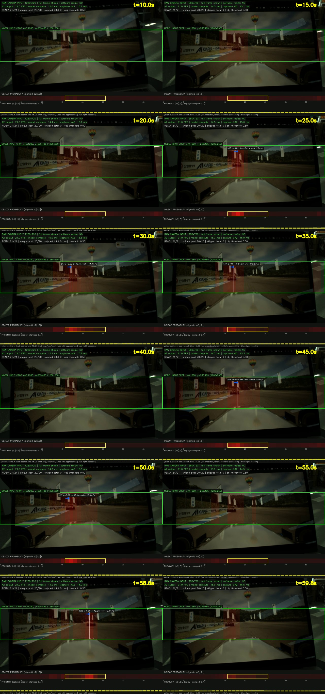

# 실물 카메라 A₂ 모니터 재촬영 60초 결과

실험일: 2026-09-14 (Asia/Seoul)  
노출: **25000 µs**, ExposureAuto Off  
종합 판정: **처리량 PASS / 화면 반응성 PARTIAL**

## 1. 이번 실험의 목적

Hikrobot 카메라가 모니터의 주행 영상을 촬영하는 동안 아래 전체 경로를 60초간 실행했다.

```text
Hikrobot BayerRG8 1280×720
→ camera_aravis2
→ ROS2
→ debayer 및 RGB 변환
→ model crop 1280×250
→ segmentation-pretrained backbone / i₁
→ current + 과거 20개 timestamp token
→ A2ModelMultiFrame
→ a₂ (1,40,7)
→ 화면 표시 + overlay MP4 + 전체 a₂ JSON 기록
```

이번 결과는 `f₂`나 차량 제어를 포함하지 않는다. 또한 모니터 재촬영은 반응성 sanity
check이며 실제 거리·속도 정확도 검증이 아니다.

## 2. 카메라와 crop 설정

| 항목 | 설정 |
|---|---|
| 카메라 전송 영상 | BayerRG8 **1280×720** |
| Sensor hardware ROI | 1920×1200 센서에서 Offset `(320,240)` |
| 노출 | **25000 µs**, auto off |
| Acquisition rate | 21 FPS |
| Software resize | **없음** |
| 모델 입력 crop | 수신 frame의 `x=0:1280`, `y=235:485` |
| Backbone 입력 | `(1,3,250,1280)` |
| 센서 좌표 기준 모델 사용 영역 | `x=320:1600`, `y=475:725` |
| Precision | FP32 |

화면의 초록 경계가 실제 모델 crop이다. 빨간 색조는 A₂ object probability의 가로 bin
반응이며 2차원 차량 bounding box가 아니다. 하단 패널의 노란 경계는 중앙 lead-search
bin 16–25일 뿐 crop, 차선 또는 차량 박스가 아니다.

## 3. 처리량 결과

| 판정 항목 | 측정값 | 결과 |
|---|---:|---|
| 측정 frame | 1260 | - |
| steady frame | 1239 | - |
| 카메라 수신률 | **20.997 FPS** | PASS |
| steady a₂ 출력률 | **20.996 FPS** | PASS |
| Compute p50 / p95 / p99 | 14.469 / **15.595** / 18.240 ms | PASS |
| Callback arrival → a₂ p95 | **16.279 ms** | PASS |
| Header timestamp → a₂ p95 | **26.879 ms** | 참고값 |
| 시각화+MP4 기록 p95 | **9.074 ms** | PASS |
| Skipped camera frame | **0** | PASS |
| History duplicate slot ratio | **0.0** | PASS |
| NaN/Inf frame | **0** | PASS |
| Sustained 21 FPS | **true** | **PASS** |

화면 표시, 21 FPS overlay MP4 저장, frame별 raw `(40,7)` a₂ 기록을 모두 켠 상태에서도
47.619 ms frame budget을 충족했다. 21-frame history는 현재 token과 과거 token 20개이며,
steady 구간에서 source frame 중복이 없었다.

## 4. 녹화 화면 직접 확인



- 시작 약 0–10초에는 모니터 전환/비주행 화면이 보였고 중앙 lead 검출은 한 번도 없었다.
- 약 10초 이후 주행 영상과 앞 차량이 초록색 model crop 안에 들어왔다.
- 25초, 30초, 35초, 45초, 50초, 58초 표본에서는 빨간 반응과 object label이 앞 차량의
  중앙 부근에 나타났다.
- 20초, 40초, 55초, 59.8초 표본에서는 차량이 보이지만 object threshold 0.5 이상의
  label이 나타나지 않았다.
- 카메라가 모니터를 비스듬히 촬영해 화면 테두리, 반사, 밝기 편차와 재촬영 artifact가
  존재한다. 실제 도로 카메라 영상과 다른 domain이다.

전체 구간의 6개 대표 표본은 [analysis_contact_sheet.jpg](analysis_contact_sheet.jpg)에도
정리했다.

## 5. A₂ 반응성 정량 분석

### 초기 비주행 화면과 주행 화면 비교

| 구간 | 중앙 lead 검출률 | 중앙 probability 중앙값 | 중앙 probability p95 |
|---|---:|---:|---:|
| 0–10초, 전환/비주행 화면 | **0.0%** | 0.068 | 0.215 |
| 10–60초, 주행 영상 | **53.67%** | 0.519 | 0.757 |

초기 비주행 화면에서 threshold를 넘지 않았고 주행 영상이 시작된 뒤 probability가 크게
상승한 점은 영상 변화에 대한 A₂ 반응이 존재한다는 증거다. 그러나 앞 차량이 보이는 주행
구간에서도 중앙 lead 검출은 전체 frame의 약 절반에 그쳤다.

### 주행 영상의 10초 구간별 결과

| 구간 | Lead 검출률 | 중앙 probability 중앙값 | 검출 distance 중앙값 | 검출 vL_rel 중앙값 |
|---|---:|---:|---:|---:|
| 10–20초 | 49.8% | 0.500 | 43.90 m | +12.58 m/s |
| 20–30초 | 56.7% | 0.530 | 44.61 m | +13.87 m/s |
| 30–40초 | 61.9% | 0.545 | 40.64 m | +11.51 m/s |
| 40–50초 | 47.1% | 0.492 | 41.39 m | +11.10 m/s |
| 50–60초 | 52.9% | 0.531 | 37.08 m | +10.40 m/s |

전체 60초 기준:

- 중앙 lead-positive frame: **563 / 1260 (44.68%)**
- 주행 영상 10–60초 기준: **563 / 1049 (53.67%)**
- 중앙 probability: median 0.465, p95 0.748, max 0.869
- positive frame의 예측 distance: 32.15–51.98 m, median 42.27 m
- positive frame의 예측 vL_rel: +5.24–+16.81 m/s, median +12.06 m/s
- lead peak은 bin 18, 17, 25, 19 순으로 자주 나타났고 전체적으로 bin 16–25 사이를 이동했다.
- lead-positive run은 115개로 분절됐고 중앙 run 길이는 2 frame이었다. 가장 긴 연속
  검출도 41 frame, 약 1.90초였다.

## 6. 판정

### 기술적 처리량: PASS

실물 카메라 입력부터 backbone/i₁, 21-frame A₂, 화면 표시와 영상/JSON 저장까지 60초 동안
21 FPS를 유지했다. 유실, history 중복, NaN/Inf도 없었다.

### 화면 반응성: PARTIAL

비주행 화면에서는 반응하지 않고 주행 영상의 중앙 차량 부근에서 확률이 상승한 점은
긍정적이다. 다만 차량이 계속 보이는데도 검출이 자주 끊겼고, 연속 검출의 중앙 길이가
2 frame에 불과했다. 모든 positive frame의 vL_rel이 양수였기 때문에 접근/이탈 방향의
부호 반응도 이번 영상만으로 확인할 수 없다.

따라서 이번 결과는 **A₂가 실물 카메라의 모니터 재촬영 영상에 반응한다**는 sanity check는
충족하지만, 안정적인 차량 검출이나 거리·상대속도 정확도 성공으로 판정할 수 없다.
정확도 판정에는 카메라 calibration/FOV 정합과 timestamp가 있는 실제 거리·속도 GT가
필요하다.

## 7. 산출물

- [모니터 입력 영상](../../assets/monitor_stimulus/front_car_left_right_loop.mp4): 재촬영 stimulus, 거리·속도 GT 없음
- [summary.json](summary.json): 처리량과 PASS/FAIL 집계
- [frames.jsonl](frames.jsonl): frame별 raw `(40,7)` A₂ 및 timing/history
- [a2_overlay.mp4](a2_overlay.mp4): 60초, 21 FPS 시각화 녹화
- [analysis_10s_to_60s.jpg](analysis_10s_to_60s.jpg): 10–60초 구간 표본
- [analysis_contact_sheet.jpg](analysis_contact_sheet.jpg): 전체 60초 대표 표본
- [camera_driver.log](camera_driver.log): 실제 25000 µs 카메라 설정 로그
