# IyModel architecture (v5 — 2026-05-24)

`src/model/image_models/iy_model.py` 의 현재 모델 구조 + 발견된 모듈 융합 문제 + 분리 제안.

## 변경 history (이번 보고서부터)

| 버전 | 일자 | 핵심 변경 |
|---|---|---|
| v1 | 2026-05-15 | controller_imitator + image fusion baseline (D=256, seq=30) |
| v2 | 2026-05-20 | i_y token-level yaw shift (np.roll), per-image i_1 cache |
| v3 | 2026-05-21 | i_g obj_gate, fx=640 only, multi-track |
| v4 | 2026-05-23 | brake_aug, ci_aug, side_branch (v18-v22 self-attn) |
| **v5** | **2026-05-24** | **redesign: main_no_image (f_1) + Side SCC cross-attn (f_2). 모듈 명명 (f_1/f_2). a_2 cache proj fix (AUC 0.51→0.98)** |

---

## 1. 모듈 명명 규약 (v5)

| ID | 모듈 | 역할 |
|---|---|---|
| **f_1** | main transformer (`main_no_image=True`, 6L) | waypoint tracking — traj+ego 만으로 steer/ax |
| **f_2** | **Side SCC module** = cross-attn (Q=traj_out, KV=image_mem) + a_2 v4 feat early inject + TTC label augment | image-grounded safety overlay |
| i_1 | seg backbone token cache (per-image) | LateralStripEncoder.backbone + adaptive_avg_pool. **proj 적용 전** raw (C_b=256) |
| i_2 | image fusion (curr + prev rotated, ego_motion) | (현재 IyModel 안에 융합. 분리 필요 ⚠️) |
| a_2 | per-bin (40, 7) features [obj, vL_abs, vY_abs, vL_rel, vY_rel, prox, dist] | image → lead 측정 (v4 ckpt 사용. AUC 0.98) |

이전 ControlNet "side branch" (v18-v22 self-attn 6L) 와 다른 신 architecture.

---

## 2. 현재 IyModel 구조 (v5, 발견된 융합 문제)

```mermaid
flowchart LR
    %% === STYLES ===
    %% NN 모듈 (computation) = 사각형 + state-based 색
    classDef m_frozen fill:#868e96,stroke:#212529,stroke-width:2px,color:#fff;
    classDef m_rand   fill:#ff6b6b,stroke:#a61e1e,stroke-width:3px,color:#fff;
    classDef m_learn  fill:#51cf66,stroke:#1b6b2c,stroke-width:2px,color:#fff;
    %% Feature (data tensor) = 평행사변형 + 노란 계열
    classDef f_input  fill:#a5d8ff,stroke:#1864ab,stroke-width:1px;
    classDef f_data   fill:#ffec99,stroke:#b08900,stroke-width:1px;
    classDef f_baddata fill:#ffa8a8,stroke:#a61e1e,stroke-width:2px;
    classDef f_cache  fill:#ffd8a8,stroke:#a05a00,stroke-width:1px;
    classDef f_out    fill:#d0bfff,stroke:#5f3dc4,stroke-width:2px;

    %% === INPUTS (data, parallelogram) ===
    IMG[/"image (curr/prev)<br/>(B, 3, 250, 1280)"/]:::f_input
    EGO[/"ego_5d<br/>(B, 5)"/]:::f_input
    TRAJ[/"traj_40<br/>(B, 40, 3)"/]:::f_input

    %% === PRE-COMPUTED CACHE (offline by separate models) ===
    subgraph PREP["Pre-computed (offline, by separate models)"]
        SEG_BB["seg backbone<br/>tf_efficientnetv2_s<br/>(mIoU 0.92, frozen)"]:::m_frozen
        I1[/"i_1 cache<br/>(B, 40, C_b=256)<br/>proj 적용 전 raw"/]:::f_cache

        A2_ENC["A2Model.encoder.proj<br/>Conv1d(256→256)<br/>frozen (v4 ckpt)"]:::m_frozen
        A2_FUS["A2Model.fusion (i_2)<br/>cross+self attn<br/>frozen (v4 ckpt)"]:::m_frozen
        A2_AUX["AuxHead<br/>Linear(256→7)<br/>frozen (v4 ckpt)<br/>AUC 0.98"]:::m_frozen
        I1 --> A2_ENC --> A2_FUS --> A2_AUX
        A2F[/"a_2 cache feat<br/>(B, 40, 7)<br/>[obj, vL_abs, vY_abs, vL_rel, vY_rel, prox, dist]"/]:::f_cache
        A2_AUX --> A2F
    end
    IMG_C --> SEG_BB
    IMG_P --> SEG_BB --> I1

    %% === IyModel (단일 class — 모듈 융합) ===
    subgraph IY["IyModel (단일 class — image+main+side 융합)"]
        IMG_PROJ["img_proj<br/>Conv1d(256→128)<br/>33K params"]:::m_rand
        IMG_FUS["img_fusion (i_2)<br/>pre_sa → cross_attn(ego) → post_sa<br/>407K params"]:::m_rand
        IMG_MEM[/"image_mem<br/>(B, 40, 128)<br/>⚠️ RANDOM"/]:::f_baddata
        I1 --> IMG_PROJ --> IMG_FUS --> IMG_MEM

        TRAJ_EMB["traj_embed Linear(3→128)"]:::m_frozen
        STATE_EMB["state_embed Linear(6→128)"]:::m_frozen
        A2_PROJ["a2_proj Linear(7→128)<br/>zero-init"]:::m_learn
        TRAJ --> TRAJ_EMB
        EGO --> STATE_EMB
        A2F -.-> A2_PROJ

        TRAJ_F[/"traj tokens<br/>(B, 40, 128)"/]:::f_data
        STATE_F[/"state token<br/>(B, 1, 128)"/]:::f_data
        A2_F[/"a_2 inject<br/>(B, 40, 128)"/]:::f_data
        TRAJ_EMB --> TRAJ_F
        STATE_EMB --> STATE_F
        A2_PROJ --> A2_F
        A2_F -.->|"add to traj"| TRAJ_F

        TOKENS[/"tokens<br/>(B, 41, 128)<br/>main_no_image=True<br/>image_mem 제외"/]:::f_data
        TRAJ_F --> TOKENS
        STATE_F --> TOKENS

        TRANSFORMER["transformer 6L (f_1)<br/>d=128, nhead=8<br/>1.19M params<br/>Professor #654 + v25c finetuned"]:::m_frozen
        TOKENS --> TRANSFORMER
        TRAJ_OUT[/"traj_out<br/>(B, 40, 128)"/]:::f_data
        TRANSFORMER --> TRAJ_OUT

        FC_OUT["fc_out Linear(128→2)"]:::m_frozen
        TRAJ_OUT --> FC_OUT
        AX_MAIN[/"steer, ax_main"/]:::f_data
        FC_OUT --> AX_MAIN

        %% Side SCC (f_2)
        CROSS["MHA cross-attn 1L<br/>Q=traj_out, KV=image_mem<br/>65K params"]:::m_learn
        TRAJ_OUT --> CROSS
        IMG_MEM --> CROSS
        SIDE_ATTN[/"side_attn<br/>(B, 40, 128)"/]:::f_data
        CROSS --> SIDE_ATTN
        SIDE_FC["side_fc Linear(128→1)"]:::m_learn
        SIDE_ATTN --> SIDE_FC
        AX_SIDE[/"ax_side<br/>(B, 40)"/]:::f_data
        SIDE_FC --> AX_SIDE
        ALPHA["α gate (zero-init → 0.37)"]:::m_learn
        AX_SIDE --> ALPHA

        ADD["ax_total = ax_main + α·ax_side"]:::m_learn
        AX_MAIN --> ADD
        ALPHA --> ADD
    end

    OUT[/"(steer_deg, ax_mps²)<br/>× 40 step"/]:::f_out
    ADD --> OUT
```



**범례 (NN 모듈 = 사각형, Feature/data = 평행사변형)**:
- 🔵 사각형 = **NN 모듈** (computation)
- 🟡 평행사변형 = **Feature / data tensor**
- ⚫ 회색 모듈 = **FROZEN** (학습됨, phase1 시 frozen)
- 🔴 빨강 모듈 / 핑크 data = **RANDOM INIT** (학습 안 됨, 의미 없는 weight/feature)
- 🟢 녹색 모듈 = **LEARNABLE** (always 학습)
- 🟠 주황 data = **pre-computed cache**
- 🟣 보라 data = **최종 output**

---

## 3. 발견된 구조 문제 (v5 진단)

### 3.1 image 처리 모듈이 main 에 융합됨
- `img_proj` + `img_fusion` 이 IyModel class 내부에 직접 포함
- `transformer` (f_1) 의 forward 가 image_mem 만들 권한 보유
- → **모듈 단위 ckpt 분리 불가능**
- → 학습 시 main 전체 (image 포함) 가 하나의 group → frozen 시 image 도 frozen

### 3.2 image 모듈이 random init 으로 학습 누락
- v25 series 모두 `main_no_image=True` → image_mem 사용 안 함 → image path 학습 안 됨
- v25f 에서 처음으로 `side_cross_attn=True` 로 image_mem 활성화
- 그러나 main frozen 으로 image path 도 frozen → **random init 그대로**
- → f_2 의 cross-attn 의 KV (image_mem) 가 random feature → α 가 random 위에서 학습

### 3.3 dimension mismatch
- iy: `d_model = 128` (Professor #654 호환)
- a_2 v4: `d_token = 256`
- → a_2 ckpt 의 학습된 image weights (encoder.proj + fusion) 를 iy 의 image module 로 direct load 불가

---

## 4. 정통 설계 (제안 v6 — 모듈 분리)

main 의 transformer 는 **controller_imitator 정통 = traj+ego+image_mem 의 concat → self-attn** (image 확장 포함).
side (f_2) 는 추가 보강 실험 모듈 (별도 cross-attn + α gate).

```mermaid
flowchart LR
    %% === STYLES ===
    %% NN 모듈 = 사각형 + state-based 색
    classDef m_frozen fill:#868e96,stroke:#212529,stroke-width:2px,color:#fff;
    classDef m_load   fill:#74c0fc,stroke:#1864ab,stroke-width:2px,color:#000;
    classDef m_learn  fill:#51cf66,stroke:#1b6b2c,stroke-width:2px,color:#fff;
    %% Feature/data = 평행사변형 + 노란계열
    classDef f_input  fill:#a5d8ff,stroke:#1864ab,stroke-width:1px;
    classDef f_data   fill:#ffec99,stroke:#b08900,stroke-width:1px;
    classDef f_cache  fill:#ffd8a8,stroke:#a05a00,stroke-width:1px;
    classDef f_out    fill:#d0bfff,stroke:#5f3dc4,stroke-width:2px;

    %% === INPUTS ===
    IMG[/"image<br/>(B, 3, 250, 1280)"/]:::f_input
    EGO[/"ego_5d<br/>(B, 5)"/]:::f_input
    TRAJ[/"traj_40<br/>(B, 40, 3)"/]:::f_input

    %% === PRE-COMPUTED ===
    SEG_BB["seg backbone (frozen)"]:::m_frozen
    I1[/"i_1 cache<br/>(B, 40, C_b)"/]:::f_cache
    IMG_C --> SEG_BB
    IMG_P --> SEG_BB --> I1

    %% === ImageModule (별도 class, 독립 ckpt) ===
    subgraph IM["ImageModule (별도 class, 독립 ckpt)<br/>= a_2 학습 시 함께 학습된 weights 로 init"]
        IMG_PROJ["img_proj<br/>Conv1d(C_b→d_img)"]:::m_load
        IMG_FUS["i_2 fusion<br/>(cross+self attn, ego prepend)"]:::m_load
        IMG_PROJ --> IMG_FUS
    end
    I1 --> IMG_PROJ
    IMG_MEM[/"image_mem<br/>(B, 40, d_img)"/]:::f_data
    IMG_FUS --> IMG_MEM

    %% === a_2 head (frozen, AuxHead) ===
    A2H["a_2 head<br/>AuxHead Linear(d_img→7)<br/>frozen"]:::m_frozen
    IMG_MEM --> A2H
    A2F[/"a_2 features<br/>(B, 40, 7)<br/>[obj, vL_abs, vY_abs, vL_rel, vY_rel, prox, dist]"/]:::f_data
    A2H --> A2F

    %% === MainModel (f_1) - controller_imitator 정통 + image 확장 ===
    subgraph MAIN["MainModel (f_1) — traj+ego+image 의 concat self-attn"]
        TRAJ_EMB["traj_embed<br/>Linear(3→d)"]:::m_load
        STATE_EMB["state_embed<br/>Linear(5→d)"]:::m_load
        A2_PROJ["a2_proj<br/>Linear(7→d, 옵션)"]:::m_load
        TRAJ_F[/"traj tokens<br/>(B, 40, d)"/]:::f_data
        STATE_F[/"state token<br/>(B, 1, d)"/]:::f_data
        A2_F[/"a_2 inject<br/>(B, 40, d)"/]:::f_data
        TRAJ --> TRAJ_EMB --> TRAJ_F
        EGO --> STATE_EMB --> STATE_F
        A2F -.-> A2_PROJ --> A2_F
        A2_F -.->|"add to traj (optional)"| TRAJ_F

        CONCAT[/"concat tokens<br/>(B, 1+40+40=81, d)<br/>state + traj + image_mem<br/>+ pos enc + frame_type emb"/]:::f_data
        STATE_F --> CONCAT
        TRAJ_F --> CONCAT
        IMG_MEM_IN[/"image_mem<br/>as main input"/]:::f_data
        CONCAT --> TR

        TR["self-attn transformer 6L<br/>d_model, nhead=8<br/>Professor #654 + finetune<br/>4-way attn (traj↔traj, traj↔img, img↔img, img↔traj)"]:::m_load
        TRAJ_OUT[/"ff_fused (traj position 만)<br/>(B, 40, d)"/]:::f_data
        TR --> TRAJ_OUT
        FC["fc_out Linear(d→2)"]:::m_load
        TRAJ_OUT --> FC
        MAIN_OUT[/"(steer_main, ax_main)"/]:::f_data
        FC --> MAIN_OUT
    end
    IMG_MEM --> IMG_MEM_IN --> CONCAT

    %% === SideModule (f_2 - 실험 중) ===
    subgraph SIDE["SideModule (f_2 — 실험 중, 안전 overlay)"]
        CROSS["cross-attn 1L+<br/>Q=traj_out, KV=image_mem"]:::m_learn
        SIDE_ATTN[/"side_attn<br/>(B, 40, d)"/]:::f_data
        SIDE_FC["side_fc<br/>Linear(d→1, ax-only)"]:::m_learn
        AX_SIDE[/"ax_side"/]:::f_data
        ALPHA["α gate<br/>(zero-init)"]:::m_learn
        AX_SIDE_G[/"α · ax_side"/]:::f_data
        CROSS --> SIDE_ATTN --> SIDE_FC --> AX_SIDE --> ALPHA --> AX_SIDE_G
    end
    TRAJ_OUT -->|"Q"| CROSS
    IMG_MEM -->|"KV"| CROSS

    %% === ADD + OUT ===
    ADD["sum: ax_total = ax_main + α·ax_side"]:::m_learn
    MAIN_OUT --> ADD
    AX_SIDE_G --> ADD
    OUT[/"(steer, ax_mps²) × 40"/]:::f_out
    ADD --> OUT
```



**색/모양 동일 (위 §2 와)**: 사각형 = NN 모듈, 평행사변형 = data/feature. 🟦 `m_load` 추가 = 학습 + 별도 ckpt load 가능 (ImageModule a_2 학습 가중치 init).

**핵심 분리**:
1. **ImageModule** = `LateralStripEncoder.proj` + `ImageFusionBlock` (i_2). **독립 ckpt**. a_2 학습 시 함께 학습된 weights 사용 가능 (단 d_token 일치 필요).
2. **MainModel** (f_1) = Professor #654 base + finetune. **traj + ego + image_mem 의 concat → self-attn**. 4-way attention. controller_imitator 정통 패턴 + image 확장.

---

## 4-bis. v6 최종 실행 architecture (2026-05-25 사용자 확정 plan)

§4 의 개념적 분리 plan 의 구체 실행: **a_2 v4 의 encoder+fusion 학습 weights 재사용 + fc_proj (256→128) 만 학습 → i_2 cache (B, 40, 128) 빌드 → iy v6 의 image module 제거 → cache 를 main+side 의 image_mem 입력으로**.

**두 버전 ablation**:
- **버전 A (정통)**: traj+img+ego concat → self-attn → control. side 없음 (controller_imitator 정통 + image 확장)
- **버전 B (side overlay)**: 버전 A + Side SCC (f_2 cross-attn) — image-grounded ax 안전 보강

---

### 4-bis. ① OFFLINE PIPELINE (두 버전 공유)

i_1 cache + a_2 v5 학습 + i_2 cache 빌드는 두 버전 모두 동일.

```mermaid
flowchart LR
    classDef m_frozen fill:#868e96,stroke:#212529,stroke-width:2px,color:#fff;
    classDef m_learn  fill:#51cf66,stroke:#1b6b2c,stroke-width:2px,color:#fff;
    classDef f_input  fill:#a5d8ff,stroke:#1864ab,stroke-width:1px;
    classDef f_data   fill:#ffec99,stroke:#b08900,stroke-width:1px;
    classDef f_cache  fill:#ffd8a8,stroke:#a05a00,stroke-width:1px;

    IMG[/"image"/]:::f_input

    subgraph PIPE1["① i_1 cache (frozen seg backbone)"]
        SEG_BB["seg backbone tf_efficientnetv2_s<br/>mIoU 0.92, frozen"]:::m_frozen
        I1[/"i_1 cache (N_frame, 40, C_b=256)<br/>raw backbone+pool, proj 전"/]:::f_cache
        SEG_BB --> I1
    end
    IMG_C --> SEG_BB
    IMG_P --> SEG_BB

    subgraph PIPE2["② a_2 v5 학습 (encoder+fusion frozen, fc_proj+head 만 학습)"]
        A2_PROJ_E["encoder.proj Conv1d(256→256)<br/>frozen (v4 ckpt)"]:::m_frozen
        A2_FUS["fusion (i_2) cross+self attn<br/>frozen (v4 ckpt)"]:::m_frozen
        A2_FC["fc_proj Linear(256→128)<br/>NEW (학습)"]:::m_learn
        A2_AUX["AuxHead Linear(128→7)<br/>NEW (학습)"]:::m_learn
        I1 --> A2_PROJ_E --> A2_FUS
        FUS_OUT[/"fusion out (B, 40, 256)"/]:::f_data
        A2_FUS --> FUS_OUT --> A2_FC
        I2_INTERNAL[/"fc_proj out (B, 40, 128)"/]:::f_data
        A2_FC --> I2_INTERNAL --> A2_AUX
        AUX_OUT[/"a_2 logits (B, 40, 7)"/]:::f_data
        A2_AUX --> AUX_OUT
        AUX_OUT -.->|"BCE(obj) + L1(reg)<br/>vs aux GT"| TRAIN["loss"]:::m_learn
    end

    subgraph PIPE3["③ i_2 cache 빌드"]
        I2C[/"i_2 cache (N_frame, 40, 128)<br/>★ 학습된 image_mem"/]:::f_cache
    end
    I2_INTERNAL -.->|"inference + save"| I2C
```



→ **i_2 cache (B, 40, 128)** 를 두 버전 (A, B) 모두 image_mem 입력으로 사용.

---

### 4-bis. ② 버전 A — 정통 (main 만, side 없음)

`prof + image-aware self-attn` — controller_imitator 정통 구조 + image_mem 확장. f_2 없음.

```mermaid
flowchart LR
    classDef m_frozen fill:#868e96,stroke:#212529,stroke-width:2px,color:#fff;
    classDef m_load   fill:#74c0fc,stroke:#1864ab,stroke-width:2px,color:#000;
    classDef f_input  fill:#a5d8ff,stroke:#1864ab,stroke-width:1px;
    classDef f_data   fill:#ffec99,stroke:#b08900,stroke-width:1px;
    classDef f_cache  fill:#ffd8a8,stroke:#a05a00,stroke-width:1px;
    classDef f_out    fill:#d0bfff,stroke:#5f3dc4,stroke-width:2px;

    %% === INPUTS ===
    IMG_C[/"image_curr<br/>(B, 3, 250, 1280)"/]:::f_input
    IMG_P[/"image_prev<br/>(Δt=200ms 전)"/]:::f_input
    D_YAW[/"d_yaw<br/>= curr_yaw - prev_yaw (rad)"/]:::f_input
    FX[/"fx (camera focal)<br/>= 640"/]:::f_input
    EGO[/"ego_5d"/]:::f_input
    TRAJ[/"traj_40"/]:::f_input

    %% === IMAGE MODULE (offline, frozen) ===
    subgraph IMG_MOD["Image Module (offline, frozen — i_1+a_2 v5 까지 모두 frozen 통과)"]
        SEG_BB["seg backbone (shared / siamese)<br/>tf_efficientnetv2_s<br/>mIoU 0.92, frozen"]:::m_frozen
        I1_C[/"i_1 tok_curr<br/>(B, 40, 256)"/]:::f_cache
        I1_P[/"i_1 tok_prev (raw)<br/>(B, 40, 256)"/]:::f_cache
        YAW_SHIFT["i_y yaw_shift_tokens_batch<br/>dx = round(fx · d_yaw / bin_w=32)<br/>np.roll along lateral dim<br/>(frozen, no learnable params)"]:::m_frozen
        I1_P_ROT[/"i_1 tok_prev_rot<br/>(B, 40, 256)<br/>회전 보정"/]:::f_cache
        A2_PROJ["a_2.encoder.proj (shared)<br/>Conv1d(256→256), frozen (v4)"]:::m_frozen
        TC_P[/"proj curr (B, 40, 256)"/]:::f_data
        TP_P[/"proj prev_rot (B, 40, 256)"/]:::f_data
        A2_FUS["a_2.fusion (i_2)<br/>cross-attn (Q=curr, KV=[ego, prev_rot])<br/>+ pre/post SA, frozen (v4)"]:::m_frozen
        A2_FC["a_2.fc_proj<br/>Linear(256→128)<br/>frozen (v5 학습됨)"]:::m_frozen
        I2C[/"i_2 cache (B, 40, 128)<br/>★ image_mem (per-frame)"/]:::f_cache
        SEG_BB --> I1_C
        SEG_BB --> I1_P
        I1_P --> YAW_SHIFT --> I1_P_ROT
        I1_C --> A2_PROJ
        I1_P_ROT --> A2_PROJ
        A2_PROJ --> TC_P
        A2_PROJ --> TP_P
        TC_P -->|"Q"| A2_FUS
        TP_P -->|"KV"| A2_FUS
        A2_FUS --> A2_FC --> I2C
        %% AuxHead 는 a_2 학습 단계에서만 사용 — inference 시 미사용 (참고용 표시)
        A2_AUX["a_2.head AuxHead<br/>Linear(128→7), frozen (v5)<br/>📌 a_2 학습 시만 loss path<br/>iy v6 inference 시 미사용"]:::m_frozen
        AUX_OUT[/"a_2 logits (B, 40, 7)<br/>[obj, vL_abs, vY_abs, vL_rel, vY_rel, prox, dist]<br/>📌 학습/검증 용"/]:::f_cache
        A2_FC -.-> A2_AUX -.-> AUX_OUT
    end
    IMG_C --> SEG_BB
    IMG_P --> SEG_BB

    %% === MAIN: traj+ego+image concat self-attn ===
    TRAJ_EMB["traj_embed Linear(3→128)"]:::m_load
    STATE_EMB["state_embed Linear(5→128)"]:::m_load
    TRAJ --> TRAJ_EMB
    EGO --> STATE_EMB
    TRAJ_F[/"traj tokens (B, 40, 128)"/]:::f_data
    STATE_F[/"state token (B, 1, 128)"/]:::f_data
    TRAJ_EMB --> TRAJ_F
    STATE_EMB --> STATE_F

    CONCAT[/"concat (B, 1+40+40=81, 128)<br/>state + traj + image_mem<br/>+ pos + frame_type emb"/]:::f_data
    TRAJ_F --> CONCAT
    STATE_F --> CONCAT
    I2C --> CONCAT

    TR["transformer 6L (f_1)<br/>d=128, nhead=8<br/>Professor #654 + v25c finetuned<br/>4-way self-attn (traj↔traj, traj↔img, img↔img, img↔traj)"]:::m_load
    CONCAT --> TR
    TRAJ_OUT[/"ff_fused (B, 40, 128)<br/>take traj position"/]:::f_data
    TR --> TRAJ_OUT
    FC["fc_out Linear(128→2)"]:::m_load
    TRAJ_OUT --> FC
    OUT[/"(steer, ax_mps²) × 40"/]:::f_out
    FC --> OUT
```



**특징**:
- main transformer 가 image_mem 도 직접 self-attn 으로 처리 (정통 controller_imitator + image)
- side overlay 없음 — main 단독으로 모든 결정
- ablation 의 단순 baseline. side 효과 측정 비교용

---

### 4-bis. ③ 버전 B — Professor #654 main (text-only) + Side SCC

**main = Professor #654 ckpt 정통 그대로** (image 입력 없음, controller_imitator 의 traj+ego self-attn). v25c 와 동일.
**Side SCC (f_2)** = traj 1.5초 + image_mem cross-attn → **ax 1step 보강**.

```mermaid
flowchart LR
    classDef m_frozen fill:#868e96,stroke:#212529,stroke-width:2px,color:#fff;
    classDef m_load   fill:#74c0fc,stroke:#1864ab,stroke-width:2px,color:#000;
    classDef m_learn  fill:#51cf66,stroke:#1b6b2c,stroke-width:2px,color:#fff;
    classDef f_input  fill:#a5d8ff,stroke:#1864ab,stroke-width:1px;
    classDef f_data   fill:#ffec99,stroke:#b08900,stroke-width:1px;
    classDef f_cache  fill:#ffd8a8,stroke:#a05a00,stroke-width:1px;
    classDef f_out    fill:#d0bfff,stroke:#5f3dc4,stroke-width:2px;

    %% === INPUTS ===
    IMG_C[/"image_curr<br/>(B, 3, 250, 1280)"/]:::f_input
    IMG_P[/"image_prev<br/>(Δt=200ms 전)"/]:::f_input
    D_YAW[/"d_yaw<br/>= curr_yaw - prev_yaw (rad)"/]:::f_input
    FX[/"fx (camera focal)<br/>= 640"/]:::f_input
    EGO[/"ego_5d"/]:::f_input
    TRAJ15[/"traj_40[:15]<br/>1.5s (15 step)<br/>나머지 25 step zero-mask"/]:::f_input

    %% === IMAGE MODULE (offline, frozen) — side 만 사용 ===
    subgraph IMG_MOD["Image Module (offline, frozen — side 만 사용. main 미사용)"]
        SEG_BB["seg backbone (shared / siamese)<br/>tf_efficientnetv2_s<br/>mIoU 0.92, frozen"]:::m_frozen
        I1_C[/"i_1 tok_curr<br/>(B, 40, 256)"/]:::f_cache
        I1_P[/"i_1 tok_prev (raw)<br/>(B, 40, 256)"/]:::f_cache
        YAW_SHIFT["i_y yaw_shift_tokens_batch<br/>dx = round(fx · d_yaw / bin_w=32)<br/>np.roll along lateral dim<br/>(frozen, no learnable params)"]:::m_frozen
        I1_P_ROT[/"i_1 tok_prev_rot<br/>(B, 40, 256)<br/>회전 보정"/]:::f_cache
        A2_PROJ["a_2.encoder.proj (shared)<br/>Conv1d(256→256), frozen (v4)"]:::m_frozen
        TC_P[/"proj curr (B, 40, 256)"/]:::f_data
        TP_P[/"proj prev_rot (B, 40, 256)"/]:::f_data
        A2_FUS["a_2.fusion (i_2)<br/>cross-attn (Q=curr, KV=[ego, prev_rot])<br/>+ pre/post SA, frozen (v4)"]:::m_frozen
        A2_FC["a_2.fc_proj<br/>Linear(256→128)<br/>frozen (v5 학습됨)"]:::m_frozen
        I2C[/"i_2 cache (B, 40, 128)<br/>★ image_mem (per-frame)"/]:::f_cache
        SEG_BB --> I1_C
        SEG_BB --> I1_P
        I1_P --> YAW_SHIFT --> I1_P_ROT
        I1_C --> A2_PROJ
        I1_P_ROT --> A2_PROJ
        A2_PROJ --> TC_P
        A2_PROJ --> TP_P
        TC_P -->|"Q"| A2_FUS
        TP_P -->|"KV"| A2_FUS
        A2_FUS --> A2_FC --> I2C
        %% SegHead (seg pretrain 시만 사용, inference 시 미사용)
        SEG_HEAD["SegHead Conv2d 1×1<br/>(K=5: void/road/vehicle/lane/wall)<br/>frozen ckpt<br/>📌 seg pretrain 시만 loss path"]:::m_frozen
        SEG_LOGITS[/"seg logits<br/>(B, K=5, 8, 40)<br/>📌 학습용"/]:::f_cache
        SEG_BB -.-> SEG_HEAD -.-> SEG_LOGITS
        %% AuxHead (a_2 학습 시만 사용)
        A2_AUX["a_2.head AuxHead<br/>Linear(128→7), frozen (v5)<br/>📌 a_2 학습 시만 loss path"]:::m_frozen
        AUX_OUT[/"a_2 logits (B, 40, 7)<br/>📌 학습/검증 용"/]:::f_cache
        A2_FC -.-> A2_AUX -.-> AUX_OUT
    end
    IMG_C --> SEG_BB
    IMG_P --> SEG_BB

    %% === MAIN: Professor #654 (text-only, image 입력 없음) ===
    subgraph MAIN_BLK["main = Professor #654 (text-only, image 없음 — controller_imitator 정통)"]
        TRAJ_EMB["traj_embed Linear(3→128)"]:::m_load
        STATE_EMB["state_embed Linear(5→128)"]:::m_load
        TRAJ15 --> TRAJ_EMB
        EGO --> STATE_EMB
        CONCAT[/"concat (B, 1+40=41, 128)<br/>state + traj only<br/>★ image_mem 없음 (main_no_image=True)"/]:::f_data
        TRAJ_EMB --> CONCAT
        STATE_EMB --> CONCAT
        TR["transformer 6L (f_1)<br/>text-only self-attn<br/>Professor #654 + v25c finetuned"]:::m_load
        CONCAT --> TR
        TRAJ_OUT[/"traj_out (B, 40, 128)"/]:::f_data
        TR --> TRAJ_OUT
        FC["fc_out Linear(128→2)"]:::m_load
        TRAJ_OUT --> FC
        MAIN_OUT[/"main pred (B, 40, 2)<br/>1step → (steer_main, ax_main)"/]:::f_data
        FC --> MAIN_OUT
    end

    %% === SIDE SCC (f_2 — image-grounded ax 1step 보강) ===
    subgraph SIDE_BLK["f_2 — Side SCC (1.5s traj + image_mem → 1step ax 보강)"]
        CROSS["cross-attn 1L+<br/>Q=traj_out[:15] (1.5s)<br/>KV=image_mem (B, 40, 128)"]:::m_learn
        SIDE_ATTN[/"side_attn (B, 15, 128)<br/>1.5s context"/]:::f_data
        SIDE_FC["side_fc Linear(128→1)<br/>1step 출력"]:::m_learn
        AX_SIDE[/"ax_side (B,)<br/>1step 보강"/]:::f_data
        ALPHA["α gate (zero-init)"]:::m_learn
        AX_SIDE_G[/"α · ax_side<br/>(scalar per sample)"/]:::f_data
        CROSS --> SIDE_ATTN --> SIDE_FC --> AX_SIDE --> ALPHA --> AX_SIDE_G
    end
    TRAJ_OUT -->|"Q (1.5s = 15 step)"| CROSS
    I2C -->|"KV (40 step)"| CROSS

    %% === FINAL (1step output) ===
    ADD["ax_total = ax_main[0] + α·ax_side<br/>steer = steer_main[0]<br/>(1step 제어 출력)"]:::m_learn
    MAIN_OUT -->|"first step"| ADD
    AX_SIDE_G --> ADD
    OUT[/"(steer, ax_mps²)<br/>1 step (실시간 inference)"/]:::f_out
    ADD --> OUT
```



**spec 정리 (버전 B)**:
- **traj input**: 앞 15 step (1.5s) 만 사용 (`traj_zero_after=15`)
- **main = Professor #654 정통**: text-only (image 없음, `main_no_image=True`) — v25c 와 동일
- **side**: cross-attn (Q=traj_out[:15], KV=image_mem 40step) → 1step ax 보강
- **output**: 1 step (steer, ax) — 실시간 inference (`target_first_only=True` 옵션)
- α zero-init → 학습 초기 main 그대로 → 점진 활성. main 충분하면 α 안 자람 (ablation)

### 두 버전의 차이 (시각화)
| | 버전 A | 버전 B |
|---|---|---|
| **main** | image-aware (concat traj+ego+image_mem → self-attn) | **text-only** (Professor 정통, traj+ego only) |
| **side** | 없음 | **f_2 cross-attn + α gate** (ax 1step 보강) |
| **traj 사용** | full 40 step | **1.5s = 15 step** (나머지 zero) |
| **output** | 40 step | **1 step** (실시간) |
| image 활용 | main 안에서 (4-way self-attn) | side 만 (cross-attn) |
| 학습 risk | main 이 image 학습 못할 수도 | main 안정 + side 보조 신호 |

---

### 두 버전 ablation
| 비교 | 학습 결과 (예상) | 의미 |
|---|---|---|
| **A 만** val | TBD | main 의 image-aware 능력 — image_mem 만으로 ax 학습 가능? |
| **B (A+side)** val | TBD | side overlay 가 추가 효과 있는가? |
| close-lead brake 정확도 | A vs B | image-grounded safety 가 main 만으로 충분 vs side 필요 |
| α gate 최종 값 (B) | small (~0.05) | main 이 충분 — side 무용 |
| α gate 최종 값 (B) | large (~0.5) | side 가 의미 있는 보강 |

### v6 최종 vs 현재 (v5) 차이

| 항목 | v5 (현재 IyModel, 사용 중) | **v6 최종 (수정 후)** |
|---|---|---|
| iy 의 image module | `img_proj` + `img_fusion` 포함 (random init, 학습 안 됨) | **제거** — i_2 cache 가 대체 |
| image_mem | iy 가 매 forward 계산 (random 분포) | **i_2 cache 에서 직접 load** (학습된 a_2 fusion + fc_proj 의 output) |
| a_2 ckpt | v4 (d_token=256) | **v5 (v4 encoder+fusion frozen + 새 fc_proj 256→128 + 새 head 128→7)** |
| dimension mismatch | 256 vs 128 → img_proj 가 random 가교 | **없음** — fc_proj 가 학습된 변환 |
| main_no_image | True (v25b/c/d/e/f) — image_mem 우회 | **False** — traj+ego+image_mem concat self-attn (정통) |
| 학습 path 모두 정합? | ❌ img_proj 학습 안 됨 | **✓ 모든 모듈 학습 또는 학습된 weights** |
| Forward 비용 | image encoder backbone 매번 통과 (느림) | **i_1 cache + i_2 cache** = backbone forward 0 (빠름) |

### 파일 명명
- `data/cache/a2_out_cache_*_prev20_fixed.npz` — 기존 v4 d=256 cache (a_2 feat 7-ch GT proxy)
- `data/cache/i2_mem_cache_*_prev20.npz` — **신규 v6** d=128 cache (image_mem)
- `data/ckpts/a2_fx640_v5_d128_best_loss.pt` — 신규 a_2 v5 ckpt
- `data/ckpts/iy_v6_main_image_aware_best_loss.pt` — 신규 v6 iy ckpt
3. **a_2 head** = 학습된 AuxHead. ImageModule 의 image_mem 에 frozen Linear(d→7). 학습/inference 시 (40,7) features 제공.
4. **SideModule** (f_2, 실험 중) = 추가 ax 보강. cross-attn (Q=traj_out, KV=image_mem) + zero-init α gate. 안전 overlay 검증 단계.

각 모듈 **ckpt 단위 분리** → init / freeze / train 독립 가능.

---

## 5. dimension 통일 계획 — **확정 plan (v6, 2026-05-25)**

**a_2 v5 = encoder + fusion frozen (v4 ckpt 재사용) + 새 fc_proj (256→128) + 새 AuxHead Linear(128→7) 만 학습**

→ a_2 v4 의 학습된 weights (encoder + fusion) 보존 + projection layer 만 추가 학습 → 진짜 학습된 i_2 (image fusion) 의 output 을 d=128 로 변환 → iy_model 의 d_model 호환.

### 데이터 흐름 (offline build)
```
i_1 cache (B, 40, C_b=256, raw)
    ↓ a_2 v5.encoder.proj (frozen, v4 weights)  ← cache 빌더 fix 후 정상 작동
    ↓ a_2 v5.fusion (frozen, v4 weights)
    ↓ a_2 v5.fc_proj (256→128, 학습됨)
    ↓
i_2 cache (B, 40, 128)  ← **진짜 학습된 image_mem**
    ↓
iy_model 의 main + side 입력
```

### iy_model 변경 (v6)
- `img_proj` 제거 (i_2 cache 가 이미 d=128)
- `img_fusion` 제거 (i_2 cache 가 이미 fusion 통과)
- `image_mem = batch["image_mem"]` 직접 입력 (i_2 cache 에서)
- main = traj+ego+image_mem concat → self-attn (controller_imitator 정통 + image 확장)
- f_2 = cross-attn (Q=traj_out, KV=image_mem) — 안전 overlay 실험

### 시간
| step | 시간 |
|---|---|
| A2Model 수정 (fc_proj + new head) | 10분 ✓ |
| a_2 v5 학습 (fc_proj + head 만) | 30분-1시간 |
| i_2 cache 6 dataset 빌드 | 10-15분 |
| iy_model 수정 (image module 제거) | 10분 |
| v25g 학습 50ep | 1-2시간 |
| **합계** | **2.5-3.5시간** |

이전에 제안된 A/B/C 옵션은 폐기. 사용자 제안 (fc_proj 추가 + head 만 학습) 이 시간/효과 균형 최적.

---

## 6. shape 산출 (현재 v25 IyModel)

기본 hyperparameter:
- `C_b = 256` (seg backbone fx640_v3 output channels)
- `d_model = 128`
- `nhead = 8`
- `num_layers = 6` (f_1 transformer)
- `traj_seq_len = 40` (학습/inference 일치)
- `traj_dim = 3` (`[x_ego_fwd, y_ego_left, speed]`)
- `state_dim = 6` (ego_5d padded)
- `num_output = 2` (`[steer_deg, ax_mps²]`)
- `fx = 640.0`

| stage | shape | params |
|---|---|---|
| input image | (B, 3, 250, 1280) | — |
| i_1 cache (raw backbone) | (B, 40, 256) | 0 (cache) |
| img_proj output | (B, 40, 128) | 33K |
| img_fusion output (image_mem) | (B, 40, 128) | 407K |
| traj_embed output | (B, 40, 128) | 0.5K |
| state_embed output | (B, 128) | 0.9K |
| transformer (6L) output | (B, 40, 128) | 1.19M |
| side cross-attn output | (B, 40, 128) | 65K |
| side_fc output | (B, 40, 1) | 0.1K |
| fc_out output | (B, 40, 2) | 0.3K |
| **total** | | **1.70M** |

main:side 비율 = 24.2× (main 1.63M, side 0.07M)

---

## 7. forward 흐름 (현재, main_no_image=True + side_cross_attn=True)

```python
def forward(self, batch):
    # 1. image_mem (현재: 융합 — 학습 안 됨)
    tok_curr = batch["tok_curr"]               # (B, 40, 256) raw cache
    tok_prev = batch["tok_prev_raw"]           # (B, 40, 256)
    tok_prev_rot = yaw_shift(tok_prev, ...)    # token-level np.roll
    # ⚠️ img_proj 가 random init
    tc = self.img_proj(tok_curr.transpose(1,2)).transpose(1,2)   # (B, 40, 128) random
    tp = self.img_proj(tok_prev_rot.transpose(1,2)).transpose(1,2)
    image_mem = self.img_fusion(tc, tp, ego_motion)              # (B, 40, 128) random

    # 2. f_1 main transformer (image 무시, traj+ego only)
    traj_e = self.traj_embed(batch["traj_40"])                   # (B, 40, 128)
    state_e = self.state_embed(batch["ego_5d"])                  # (B, 128)
    if use_a2_feat:
        a2_e = self.a2_proj(batch["a2_feat"])                    # (B, 40, 128) zero-init
        traj_e = traj_e + a2_e
    tokens = self.pos_encoder(torch.cat([state_e[:, None], traj_e], dim=1))
    main_out = self.transformer(tokens)                          # (B, 41, 128)
    traj_out = main_out[:, 1:]                                   # (B, 40, 128)
    pred = self.fc_out(traj_out)                                 # (B, 40, 2)
    ax_main = pred[..., 1]; steer = pred[..., 0]

    # 3. f_2 side (image_mem 가 random KV)
    side_attn, _ = self.side_cross(traj_out, image_mem, image_mem)
    side_attn = self.side_cross_ln(traj_out + side_attn)
    ax_side = self.side_fc_cross(side_attn).squeeze(-1)          # (B, 40)
    ax_total = ax_main + self.side_alpha_cross * ax_side

    return torch.stack([steer, ax_total], dim=-1)
```

---

## 8. 이전 학습 시리즈 history (간략)

| 시리즈 | spec | val |
|---|---|---|
| v18-v22 | ControlNet self-attn side 6L (parallel) | 1.0 m/s² ax plateau |
| v23-v23e | main_no_image + side cross-attn (현재 architecture 기원) | phase logic 버그 다수 |
| v24 | TTC augment + v23 resume | partial |
| v25 | Professor RAW + 2-phase | partial |
| **v25b** | f_1 alone (main_no_image, no side) lr 3e-5 | 0.55 (lr 작음) |
| **v25c** | f_1 alone lr 3e-4 + decaying cosine | **0.37** ⭐ baseline |
| v25d | f_1 + f_2 (cross-attn + a_2 + TTC) — but a_2 cache 깨짐 | partial |
| v25e | multi-prebake + main long freeze — DriverB target=0 bug | 1.49 (kill) |
| v25f | a_2 cache fix + DriverB fix — image_mem random 발견 | 1.50 plateau (kill) |
| **v25g** | image_mem 학습 가능하도록 (계획) | TBD |

---

## 9. 관련 문서

- `docs/REPORT_v5.md` — v23-v25d 시리즈 시간순 보고
- `docs/INCIDENT_a2_cache_proj_bug.md` — a_2 cache proj 누락 버그 (영향: v18-v25 모두)
- `docs/DATA_PIPELINE_GLOSSARY.md` — prebake / cache / aux 용어 사전
- `docs/v25f_problem_diagram.md` — v25f plateau 진단 (image_mem random)
- `DESIGN.md` — 설계 문서 (v5 update 진행 중)
