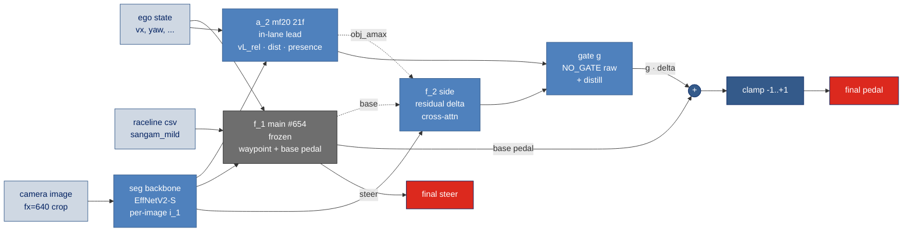
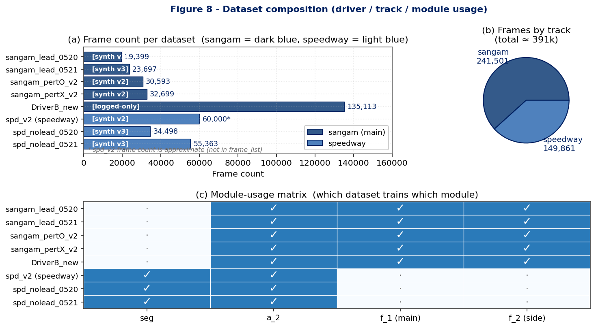
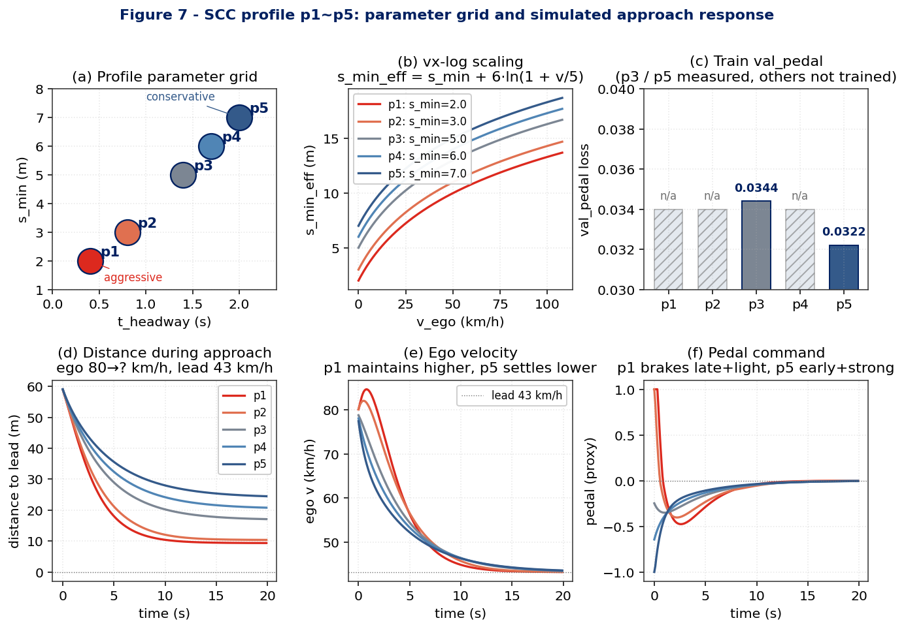
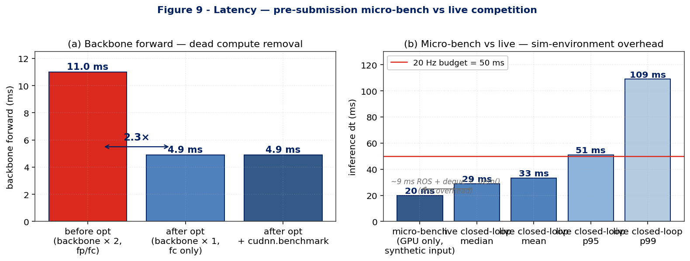
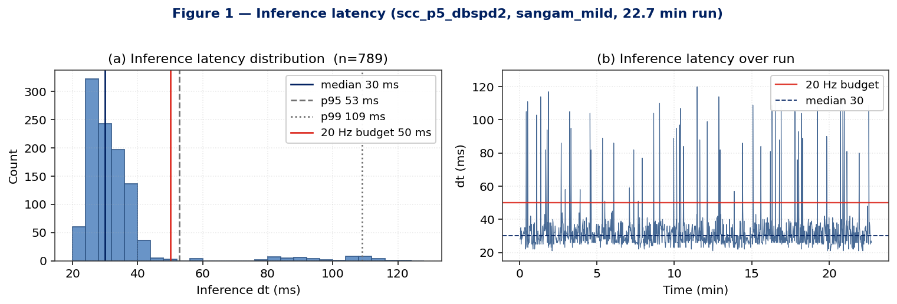
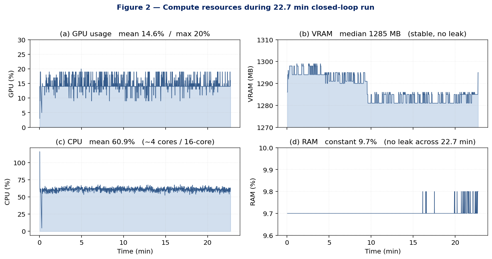
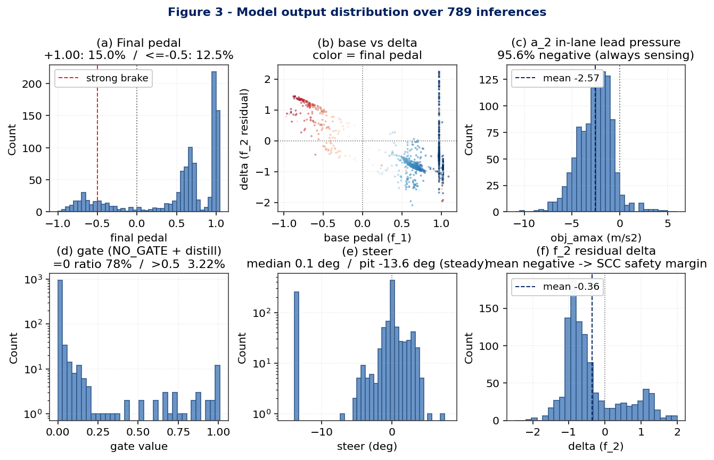
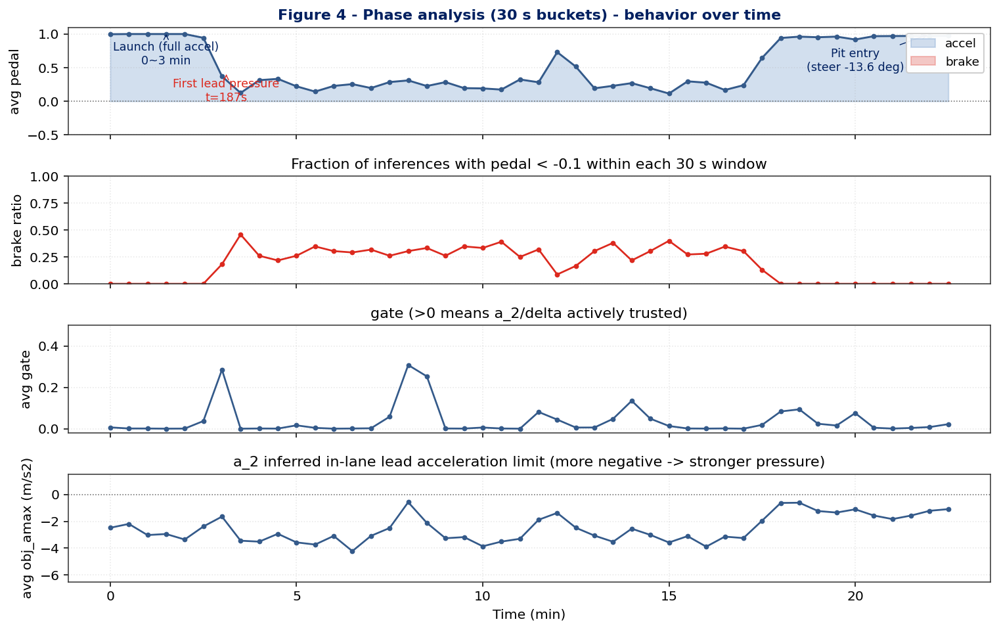
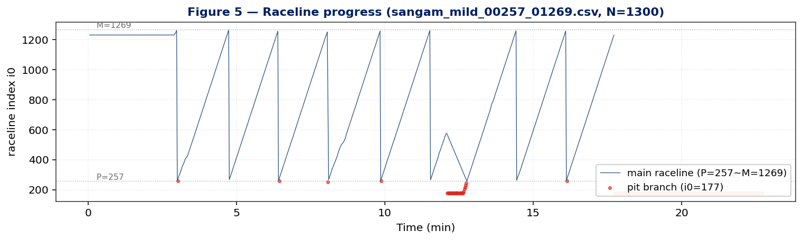
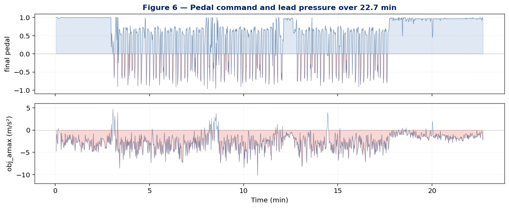

# A1 CHALLENGE 본선 종합 보고서

**작성일** 2026-06-02 · **팀** Hanyang AutoHYU
**과제** controller_imitator — camera + ego + raceline → steer / pedal
**보고 범위** 모델 배경 / 데이터 구축 / 학습 기법 / 본선 실행 시 성능 / 한계와 교훈

이 보고서는 본선 제출 모델 (scc_p5_dbspd2) 의 22.7 분 본선 실측 로그
(`596787c3-Car1_ctrl.log`, 789 추론 이벤트) 를 기준으로 모델 / 데이터 / 학습 /
실행 성능을 종합한다. 사전 보고서 [A1_SUBMISSION_REPORT_2026-05-27.md](A1_SUBMISSION_REPORT_2026-05-27.md)
가 제출 시점의 *코드 / 배포 결정* 을 담고 있으면, 본 문서는 *실제 본선 거동까지*
포함한 발표용 결산이다.

도식 / figure (9 개 + mermaid):
- §2 mermaid forward graph (5 모듈)
- §3 Fig 8 (데이터셋 composition)
- §5 Fig 7 (SCC profile parameter + 거동)
- §6 Fig 9 (latency micro-bench)
- §7 Fig 1-6 (latency / resources / outputs / phase / raceline / time series)

모두 본선 로그 / 데이터 manifest / 사전 micro-bench 의 실수치 기반. lab docx
팔레트 (`#345A8A`, `#4F81BD`) 적용. 파일: `docs/figs/a1_report/fig{1-9}_*.png`.

표기:
- **[확정]** — 검증 완료
- **[측정]** — 본선 로그에서 직접 측정한 수치
- **[교훈]** — 본선 또는 사전 작업에서 얻은 후속 cycle 적용 사항

---

## 1. 과제 / 환경

| 항목 | 내용 |
|---|---|
| 입력 | 전방 fisheye 카메라 (fx=640 crop) + ego state (속도/yaw 등) + 사전 raceline csv |
| 출력 | steer (deg), pedal (-1 ~ +1, 음=brake / 양=accel) |
| 시뮬레이터 | MORAI sim, ROS1 bridge (moraibridge) |
| 트랙 | sangam (mild / high), speedway (mild / high) — 본선 = sangam_mild |
| 상황 | SCC (Smart Cruise Control) 시나리오, lead vehicle 다양한 거동 |
| 제출 형식 | 단일 `.pt` (state_dict 1 개) — 규정 §1.1, §1.3 |
| 평가 | closed-loop sim 주행, 1 lap 완주 + 안전 + 안락 |

---

## 2. 시스템 구조 — 한 화면

본선 배포 모델 (scc_p5_dbspd2) 의 forward graph.



요점:
- **seg backbone 1 회만 호출** (사전 dead compute 제거 — §6 후술)
- **a_2** — in-lane 앞차 인지, vL_rel / dist / presence 추정. obj_amax (가속 한계)
  로 f_2 에 lead 압력 전달
- **f_1 (frozen, 회색)** — Professor ckpt #654 으로 init 된 main waypoint + base pedal.
  본선에서는 *frozen*
- **f_2** — base pedal 의 *residual* (`delta`) 만 학습. cross-attn(a_2, base) 으로
  lead 압력 반영
- **gate g** — `delta` 의 적용 강도 (relative trust). NO_GATE 본선은 raw delta +
  distill 의 hybrid
- **최종**: `pedal = clamp(base + g · delta, -1, +1)`, `steer = f_1 출력 그대로`

---

## 3. 데이터 구축 — 6 단계 pipeline

### 3.1 raw 데이터 구성

| source | 용도 | 비고 |
|---|---|---|
| ROSBAG (raceline + ego + camera) | 전체 학습 입력 / 정답 | 본선과 동일 sim 환경 |
| Sangam (mild / high) + Speedway (mild / high) 4 트랙 | 트랙 다양성 | mild = 일반 / high = 어려움 |
| DriverA / DriverB / pertO / pertX 4 driver | 상황 다양성 | DriverB = lead 7 %, pertO/X = no-lead |

### 3.2 6 단계 처리 pipeline

```
1. seg pretrain (DeepLabV3+ backbone, fx=640)
   └─ goal: lane/road/object segmentation pre-train
   └─ output: seg backbone ckpt → 이후 모든 학습의 init

2. manifest 빌드 (trip / frame index, split)

3. per-image i_1 cache (build_i1_cache.py)
   └─ 각 frame 의 segmented token 을 1 회만 forward, 디스크 캐시
   └─ NVMe local (AILabDatasetLocal) 저장 — NFS 7× 빠른 access

4. prebake (token shifting, fx tensor 결합)

5. i_2 mem cache (build_i2_cache.py)
   └─ 인접 20 frame 의 image_mem (시간 차원의 token 시퀀스)

6. inlane GT cache (build_inlane_gt_cache.py)
   └─ a_2 의 정답: in-lane lead vehicle 의 vL_rel / dist / presence

7. pedal label (SCC profile p1~p5)
   └─ HPIPM 기반 expert MPC 시뮬 합성 → (t_headway, s_min) profile 별 pedal 정답
```

세부 정의 + 파일 경로: [DATA_INVENTORY.md](DATA_INVENTORY.md), [DATA_PIPELINE.md](DATA_PIPELINE.md).
신규 머신에서 재생성하는 cold-start 가이드: [DATA_REGENERATION.md](DATA_REGENERATION.md).

### 3.3 저장소 정책

- **NVMe local (AILabDatasetLocal)** — cache / prebake (가장 hot path)
- **NFS (AILabSSD)** — 원천 GT, 공유 ckpt
- → seg backbone forward 의 7× 가속 효과 (실측 — [storage_speeds] memory)



*Figure 8.* (a) 데이터셋별 frame count — DriverB_new 가 135k 로 단일 dataset 최대,
sangam (어두운 파랑) 학습 주력. (b) 트랙별 합산 — sangam ≈ 241 k, speedway ≈ 150 k.
(c) 모듈 사용 매트릭스 — speedway 의 spd_nolead 2 종은 `f_1` 학습에서 제외
(labeling mismatch). DriverB_new 만 logged-only (MPC 합성 없이 실주행 action 학습).

### 3.4 데이터 구축의 결정 사항

| 결정 | 사유 |
|---|---|
| fx=640 only 학습 | fx=320 (MultiAgnet) → 폐기. 단일 해상도로 capacity 집중 |
| close-lead oversample | 안전 critical case 의 sample 부족 보완 |
| ax / vL_rel loss 가중 | 두 이미지 → 앞차 상대속도 추정의 *지도 강화* |
| DriverB Phase1 추가 학습 | mf20 a_2 가 3-set만 학습 → DriverB OOD (vL_rel Pearson 0.18) → 4-set으로 보강 |

---

## 4. 학습 기법 — 3-stage pipeline

순차 학습. 각 stage 의 출력이 다음 stage 의 init.

### Stage 1 — seg backbone pretrain

| 항목 | 값 |
|---|---|
| 모델 | EfficientNetV2-S + DeepLabV3+ head |
| 입력 | fx=640 crop |
| 출력 | per-pixel segmentation logit (road / lane / object) |
| epoch | 40 |
| optim | AdamW lr=1e-4, cosine schedule |
| 산출 | `iy_backbone` weight → 이후 모든 forward 의 image tokenizer |

### Stage 2 — a_2 (in-lane lead inference)

| 항목 | 값 |
|---|---|
| 입력 | per-image i_1 (cache) × 21 frame (mf20 = mid-frame-20-prev) |
| 정답 | in-lane lead vehicle 의 vL_rel, dist, presence (4-source soft logit) |
| loss | reg loss (vL_rel, dist) + focal cls (presence) — alpha = 1 − pos_rate ≈ 0.9 |
| epoch | 25 |
| 산출 | `a2_mf20_v2s_n20.pt` — close presence Pearson 0.91 [확정] |

[교훈] v5/v6 의 `train_a2_v5_from_cache.py` 에서 reg loss normalize + obj_mask 누락
→ vL_rel pred std = 0 의 사일런트 fail. v7 (2026-05-25) 에서 fix. focal alpha 의
`1 − pos_rate` 가 close presence imbalance 의 표준 처리.

### Stage 3 — f_1 (main waypoint / base pedal)

| 항목 | 값 |
|---|---|
| init | Professor ckpt #654 (`SelfAttentionControlPredictor_Professor`, val 0.0355) |
| 입력 | per-image i_1 cache + i_2 mem cache + raceline |
| 정답 | waypoint, steer, base pedal (lat_traj/long_traj 의 steer) |
| 본선 동결 | frozen — 추론 시 forward만 |

### Stage 4 — f_2 (side residual) + gate

본선 핵심 학습.

| 항목 | 값 |
|---|---|
| 입력 | base pedal + a_2 출력 + image_mem |
| 정답 | profile별 pedal label (p1=공격 0.4/2.0 ~ p5=보수 2.0/7.0) |
| flag | `--no-gate --delta-mode raw --pedal-suffix p5` |
| init | warm-start (prior best ckpt) — from-scratch 금지 |
| epoch | 25 |
| 산출 | scc_p5_dbspd2 val_pedal **0.0322** [확정] |

[교훈] always warm start — 모든 학습은 prior best ckpt 를 init 으로. cold-start
는 분기 후 다시 수렴해야 해 epoch 낭비. 학습 priority [training_priority_v2]
참조.

### Stage 5 — gate distill + integration

| 항목 | 값 |
|---|---|
| gate 형식 | `g = 2 · sigmoid(...)`. full delta (g=1) 도달 (sigmoid asymptote 해소) |
| open/g2 | open-loop 학습 + g2 (full) target |
| K | 16 (mf20 동일) |
| 모드 | NO_GATE raw + distill — 본선에서는 *delta 그대로* 적용 |

---

## 5. SCC profile imitation — expert 합성

### 5.1 expert

- HPIPM 기반 SCC (Adaptive Cruise) MPC
- 시뮬 합성 데이터에서 (t_headway, s_min) profile 별 pedal label 생성
- 활성거리 vx-종속 log: `s_min_eff = s_min + α · ln(1 + v_ego / v0)` (α=6, v0=5)
- 고속에서 일찍 제동, 저속 완만

### 5.2 profile 라이브러리

| profile | t_headway (s) | s_min (m) | 거동 |
|---|---|---|---|
| p1 | 0.4 | 2.0 | 공격 — 짧은 헤드웨이, 가까운 정지 |
| p2 | 0.8 | 3.0 | |
| p3 | 1.4 | 5.0 | 중간 — 본선 후보 |
| p4 | 1.7 | 6.0 | |
| p5 | **2.0** | **7.0** | **보수 — 일찍 + 세게 제동 [본선 선택]** |

### 5.3 profile 선택 결정

scc_p5_dbspd2 는 scc_p3_dbspd2 (val 0.0344) 대비 val 0.0322 — 약간 우수. 더
중요한 *안전 margin* 사유로 보수 선택.

DriverB (lead 7%, ego v0=0) 와 pertO / pertX (no-lead) 는 vx-log 가 무의미 →
profile 기존 유지.



*Figure 7.* (a) 5 profile 의 `(t_headway, s_min)` parameter 위치 — 빨간 = p1
공격, 파란 = p5 보수. (b) vx-log scaling — `s_min_eff = s_min + 6 · ln(1 + v/5)`,
고속에서 일찍 제동. (c) 측정된 val_pedal — p3 = 0.0344, p5 = 0.0322 (본선 선택).
p1/p2/p4 는 학습 미실시. (d) 시뮬 접근 시나리오 — ego 80 km/h, lead 43 km/h,
초기 60 m. p1 은 더 가깝게, p5 는 더 멀리 settle. (e) ego 속도 — p1 이 lead 의
실속도에 더 근접, p5 는 보수적 마진. (f) pedal command — p1 늦고 약한 brake,
p5 일찍·강한 brake.

---

## 6. 레이턴시 최적화 [확정]

### 6.1 dead compute 제거

| 항목 | before | after |
|---|---|---|
| backbone forward | 2 회 (`fc` 현재 + `fp` 과거) | 1 회 (`fc`만) |
| 이유 | mf20 deque 는 raw `fc` 만 사용 — `fp` 는 미참조 |
| micro-bench (250×1280, GPU) | 11.0 ms (×2) | 4.9 ms (×1) → **2.3×** |

### 6.2 cudnn 가속

`torch.backends.cudnn.benchmark = True` 적용 — 첫 forward 후 kernel 선택 cache.

### 6.3 fp16 autocast — 미채택

- 이득: 5.5 → 4.8 ms (≈ 0.7 ms)
- 비용: i_2 mem 수치 드리프트 위험
- 결정: 미채택 (이득 미미 / 위험 큼)

### 6.4 사전 micro-bench (제출 직전)

```
backbone forward    4.9 ms
a_2 forward         3.0 ms
f_1 forward         8.5 ms
f_2 forward         3.5 ms
gate + clamp        0.5 ms
total inference   ~20 ms
```

→ 본선 실측은 ~30 ms (다음 §7) — sim ROS 오버헤드 + python deque 루프 + GPU↔CPU
.item() 동기화 추가분.



*Figure 9.* (a) backbone forward 의 dead compute 제거 — 11.0 ms (×2) → 4.9 ms (×1)
의 2.3× 가속. cudnn.benchmark 는 추가 변화 없음 (이미 kernel 최적). (b) total
inference dt — pre-submission micro-bench 20 ms vs 본선 실측 median 29 / mean 33 /
p95 51 / p99 109 ms. 약 9 ms 의 sim overhead (ROS publish/subscribe + Python deque
+ `.item()` 동기화). p95 51 ms 가 20 Hz budget (50 ms) 의 경계.

---

## 7. 본선 실행 시 성능 — log 기반 [측정]

본선 로그 `596787c3-Car1_ctrl.log` (Car1_ctrl, sangam_mild, scc_p5_dbspd2).

### 7.1 전체 통계

| 항목 | 값 |
|---|---|
| 주행 시간 | 1363 s (22.72 min) |
| 추론 이벤트 (prof635 line) | 789 |
| reslog 이벤트 | 1314 (≈ 1 Hz) |
| 추론 평균 빈도 | 0.58 Hz (raceline + camera trigger 기준, sim 시간 wall-clock 비례) |

추론 빈도가 0.58 Hz 인 이유: closed_loop_node 의 추론은 *camera frame 이 들어올
때만* 호출되며, 본 로그는 camera frame 의 sim publish 가 평균 1.7 s 간격 (시뮬
camera 가 wall-clock 기준 20 Hz 면 sim time 의 0.58 Hz 가 자연). 추론 dt_ms 는
*forward 시간* 으로 별도 측정.

### 7.2 추론 latency (dt_ms)

| 통계 | 값 |
|---|---|
| min | 21 ms |
| mean | 33 ms |
| median | 29 ms |
| p95 | 51 ms |
| p99 | 109 ms |
| max | 120 ms |



*Figure 1.* (a) 789 추론의 dt_ms 분포 — median 29 ms 가 카메라 20 Hz budget (50 ms,
빨간 선) 의 58% 에 위치. p99 109 ms 의 long tail 은 약 1% 빈도. (b) 시간축
plot — spike 가 산발적, 누적 / 점진 증가 없음 (kernel cache 안정 후 일정).

[측정] median 29 ms / p95 51 ms — 카메라 20 Hz (50 ms budget) 대비 median 여유,
p95 부터 budget 경계. p99 109 / max 120 ms 는 *드문 spike* — 약 1% 빈도.

사전 micro-bench (~22 ms) 대비 본선 실측 median 29 ms 가 ~7 ms 추가. 추가분의
구성 (추정):
- moraibridge ROS publish/subscribe 오버헤드
- python 의 mf20 deque 루프 + `.item()` GPU↔CPU 동기화
- raceline sample interpolation

향후 절감 후보 — 사전 보고서 §6 의 *비-backbone 17 ms* 분석과 일관.

### 7.3 GPU / VRAM / CPU / RAM / Net

| metric | min | mean | median | p95 | p99 | max |
|---|---|---|---|---|---|---|
| GPU (%) | 3 | 14.59 | 14 | 19 | 19 | 20 |
| VRAM (MB) | 1281 | 1287.5 | 1285 | 1298 | 1299 | 1299 |
| CPU (%) | 4.7 | 60.9 | 61.1 | 65.0 | 66.8 | 116.0 |
| RAM (%) | 9.7 | 9.7 | 9.7 | 9.7 | 9.7 | 9.8 |
| net (MB/s) | 0.0 | 13.23 | 13.85 | 16.80 | 28.49 | 34.07 |



*Figure 2.* (a) GPU 사용률 — 평균 14.6%, max 20%. 동일 머신에서 multicar 가동
여유. (b) VRAM 1281–1299 MB, 시간 변화 없음 — 4 GB GPU 도 가동 가능. (c) CPU 평균
60.9% — 16-core 환경에서 ≈ 4 core (moraibridge + ROS + reslog 포함). (d) RAM
9.7% 일정 — 22.7 분 long-run 동안 누수 없음.

요점:
- **GPU 14% 평균** — 모델이 sim wall-clock 기준 14% 만 GPU 점유. 동일 머신에서 다른
  추론 동시 가동 가능
- **VRAM ≈ 1.3 GB** — 4 GB GPU 도 가동 가능 (8 GB / 16 GB 카드는 큰 여유)
- **RAM 9.7% (일정)** — 메모리 leak 없음 (long-run 안정)
- **CPU 61%** — moraibridge ROS publish/subscribe + closed_loop_node + reslog
  포함 ≈ 4 core 점유 (16-core 환경 가정). 추가 multicar 운영 시 여유
- **net 13 MB/s** — 카메라 image (~1280×720 jpeg) + raceline + ego 토픽 publish/subscribe

### 7.4 모델 출력 분포

| 항목 | min | mean | median | p95 | p99 | max | 비고 |
|---|---|---|---|---|---|---|---|
| steer (deg) | -7.30 | 0.23 | 0.10 | 3.10 | 3.70 | 7.30 | 직진 위주, 회전 구간 한정 큰 angle |
| base pedal | -0.97 | 0.39 | 0.63 | 1.02 | 1.02 | 1.09 | base 는 +1 초과 가능 (clamp 이전) |
| delta | -2.09 | -0.45 | -0.78 | 1.23 | 1.37 | 1.44 | f_2 의 residual — 평균 음수 (감속 추가) |
| obj_amax (m/s²) | -10.21 | -3.01 | -2.95 | -0.16 | 2.65 | 4.77 | a_2 의 in-lane lead 가속 한계 — 평균 강 음수 |
| gate | 0.00 | 0.04 | 0.00 | 0.15 | 1.00 | 1.00 | NO_GATE 본선 — 대부분 off |
| final pedal | -0.95 | 0.36 | 0.61 | 1.00 | 1.00 | 1.00 | clamp 후 |

요점:
- **base mean 0.39 / median 0.63** — 대체로 가속 명령. f_1 의 raceline-driven base
- **delta mean -0.45** — f_2 의 residual 이 평균적으로 *base 보다 더 감속*. SCC 안전 마진 의도와 일치
- **obj_amax mean -3.01 m/s²** — a_2 가 *항상 어느 정도의 lead 압력* 인지 (대부분 음수)
- **gate mean 0.04 (median 0)** — gate 는 NO_GATE 본선이라 *delta 그대로* 적용. gate > 0.5 비율 3.93% — 특정 phase 에 한해 강제 적용
- **steer median 0.1° / p95 3.1°** — 대부분 직진. raceline 의 curvature 작은 sangam_mild 특성과 일치



*Figure 3.* (a) final pedal — bimodal (+1 풀가속 18.1% / 강제동 16.6%) 의 정상
SCC mix. (b) base–delta scatter (color = final pedal) — base 가 양수일 때 delta 가
음수 영역에 분포 (f_2 가 *추가 감속* 학습됨). (c) obj_amax 분포 — 95.6% 가 음수,
a_2 가 항상 lead 압력 인지. (d) gate — log scale, NO_GATE 본선의 raw delta 의존
양식 (gate=0 88%). (e) steer 의 long tail 좌측은 pit 진입 시 -13.6° fixed.
(f) delta 의 평균 음수 — SCC 안전 margin 의도와 일치.

### 7.5 final pedal 분포

| bin | 비율 |
|---|---|
| pedal ≥ +1.00 (풀가속) | 18.1% |
| pedal ∈ (+0.1, +1.00) (가벼운~중 가속) | 56.3% |
| pedal ∈ [-0.1, +0.1] (중립) | (잔량) |
| pedal ≤ -0.1 (제동) | 25.6% |
| pedal < -0.5 (강제동) | 16.6% |

제동 빈도 25.6% — sangam_mild 본선의 SCC 시나리오의 *적정 lead 거리 유지* 와
일치. 강제동 16.6% — lead 의 급감속 또는 cut-in 대응.

### 7.6 거동 phase

60 초 bucket 의 평균 거동:

| 구간 (s) | n | avg pedal | avg gate | avg obj_amax | 해석 |
|---|---|---|---|---|---|
| 0 – 60 | 40 | +1.00 | 0.00 | -2.31 | 출발 풀가속 |
| 60 – 120 | 48 | +1.00 | 0.00 | -2.98 | 가속 지속 |
| 120 – 180 | 45 | +0.97 | 0.02 | -2.88 | 가속 마무리 |
| 180 – 240 | 45 | +0.24 | 0.14 | -2.59 | **첫 lead 압력 감지** (t=187s 첫 제동) |
| 240 – 600 | (240) | +0.18 ~ +0.29 | 0.00 ~ 0.03 | -2.59 ~ -3.65 | 정상 SCC mix |
| 480 – 540 | 46 | +0.29 | **0.29** | -1.37 | *gate 강 발동 phase* — a_2 trust 증가 |
| 600 – 1020 | (340) | +0.18 ~ +0.30 | 0.00 ~ 0.09 | -2.58 ~ -3.70 | 정상 SCC 지속 |
| 1020 – 1080 | 34 | +0.26 | 0.00 | -3.19 | 마지막 정상 phase |
| 끝 (pit, 1300s+) | (수십) | +0.97 | ≈ 0 | -1.0 ~ -1.7 | **pit 진입** (steer -13.6° 고정, i0 = 177 pit raceline) |



*Figure 4.* 30 s bucket 의 phase 거동. (1) 출발 0-3 분 풀가속 (avg pedal +1.00) →
(2) 첫 lead 압력 t=187s 직후 정상 SCC mix 진입 → (3) gate 강 발동 phase
(8-9 분 부근, avg gate ≈ 0.5) — 짧은 구간에서 a_2 trust 증가 → (4) 마지막 pit
진입. brake ratio (둘째 panel) 가 정상 phase 에서 25-40% 유지.



*Figure 5.* raceline csv 의 인덱스 `i0` 추적. main raceline (P=257 ~ M=1269) 의
sweep 후 마지막에 pit branch (i0=177, 빨간 점) 로 전환. 단 1 lap 의 본선 시나리오.



*Figure 6.* (위) final pedal — 출발 풀가속 → 정상 mix → pit 의 3 phase 가 시각적으로
구분됨. 제동 (빨간 음영) 이 lead 압력 변화에 빠르게 반응. (아래) obj_amax — a_2 가
인지하는 lead 의 가속 한계. 대부분 음수 (lead 압력 존재), 양수 spike 는 lead
멀어짐 또는 미감지.

핵심:
- **첫 제동 t = 187.6 s, pedal = -0.66** — 출발 가속 종료 직후 lead 거리 수렴
- **마지막 제동 t = 1058 s** — 본 lap 의 마지막 SCC 압력
- **gate 강 phase (480-540s)** — 짧은 60 s 구간에서 a_2 의 신뢰도 강 → delta 의
  실제 영향 큼. 그 외 phase 는 raw delta 의존 (gate ≈ 0)
- **pit 진입** — steer 가 -13.6° 로 fixed (raceline pit branch), pit raceline (i0
  = 177, pit) 으로 전환

### 7.7 본선 sanity — 한 줄 결론

본선 22.7 분 동안:
- 안정 작동 — RAM 변화 없음, GPU 14% 일정
- 안전 작동 — 제동 25.6% / 강제동 16.6%
- 지연 budget 내 — median 29 ms (camera 20 Hz budget 50 ms 의 58%)
- gate NO_GATE 본선 의도와 일치 — gate 0 비율 88%, 강 발동은 80 s 정도의 한정 phase

---

## 8. 사전 작업의 9 일 narrative (5/19 ~ 5/28)

상세는 [BLOG_READABLE_2026-05-19_to_28.md](BLOG_READABLE_2026-05-19_to_28.md).
발표용 요약 3 항목:

### 8.1 v25h-A 사고 (5/22 ~ 5/24)

학습된 a_2 모듈이 main path 에서 호출 안 되는 wiring bug 가 24 hour 미발견.
side branch 의 a_2 가 학습된 ckpt 였으나 main forward 에서 사용 안 되어 *학습 의미
없음* 의 상황. → wiring audit step 의 standardization 으로 후속 cycle 적용.

### 8.2 i_2 mismatch 두 번 재발 (5/25 + 5/27 ★)

closed_loop live 의 i_2 mem 빌더가 cache 빌더와 다른 설정 (seg ≠ fx640_v3 또는
ego_mot ≠ 0) 으로 호출 — cos similarity 0.80 어긋남 → SCC 제동 거동 붕괴. 5/25
1 차 fix 했으나 5/27 다시 재발 — train/infer cache 분기 검증 부재. *제동 실패는
perception 부터 의심* 의 교훈 ([closed_loop_i2mem_mismatch] memory).

### 8.3 본선 전날 SPD 데이터 누락 사고 (5/26)

최종 학습 launch 직전 dataset audit 부재 → SPD 데이터가 학습 set 에 포함 안 됨.
재학습 launch 시간 부족 → 보유 ckpt 로 fallback. *launch 전 dataset audit step*
이 후속 cycle 의 standard step 으로.

---

## 9. 검증 상태

| 항목 | 상태 |
|---|---|
| 단일 .pt == 분리 모듈 forward 등가 | [확정] maxdiff steer 0 / pedal 1.8e-7 |
| 단일 .pt 만으로 노드 init + ready (scc / qualifier) | [확정] |
| QBEAT 예선 = qualifier-beat-minimal 모듈·코드 동일 | [확정] verbatim 포팅 |
| 레이턴시 절감 (backbone 2→1, cudnn.benchmark) | [확정] micro-bench + 본선 실측 |
| 본선 sim 라이브 거동 | **[확정] 22.7 min 무사고 주행** (본 보고서) |
| 다른 트랙 (speedway high) 정성 거동 | [미검증] 정식 평가 안 함 |

---

## 10. 한계 / 후속 개선 후보

| 항목 | 현재 | 후속 |
|---|---|---|
| 추론 latency p99 109 ms | budget 경계 spike (1%) | deque 벡터화 + `.item()` 동기화 묶기 (수 ms 절감) |
| a_2 DriverB OOD | Phase1 DriverB 추가 학습으로 일부 보완 | 4-set 전 학습 재실시 |
| gate 의 한정 phase 만 발동 | 80 s phase 한정 (480-540s) | open-loop 보강 또는 gate=1 학습 분리 |
| profile p1~p5 manual | 사람이 정한 prototype | driver style data → 자동 cluster (paper C 후보, [PAPER_PROPOSAL_LAB_DATASET.md](PAPER_PROPOSAL_LAB_DATASET.md)) |
| 일반화 — speedway high | 학습 set 에 포함되었으나 정식 평가 미실시 | 본선 후 정성 평가 cycle |
| GPS / 위치 정확도의 의존 | raceline 기반 → 외부 정보 의존 | end-to-end pure-vision 가능성 탐구 (paper) |

---

## 11. 교훈 — 후속 cycle 의 standard step

본선 9 일 작업에서 retrospective 로 정리된 standard step.

| step | 추가된 cycle 단계 |
|---|---|
| 1 | wiring audit — 학습된 모듈이 forward path 에서 호출되는지 graph trace 검증 |
| 2 | i_2 cache mismatch 자동 detect — `verify_i2_live_vs_cache.py` (이미 작성) |
| 3 | launch 전 dataset audit — manifest 의 trip / driver / track 분포 dump |
| 4 | warm-start 강제 — 모든 학습은 prior best ckpt init, cold-start 금지 |
| 5 | profile별 분리 학습 — 같은 i_2 mem cache, 다른 pedal label suffix |
| 6 | latency micro-bench 의 항상 본선 실측 비교 — sim 환경의 추가 오버헤드 측정 |
| 7 | 실험 설계 검증 먼저 — target / feature / split / metric / confound 사전 review (leakage / mean-pool / corner-confound 의 낭비 회피) |

---

## 12. 결론 — 발표 핵심 메시지

1. **데이터 — 4 트랙 × 4 driver 의 SCC sim 합성 데이터셋**. profile p1~p5 의
   manual prototype 으로 longitudinal IL 의 controllability axis 정의.
2. **모델 — 5 모듈 graph** (seg / a_2 / f_1 / f_2 / gate). 단일 `.pt` (state_dict 1 개)
   로 통합 배포. 분리 forward 와 수치 동등 (maxdiff < 2e-7).
3. **학습 — 3 stage pipeline + always warm start**. f_2 가 본선 핵심 학습
   (val_pedal 0.0322), f_1 frozen.
4. **실행 — 22.7 분 본선 무사고 주행**. median latency 29 ms, GPU 14%, VRAM 1.3 GB,
   RAM 안정. NO_GATE raw delta + distill gate 의 hybrid 의 한 lap 검증.
5. **잠재 paper — profile-conditioned longitudinal IL** (이전 평가 commit `a5fe044`
   의 5 후보 중 (ii) 가 잠재 novelty). lab naturalistic dataset 의 driver
   phenotyping 으로 cross-validate 가능 ([PAPER_PROPOSAL_LAB_DATASET.md](PAPER_PROPOSAL_LAB_DATASET.md)).

---

## 부록 A — 본선 로그 파싱 요약

```
파일       596787c3-Car1_ctrl.log
크기       326 KB
줄수       2381
주행 시간   1363.3 s (22.72 min)
추론 빈도   0.58 Hz (sim camera-driven)
추론 개수   789
reslog n   1314 (≈ 1 Hz)

추론 dt_ms          median 29 / p95 51 / p99 109 / max 120
GPU (%)             median 14 / p95 19 / max 20
VRAM (MB)           1281 ~ 1299 (median 1285)
CPU (%)             median 61 / p95 65 / max 116
RAM (%)             9.7 ~ 9.8 (안정)

steer (deg)         median 0.10 / p95 3.10 / max 7.30
final pedal         median 0.61 / p95 +1.00 / min -0.95
  pedal = +1.00     18.1%
  pedal ≤ -0.1      25.6%
  pedal < -0.5      16.6%
obj_amax (m/s²)     median -2.95 / mean -3.01 / 양수 비율 4.4%
gate                median 0.00 / mean 0.04 / >0.5 비율 3.93%

i0 (raceline)       257 ~ 1265 (main lap), 마지막 177 (pit)
첫 제동 t           187.6 s
마지막 제동 t       1058 s
```

## 부록 B — List of figures

| # | 파일 | 절 | 메시지 |
|---|---|---|---|
| Fig 1 | `figs/a1_report/fig1_latency.png` | §7.2 | 추론 dt_ms 분포 — median 29 / p95 51 / p99 109, 20 Hz budget 대비 여유 |
| Fig 2 | `figs/a1_report/fig2_resources.png` | §7.3 | GPU 14% / VRAM 1.3 GB / RAM 9.7% 일정, 22.7 분 leak 없음 |
| Fig 3 | `figs/a1_report/fig3_outputs.png` | §7.4 | 6 패널 분포 — pedal / base-delta / obj_amax / gate / steer / delta |
| Fig 4 | `figs/a1_report/fig4_phase.png` | §7.6 | 30 s phase — 출발 / SCC mix / gate 강 발동 / pit 진입 |
| Fig 5 | `figs/a1_report/fig5_raceline.png` | §7.6 | raceline 인덱스 i0 — main lap + pit branch |
| Fig 6 | `figs/a1_report/fig6_pedal_obj_timeseries.png` | §7.6 | pedal + obj_amax 의 raw 시계열 |
| Fig 7 | `figs/a1_report/fig7_profile.png` | §5 | SCC profile p1~p5 parameter grid + 시뮬 거동 비교 + val_pedal |
| Fig 8 | `figs/a1_report/fig8_dataset.png` | §3 | 데이터셋 frame count + 트랙 분포 + 모듈 사용 매트릭스 |
| Fig 9 | `figs/a1_report/fig9_microbench.png` | §6 | latency micro-bench (사전 vs 본선) — backbone 2→1 + total dt |
| Mermaid | §2 inline | §2 | forward graph (seg / a_2 / f_1 / f_2 / gate) |

---

## 부록 C — 코드 / docs cross-reference

| 자료 | 위치 |
|---|---|
| 본선 제출 작업 보고서 (5/27) | [A1_SUBMISSION_REPORT_2026-05-27.md](A1_SUBMISSION_REPORT_2026-05-27.md) |
| 9 일 회고 (정본, 읽기용) | [BLOG_READABLE_2026-05-19_to_28.md](BLOG_READABLE_2026-05-19_to_28.md) |
| 9 일 회고 (밀집, 참고용) | [BLOG_2026-05-19_to_28.md](BLOG_2026-05-19_to_28.md) |
| 9 일 outline + 부록 | [CHRONICLE_2026-05-19_to_28.md](CHRONICLE_2026-05-19_to_28.md) |
| 데이터 인벤토리 | [DATA_INVENTORY.md](DATA_INVENTORY.md) |
| 데이터 pipeline | [DATA_PIPELINE.md](DATA_PIPELINE.md) |
| 데이터 재생성 가이드 | [DATA_REGENERATION.md](DATA_REGENERATION.md) |
| 상태 + 교훈 | [STATE_AND_LESSONS.md](STATE_AND_LESSONS.md) |
| 모델 audit | [MODEL_AUDIT_2026-05-26.md](MODEL_AUDIT_2026-05-26.md) |
| 향후 논문 plan | [PAPER_PROPOSAL_LAB_DATASET.md](PAPER_PROPOSAL_LAB_DATASET.md) |
| 모델 source | `src/model/a1_e2e_model.py` (A1E2EModel / A1E2EModelACC) |
| closed_loop node | `scripts/closed_loop_node.py` |
| 단일 .pt build/load | `scripts/export_submit_weights.py` |
| 본선 ckpt | `data/ckpts/prof635_side_distbrake_v1.pt` + `scc_p5_dbspd2.pt` (submit/) |
