# 9 일 동안 SCC 짠 이야기 — 2026-05-19 ~ 5-28

> A1 CHALLENGE 자율주행 대회에 낼 모델을 짜고, 깨먹고, 다시 짜고, 압축하고, 본선 직전에 한 번 더
> 깨먹고, 결국 굴린 9 일의 회고. 톤은 친구한테 일 끝나고 술 한 잔 하면서 말하듯.

## 길찾기 — 어떻게 읽나

| 독자 유형 | 권장 경로 |
|----------|-----------|
| **이 글 처음 읽는 사람** | § 0.5 (배경) → § 1 (5/19 Day 0) 부터 순서대로 |
| **본선 디테일만** | § 9 (5/27, 19 시간 9 단계) + 부록 H (a_2 9 일 진화) |
| **사고 / 회고만** | § 7 (5/25 i_2 mismatch 진흙탕) + § 11 (종합 회고) + 부록 H.0 / H.0.5 (★incident 깊은 단락) |
| **우리 명명 검색** | 부록 G (이름 사전 — 우리끼리만 아는 prefix / 일화) |
| **양방향 회고만** | § 11 의 *"Claude 관점에서 본 사용자 잘못 + 메타"* (양쪽 액션 가이드) |

색깔 컨벤션 — 본문에 두 종류 span 이 있다.

- <span style="color:#c0392b">[회고]</span> 빨강 = 사용자의 자기 회고. *"다음엔 이러지 말자"* 의
  짧은 list. 거기만 골라 읽어도 lesson 추출 가능.
- <span style="color:#2563eb">[Claude 관점]</span> 파랑 = 글 쓴 agent (나) 의 외부 시선. *사용자가
  잘못한 것 + agent / 사용자 양쪽이 어떻게 했으면 더 좋았는지*. 비난이 아니라 다음 사이클을 위한
  짚기. 자기 회고만으론 본인 잘못이 가려지는 게 자연이라 분리.

---

## 0. 들어가는 말

회고를 왜 쓰냐고 묻는다면 — 9 일 동안의 선택을 며칠 안에 까먹기 때문이다. commit log 는 결과의
단편만 남고 *왜 그 commit 을 짰는지* 는 내 머리에만 있는데, 그 머리는 일주일이면 비운다.

이번 9 일은 다행히 한 사이클이 깔끔히 닫혔다. 그래서 박을 만하다.

```
5/19  설계 합의
5/20  파이프라인 한 번에 5 개
5/21  학습 / 합성 인프라 가속
5/22  운영 편의
5/23  잔잔한 버그 한꺼번에
5/24  redesign — main / side 분리
5/25  진흙탕 (perception 분포 어긋남)
5/26  부풀리기 (단일그래프 + NN gate)
5/27  하루에 9 단계 (압축 → 정정 → 운영)
5/28  본선 전 마지막 정정 + 이 글
```

본선 deliverable 은 단일 `.pt` 5 개 (`submit/scc_p{3,5}_*.pt`, qualifier 포함). 예선은
`prof635-beat` 동등. 시작.

---

## 목차

### 1부 — 배경 / 모델 구조

- [0.5 처음 보는 사람을 위한 배경](#05-처음-보는-사람을-위한-배경)
  - [0.5.1 A1 CHALLENGE 가 뭐냐](#051-대회-a1-challenge-가-뭐냐)
  - [0.5.2 입력 / 출력](#052-입력-출력-모델이-매-005-초마다-받고-내는-것)
  - [0.5.3 SCC 가 뭐냐](#053-scc-가-뭐냐)
  - [0.5.4 closed_loop vs open_loop](#054-closed_loop-vs-open_loop-진짜-평가는-closed_loop)
  - [0.5.5 **모델 구조 — 왜 이 구조에 도달했는지**](#055-모델-구조-왜-이-구조에-도달했는지)
  - [0.5.6 모듈 / 피쳐 ID 사전](#056-모듈-피쳐-id-사전)
  - [0.5.7 학습 / GT 합성](#057-학습-gt-합성)
  - [0.5.8 SCC profile p1~p5](#058-scc-profile-p1p5-527-에-도입)
  - [0.5.9 본선 / 예선 deliverable](#059-본선-예선-deliverable)
  - [0.5.10 mini glossary](#0510-자주-나오는-키워드-mini-glossary)

### 2부 — 9 일 일지

- [1. 5/19 (월) — 설계 합의의 날](#1-519-월-설계-합의의-날)
- [2. 5/20 (화) — 한 번에 다섯 코너](#2-520-화-한-번에-다섯-코너를-돌았다)
- [3. 5/21 (수) — i_y refactor + HPIPM LMPC fork](#3-521-수-인프라-두-개를-한-날에)
- [4. 5/22 (목) — 운영 편의](#4-522-목-운영-편의의-날)
- [5. 5/23 (금) — 잔잔한 버그 한꺼번에](#5-523-금-잔잔한-버그를-한꺼번에-잡은-날)
- [6. 5/24 (토) — main / side 분리 redesign](#6-524-토-main-side-를-가른-한-commit)
- [7. **5/25 (일) — prof635 v5 진흙탕**](#7-525-일-진흙탕-하루)
- [8. **5/26 (월) — A1E2EModel + NN gate**](#8-526-월-부풀리기의-날)
- [9. **5/27 (화) — 본선 전날, 19 시간 9 단계 (★SPD 미포함 + Claude 느림)**](#9-527-화-본선-전날-19-시간)
- [10. 5/28 (수) — RESLOG 폴백 + 회고록](#10-528-수-사용자-한-마디에-다시-잡고-회고를-쓴다)

### 3부 — 종합 회고

- [11. 9 일 돌아보면](#11-9-일-돌아보면)
  - [잘한 것](#잘한-것)
  - [또 물린 패턴](#또-물린-패턴-문서-주석-vs-실배포-불일치-가-5-번-재발)
  - [메타-패턴 — "학습은 됐는데 inference 에 효과 없음"](#그리고-메타-패턴-학습은-됐는데-inference-에-효과-없음)
  - [**Claude 관점에서 본 사용자 잘못 5 가지**](#claude-관점에서-본-사용자-잘못-패턴-5-가지)
  - [다음 사이클 적용 7 가지](#다음-사이클-포스트-본선-적용할-7-가지)

### 4부 — 부록

- [A — commit 통계](#부록-a-commit-통계)
- [B — 핵심 파일 경로](#부록-b-핵심-파일-다음-사이클에서-찾기-좋게)
- [C — 형제 파일](#부록-c-이-글의-형제-파일)
- [G — 우리끼리만 아는 이름 사전](#부록-g-우리끼리만-아는-이름-사전-검색해도-안-나옴)
- [H — **a_2 + a_2_aux 9 일 진화**](#부록-h-a_2-a_2_aux-의-9-일-진화)
  - [H.0 ★ v7 reg loss bug 깊은 단락](#h0-v7-reg-loss-bug-깊은-한-단락)
  - [H.0.5 ★ a_2 안 쓴 사건 (v25h-A)](#h05-a_2-따로-학습해-놓고-안-쓴-사건-525-v25h-a)
  - [H.2~H.8 version 별 현상→원인→결정→결과](#h2-v3-v4-fp-가-너무-많다-focal-로-잡자)

---

## 0.5. 처음 보는 사람을 위한 배경

자율주행을 안 해본 사람도 읽을 수 있게, 9 일 일지를 보기 전에 한 번 깔고 가자. 이 섹션만 읽어도
*"이 사람들이 9 일 동안 뭘 짜고 있었는지"* 가 잡힌다.

### 0.5.1 대회 — A1 CHALLENGE 가 뭐냐

자율주행 모델을 **시뮬레이터에서 실시간 주행** 시켜 평가하는 대회.

- **시뮬레이터**: MORAI (한국에서 만든 자율주행 simulator). 차량 / 라이다 / 카메라 / 도로를 가상으로
  제공. ROS 로 차량 ↔ 시뮬 통신.
- **트랙**: 상암 (sangam) 과 speedway 두 종. 각각 mild / high (난이도) 두 버전.
- **평가**: 모델이 차량을 한 lap 주행. 추돌 회피 / 차선 유지 / 속도 적정성 / 자원 사용량 채점.
- **본선 deliverable**: 단일 `.pt` 파일 + closed_loop 운영 코드. 한 PC 에서 4 차 동시 평가 (multicar).
- **예선 (qualifier)**: 본선과 다른 변형. 별도 ckpt.

### 0.5.2 입력 / 출력 — 모델이 매 0.05 초마다 받고 내는 것

```
INPUT (20 Hz)                              OUTPUT (20 Hz)
─────────────                              ──────────────
camera   1280 × 720 RGB (전방 1 대)         steer    조향 (deg)
ego      vx (속도), wz (yaw rate)           pedal    가속/제동 ([-1, +1])
traj     (x, y, v) × 30 step (raceline 기반)
```

입력의 의미:

- **camera** — 전방 카메라 한 대. horizon 영역만 crop (`y=235~485`, height 250 × width 1280)
- **ego** — 자차의 현재 속도와 회전 속도. 학습 / 추론에서 traj 의 첫 토큰에 prepend
- **traj** — 라인 (raceline csv) 위에서 미리 정해진 30 step (≈3 초) 미래 경로. *"이 길로 가라"*
  의 reference

출력의 의미:

- **steer** — 핸들 각도. 양수 = 좌회전, 음수 = 우회전
- **pedal** — `+`는 가속 (throttle), `−`는 제동 (brake). pedal_map 으로 차량 ax 변환

### 0.5.3 SCC 가 뭐냐

**Smart Cruise Control** — 앞차 (lead vehicle) 의 거리 / 상대속도 보고 종방향 (가속 / 제동) 조절.
**앞차가 있고 가까워지면 brake, 없거나 멀어지면 raceline 기반 base pedal 유지.**

우리 프로젝트는 SCC 거동을 **신경망 imitation** 으로 학습. 즉 *rule 로 짠 SCC 가 만든 GT* 를
보고 신경망이 따라 짓도록.

### 0.5.4 closed_loop vs open_loop — 진짜 평가는 closed_loop

- **open_loop** — 학습 / 검증 시. 한 frame 입력 → 모델 출력 vs GT 비교. offline. 빠름.
- **closed_loop** — 시뮬에 모델 띄우고 실시간 20 Hz 로 차량 제어. 모델 출력이 다음 frame 의 입력에
  영향. **이게 진짜 평가**. 모델이 한 frame 이라도 NaN / 잘못된 pedal 내면 다음 frame 부터
  cascading.

대회 채점은 closed_loop. 그래서 5/25 의 *"prof635 v5 처음 꽂아본 날"* 의 의미는 — 학습 잘 됐던
ckpt 를 시뮬에서 처음 차량 띄워본 날.

### 0.5.5 모델 구조 — 왜 이 구조에 도달했는지

다이어그램 보기 전에, *어떤 단계의 결정이 모여 이 구조가 됐는지* 한 번. 5/19~5/24 의 사고
흐름을 미리 깔아두면 본문 day section 이 훨씬 자연스럽다.

#### 출발 — 잘 되던 text-only controller_imitator 가 있었다

5/15 즈음 이미 강한 baseline 이 있었다. **`controller_imitator`** (별도 repo) — text-only transformer
가 trajectory + ego state 만 받아 `steer + base pedal` 출력. raceline 위 imitation 의 val L1
**0.0355** (best ckpt **Professor #654**). closed_loop 에서 raceline 따라 부드럽게 잘 달림.

문제는 SCC 가 없다는 것. 앞에 차가 있어도 못 보니까 그냥 raceline 속도로 들이받음. 대회 평가는
SCC 가 필수. 그래서 *"이 잘 도는 baseline 에 SCC 만 추가하자"* 가 이 프로젝트의 출발.

#### 입력 — 전방 1 대 카메라 + horizon strip 만

대회 시뮬이 **5 대 카메라** (전방, 좌후, 우후, 좌측, 우측) 를 다 준다. 다 쓰면 model 입력이 커지고
encoder 가 느려진다. SCC 의 *"앞차 인지"* 만 필요하니 **전방 1 대만** 사용.

그것도 1280×720 전체가 아니라 **horizon strip `y = 235 ~ 485` (height 250)** 만 crop. 위는 하늘,
아래는 hood / 대시. 차선 / 차량은 이 250 픽셀 가운데 zone 안에 다 들어온다. **연산 감소 ↓
significant.** 4 차 multicar 동시 운영 시 본선 PC GPU 가 안 터지는 한 원인.

#### 첫 시도 — 다 한 모델에 섞기 (실패)

순진하게 한 모델이 image + traj + ego 다 받아 `steer + pedal` 출력하게 했다. v6 ~ v18 시기.

**결과 — controller_imitator 의 *원래* 성능마저 떨어짐.** 즉 image 가 추가됐는데 SCC 가 잘 되는
것도 아니고, 잘 되던 waypoint imitation 마저 흔들렸다. image noise 가 base 제어에 leak.

이게 5/24 의 redesign 직전 상태. *"text-only 가 0.0355 인데 image 까지 보는 게 0.05 대"* 라는
황당한 결과.

#### Redesign — 4 가지 결정 (5/24)

5/24 의 한 commit (`d25c9a9`) 에서 한 번에 들어간 사고의 골격:

1. **잘 되는 건 손대지 말자.** controller_imitator (f_1) 를 **frozen** 으로 두고 weight 안 건드린다.
   text-only 그대로. base 제어는 baseline 의 성능 그대로 가져간다.
2. **SCC 기능만 image 로 살자.** image 는 별도 모듈 (`a_2` + `f_2`) 에만 들어간다. main f_1 은
   image 자체를 안 봄. *"task 별 모듈 분리"* — base 제어는 text, brake delta 만 image.
3. **delta 만 만들자, base 는 손대지 말자.** 한때 SCC 가속도 (`ax`) 를 모델이 직접 generate 하게
   하려 했다 (ACC 모드). 그게 안 됐다 — base 와 SCC ax 가 합치는 단계에서 conflict. **결국 ACC →
   pedal 로 회귀** — f_2 가 새 ax 를 generate 하지 말고, f_1 의 base pedal 에 *더할 delta* (음수)
   만 출력. 출력 형식 = `final_pedal = base_pedal + g · delta`.
4. **lead 없으면 f_1 방해하지 말자.** 앞에 차 없을 때는 base 가 이미 잘 도는데 delta 가 더해지면
   괜히 jitter 가 생긴다. **gate `g`** 가 *"lead 가 있을 때만 delta 적용"* 의 역할 — no-lead 면
   g≈0 → `delta · 0 = 0` → base 그대로. lead 잡으면 g→1 → brake delta 가 base 에 합산. 이게
   gate 의 정확한 동기.

5/24 의 한 줄 redesign 이 본선까지 살아남는 골격. **다이어그램은 이 4 가지 결정의 시각화**.

#### 다이어그램 (5/24 redesign 결과)

```
                  [전방 카메라]
                       │
                       ▼
          ┌──────────────────────┐
          │   seg backbone       │  (EfficientNetV2 + SAM mask 로 pretrain)
          │   (차량/차선 인식)    │
          └──────────┬───────────┘
                     │  i_1  (per-image latent, 40 lateral 토큰)
                     │
       ┌─────────────┴─────────────┐
       │                            │
       ▼                            ▼
  i_1 (현재)                  i_1 (이전 Δyaw 보정)
       │                            │
       └─────────────┬──────────────┘
                     ▼
            ┌────────────────┐
            │   a_2          │  (image fusion 모듈 — 현재 + 이전 i_1 을 self-attn 으로 fuse)
            └────────┬───────┘
                     │  i_2 (image memory token, fused)
                     │
        ┌────────────┼────────────┐
        │            │            │
        ▼            │            ▼
 ┌────────────┐      │   [ego: vx, wz]   [traj: (x,y,v) × 30]
 │ a_2_aux    │      │        │                  │
 │ (aux head, │      │        └────────┬─────────┘
 │ 객체 정보  │      │                 ▼
 │ 7d 추론)   │      │    ┌──────────────────────────┐
 └─────┬──────┘      │    │   f_1 (main, Professor   │
       │             │    │   #654, frozen)          │
       │ lead pres / │    │   trajectory + ego →     │
       │ 거리/vL_rel/│    │   steer + base pedal     │
       │ lateral bin │    └─────────────┬────────────┘
       │             │                  │
       │             ▼                  │ steer, base_pedal
       │   ┌──────────────────┐         │
       │   │  f_2 (side)      │         │
       │   │  cross-attn(i_2) │         │
       │   │  + a_2_aux feat  │         │
       │   │  + TTC augment   │         │
       │   └────────┬─────────┘         │
       │            │ delta (brake 음수)│
       │            │                   │
       ▼            ▼                   │
 ┌──────────────────────┐               │
 │  gate (NN MLP)       │               │
 │  sigmoid(gate_head(  │               │
 │    a_2_aux obj logit,│               │
 │    vrel))            │               │
 └──────────┬───────────┘               │
            │ g ∈ (0, 2)                │
            └───────────────┬───────────┘
                            ▼
               final_pedal = base + g · delta
               final_steer = steer
```

**한 줄 요약**: text-only Professor #654 가 base 정책 (steer + base pedal), 거기에 image 가 본 객체
정보로 만든 brake delta 를 gate 로 곱해서 더한다. lead 없으면 g≈0 → 그냥 raceline 따라가고, lead
가까이 오면 g→1 → brake delta 가 base 에 합산. **waypoint 는 모델 출력이 아니라 *입력* (raceline
traj) 임에 주의** — 모델이 새 path 를 그리는 게 아니라 *주어진 raceline 위에서 종방향 / 조향만*
imitation.

### 0.5.6 모듈 / 피쳐 ID 사전

블로그 본문에 ID 가 자주 나온다. 미리 한 번. **두 종류** 를 분리 — *모듈* (학습 가능한 `nn.Module`)
과 *피쳐* (모듈 사이를 흐르는 vector / tensor).

#### 모듈 (학습 가능한 nn.Module)

| ID | 무엇 | 입력 | 출력 |
|----|------|------|------|
| `seg backbone` | 카메라 image encoder (EfficientNetV2 + SAM mask pretrain) | image (3, 250, 1280) | feature map → `i_1` |
| `a_2` | image fusion 모듈. 현재 + 이전 `i_1` 을 self-attn 으로 fuse | `i_1` (현재), `i_1` (이전) | `i_2` (fused image memory token) |
| `a_2_aux` | aux head — `i_2` 위에 얹어 객체 정보 추론 | `i_2` | 7d aux (lead presence, 거리, vL_rel, lateral bin) |
| `f_1` | main control predictor (Professor #654, frozen) | traj + ego | **steer + base pedal** (waypoint 는 *입력*, 출력 아님) |
| `f_2` | side SCC 모듈, brake delta 만 책임 | `i_2` + `a_2_aux feat` + TTC | brake delta (음수) |
| `gate` (`gate_head`) | NN MLP. brake delta 를 곱하는 scalar. 5/26 부터 학습 | `a_2_aux` obj logit + vrel | `g ∈ (0, 2)` |
| `A1E2EModel` | 단일 graph wrapper. 위 모듈을 한 forward 로 묶음 (§1.1 / §1.3) | 위 입력 전부 | steer + final pedal |

#### 피쳐 (모듈 사이의 vector / tensor)

| ID | 무엇 |
|----|------|
| `i_1` | per-image latent. seg backbone 의 출력 (40 lateral token). 학습 시 미리 cache (`build_i1_cache.py`) → epoch 마다 encoder forward 안 함 |
| `i_2` | image memory token. `a_2` 가 두 frame 의 `i_1` 을 fuse 한 결과. `f_2` 의 cross-attn key/value + `a_2_aux` 의 입력 |
| `i_g` | image gate scalar. *"image 가 얼마나 신뢰할 만한가"*. 5/21 도입 후 5/26 NN gate (`gate_head`) 로 흡수 |

**왜 분리해 두는가** — *모듈* 은 학습 / freeze / ckpt 단위, *피쳐* 는 cache 단위. 5/25 / 5/27 의
i2_mem mismatch 사고가 *피쳐 (i_2)* 가 학습 / 추론에서 다르게 만들어진 거 — 모듈 (`a_2`) 의 weight
는 같은데 *피쳐* 빌더가 어긋남. 둘을 섞어 부르면 사고 trace 가 흐려진다.

### 0.5.7 학습 / GT 합성

학습 데이터는 **합성 GT**. 즉 사람이 운전한 게 아니라 — *rule 로 짠 SCC (HPIPM LMPC + scc_replanner)*
가 풀어준 control sequence 를 GT 로 삼는다. 모델이 *rule 의 정책을 imitation*.

```
raw bag (시뮬 / 실차 로그)
    │
    ▼
frame_loader (cpp/scc_batch_synth)
    │
    ▼ frame 별 (ego, objects, lane mask)
SCC re-profile (cpp/scc_replanner)
    │  ↑ Frenet 좌표로 in-lane lead 검출
    │  ↑ time-headway + min-gap 으로 trajectory speed re-profile
    │
    ▼ re-profiled trajectory
HPIPM LMPC (mpc/)
    │  ↑ 5/21 에 ax ±20, jerk ±100 으로 풀어준 fork
    │  ↑ ResetInternalState + 5 warm-up
    │
    ▼ control sequence
GT (steer, ax, pedal)
```

3-stage 학습:

```
Stage 1   seg pretrain         EfficientNetV2 + SAM mask supervision
                               (backbone 이 차량/차선 semantic 먼저)
   ↓
Stage 2   a_2 + a_2_aux        a_2 가 i_1 두 frame 을 fuse → i_2
                               a_2_aux 가 i_2 → 7d aux GT (lead 인지)
   ↓
Stage 3   f_1, f_2             f_1 (Professor #654, frozen) = traj + ego → steer + base pedal
                               f_2 = i_2 + a_2_aux feat + TTC → brake delta
```

### 0.5.8 SCC profile p1~p5 (5/27 에 도입)

SCC 거동의 *"공격성"* 을 한 차원으로 정량화. `(t_headway, s_min)` 두 param.

| profile | t_headway | s_min | 성격 | 본선 |
|---------|-----------|-------|------|------|
| p1 | 0.4 s | 2.0 m | 가장 공격적 | (학습 포기) |
| p2 | 0.8 s | 3.5 m | | |
| **p3** | **1.2 s** | **5.0 m** | 중간 / 기본 | ★ |
| p4 | 1.6 s | 6.0 m | | |
| **p5** | **2.0 s** | **7.0 m** | 가장 보수적 | ★ |

`t_headway` 가 클수록 *"앞차에서 더 멀리 떨어진 채 같은 속도 유지"*, `s_min` 이 클수록 *"멈출 때
더 멀리에서 멈추기 시작"*.

### 0.5.9 본선 / 예선 deliverable

A1 CHALLENGE 규정:

- **§1.1**: 운영 ckpt 는 **단일 `.pt`**
- **§1.3**: **단일 differentiable graph** (python rule / IIR 금지)

→ 5 모듈 (seg + a_2 + f_1 + f_2 + gate) 을 `A1E2EModel` 클래스로 wrapping. 한 forward 안에서 grad
가 흐름. `submit/` 에 5 종:

| 파일 | 용도 | profile | 학습 데이터 |
|------|------|---------|------------|
| `submit/scc_p3_db.pt` | 본선 | p3 | speedway 전 (db) |
| `submit/scc_p3_dbspd.pt` | 본선 | p3 | speedway 포함 (db_spd, pre-vxlog 0.0427) |
| **`submit/scc_p3_dbspd2.pt`** | **본선 기본** | **p3** | **speedway 포함 (vxlog 재학습 0.0344)** |
| `submit/scc_p5_dbspd2.pt` | 본선 | **p5** | speedway 포함 (보수 거동, 0.0322) |
| `submit/qualifier.pt` | **예선** | (별도) | prof635 + a_2 v7b + beat gate |

각 ~176 MB. git 미포함 (별도 배포). `closed_loop_node.py` 가 `E2E_CKPT` env 한 줄로 로드.

### 0.5.10 자주 나오는 키워드 mini glossary

| 키워드 | 의미 |
|-------|------|
| **prof635** | Professor #654 main + f_2 side residual 의 구성 (5/25 의 v5 deploy 부터) |
| **#654 / #656** | Professor backbone 의 두 변형 (ckpt 일련번호) |
| **qualifier** | 예선 모델 (prof635-beat 동등) |
| **minimal** | 본선 압축 브랜치 (`origin/minimal`, `minimal-b`) |
| **multicar** | 한 PC 에서 4 차 동시 평가 launcher |
| **moraibridge** | MORAI 시뮬 ↔ ROS 통신 ROS package (5/26 에 클러스터 이전) |
| **dt0p1s** | Δt = 0.1 s raceline 통합 포맷 |
| **mf20** | A2Model **M**ulti**F**rame **20** offsets — a_2 의 multi-frame 버전 (21 frame i_1) |
| **TTC** | Time-To-Collision. 거리 / vrel. close lead 의 brake 학습 신호 |
| **vx-log** | SCC 활성 거리 `s_min_eff = s_min + α·ln(1+v/v0)` (고속에서 lead 검출 확장) |
| **DriverB** | 추가 데이터셋 (다른 driver 의 로그). 5/25 의 v6 부터 합류 |
| **spd_0522** | speedway 신규 데이터 (5/22 추가). 5/27 에 6 stage 가공 |
| **gate** | brake delta 를 곱하는 scalar (0~2). 5/25 의 rule → 5/26 의 NN gate (gate_head MLP) |
| **E2E** | end-to-end. `A1E2EModel` 클래스 |
| **ckpt** | checkpoint. 학습된 모델 weight 파일 (.pt) |
| **closed_loop** | 시뮬 실시간 주행 평가 (vs open_loop = offline 학습 평가) |
| **prebake** | 학습 데이터 사전 가공 (image + label 묶어둠) |
| **i2_mem** | i_2 의 image memory. *학습 cache 와 추론이 어긋나면 5/25 같은 사고 — 두 번 났음* |

이걸 한 번 깔아두고 다음 § 1 부터 시작하면 본문이 훨씬 잘 읽힐 거다.

---

## 1. 5/19 (월) — 설계 합의의 날

repo 가 비어 있는 상태로 시작한 건 아니다. 5/15 즈음에 만들어둔 controller_imitator (text-only —
trajectory + ego → steer / accel_brake) 가 있었고, 거기에 이미지를 끼우자는 게 이 프로젝트의 출발.
12:46, repo init.

### 5/19 시간 사용표

| 시각 (KST) | 사건 | 소요 |
|-----------|------|------|
| 12:46 | repo init (`3fd56e8`) | spot |
| 13:39 | Δyaw warp → 1D shift 합의 | spot |
| **14:59 ~ 15:23** | **DESIGN dialogue 1차** — 가속도 target + ego (vx,wz) prepend + traj_embed 첫 토큰 위치 | **~25 min** |
| 14:39 ~ 15:48 | MPC interactive viz tool (PoC) + lane filter ±2m + weights.ini hot-reload | ~1h 10m |
| **18:02 ~ 18:04** | **acados → legacy/ + cpp/scc_replanner + scc_batch_synth 신설** (새 GT pipeline) | **~2 min** |
| 18:09 ~ 18:21 | DESIGN dialogue 2차 — 옵션 매트릭스 축소 (control_ego 제거 등) | ~12 min |
| **총** | 12:46 ~ 18:21 | **~5h 35m** |

dialogue 자체는 짧은 messages chain (총 한 시간도 안 됨) 인데, 그 사이의 architecture 작업 +
acados 격리 + cpp 신설이 9 일의 골격을 결정. *시간 대비 결정력* 이 가장 높은 날.

### 어떻게 합의됐는지 — 4 시간의 messages chain

합의는 한 번에 나오지 않았다. 12:46 repo init 후 약 4 시간 동안 짧은 messages 가 오가며 차례로
들어왔다. 그 흐름이 본문 분위기에 중요하니 시간순으로.

**14:59 KST — 첫 message (가속도 도입).**

> 사용자: *"DESIGN.md 이 문서 조금 고치려고해. 출력 target 을 조향, 가속도 옵션도 추가하고싶어.
> 종방향을 페달값이 아닌 가속도 명령 값으로."*

곧이어 내가 세 질문 던졌다 — 기존 페달 target 처리? GT 어디서? 정규화 / 손실 weight 컨벤션?
사용자 응답 셋:

> *"공존하되 가속도가 default. MPC 솔브를 통해 취득 혹은 EGO_INFO 사용. raw m/s² (정규화 없음)."*

→ **합의 #1 — 출력 = 가속도 raw m/s², MPC GT, 페달은 호환을 위해 공존** 확정.

**15:11 KST — ego 위치의 의문.**

> 사용자: *"디자인에 대해 논의 하려 하는데, 처음 이미지 엔코딩 하고 prev, curr 셀프 어텐션 후 cross
> attention 할 때 자차 운동 정보(ego 정보) 는 필요없을까?"*

ego 가 어디에 들어가야 의미 있는지의 질문. 처음 architecture 그림에선 ego 5d (vx, vy, ax, ay,
yaw_rate) 가 image × traj cross-attn *뒤* 에 단순 add 되는 자리. 그러면 self-attn 으로 퍼질 기회
없음.

3 분 뒤:

> *"vx, wz 만 ego token prepend 로 진행."*

ego 차원 축소 결정 (5d → 2d). ax/ay 는 trajectory 시계열에서 derive 가능, vy 는 dynamic 작아서
일단 무시.

또 9 분 뒤:

> *"ego 임베딩 토큰이 cross attention 뒤에 더해지는데 cross attention 전에 traj_embed 토큰 젤 첫번째
> 토큰에 더해지도록 수정."*

→ ego 위치 확정 — traj_embed 의 first token 에 prepend, cross-attn *이전*. 30 토큰 self-attn 으로
ego 가 전체에 퍼지게.

→ **합의 #2 — ego = (vx, wz) 2d only, traj first token 에 prepend** 확정.

**18:02 ~ 18:04 KST — 새 GT pipeline 결정 (acados → legacy).**

직접 코드 작업 시간. dialogue 거의 없이 — acados_scc 폴더를 legacy/ 로 옮기고 cpp/scc_replanner +
scc_batch_synth 신설. *"새 프로젝트는 acados 가 아니라 HPIPM + Frenet in-lane 검출 + LMPC 로 처음
부터 다시 짠다"* 가 합의 #3.

**18:09 KST — 옵션 매트릭스 축소.**

> 사용자: *"모델 디자인에 대해 옵션을 일단 줄이려고해 trajectory 입력은 x, y, v 만 들어가기. (자차
> 좌표 절대 위치), 출력은 steer_accel_brake, steer_accel 만. control_ego 옵션 없에기."*

→ **합의 #4 — traj 입력 = (x, y, v), 출력 옵션 2 종, control_ego 제거** 확정.

총 4 가지 합의, 4 시간 만에. 한 줄 정리:

| 합의 | 결정 |
|------|------|
| #1 출력 | 가속도 raw m/s² (페달 공존, default `steer_accel`) |
| #2 ego | (vx, wz) 2d, traj_embed first token 에 prepend, cross-attn 전 |
| #3 GT pipeline | acados → legacy/, cpp/scc_replanner + scc_batch_synth + HPIPM LMPC 신설 |
| #4 옵션 | traj=(x, y, v), output 2 종, control_ego 제거 |

dialogue 자체는 짧은 질문 / 답의 chain 이었지만, 4 가지 합의가 모두 *"본선까지 살아남는"* 결정들
이었다는 게 결과적으로 인상적.

<span style="color:#2563eb">[Claude 관점] dialogue 의 흐름을 보면 합의 #4 (옵션 축소 — control_ego
제거 등) 가 18:09 에 따로 들어왔다. 14:59 의 첫 message 에서 *동시에* 옵션 축소까지 같이 합의했으면
3 시간 사이의 architecture 작업이 이미 *축소 후 옵션* 위에 짜였을 것.
*어떻게 했으면 — 양쪽*
- *사용자* — 14:59 의 첫 message 에서 *"가속도 도입 + 옵션 축소 + ego 위치"* 를 함께 묶은 큰 patch
  로 던졌으면 4 시간이 4 분으로. 한 번에 한 topic 만 던지는 default 가 critical decision 시점엔
  비효율.
- *agent (나)* — 14:59 의 첫 답변에서 *"target 가속도 도입 김에 기존 옵션 매트릭스도 같이 정리할까요?
  control_ego / output 분기 등"* 의 adjacent decision 묶어 제안. 한 결정 안에 가능한 deps 를 같이
  제시하는 게 design 합의 단계의 agent 역할.</span>

### 이 날 합의한 세 가지의 의미

위 4 합의 중 #1, #2, #4 가 모델 구조와 직접 연결 — 좀 더 풀어 적으면.

**하나, 출력은 가속도 (m/s²) raw.** 그전까지 controller_imitator 는 페달 신호 `accel_brake ∈
[-1, +1]` 였는데, 실차 ax 와 단위가 안 맞아 학습 신호로 noisy 했다. pedal_map 으로 ax 를 거꾸로
만들어 쓰는 짓을 매번 하기도 싫었다.

> 사용자: *"가속도가 default. raw m/s² (정규화 없음). GT 는 MPC 솔브 혹은 EGO_INFO 사용."*

페달은 호환을 위해 살려두지만, default 는 `steer_accel`.

**둘, ego 토큰은 cross-attn *뒤* 가 아니라 traj_embed 의 첫 토큰에 더한다.** (모르는 사람을 위해 —
*self-attn / cross-attn* 은 transformer 안에서 토큰들끼리 정보를 주고받는 mechanism. self-attn 은
같은 시퀀스 안에서, cross-attn 은 두 다른 시퀀스 사이에서.) 처음 그린 그림은 ego (vx, vy, ax, ay,
yaw_rate) 5d 가 image × traj cross-attn 결과 뒤에 더해지는 구조였다. 그러면 ego 가 self-attn 으로
퍼질 기회가 없다.

> 사용자: *"ego 임베딩 토큰이 cross atention 뒤에 더해지는데 cross attention 전에 traj_embed
> 토큰 젤 첫번째 토큰에 더해지도록 수정"*

합당. ego 정보를 self-attn 의 first token 으로 박으면 30 토큰 전체로 *"내가 지금 어떤 자세인지"*
가 퍼진다. ego 도 5d → 2d (vx, wz) 로 축소. acceleration / lateral velocity 는 trajectory 시계열
에서 derive 가능하니까.

**셋, 옵션을 죽인다.** trajectory 입력은 (x, y, v) 만. 출력은 `steer_accel_brake` /
`steer_accel` 두 종. `control_ego` 옵션 없앤다.

> 사용자: *"옵션을 일단 줄이려고. control_ego 옵션 없애기."*

이 결정이 9 일 내내 효자였다는 걸 본인은 그때 몰랐다.

<span style="color:#c0392b">[회고] 옵션은 일찍 줄일수록 좋다. *"혹시 모르니까"* 라는 이유로 옵션
다섯 개 남겨두면, 5/24 쯤엔 그 다섯 개를 모두 검증하느라 정작 redesign 할 시간이 없어진다.
5/27 의 minimal 압축에서 178 files 제거가 가능했던 한 원인이 5/19 의 이 한 줄.</span>

**이 시점의 모듈 형상** (DESIGN.md 합의 직후 — 한 모델이 모든 입력을 받는 단순 baseline):

```
[image_curr]      [image_prev_rot]    [traj (x,y,v)×30]   [ego (vx,wz)]
      └─────┬─────────┘                       │                 │
            ▼                                 └────────┬────────┘
        encoder                                        │
            │                                          │
            └────────────────────┬─────────────────────┘
                                 ▼
                  ┌─────────────────────────────┐
                  │  TwoImgTrajEgoController    │  (단일 모델, 한 번에 다 fuse)
                  │  cross-attn + self-attn     │
                  └──────────────┬──────────────┘
                                 │
                                 ▼
                     (steer + accel_brake) × 30
```

*아직 모듈 분리 없음.* 5/24 의 redesign 까지는 *"한 모델이 image + traj + ego 다 받아 steer + pedal
출력"* 구조. 이 형상이 5/19 ~ 5/23 의 v6 ~ v18 의 base.

### MPC viz 도구 — 시각화 도구 투자는 늘 1 일 안에 회수된다

DESIGN 합의 후 곧장 짠 게 MPC interactive viz. (모르는 사람을 위해 — *MPC = Model Predictive
Control*. 미래 N step 의 차량 state 를 미리 예측하면서 그 horizon 안에서 control 을 최적화하는
solver. SCC 같은 종방향 제어의 GT 합성에 쓰임. *pred_X* = 그 미래 N step 의 state 시퀀스.) 왜냐면
MPC 의 pred_X 가 어떻게 풀리는지 정성으로 볼 도구가 없었기 때문이다.

weights.ini 하나 바꾸고 즉시 plot 으로 보고 싶다. lane filter ±2m 도 시각화에 표시. 이 viz 가
이후 5/21~5/24 의 ablation 사다리 (v3~v25) 에서 *"왜 망가졌는지 즉시 보이는"* 자산이 됐다.

<span style="color:#c0392b">[회고] 시각화 도구 투자는 늘 하루 안에 회수된다. 이건 거의 법칙.</span>

### 6 시 — acados 격리, 새 GT pipeline 의 첫 삽

오후 6 시, 가장 큰 결정.

이전 controller_imitator 의 GT pipeline 은 acados 기반 NMPC + numba util 이었는데, 새 프로젝트는
처음부터 다시 짤 계획이었다. HPIPM 기반 LMPC + Frenet in-lane 검출 + time-headway / min-gap 기반
speed re-profile.

그래서 acados 자체는 `legacy/` 로 빼고 (40 files rename), build artifact 도 `legacy/.gitignore` 로
옮겼다. 그리고 `cpp/` 디렉토리에 두 개의 새 모듈:

- **`cpp/scc_replanner`** — Trajectory + PredictObjects + VehicleState 받아서 in-lane lead 검출 후
  speed 만 re-profile. path 는 안 건드림. (모르는 사람을 위해 — *Frenet 좌표* 는 raceline 을 따라가는
  좌표계 `(s, n)`. `s` = path 따라간 거리, `n` = path 와의 lateral 거리. *"내 차 lane 안에 있냐"* 가
  `|n| ≤ lane_half_width` 한 줄로.)
- **`cpp/scc_batch_synth`** — frame_loader / ego_parser / object_parser → 한 frame 에서 GT 합성.

테스트 결과 — S1 (no-lead pass-through), S2 (lead detected as in-lane), S3 (close-static lead
decel limit) 세 시나리오 모두 PASS.

이 두 모듈이 9 일 내내 한 번도 reset 없이 살아남았다. 5/27 의 SCC profile p1~p5 합성까지.

<span style="color:#c0392b">[회고] 처음부터 cpp/ + Frenet in-lane 으로 새로 짠 게 9 일 내내
효자였다. acados 의존을 그대로 끌고 갔으면 5/21 의 LMPC fork 가 ill-posed input 에 fail 하는 사고를
훨씬 더 자주 봤을 것. "기존 코드 재활용" 의 유혹은 거의 항상 비싸다.</span>

작은 사이드 — worktree bgIsolation 경고를 끄려고 `.claude/settings.local.json` 손대려 했더니
auto-mode classifier 가 self-modification 으로 차단. *EnterWorktree* 로 우회. agent config 자가
수정은 의도와 무관하게 막힌다는 거 한 번 더 배움.

### Day 0 정리

코드는 별로 안 짰는데 9 일의 방향이 결정됐다. 페달 → 가속도, ego 위치, 옵션 축소, acados →
legacy, cpp/scc_replanner+scc_batch_synth, MPC viz — 이 여섯 결정이 본선까지 살아남았다.

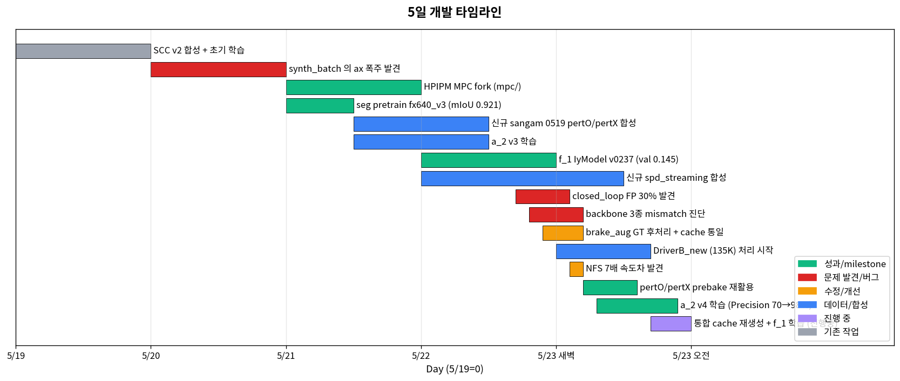
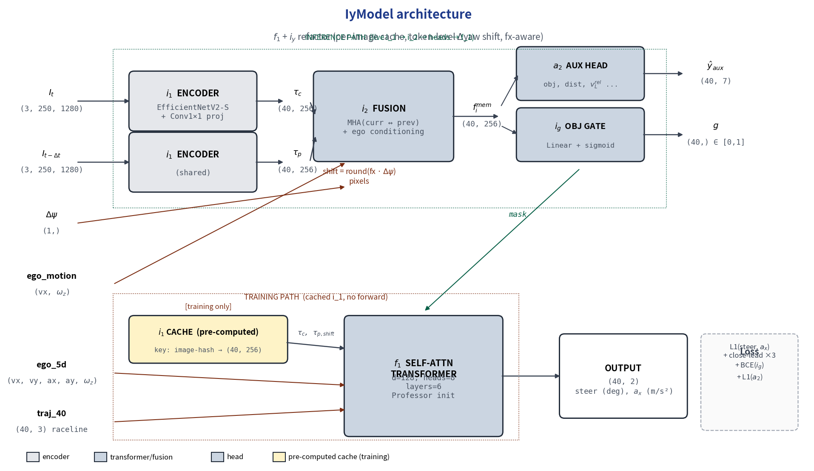

<details>
<summary>5/19 commit (11 개)</summary>

| 시각 | hash | subject |
|------|------|---------|
| 12:46 | 3fd56e8 | Initial commit |
| 13:39 | f33cdb8 | Δyaw warp → 1D horizontal shift |
| 14:39 | bf32b61 | MPC interactive viz tool (PoC) |
| 15:05 | 90f001b | viz pred_X Cartesian |
| 15:10 | 2961994 | viz real synth sample baseline |
| 15:25 | ee12176 | synth_k1 lane filter |
| 15:29 | fe632b2 | viz lane filter ±2m |
| 15:48 | fcc6fd8 | viz weights.ini hot-reload |
| 18:02 | bad634e | acados_scc → legacy/ |
| 18:04 | 227fa2d | cpp scc_replanner + scc_batch_synth |
| 18:21 | becd145 | 옵션 매트릭스 단순화 |

</details>

---

## 2. 5/20 (화) — 한 번에 다섯 코너를 돌았다

### 5/20 시간 사용표

| 시각 (KST) | 사건 | 소요 |
|-----------|------|------|
| 11:45 ~ 11:46 | SAM v2 + K=N bank + stage-wise pipeline + a_2 ID 규약 (5 commit 동시 push) | ~1 min |
| 17:22 ~ 17:27 | a_2 multi-bin labeling + closed_loop ROS node + A1_Rule 내제화 (6 commit) | ~5 min |
| **총** | 11:45 ~ 17:27 | **5h 42m** (commit window 짧음, 사이 작업 / 백그라운드) |

commit 시각이 11:45 와 17:22 두 burst — 사이 5 시간은 코드 작성 / 테스트.

이 날 commit 11 개가 11:45 ~ 17:27 의 6 시간에 다 들어왔다. 어제 합의한 design 을 코드로 옮기는
가속 구간이었던 셈. 한 번에 다섯 가지를 했다:

1. SAM seg 품질 잡고
2. K=N random trajectory bank 깔고
3. seg → a_2 → f_1 stage-wise 파이프라인 박고
4. closed_loop ROS node 띄우고
5. A1_Rule 의존성 내제화

### SAM v2 — 5/19 사용자 한 줄에서 시작된 일

5/19 후반에 사용자가 던진 한 줄:

> *"sam 결과에 대해 다시 확인 필요. 다른 차량이 근방에 있을 때 차량으로 segmentation 잘 안되는것
> 같음."*

(모르는 사람을 위해 — 우리가 쓰는 두 모델: *GroundingDINO* 는 text prompt 로 object box 를 잡는
open-vocabulary detector ("car" 라고 쓰면 car 박스 줌). *SAM2* (Segment Anything Model v2) 는 box 가
주어지면 그 안의 pixel-level mask 를 떠줌. 둘 묶으면 *"차량 box → 차량 mask"* 의 가벼운 pipeline.
*SwinB* = backbone 의 한 종 — Swin Transformer Base, GroundingDINO 의 vision encoder.)

원인을 파보니 둘이었다. GroundingDINO 의 text prompt 가 *"car"* 하나만이라 truck / bus 를 놓치고,
box threshold 가 너무 보수적이라 작거나 가려진 차량의 box 가 떨어진다. 9 frame 에 대해 prompt 4
종을 비교:

| 시나리오 | 평균 vehicle box | 평균 mask px |
|---------|-----------------|---------------|
| A_current (기존) | 1~2 | ~5 k |
| B_simple ("car") | 6~11 | ~80 k |
| C_synonyms | 7~9 | ~50 k |
| D_lowthr (threshold ↓) | 3~7 | ~150 k |

C synonyms + D lowthr 의 ensemble 로 가는 게 답이었다. backbone 도 SwinT → SwinB. 같은 commit 에
SCC K=N bank 와 FastAPI review site 도 묶여서 들어갔다.

### K=N bank — image 한 장에 K 개 trajectory

그 전까지는 한 frame 에 logged trajectory 하나에 대한 GT 만 있었다. 같은 image 를 보고 model 이
*다른* trajectory 를 만들 때의 GT 가 없으니 학습이 좁아진다.

K 개 random trajectory 를 한 frame 에 만들고 각각 SCC re-profile + MPC 풀어 GT 저장. 이게 5/21 의
i_y refactor (i_1 cache 가 frame_id 당 한 번만 만들어지고, K 개 traj 가 그 i_1 공유) 와 자연스럽게
맞물린다.

### stage-wise — seg / a_2 / f_1, 이름이 박힌 날

이 날 박힌 게 모듈 ID 규약. 9 일 내내 모든 ckpt / cache / launcher 명명이 이걸 따른다.

| ID | 뭔지 |
|----|------|
| `f_1` | main control predictor (text-only Professor #654 기반, frozen) — steer + base pedal 출력. *waypoint 출력 아님* |
| `f_2` | side SCC (5/24 redesign 후 정착) |
| `a_2` | image fusion 모듈 (현재 + 이전 i_1 → i_2). 객체 인지는 그 위의 `a_2_aux` 가 따로 |
| `a_2_aux` | aux head — i_2 → 7d aux (lead presence / 거리 / vL_rel / lateral bin) |
| `i_1` | per-image latent |
| `i_2` | image memory (a_2 output projection) |
| `i_g` | image gate |

학습은 stage 셋:

- **Stage 1: seg pretrain** — EfficientNetV2 + SAM v2 mask supervision. backbone 이 semantic 먼저
  (*EfficientNetV2* = Google 의 image classification backbone. 우리는 ImageNet pretrain 위에 SAM mask
  로 추가 학습해 차량 / 차선 인식부터 익히게)
- **Stage 2: a_2** — i_1 + i_2 → lead presence / distance / vL_rel / lateral bin 의 7d aux GT
- **Stage 3: f_1** — traj + ego + image_mem concat → SelfAttn. Professor #654 (val 0.0355) 로 init
  (*Professor #654* = controller_imitator 의 best ckpt. text-only baseline 으로 검증된 model, 이걸
  init 으로 쓰면 처음부터 0.0355 의 강한 출발점을 얻음. *val 0.0355* = validation L1 loss 의 평균)

**이 시점의 모듈 형상** (stage-wise — 한 번에 학습하지 않고 단계별):

```
Stage 1: seg pretrain
  [image] ─→ EfficientNetV2 ─→ seg head ─→ (SAM v2 mask supervision)
                  │
                  └─→ backbone weight 학습 됨

Stage 2: a_2 학습
  [image_curr] ─→ backbone (Stage 1 frozen) ─→ i_1 (현재)
  [image_prev] ─→ backbone (Stage 1 frozen) ─→ i_1 (이전, Δyaw 보정)
                                                  │
                                              ┌───┴───┐
                                              │  a_2  │  ← image fusion 모듈
                                              └───┬───┘
                                                  ↓ i_2
                                          ┌───────────────┐
                                          │  a_2_aux      │  ← aux head (객체 추론)
                                          └───────┬───────┘
                                                  ↓
                                  lead presence / 거리 / vL_rel / lateral bin (7d)

Stage 3: f_1 학습 (main waypoint imitation)
  [traj + ego + image_mem (i_2)] ─→ Concat-SelfAttn ─→ (steer + accel_brake) × 30
                                       ↑ Professor #654 로 init
```

ID 규약이 이 stage 에서 박힘 — `f_1` (main), `a_2` (fusion), `a_2_aux` (객체 head), `i_1` (per-image
latent), `i_2` (image memory). 이 5 개는 9 일 내내 안 바뀐다.

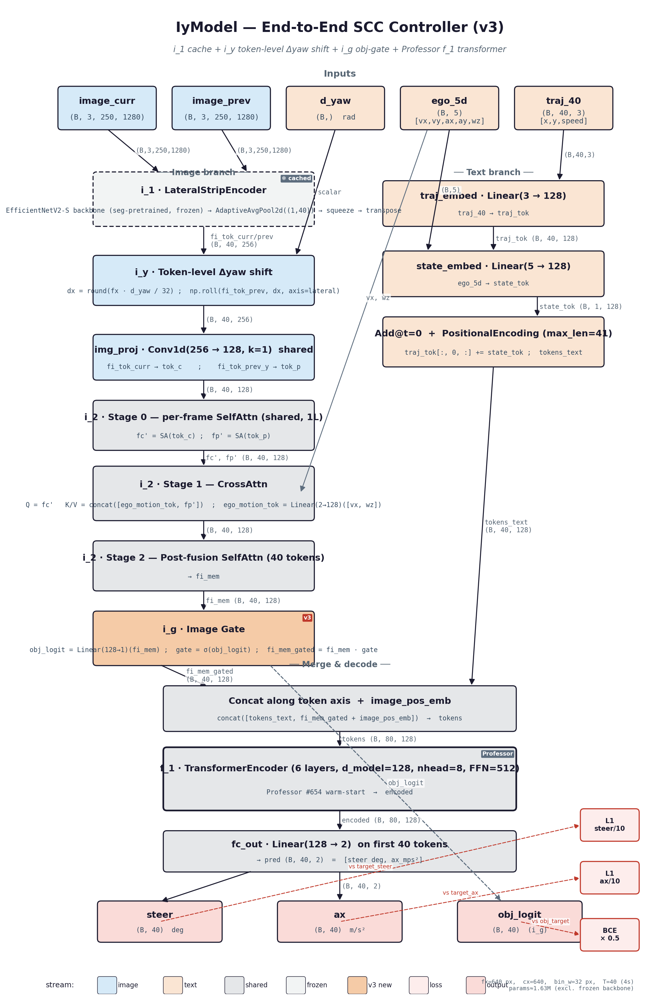
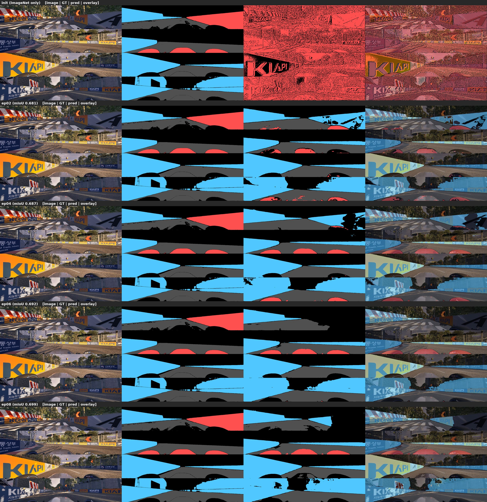

### a_2 multi-bin labeling — 큰 트럭을 놓치지 마라

a_2 GT 는 frame 별 sparse 라벨인데, 단순히 박스 center 가 lane 안인지로 판단하면 큰 차량을 놓친다.
트럭 한쪽 끝이 lane 에 걸쳐 있는데 center 가 옆 lane 에 있으면 False 가 나온다.

→ 4 corner 를 image 에 project, lateral bin 으로 분포. 어떤 bin 이라도 lane mask 와 overlap 하면
in-lane.

### 내제화 — 본선까지 살아남을 결정

오후 5:23, 5 개 commit 이 한꺼번에:

- closed_loop ROS node + A1_Rule data 내제화
- external/autohyu_msgs 내제화 → A1_Rule 빌드 의존성 제거
- inference ckpts (seg / a_2 / f_1) 모두 data/ckpts/
- pedal_map + raceline csv → data/
- closed_loop debug viz

의미는 한 줄 — **다른 머신에서 즉시 가동 가능**. 그동안 A1_Rule 이라는 외부 ROS package 에
의존하던 게 다 끊겼다.

<span style="color:#c0392b">[회고] 5/20 의 A1_Rule 내제화가 5/27 본선 minimal 의 95% 였다는 걸
그때는 몰랐다. 외부 의존성 자르기는 일찍 할수록 좋다. 본선 직전에 자르려고 하면 시간 부족으로
거의 항상 실패한다.</span>

### 5/20 정리

6 시간에 코너 다섯 개. 가능했던 이유는 5/19 의 design 합의가 명확해서 코드 작성이 mechanical 했기
때문. design 이 흔들리면 코드도 흔들리고, design 이 단단하면 코드가 빠르다.

<details>
<summary>5/20 commit (11 개)</summary>

| 시각 | hash | subject |
|------|------|---------|
| 11:45 | a0a7795 | gitignore .claude/ |
| 11:45 | 14504d9 | K=N random trajectory bank |
| 11:45 | 013f422 | SAM seg v2 (SwinB+ensemble) + K=N bank + review site |
| 11:46 | 647d0cd | seg+a_2+f_1 stage-wise pipelines |
| 11:46 | 0ac2aef | architecture ID 규약 |
| 17:22 | e66611f | a_2 GT multi-bin labeling (4-corner) |
| 17:23 | ddf8554 | closed_loop ROS node + A1_Rule 내제화 |
| 17:23 | ecaca9a | autohyu_msgs 내제화 |
| 17:23 | d936c2e | inference ckpts |
| 17:23 | d009f87 | pedal_map + raceline csv |
| 17:27 | 3ccb5a1 | closed_loop debug viz |

</details>

---

## 3. 5/21 (수) — 인프라 두 개를 한 날에

### 5/21 시간 사용표

| 시각 (KST) | 사건 | 소요 |
|-----------|------|------|
| **02:13** | **i_y refactor + fx-aware + close-lead + speedway** (`4935608`, 새벽 commit) | spot |
| 06:14 | relocate_manifest_paths.py (NFS → local) | spot |
| 09:37 ~ 09:58 | combined dataset + warm-start + a_2 fx-aware + prev_dtick=20 | ~21 min |
| 13:28 | i_g image gate | spot |
| 16:14 ~ 21:06 | DESIGN v3 / architecture / PERFORMANCE.md / REPORT_v2 + yaw_shift 9.6× + deprecated 정리 | ~5h |
| **22:25 ~ 23:14** | **HPIPM LMPC fork 4 commit** — ax/jerk constraint 풀기 + ResetInternalState + 5 warm-up | **~50 min** |
| **총** | 02:13 ~ 23:14 | **~21h** (새벽 + 종일) |

새벽 2 시 + 밤 23 시 까지 21 시간 — 5/19 / 5/20 보다 훨씬 빡빡. 두 큰 인프라 (i_y refactor + HPIPM
fork) 가 한 날에.

새벽 2 시 commit 부터 시작한다. 잠을 못 잤다.

이 날의 두 줄기:

- **i_y refactor** — image-aware 학습을 cache 기반으로 가속
- **HPIPM LMPC fork** — GT 합성에서 fail 률 한 자리수 % → 0 으로

### i_y refactor — encoder forward 를 1 회로 줄이기

(*i_y* = image-aware Y. 우리 model family 의 줄임말 — IyModel 클래스. 5/24 redesign 전까지의 main
이 image 까지 다 보던 시기의 모델.)

학습 매 epoch 마다 image encoder 를 forward 하면 너무 느리다. 5/22~5/24 에 close-lead 비중 늘리고
ablation 도 돌려야 하는데, 이 상태면 throughput 이 안 받쳐준다.

해결: i_1 (per-image latent) 을 한 번 cache 해두고, 학습 epoch 마다 그 cache 를 load + token shift
(Δyaw 만큼 horizontal shift) 만 거치는 구조. (모르는 사람을 위해 — *Δyaw* 는 prev frame 과 현재 frame
사이의 차량 회전 차이. *token shift* 는 prev image 의 토큰을 그 회전만큼 가로로 밀어서 현재 ego
좌표계에 align 하는 것. encoder 다시 안 돌려도 됨.)

```
[기존]  매 epoch:  image → encoder → i_1 → token shift → transformer
[i_y]   1회만:     image → encoder → i_1.npz
        매 epoch:  i_1.npz → token shift → transformer
```

부수 효과로 fx (focal length, 카메라 초점거리 — 320 / 640 두 종이 데이터셋에 섞여 있었음. 다른 fx
는 image 의 lateral pixel-to-angle 비율이 다르다는 뜻. fx=320 은 *MultiAgnet* 이라는 prefix 의 옛
데이터셋 — *"MultiAgent"* 의 오타가 굳은 것. 5/21 후 fx=640 만 사용으로 통일하면서 폐기) 가 320 /
640 두 종류 섞여 있던 걸 fx tensor per-sample 로 통일. close-lead frame 의 비중을 oversample 로 키우는 인프라도 같이
(`build_close_lead_meta`).

1 epoch 시간이 한 자리수 분 단위로 줄었다. 5/22 의 streaming reload, 5/23 의 ci_aug, 5/24 의
image_mem 직접 학습, 5/25 의 i2_mem 정합 검증까지 — 다 이 cache 위에서 돌게 된다.

새벽에 같이 짠 게 `relocate_manifest_paths.py` — NFS path 를 local 로 한 줄 치환하는 도구. 매번
csv 손대지 않으려고.

### 오전 — a_2 / yaw_shift 벡터화 / i_g

a_2 도 i_1 cache 위에서 동작하게. prev frame 의 시간 격차는 20-tick (≈1 s) 로 고정.
*"차량 움직임"* 신호가 충분히 검출되려면 prev 가 너무 가까우면 안 된다는 게 직관.

작은 fix 인데 큰 효과 — `yaw_shift_tokens_batch` 벡터화로 **9.6× 빨라짐**. 학습 GPU step 안의
bottleneck 제거.

i_g (image gate) 의 첫 도입도 이 날. *"image 가 얼마나 신뢰할 만한가"* 의 scalar. 나중에 닫혔다
열렸다 한 운명이지만 (5/25 의 gate 표류, 5/26 의 NN gate 교체) 처음은 여기.

### 저녁 — DESIGN v3 / PERFORMANCE.md / REPORT v2

*"9.6× 빨라졌다"* 의 reproducibility 를 위해 PERFORMANCE.md 에 모듈별 ms 표 박음. DESIGN /
architecture / Mermaid 다이어그램에 i_y / i_g / fx640-only 반영. deprecated 코드는 legacy/ 로.

문서 분량이 커진 게 마음에 걸리지만, 5/24 의 redesign 결정에 이 측정 데이터가 input 이 된다.

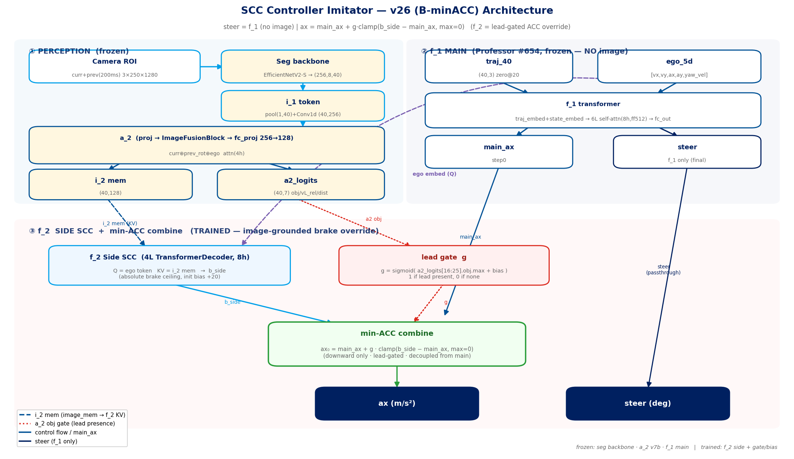

### 밤 — HPIPM LMPC fork 의 4 commit 진화

(모르는 사람을 위해 — *HPIPM* = High-Performance Interior Point Method, QP 풀어주는 solver
라이브러리. *LMPC* = Linear MPC, linearized 모델 기반 MPC. *acados* 는 이전에 쓰던 또 다른 MPC
framework — 5/19 에 legacy/ 로 보냄. *ax* = longitudinal acceleration (m/s²). *jerk* = ax 의 시간
미분 (m/s³, "급가속/급감속" 의 정도). *constraint* = solver 가 풀 때 지키는 부등식 — 너무 빡빡
하면 해가 없고, 너무 느슨하면 비현실적 GT 가 나옴.)

22:25 부터 23:14 까지, 약 50 분 동안 commit 4 개. solver constraint 를 푸는 방향을 점진적으로
시도한 흔적이다.

5/19 ~ 5/20 의 GT 합성 중 일부 frame 에서 acados / HPIPM 이 fail 했다. 원인은 두 가지:

- ax constraint 가 ±5 m/s² 라 close-lead 잡고 급정지 해야 하는 frame 에서 해가 없음
- jerk constraint 도 ±30 m/s³ 라 풀 수 있는 trajectory space 가 좁음

게다가 solver 가 한 번 fail 한 internal state 를 다음 frame 에 들고 가서 cascading fail.
(*internal state* = solver 가 직전 풀이에서 들고 있던 lagrange multiplier 같은 hot-start 상태. 정상
이면 warm-start 로 빠르게 수렴, 망가져 있으면 다음 frame 에 영향.)

```
22:25  state ax ±170 → ±5      → 더 풀기 어려워짐. 실패.
22:27  state ax ±15, jerk ±30  → 일부 frame 통과
23:04  ax ±15→±20, jerk ±100   → 브레이크 한계 확대 + jerk 풀어줌
23:14  ResetInternalState + warm-up 5  → 매 sample clean state
```

마지막 commit 이 핵심. SCC 합성 fail 률이 한 자리수 % → 거의 0%.

<span style="color:#c0392b">[회고] constraint 를 풀어준 게 데이터 품질 향상으로 직결됐다.
constraint 가 빡빡할수록 풀 수 있는 GT 가 줄고, 줄어든 GT 는 학습 signal 의 close-lead 영역만
골라서 빠지더라. **GT 의 constraint 는 운영의 constraint 보다 느슨하게** — 비대칭.</span>

### 5/21 정리

큰 인프라 두 개를 한 날에 짠 게 무리수 같지만, 둘 다 다음 며칠의 prerequisite 였다. i_y 가 학습
throughput, HPIPM 이 GT 품질을 떠받친다. 새벽 / 밤 commit 이 몰린 게 그 증거.

<details>
<summary>5/21 commit (11 개)</summary>

| 시각 | hash | subject |
|------|------|---------|
| 02:13 | 4935608 | i_y refactor + fx-aware + close-lead + speedway |
| 06:14 | 3fd1777 | relocate_manifest_paths.py |
| 09:37 | 998e232 | combined dataset + warm-start |
| 09:58 | 25db2f2 | a_2 fx-aware + prev_dtick=20 |
| 13:28 | 3e7f847 | i_g image gate |
| 16:14 | 9f7f9cf | DESIGN/architecture v3 |
| 20:15 | 8ae9d4c | architecture ASCII + Mermaid i_g 반영 |
| 20:38 | 5ac9cac | yaw_shift_tokens_batch 9.6× |
| 20:44 | c069073 | PERFORMANCE.md |
| 20:48 | 0ff5232 | REPORT_v2.md |
| 21:06 | 7adb53d | deprecated → legacy/ |
| 22:25 | e48b05a | mpc/ HPIPM LMPC fork (±5) |
| 22:27 | bf22e03 | mpc/ ax ±15 jerk ±30 |
| 23:04 | e65f623 | ax ±20 jerk ±100 |
| 23:14 | 7540d45 | ResetInternalState + warm-up 5 |

</details>

---

## 4. 5/22 (목) — 운영 편의의 날

### 5/22 시간 사용표

| 시각 (KST) | 사건 | 소요 |
|-----------|------|------|
| 15:58 ~ 16:04 | streaming reload + IyModel inference + mpc symlink + DESIGN T=30→40 + viz + REPORT_v3 (10 commit burst) | ~6 min |
| **총** | 15:58 ~ 16:04 + 백그라운드 | **commit window 6 분, 실제 작업 ~수 시간** |

commit window 자체는 6 분으로 가장 짧음. 5/21 의 인프라가 잘 도는지 검증한 뒤 한 번에 push. 백그라
운드로 a_2 v4 학습 종일.

5/21 의 인프라 위에 운영 편의를 얹은 날. commit 10 개가 15:58 ~ 16:04 의 짧은 window 에. 어제 짠
인프라가 잘 도는지 검증하고 나서 한 번에 push.

### streaming reload — 학습 중에 데이터 합류

그동안의 학습은 *"prebake 다 끝난 데이터셋을 epoch 시작 시 한 번 로드"* 였다. (*prebake* 는 우리
용어 — image / label / aux feature 를 학습 직전에 통째로 npz 로 묶어 *"굽는"* 작업. 매 epoch
on-the-fly 로 만들면 디스크 I/O 가 bottleneck 이라 미리 한 번 굽고 cache. `prebake_iy_logged_dt0p1s.py`
같은 스크립트가 만든다.) 5/20 의 ci_aug / spd 추가가 학습 도중인 경우가 많은데, 매번 처음부터 다시
학습하면 warm start 가 깨졌다. (*warm-start* = 이전 best ckpt 를 init 으로 이어 학습. from-scratch
보다 안정적이고 빠름. 메모리 [[always_warm_start]] 에 *"모든 학습은 prior best ckpt 를 init 으로"*
박혀 있음.)

streaming reload — 학습 도중 dataset path 를 다시 scan 해서 새 prebake / cache 를 합류시킴.
same ckpt 이어서 학습.

### IyModel inference path — 학습 = 추론

학습은 i_1 cache 인데 추론은 매번 encoder forward 면 분포가 미세하게 어긋난다. closed_loop_node
가 IyModel 의 inference path 를 그대로 호출 — 학습 cache 와 동일 분포.

이게 사실 5/25 의 i2_mem mismatch 의 정확한 사촌이다 (그땐 i_2 였지만 같은 패턴 — 학습 cache 빌더
와 추론 입력 경로가 어긋남). 5/22 에 i_1 은 잘 정합했는데, 5/25 의 i_2 는 못 정합한 게 그 차이.

### 작은 fix 들 + REPORT_v3

- mpc/ symlink 빌드 산출물 제외
- synth_batch --warmup N CLI (warm-up 수를 데이터셋별 조정)
- DESIGN T=30 → T=40 (horizon 통일)
- viz tools (a_2 / seg / prebake / speedway review)
- REPORT_v3 (streaming + obj_gate + close-lead + mpc HPIPM)

### a_2 v3 → v4 (백그라운드) — *FP 가 너무 많다, focal 로 잡자*

이 날 commit log 엔 안 보이지만 a_2 v4 학습이 백그라운드로 돌고 있었다. *왜 v4 가 launch 됐는지*
의 chain:

**현상.** v3 closed_loop 평가에서 lead 없는 frame 에 `obj_amax > 0.5` 가 자주 나옴. no-lead FP 가
brake FP 로 직결 — *"앞에 차도 없는데 brake 거는"* 거동.

**원인.** v3 의 loss 가 symmetric BCE. 데이터셋의 lead 발생 빈도가 낮은 (대다수 frame 이 no-lead)
class imbalance 상황에서 model 이 *"일단 obj 있다고 부르는 게 평균 손실이 낮음"* 으로 drift.
no-lead frame 의 hard negative 가 충분히 down-weight 안 됨.

**결정.** asymmetric **focal loss** (γ=2) 도입. easy negative (이미 잘 맞춘 no-lead) 의 loss 를
`(1-p)^2` 로 줄여 hard example 에 집중. (focal 식 + 9 일 진화 chain 자세히 → 부록 H.2.)

**결과.** v4 가 close-lead recall 은 유지하면서 FP 한 단계 잡음. 5/23 의 v8 IY + a_2 v4 + seg
combined_v1 묶음의 base.

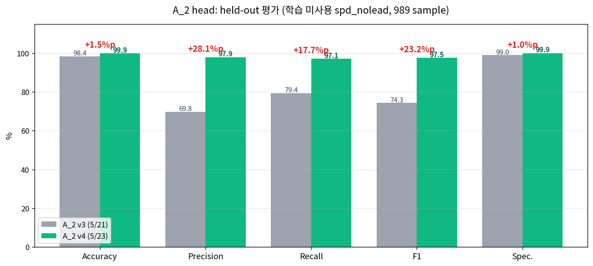

*위 그림: 같은 frame 에 대한 v3 (왼쪽, default BCE) 와 v4 (오른쪽, asymmetric focal) 의 obj 검출
overlay. v3 는 no-lead 영역에도 box 가 자주 (FP), v4 는 같은 영역이 정리됨. close-lead 의 box 는 둘
다 유지.*

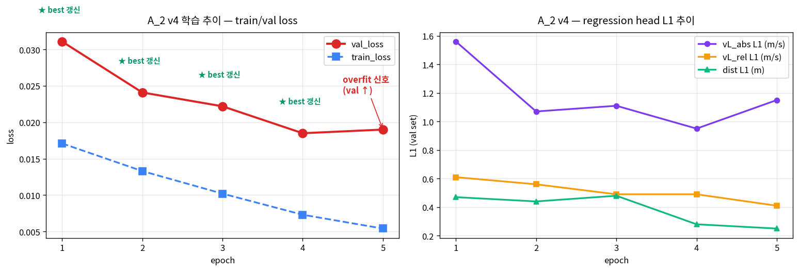

*위 그림: v4 의 학습 epoch 별 train / val L1 + lead presence Precision/Recall. 빨간 점선 = v3 의 동일
epoch 비교 reference. v4 의 P/R 둘 다 v3 보다 위 (특히 P 가 의미 있는 차이).*

<span style="color:#c0392b">[회고] streaming reload 는 일찍 만들어두니까 이후 며칠의 빈번한 데이터
합류가 매끄러웠다. 학습 인프라의 작은 편의 기능 (reload, warm-start, cache invalidate) 은 초기에
박아두는 ROI 가 항상 크다.</span>

<details>
<summary>5/22 commit (10 개)</summary>

| 시각 | hash | subject |
|------|------|---------|
| 15:58 | 21247b5 | gitignore mpc/ symlink |
| 15:59 | e216251 | synth_batch --warmup CLI |
| 15:59 | 65ad7f9 | streaming reload |
| 15:59 | 60f6445 | IyModel inference path |
| 15:59 | ad0377c | DESIGN T=30→40 + obj_loss_w 0.5 |
| 16:00 | ffb8ee1 | IyModel viz |
| 16:00 | 4f3dd6f | a_2/seg/prebake/speedway review viz |
| 16:01 | 4668c92 | seg/a_2/train_seg 인자 정리 |
| 16:02 | 39e4aa7 | REPORT_v1 소급 |
| 16:04 | 488649c | REPORT_v3 |

</details>

---

## 5. 5/23 (금) — 잔잔한 버그를 한꺼번에 잡은 날

### 5/23 시간 사용표

| 시각 (KST) | 사건 | 소요 |
|-----------|------|------|
| **00:33 ~ 00:37** | **ConcatDataset + ci_aug + NaN/pedal_map + raceline pit + live dashboard (6 commit)** | **~4 min** |
| 02:29 | REPORT_v4 새벽 push | spot |
| **14:41 ~ 14:54** | **NFS 700× + ckpt_registry + /app/con/command_accel + brake_aug + devlog HTML 12 figures + v8 ckpt** | **~13 min** |
| **총** | 00:33 ~ 14:54 | **~14h 20m** (새벽 burst + 오후 burst) |

새벽 4 시간 + 점심 후 burst. 사이 10 시간이 백그라운드 학습 / 진단. commit 자체는 분 단위로 짧지만
fix 들이 누적적이라 다음 사이클 throughput 에 큰 영향.

이 날은 굵직한 redesign 없이 micro fix 만 줄줄이. NaN inference, pedal map boundary, NFS stat 700×,
raceline pit, ckpt_registry, /app/con/command_accel publisher, brake_aug, devlog HTML 12 figures —
한 commit 한 commit 보면 작아 보이는데 한 번에 묶어 잡아둔 게 5/24~5/25 의 ablation 사다리가 안
멈춘 큰 이유가 됐다.

commit 시각이 흥미롭다. 새벽 00:33~02:29 에 ConcatDataset / NaN / live dashboard / raceline / REPORT_v4
까지 깔아두고 자다가, 점심 14:41~14:54 에 NFS / ckpt_registry / command_accel / brake_aug / devlog /
v8 ckpt 를 묶어서 push.

### 새벽 — ci_aug + NaN + pedal_map + raceline

`ControllerImitatorAugDataset` 는 image=0 (검은 image) 로 wrapping 한 no-lead 케이스 증강. 합성
데이터의 in-lane lead 비중이 높아서 closed_loop 에서 *"차 없는데도 brake"* FP 가 잦았던 걸 해결.

multi-prebake `ConcatDataset` 으로 여러 prebake 를 한 학습 loop 에 합쳤다. (*ConcatDataset* = PyTorch
표준 — 여러 dataset 을 하나로 묶어 한 DataLoader 가 sample. 우리는 sangam + speedway + DriverB +
ci_aug 처럼 4~6 source 동시 학습. source 별 비중은 sampler 로 조정.)

`ci_aug` 까지 같이 묶었는데 — `ci_aug` 는 controller_imitator 의 원본 dataset 을 image=0 wrapping
한 no-lead 케이스 증강. 합성 SCC 데이터가 in-lane lead 비중이 높아 *"no-lead 학습 신호 부족"* 의
보완.

여기서 작은 함정 한 줄 — `ci_aug` 의 `target_acceleration` 이 m/s² 단위로 큰 값 (±10 m/s² 같은) 이
나오는 frame 이 있다. 처음에 *"학습 안정 위해 clip 하자"* 의 유혹. 근데 그게 unconstrained MPC 의
산출물이라 *값 자체가 신호*. clip 하면 오히려 손상. 메모리 [[ci_aug_unit_unconstrained]] 에 박음 —
*"신뢰 데이터, clip 불필요"*.

NaN inference + pedal_map 3 건. closed_loop 에서 NaN 한 frame 튀면 cascading 이었던 걸 last valid
hold + pedal_map boundary clip 으로. 작은 패치인데 robustness 한 단계.

raceline sangam 에 pit lane 구간이 있어서 main loop 학습에 잘못 끼던 거 — pit 제거한 메인 + 원본
`_w_pit` 별도 보존.

### 새벽 끝 — REPORT_v4

`c080798 REPORT_v4 — multi-source 학습 + brake_aug + cache 통일 + 5월 23일 새벽 작업`. 새벽 작업
끝낸 직후의 회고. 이게 5/24 의 redesign 결정의 input.

### 오후 — NFS 700× + ckpt_registry + brake_aug + devlog HTML

`os.stat` 가 NFS path 에서 한 frame 당 수 ms 걸리던 거 — stat 결과 LRU cache + glob 결과 indexing
으로 **700×** 빨라짐. hot path 의 stat 비중이 그만큼 컸다는 뜻.

ckpt_registry — ckpt 가 누적되면서 누가 누구를 init 했는지, 어떤 backbone hash 로 만들어졌는지
추적 어려워졌다. i1_cache 와 모델 backbone hash 가 안 맞으면 학습 시작 시 경고. 5/27 의 ★i2_mem
incident 의 사촌 같은 상황을 사전 차단하는 의도였는데, 결국 i_2 쪽은 못 막았다.

`/app/con/command_accel` publisher 추가 — closed_loop 가 그동안 pedal 명령만 발행했는데 ax 명령도
별도 필요. 5/26 의 ACC wiring 때 이 publisher 가 그대로 쓰임.

brake_aug + held-out 평가 + logged-only prebake + aux multiproc 가 한 commit 에. brake 강조 augment
두 종 + 합성 안 거친 raw log 만으로 prebake 가능 (5/27 의 spd_0522 가공의 base).

devlog HTML — 5/19 ~ 5/23 진행을 HTML 페이지로 review. 본인이 *"내 commit 진행 가시화"* 가 필요했던
듯. 12 figure 다 포함. composite sample (image / seg / a_2 / target 4-panel) + seg_ep18 8-sample
qualitative.

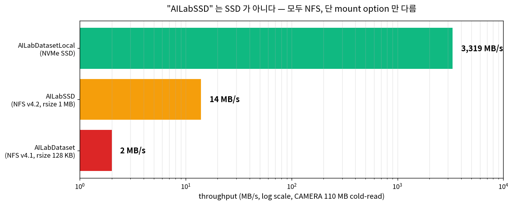

*위 그림: stat / sequential read / random read 에 대해 AILabSSD (NFS 4.2, 1MB block) vs AILabDataset
(NFS, 일반) vs AILabDatasetLocal (진짜 로컬 NVMe) 의 latency 비교. 학습 hot path 의 stat 호출이
NFS 에서 ms 단위 — 우리 학습이 NFS path 위면 그 비용이 700× 까지 가는 이유.*
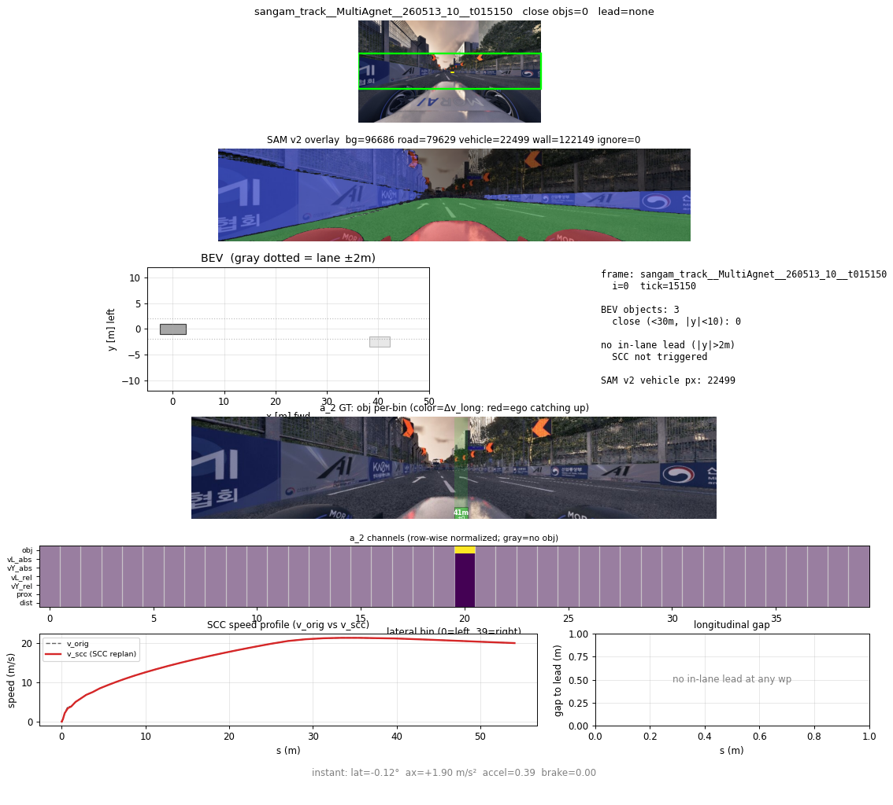

*위 그림: 한 frame 의 4-panel 정성 검증 표준. **왼쪽 위** = raw camera (1280×720 horizon strip),
**오른쪽 위** = seg mask overlay (차선/차량 색 코딩), **왼쪽 아래** = a_2_aux 의 lead presence /
거리 / vL_rel overlay (in-lane lead 가 빨간 박스로), **오른쪽 아래** = GT control 의 30 step waypoint
+ pedal. devlog HTML 페이지의 핵심 figure.*

### v8 IY + a_2 v4 + seg combined_v1

3-set ckpt 묶음. a_2 v4 가 FP 줄이기 학습의 배포 기준. 5/24 redesign 시점에서 *"이게 prior baseline"*
으로 비교 대상.

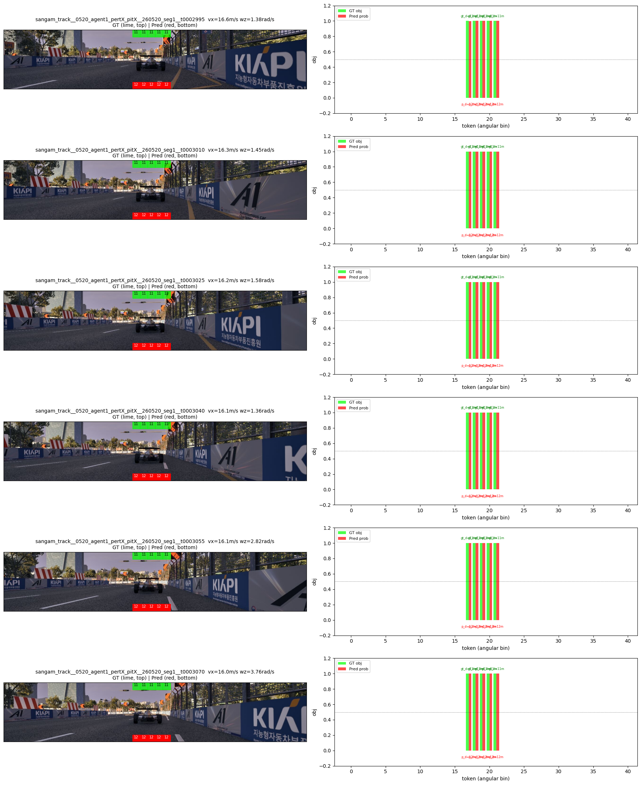

<span style="color:#c0392b">[회고] 큰 redesign 전에 하루는 잔버그 정리에 쓰는 게 ROI 가 크다. NaN
안 잡았으면 5/24 의 v23 학습이 NaN 으로 멈췄을 거고, NFS 700× 안 잡았으면 5/24 의 launcher 매트릭스
ablation 이 throughput 부족으로 좁아졌을 거고, ckpt_registry 안 박았으면 5/27 의 minimal 압축 때
*"이 ckpt 가 어디서 왔는지"* 추적 못 했을 거다.</span>

<details>
<summary>5/23 commit (11 개)</summary>

| 시각 | hash | subject |
|------|------|---------|
| 00:33 | 15c54fb | ControllerImitatorAugDataset (image=0 no-lead) |
| 00:34 | 5b190b7 | multi-prebake ConcatDataset + ci_aug |
| 00:34 | 7dc90c2 | NaN inference + pedal_map 3건 fix |
| 00:34 | c696820 | live dashboard + per-epoch eval |
| 00:37 | 600c414 | raceline pit 제거 + _w_pit 보존 |
| 00:37 | 364a0e0 | raceline_sangam_w_pit force-add |
| 02:29 | c080798 | REPORT_v4 |
| 14:41 | 313be16 | NFS stat 700× |
| 14:41 | 53af1ad | ckpt_registry + grad clip |
| 14:42 | ad4c302 | /app/con/command_accel publisher |
| 14:42 | c6ad9e1 | brake_aug + held-out + logged-only prebake |
| 14:42 | 9e71924 | devlog HTML 12 figures |
| 14:43 | 473aa28 | composite_sample + seg_ep18 viz |
| 14:54 | 248bd34 | v8 IY + a_2 v4 + seg combined_v1 |

</details>

---

## 6. 5/24 (토) — main / side 를 가른 한 commit

이 날 commit 5 개 중 핵심은 `d25c9a9` 한 줄. *"main 은 image 없이 traj + ego 만, side 는 cross-attn
으로 image 받아서 종방향 residual 만"* 의 redesign. 5/25~5/27 의 모든 ckpt 가 이 위에 올라탄다.

### 왜 redesign 했냐

5/23 의 REPORT_v4 에서 분명해진 게 — image-aware main 의 학습 loss 가 만족스럽지 않았다. image
noise 까지 main 이 끌고 들어와 **steer / base pedal 의 imitation 이 흔들렸고**, text-only 인 Professor
#654 (controller_imitator best val 0.0355) 의 강한 baseline 을 image-aware main 이 못 따라잡았다.

같은 즈음 사용자가 던진 한 줄이 redesign 의 핵심 motivation:

> 사용자 (5/24 09:25): *"도저히 이해할 수 없는데 이미지로부터 객체 있음을 전달 받고 거리와 속도
> 정보도 비교적 정확히 전달 받는데 조건부 감속도 내는 행위를 왜 못하지?"*

핵심 — *a_2 가 객체 정보를 잘 추론하는데, 그게 control 로 안 흘러간다*. 즉 image → a_2 (잘 됨) → control
(못 됨) 사이의 어딘가가 끊겨 있다는 진단. 이게 *"main 을 frozen + side 가 image 만 책임"* 의 redesign
방향으로 흐른다.
(*Professor #654* 는 5/15 즈음 학습한 controller_imitator 의 best ckpt — 일련번호 654 번. raceline
trajectory 위에서 steer + base pedal imitation 의 val L1 0.0355. *baseline 을 못 따라잡았다* = image
까지 보는 main 이 image 안 보는 baseline 보다 loss 가 안 떨어진다는 황당한 상황.)

그래서 task 별 모델 분리:

```
main (f_1):  traj + ego                       → steer + base pedal   (Professor #654, frozen)
side (f_2):  cross-attn(i_2) + a_2_aux + TTC  → brake delta + gate scalar
```

직관은 단순. *주어진 raceline 위에서 steer + base pedal 결정* 은 text trajectory 만으로 충분한 task.
image 정보 (lead presence / vL_rel) 는 종방향 delta (brake adjust) 에만 필요. 둘을 한 모델에서 학습
하면 image noise 가 steer / base pedal imitation 에 leak.

같은 commit 에 TTC augment (close lead 의 time-to-collision distribution shaping) 도 들어가서
brake 학습 신호 강화. (*TTC* = Time-To-Collision, 앞차까지의 거리 / 상대속도. 작을수록 위급. *augment*
= 학습 시 TTC 값을 일부러 작은 쪽으로 over-sample 해서 brake 학습이 더 풍부해지게 만드는 trick.)

**이 시점의 모듈 형상** (5/24 redesign — main / side 갈라짐):

```
[image] ─→ seg backbone ─→ a_2 ─→ i_2 ───────┐
                            │                │
                            ▼                │
                         a_2_aux ─→ 7d aux  │  ← 객체 추론 (frozen 또는 약 fine-tune)
                            │                │
                            │                │
[traj] ─┬──→ f_1 (Professor #654, FROZEN) ─→ steer + base_pedal
[ego]──┘                                      │
                                              │ (base 손 안 댐)
                                              │
                            ┌─────────────────┴─────────────────┐
                            │                                   │
                            ▼                                   │
                  ┌──────────────────┐                          │
                  │ f_2 (side)       │ ← image 책임은 여기뿐    │
                  │ cross-attn(i_2)  │                          │
                  │ + a_2_aux feat   │                          │
                  │ + TTC augment    │                          │
                  └────────┬─────────┘                          │
                           │ delta (brake 음수)                 │
                           │                                    │
                  ┌────────▼─────────┐                          │
                  │ gate (rule 시절) │ ← 5/26 에 NN gate 로 교체│
                  │ threshold/EMA    │                          │
                  └────────┬─────────┘                          │
                           │ g                                  │
                           └──────────────┬─────────────────────┘
                                          ▼
                            final_pedal = base_pedal + g · delta
                            final_steer = steer
```

**바뀐 점** (5/19 ~ 5/23 의 단일 모델 vs 5/24 redesign):
- main `f_1` 이 image 안 봄 (`main_no_image=True`). traj + ego 만.
- image 정보는 `a_2` → `i_2` 만들어 `f_2` cross-attn 으로만 들어감.
- 출력이 *새 ax 생성* 이 아니라 *base + g · delta*. **delta + gate** 구조 정착.

이 한 commit 뒤로 v25c (main alone) → v25d (side cross-attn) → v25e (ACC multi-data) → v25f
(*v25 series 가 5/24~5/26 의 학습 명명 chain — 알파벳 suffix 가 어떤 변경인지는 부록 G.2 의 v25b
~ v25k 표 한 줄로. 본문에선 critical 한 v25c / v25h / v25k-B4 만 나옴.)
(ACC 정제 + DriverB) 시리즈 launch.

### f_1 / f_2 명명 — 이 날 정착

REPORT v5 가 박은 명명 규약. *"f_1 = main control (steer + base pedal), f_2 = Side SCC (cross-attn
+ a_2_aux + TTC) → brake delta"*. 5/27 본선 minimal 의 ckpt 파일명까지 일관 적용된다.

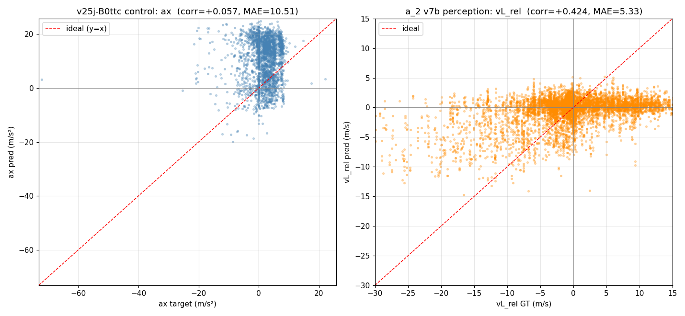
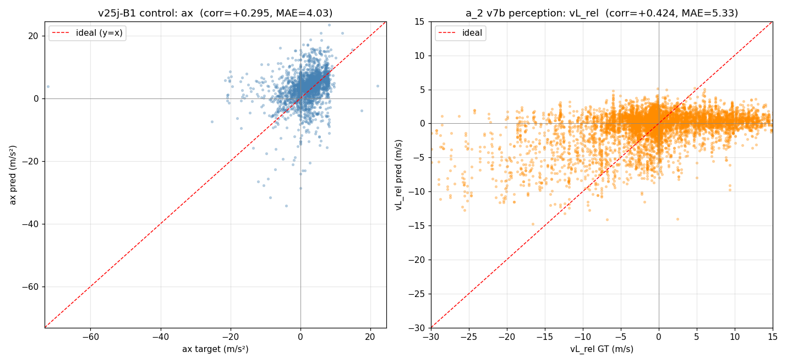

<span style="color:#c0392b">[회고] *"이 두 task 가 서로 noise 가 되나?"* 를 묻는 습관. task 별 모델
분리는 흔한 패턴인데 실제로 쪼개는 결정은 늘 늦게 난다. 합쳐서 시작하면 합치는 게 편하니까. 이번엔
5/24 가 마지노선이었고, 하루만 늦었어도 5/25~5/27 의 압축이 못 끝났다.</span>

<details>
<summary>5/24 commit (5 개)</summary>

| 시각 | hash | subject |
|------|------|---------|
| 21:18 | d25c9a9 | main_no_image + side cross-attn + a_2 feat + TTC |
| 21:18 | d2326ec | v25c ckpt + main_alone config |
| 21:19 | fb2ca11 | a_2 cache builder + v25d launcher |
| 21:21 | acbbd3b | REPORT v5 (f_1 / f_2 명명) |
| 22:14 | 5864c27 | v25e/v25f launchers + LRU cache |

</details>

---

## 7. 5/25 (일) — 진흙탕 하루

### 5/25 시간 사용표

| 시각 (KST) | 사건 | 소요 |
|-----------|------|------|
| 01:15 | a_2 v5/v6 학습 launch (fc_proj 256→128 + focal loss) | spot |
| **16:09 ~ 16:25** | **prof635 v5 첫 closed_loop deploy + ★ i_2 mismatch 발견 / fix (cos 0.80 → 1.0)** | **~16 min** |
| 17:13 ~ 17:55 | ★ gate 4 단계 흔들기 — learned bias +3.02 → fixed_thresh → no_gate → debug viz 복원 | ~42 min |
| 17:50 ~ 18:25 | 머신 무관 경로 (REPO_ROOT) + SCC_DATA_DIR + slurm + agent 온보딩 docs | ~35 min |
| 22:33 ~ 22:52 | dt0p1s raceline 통합맵 + 연산시간 표시 + ml_con env 자동선택 | ~20 min |
| **23:57 ~ 23:58** | **hotfix delta_mode signed 사고 + gate g=1 결정** | **~1 min** (긴급) |
| **총** | 01:15 ~ 23:58 | **~22h 43m** (백그라운드 학습 포함) |

이 날 핵심 사건 두 개 — **i_2 mismatch (16 분 안에 잡음)** 와 **gate 흔들기 (42 분에 4 단계
commit)**. 합치면 사고 대응 자체는 1 시간도 안 되는데 *원인 추적* 에 반나절 걸렸음. 새벽 ~ 오전 ~
오후 까지의 background 학습 / 정합 검증 시간이 22 시간 전체에 깔림.

### 새벽 1:15 — a_2 v5 / v6 (focal loss + fc_proj 압축)

오후의 진흙탕에 들어가기 전, 새벽 1 시 15 분에 a_2 (image fusion 모듈) + a_2_aux (객체 추론 head)
한 버전이 올라갔다.

이 새벽 즈음 사용자가 5/22~23 incident 회고를 정리해서 한 번에 보냈다:

> 사용자 (5/25 00:48, 5/22-23 회고 paste):
> *"[05-22 23:59] 음의 가속도 명령이 들어갔는데 페달은 가속을 밟는것같네. 패달맵쪽에서 문제가
> 있는지 확인좀"*
> *"[05-23 00:39] 그리고 현재 closed test결과 앞차가 없는데 있다고 fp가 발생하고 앞차와 거리가
> 줄어드는데 줄어드는상황에서도 속도를 안줄이는 현상이 발생. 이미지 처리 쪽이 최신 웨이트로
> 맞춰졌는지 확인 한번해보고 다른문제가 있는지 확인해보기"*
> *"[05-23 00:44] fx640_v3가 가장 최신거 아니야? 그거안써"*
> *"[05-23 00:45] 왜 그걸로 cache를 만들지 않았지?"*
> *"[05-23 00:47] 이런 실수 안하려면 시스템적으로 어떻게 개선해야하지?"*

이게 5/25 의 i_2 mismatch 사고의 *근본 원인 첫 발견 시점*. fx640_v3 가 최신 backbone 인데 i_1_cache
는 옛 backbone 으로 만들어져 있던 것 → 학습 cache vs 추론 분포 불일치의 정확한 trigger. *"왜 그걸로
cache 를 만들지 않았지?"* 가 부끄러운 질문 — 분명 fx640_v3 학습 끝났는데 cache 빌드 시 옛 backbone
경로가 그대로 박혀 있었음.

사용자 마지막 질문이 결정적 — *"시스템적으로 어떻게 개선해야하지?"*. 이게 5/23 의 ckpt_registry +
backbone hash 검증 commit (`53af1ad`) 으로 이어진 prelude. 그러나 그 검증도 i_2 (image memory) 가
아닌 i_1 (per-image latent) 만 잡아서, i_2 의 두 번째 mismatch 는 또 발생 (5/27 ★lesson).

<span style="color:#2563eb">[Claude 관점] *"왜 그걸로 cache를 만들지 않았지?"* 라는 질문 자체가 사실
상호 책임. fx640_v3 학습이 끝났을 때 *"cache 도 같이 만들고 학습된 cache 의 backbone hash 메타에
박는"* 의 정책을 사용자가 launch 전에 정하지 않았음. cache 만들기 / 학습 launch / closed_loop 띄우기
3 단계 사이에 *backbone 일치 검증* gate 가 없었던 게 사용자의 인프라 design 누락이기도. *"시스템적
개선"* 을 5/23 에 명령하긴 했지만 — 그게 i_1 만 cover 한 게 5/27 의 i_2 두 번째 mismatch 의 원인.
1 차 사고 직후에 *"cache key/path/hash 의 unit test"* 의 범위를 넓게 박지 않은 게 사용자의 1 차 처방
부족.
*어떻게 했으면 — 양쪽*
- *사용자* — fx640_v3 학습 완료 직후에 *"이 backbone 으로 만들어진 cache 가 어디 어디 있나 audit"*
  스크립트 한 줄을 요청했어야. 또 1 차 i_1 mismatch fix 시 *"i_2 / aux / pedal_label 도 같은 risk
  있나"* 의 generalization 명령을 명시적으로.
- *agent (나)* — 새 backbone 학습 끝났을 때 *"이 backbone 로 만들어야 할 cache 가 i_1 / i_2 /
  pedal_map prebake 3 종 있는데 다 갱신할까요?"* 의 dependency graph 를 사전 제시. 1 차 사고 fix 시에
  *"이게 다른 cache 에도 발생 가능한가"* 의 generalization 체크리스트를 lesson 문서에 자동 추가.
  사용자가 *"i_1 만 cover"* 한 건 *agent 가 i_2 까지 generalize 안 한 채 fix 만 commit* 한 게 직접
  원인이기도.</span> `db755b2 a_2 v5/v6 —
fc_proj (256→128) + freeze API + cache-only training + focal loss`.

변경 셋:

- **fc_proj 256 → 128.** a_2 의 마지막 projection 차원을 절반으로 줄여 i_2 dim 축소. 학습 throughput
  ↑ + 다운스트림 f_2 의 cross-attn 비용 ↓.
- **freeze API.** backbone freeze / unfreeze 를 코드 한 줄로. v6 부터 fine-tune 시 main 만 frozen
  유지 등의 phase 정의가 쉬워짐.
- **focal loss.** 가장 중요한 변경. (*focal loss* = Lin 등 2017, easy negative 의 loss 를 `(1-p_t)^γ`
  로 down-weight 해서 hard example 에 집중. 객체 인지처럼 *대다수가 no-lead* 인 class imbalance 에 표준.
  `FL(p_t) = -α_t · (1-p_t)^γ · log(p_t)`. α 는 class 별 가중치, γ 는 focusing parameter. γ=2 가 default.)

처음엔 α default. 5/25 가 흐르면서 *"no-lead 너무 많이 학습"* 의 부작용이 보임 → 5/26 의 v7b 에서
**α=0.75** + sangam upweight (resume v7), v7c 에서 **α=0.9** (≈ `1 - pos_rate`, 즉 *"실제 lead 발생
확률의 역수"*) 까지 sweep. 본선 예선 qualifier 는 v7b (α=0.75) 가 채택.

이 새벽 작업이 5/25 의 v5 deploy 진흙탕의 prelude. v5 / v6 가 학습된 ckpt 인데, 그걸 closed_loop
에 꽂으면서 5/25 오후의 사건이 시작.

(여담 — fc_proj 256→128 압축까지 한 a_2 ckpt 가 며칠 뒤 v25h-A 학습에서 *통째로 사용 안 되는*
짧은 사고가 또 있다. main 의 fusion 단계가 학습된 a_2 의 i_2 output 을 안 쓰고 fresh init 된
cross-attn 으로 i_1 / i_2 를 다시 합치는 path 였음 → a_2 weight 가 inference 에 한 번도 안 호출됨.
그래서 *"잘 학습한 a_2 가 closed_loop 에서 왜 효과 없냐"* 의 의문. 부록 H.0.5 에 깊은 단락. **5/25
의 i_2 mismatch (피쳐 빌더 어긋남) 와 짝**.)

### 오후 4 시 — prof635 v5 처음 꽂아본다

5/25, 일요일. 오후 4 시.

드디어 prof635 v5 를 closed_loop 에 처음 꽂아본다. (*prof635 v5* = Professor #654 main +
f_2 side residual + gate 를 한 state_dict 에 묶은 5 번째 iteration. *prof635* 이름은 [Professor +
#635] 의 작명 유래 — 옛 backbone 후보 일련번호. 이 시점부터 본선까지 살아남는 deploy 갈래.) 그동안
v4 까지는 component 분리 deploy 라 매번 ckpt 4~5 개를 따로 로드해야 했는데, v5 는 main + side +
gate 가 한 state_dict. ROS node 에 그냥 꽂으면 끝. 마찰 줄어드는 거 한 번 보자고.

**이 시점의 모듈 형상** (prof635 v5 — 한 ckpt 로 묶임):

```
deploy 전 (v4 까지):                deploy 후 (v5):

  seg_backbone.pt   ─┐                ┌─────────────────────────┐
  a_2_v4.pt         ─┤                │  prof635_v5.pt          │
  a_2_aux.pt        ─┼─→ 4~5 file     │  (한 state_dict)        │
  f_1_pro654.pt     ─┤   따로 로드     │   seg_backbone          │
  f_2_v18.pt        ─┘                │   a_2 / a_2_aux         │
                                      │   f_1 (#654, frozen)    │
                                      │   f_2 (side residual)   │
                                      │   gate (rule, EMA)      │
                                      └──────────┬──────────────┘
                                                 ↓
                                       closed_loop_node 에
                                       바로 꽂으면 됨
```

배포 마찰 ↓ 가 목적이었는데, 첫 시도에서 SCC 거동이 무너졌다 — i_2 가 학습 cache 와 다르게 추론
경로에서 만들어지는 mismatch 가 그 원인. (다음 sub-section.)

돌렸다.

**SCC 가 망가졌다.**

앞에 차가 있다. close-lead. 거리 5 m. 그런데 brake 가 안 나온다. base pedal 만 깔리고 delta 가
*"먹지를 않는"* 양상. obj_amax 의 분포도 학습 때 본 거랑 다르게 찍힌다.

### 가설을 잘못 세웠다

첫 가설 — ckpt 가 잘못 로드됐다. `load_state_dict` 의 miss key / unexpected key 본다. **0 / 0**.
무죄.

두 번째 — f_2 의 delta_mode 가 잘못 적용됐나. config 본다. 명시. 정상.

세 번째, 데이터 인지부터 다시 보자.

같은 image 에 대해 학습 cache 의 i_2 와 closed_loop 의 i_2 를 비교했다. cos similarity **0.80**.
(*cos similarity* = 두 vector 의 각도 cos 값. 1.0 = 완전 같은 방향, 0.0 = 직교, -1 = 정반대. 같은
image 면 학습 / 추론이 같은 vector 를 내야 하니까 1.0 에 거의 붙어야 정상. 0.80 이면 약 37° 어긋남
— vector 공간에선 거의 다른 동물.)

거의 다른 vector 다. 학습은 한 번도 본 적 없는 입력 분포를 보고 있던 거다.

왜 어긋났나 — 학습 cache 빌더는 `seg = fx640_v3 + ego_motion = 0` 으로 i_2 를 만들었는데, closed_loop
추론은 옛 seg backbone + ego_motion 활성으로 계산. 같은 image 가 들어와도 i_2 가 다르게 나온다.

fix 는 간단했다. closed_loop 의 seg / ego_motion 을 학습 cache 와 동일하게 맞추기. 한 줄.
정합 후 cos similarity **1.0** 회귀. 제동 거동 복원.

메모리에 박았다 — *"제동 실패는 perception 부터 의심."*

<span style="color:#c0392b">[회고] 학습 / 추론이 같은 perception 입력 쓰는지 가장 먼저 cos
similarity 한 줄 찍었어야. 반나절을 ckpt 의심에 썼다. 가설 순서가 틀렸다.</span>

### 이번엔 gate 가 표류한다

i_2 mismatch 잡고 cos 1.0 회귀한 직후. 한숨 돌리려는데 새 문제.

closed_loop 에서 앞에 차가 *없는데* gate 가 열린다. FP brake — 아무 차도 없는데 제동. (*FP* = False
Positive, 차 없는데 있다고 판단해서 brake 거는 거. *gate 열린다* = `g ≈ 1` 이라 brake delta 가 그대로
적용되는 상태.)

원인을 파보니 gate_head 의 bias 가 `+3.02` 로 drift 돼 있다. sigmoid(+3.02) ≈ 0.95. gate 가 거의
항상 1 쪽으로 붙는다. (*sigmoid* = `1 / (1 + e^-x)`, x → +∞ 면 1, x → -∞ 면 0 으로 saturate 하는
S 자 함수. bias 가 학습 중 +3 까지 drift 했다는 건 — *no-lead 인 경우의 학습 signal 이 부족해서
model 이 일단 gate 열어두는 게 안전하다고 판단한* 흔적.)

수정을 시도했다. 네 번 갈았다.

**1.** *learned bias 를 버리고 a_2 의 obj presence threshold 로 gate.* 결과: frame 단위로 obj 신호가
빵빵 — 꺼졌다 켜졌다. brake 가 깔짝거린다.

**2.** *threshold 를 fixed_thresh 로 (학습된 bias 차단).* 같은 flicker. 안 됨.

**3.** *gate 자체 제거. g=1 고정.* 결과: v5 가 signed (2·tanh, 양수까지 나옴) ckpt 라 pedal delta
가 양수로 튄다. 출발 자체가 안 되는 더 큰 사고.

**4.** *gate 다시 살리고 EMA 평활.* `g_ema = α·g_prev + (1-α)·g_raw`. 출발 가능. (*EMA* =
Exponential Moving Average. 시계열의 한 frame 튀는 noise 를 이전 값과 섞어 부드럽게 만드는 1-pole
filter. α 가 1 에 가까우면 응답 느리지만 smooth, 0 에 가까우면 응답 빠르지만 jitter. *IIR* = Infinite
Impulse Response, 이전 출력을 다시 입력으로 쓰는 형태의 필터.)

근데 EMA 가 python IIR rule 이라 §1.3 (단일 differentiable graph) 와 마찰. 5/26 의 NN gate 교체가
여기서 잉태된다. 같은 밤 (5/26 01:32 commit) 에 learned temporal gate filter (distill / beat) 도입
까지.

<span style="color:#c0392b">[회고] gate 같은 1 차원 스칼라 정책은 한 번에 (a) 학습된 bias 검증 →
(b) rule 임계 → (c) 평활 → (d) learned filter 의 순서로 갔어야. 거꾸로 한 단계씩 거치며 매번 주행
깨먹은 게 비효율. 시뮬 1 분 sanity probe 하나라도 자동화돼 있었으면 commit 4 개 → 1~2 개로 줄었다.
그리고 v5 의 signed default 가 양수까지 나오는 설계 자체도 문제 — default 는 "안전한 방향
(brake_only)" 으로.</span>

<span style="color:#2563eb">[Claude 관점] gate 의 rule 한계는 두 번째 commit (`1ee15f0` fixed_thresh)
시점에 frame 단위 flicker 로 이미 보였다. 그때 *"rule 안 되니까 NN gate 로 가자"* 명령했으면 5/25 의
commit 4 개 / hotfix 2 개 다 안 났음. NN gate 도입이 5/26 01:32 까지 끌렸다. 사용자의 default 가
*"rule 우선 시도 → 안 되면 NN"* 인데, 그게 강점인 동시에 약점. *"rule 2 회 실패 시 즉시 learnable"*
의 휴리스틱이 본인 결정 framework 에 박혀 있었으면 본선 직전 일정이 한 사이클 vacate 됐을 것.
*어떻게 했으면 — 양쪽*
- *사용자* — 두 번째 rule (`1ee15f0` fixed_thresh) 실패 시 *"rule 2 번째 실패다. NN gate 로 넘어
  가자"* 를 본인이 먼저 결정. *"한 번만 더 rule"* 의 인내심이 critical 시점엔 비용.
- *agent (나)* — 두 번째 rule 실패 직후에 *"같은 1 차원 정책에 rule 두 번 실패, NN gate (gate_head
  MLP) 가 통상 ROI 큽니다. 진행할까요?"* escalation 제안을 했어야. *"앞으로 N 단계만 더 rule"* 의
  budget 을 명시적으로 보여줘서 cost 가 보이게.</span>

### 그 와중에 머신 무관 경로 + dt0p1s + slurm

진흙탕 와중에도 다른 정리가 들어갔다. 본선 PC 에서 안 도니까 `/home/ailab-12` 하드코딩 제거,
SCC_DATA_DIR env. slurm 스크립트 추가. ml_con env 자동 선택 (어느 머신 / shell 에서 띄워도 자동
진입). agent 온보딩 docs 정리.

dt0p1s raceline 통합맵 — 그동안 raceline csv 가 track / map 조합마다 흩어져 있었는데, mild / high
× sangam / speedway 4 종 맵을 한 포맷으로. `raceline_dt0p1s.load_map(TRACK, MAP, data_dir)` 한
줄로 끝. 5/27 의 multicar launcher 가 이 위에 올라간다.

### 자정 — 두 hotfix

23:57 에 `536141e hotfix(closed-loop): f_2 delta_mode 미전달로 signed(2·tanh, 양수) 기본 적용되던
버그`. v5 의 f_2 delta_mode 가 closed_loop_node 에서 명시 안 됨 → default `signed` 로 brake 가
+방향. fix 는 명시적으로 전달. (*delta_mode* 는 f_2 의 출력 형태 dial — *signed* = `g · 2·tanh(raw)`
∈ (-2, 2) 이라 brake / 가속 둘 다 가능. *brake_only* = `g · sigmoid(raw)` 음수만, 가속은 base 책임.
v5 가 signed default 라 *"앞에 차 있을 때 가속하라"* 같은 잘못된 행동 발화 가능. 4 정책 비교 →
부록 G.3.)

23:58 에 `c046be5 fix(closed-loop): a_2 obj 임계 gate 제거 (g=1)`. 위 gate 흔들기의 세 번째 commit.

### 5/25 정리

이 날 두 사고 — i_2 mismatch 와 gate 표류 — 가 다음 사이클의 가장 큰 경고. 좋은 점은 둘 다 메모리에
박혀서 다음 번에 안 물릴 가능성이 높다는 것.

근데 5 일 뒤 (5/27) 에 i_2 mismatch 가 또 한 번 재발하게 된다. 사람 머리에 박은 checklist 의 한계.

<details>
<summary>5/25 commit (19 개)</summary>

| 시각 | hash | subject |
|------|------|---------|
| 01:15 | db755b2 | a_2 v5/v6 — fc_proj + freeze + focal |
| 01:15 | 41ab45c | a_2 cache TTC label aug + v25f fixed |
| 01:15 | 7ffc8bf | architecture+v6 redesign 다이어그램 |
| 16:09 | 6aff0d8 | **prof635 v5 deploy + i2_mem mismatch fix** |
| 16:12 | 101dc3e | prof635 v5 docs |
| 16:23 | 29cbfb1 | closed_loop sangam/speedway 양 트랙 |
| 16:25 | 2f6a1b5 | v6 launch DriverB 5 datasets |
| 17:13 | cde28d2 | **gate 표류 #1 — a_2 obj 임계** |
| 17:22 | 1ee15f0 | **gate 표류 #2 — fixed_thresh** |
| 17:24 | 31d6246 | os import 누락 fix |
| 17:46 | 2155a48 | debug viz 복원 |
| 17:50 | d3dacb5 | 머신 무관 경로 (REPO_ROOT) |
| 17:55 | 0b6a474 | SCC_DATA_DIR |
| 18:01 | 924a6aa | slurm script |
| 18:25 | 9a0bd25 | agent 온보딩 docs |
| 22:33 | 46b4e04 | dt0p1s raceline 통합맵 |
| 22:37 | 62bcbe2 | closed-loop 연산시간 + waypoint 표시 |
| 22:43 | 1a84da7 | 런처 ml_con env 자동 선택 |
| 22:52 | f0a86f5 | closed-loop python conda env 자동 |
| 23:57 | 536141e | **hotfix delta_mode 미전달 (signed)** |
| 23:58 | c046be5 | **gate 표류 #3 — g=1** |

</details>

---

## 8. 5/26 (월) — 부풀리기의 날

commit 27 개. 새벽 0 시부터 자정 직전까지 거의 하루 종일. 큰 변경 다섯 개 — moraibridge 클러스터
이전, A1E2EModel 단일 그래프 통합, rule → NN gate 교체, bin80 stride16 a_2, ACC wiring — 가 한
날에 다 들어왔다.

### 5/26 시간 사용표

| 시각 (KST) | 사건 | 소요 |
|-----------|------|------|
| 00:02 ~ 00:19 | 5/25 진흙탕 정리 (brake_only distbrake_v1 deploy + gate 복원 + EMA 평활) | ~17 min |
| 01:18 ~ 01:23 | ★ 좀비 프로세스 24h 발견 / kill | ~5 min |
| 01:32 ~ 01:46 | learned temporal gate filter (distill / beat) + GATE_SMOOTH nbsp 방어 | ~14 min |
| **03:23** | **A1E2EModel beat qualifier 단일 모델 통합** (§1.1 / §1.3) | spot |
| 09:12 ~ 10:01 | ACC wiring + A2ModelMultiFrame(5f) + F2_DELTA_SCALE + A1E2EModel full e2e + minimal trim 시연 | ~50 min |
| **11:32 ~ 13:00** | **moraibridge 클러스터 이전 chain (8 commit)** — 예선 3노드 + catkin-ws + sangam/utm fix | **~1h 30m** |
| **23:16 ~ 23:45** | **bin80 stride16 a_2 + multicar + SLURM + rule gate → NN gate** | **~30 min** |
| **총** | 00:02 ~ 23:45 | **~23h 43m** (사이 점심 / 오후 gap 다수) |

핵심 — 큰 변경 5 개가 한 날에 들어왔는데 사이사이 *gap* 이 많음. 새벽 (00~03), 오전 (09~13), 밤
(23 시) 의 3 burst 로 묶임. 점심 ~ 저녁 10 시간 정도 background 학습 / 진단 / agent 위임.

### 새벽 — 5/25 의 진흙탕 정리 + EMA → NN gate 첫 그림

00:02. `17bd3cb deploy: brake_only distbrake_v1` — 5/25 의 g=1 + delta_mode 사고 직후 config 정합
배포. (*distbrake* = *distance-onset brake label*. 일반 brake GT 는 *"앞차가 임계 거리에 들어오는
순간 brake 시작"* 인데 그게 closed_loop 에서 brake 가 너무 늦게 시작하게 만들어서, *한 frame 미리
brake target 을 깔아둔* 라벨. 자세한 설명 → 부록 G.4.)

00:19. `1d29d63 fix(closed-loop): gate 복원 + EMA 평활`. 5/25 의 g=1 로 출발 불가 사고 fix. EMA
로 frame flicker 해소.

근데 EMA 자체가 python IIR rule. 규정 §1.3 (단일 differentiable graph) 와 마찰.

01:32. `030546a feat(closed-loop): learned temporal gate filter (distill/beat)`. EMA 의 시계열
평활 효과를 작은 NN 으로 distill (rule 따라하기) 또는 beat (rule 보다 좋게). 둘 다 §1.3 통과 +
EMA 효과 보존. **이 distill / beat gate 가 본선까지 살아남는 줄기가 된다.**

01:46. `1f6060d fix: GATE_SMOOTH 값 strip — paste artifact(nbsp) 방어`. GATE_SMOOTH env 를 사람이
paste 하다가 nbsp 가 섞이면 float parse fail. 작은 fix.

### 03:23 — A1E2EModel 첫 commit (잠 안 자고)

`a2bf1b6 feat(a1-qualifier): beat 구성 단일모델 통합(A1E2EModel) + 규정 §1.1/§1.3`. 새벽 3 시 23분.

A1 CHALLENGE 규정:

- §1.1 단일 .pt
- §1.3 단일 differentiable graph (python rule / IIR 금지)

(*differentiable graph* = backward pass 가 한 번에 흐르는 신경망 graph. python 의 `if` 로 분기하거나
EMA 같이 numpy 로 후처리하면 graph 가 끊김. 한 forward → 한 backward 안에 모든 weight 가 들어와야
*"한 graph"*.)

만족하려면 seg backbone + a_2 + main #654 + f_2 side + gate 의 5 모듈을 한 forward 안에서 grad 가
흐르게 wrapping 해야 한다. `A1E2EModel` 클래스. (*E2E* = end-to-end. 즉 입력 image / ego / traj 부터
출력 steer / pedal 까지 한 nn.Module 안에서.)

beat 구성 = prof635 + a_2 + learned temporal gate (beat). qualifier (예선) 용. (*beat* 는 우리가 붙인
변형 이름 — rule EMA 보다 좋은 정책을 학습한 NN gate 라는 의미로.)

**이 시점의 모듈 형상** (A1E2EModel — 단일 graph wrapping):

```
┌─────────────────────────────── A1E2EModel ───────────────────────────────┐
│                                                                          │
│  [image]──→ seg backbone ──→ a_2 ──→ i_2 ──→ a_2_aux ──→ 7d aux         │
│                                │                            │            │
│                                │                            │ obj logit  │
│  [traj+ego]──→ f_1 (#654, frozen) ──→ steer + base_pedal   │            │
│                                            │                │            │
│                                            │      ┌─────────┘            │
│                                            │      │                      │
│                                            │   ┌──▼─────────────┐        │
│                                            │   │ f_2 (side)     │        │
│                                            │   │ cross-attn(i_2)│        │
│                                            │   │ + a_2_aux feat │        │
│                                            │   │ + TTC          │        │
│                                            │   └──┬─────────────┘        │
│                                            │      │ delta                │
│                                            │      │                      │
│                       ┌────────────────────┴──────┴──┐                   │
│                       │  gate_head (NN MLP, NEW)     │                   │
│                       │  sigmoid(W·[obj_logit, vrel])│   ← rule 교체     │
│                       └──────────┬───────────────────┘                   │
│                                  │ g ∈ (0, 2)                            │
│                                  ▼                                       │
│              final_pedal = base + g · delta                              │
│              final_steer = steer                                         │
│                                                                          │
└──────────────────────────────────────────────────────────────────────────┘
   ↑ 한 forward / 한 backward — §1.1 단일 .pt + §1.3 단일 differentiable graph
   ↑ EMA / threshold 같은 python rule 모두 제거. gate_head MLP 가 흡수.
```

**5/25 (rule gate) → 5/26 (NN gate) 의 차이**:
- 5/25: `g = EMA(threshold(a_2_aux obj logit))` — python 안의 IIR rule, graph 끊김
- 5/26: `g = sigmoid(gate_head MLP)` — 한 forward 안. backward 까지 흐름. §1.3 통과.

### 오전 — ACC wiring + F2_DELTA_SCALE + minimal trim 시연

09:12 ~ 09:52, ACC chain.

(*ACC* = Adaptive Cruise Control. SCC 보다 한 단계 위 — 단순히 brake 만이 아니라 *앞차의 속도 변화*
를 미리 보고 proactive 가속 / 감속. *vrel* = relative velocity = `v_lead - v_ego`. 음수면 closing.)

SCC 의 종방향만으론 reactive. ACC 처럼 lead 의 vrel 을 직접 입력 받아 proactive brake. `MODEL_ACC=1`
env 로 활성. `A2ModelMultiFrame(5f)` — 5 frame i_1 sequence 가 vL_rel 추정 정확도 ↑. (*multi-frame*
= 한 frame 이 아닌 N frame i_1 을 같이 봄. 시간 정보가 들어가니 vrel 같은 derivative 추정에 직접
도움.) `F2_DELTA_SCALE` — brake delta 의 scaling factor (기본 1.3).

같은 시각 `3e0d605 A1E2EModel full e2e-differentiable 단일그래프` — 모든 모듈이 한 backward 로
grad 흐르는지 검증. §1.3 통과의 코드 표현. `c7a632f A1E2EModelACC` — ACC 변형도 단일 .pt.

10:01 ~ 10:47 의 minimal trim 시연 — `9a84968 추론 본질만 남기고 재트림 (464 → 97)`. 미니멀 패턴
이 동작하는지 미리 보는 거.

### 오전 후반 — moraibridge 클러스터 이전 (8 commit chain)

11:32 ~ 13:00. 이 chain 이 이 날의 가장 큰 작업.

(*moraibridge* = MORAI 시뮬 ↔ ROS 의 통신 ros package. 시뮬 안의 차량 state / 카메라 이미지 / 객체
정보를 ROS topic 으로 발행하고, 우리 모델의 steer / pedal 명령을 시뮬에 다시 입력. *catkin / catkin_make*
= ROS 1 의 build 도구. `cd <ws> && catkin_make` 하면 src/ 안의 패키지들을 빌드.)

배경 — 그동안 시뮬 ↔ 차량 통신은 A1_Rule (외부 ROS package) 의 MORAI bridge 에 묶여 있었다. 본선
PC 에서 빌드 / 실행하려면 매번 A1_Rule 전체 clone + build. 우리가 필요한 건 예선 3 노드
(vehicle_driver / control / camera_driver) 뿐인데.

→ `moraibridge/` 디렉토리에 catkin-ws src/ 레이아웃으로 정리. `cd moraibridge && catkin_make`
한 줄로 본선 PC 셋업.

작은 사고도 잡았다 — `morai_bridge.launch` 기본값이 `kcity / local_cartesian` 으로 돼 있어 좌표가
틀어졌던 거 `sangam / utm` 으로.

이 chain 의 의미 한 줄 — 5/20 의 A1_Rule 내제화 (closed_loop 부분) 와 5/26 의 moraibridge 이전
(시뮬 통신 부분) 이 한 쌍을 이룬다. **외부 의존성을 두 단계로 끊은 게 결국 본선 minimal 의 95%.**

### 밤 23:16 — bin80 stride16 + 다차량 launcher + SLURM

한 commit (`d449757`) 에 여러 작업이 묶임. 가장 큰 결과 한 줄:

- **a_2 stride16 1D-merge (80 col)** — 기존 40 token lateral resolution 에선 close-lead 차폭이
  1~2 token 안에서 흐려졌음. stride16 으로 80 col 까지 늘리면 **far closing std 3.0 → 1.9 m/s**.
  perception 정밀도 한 단계 ↑. (*stride* = backbone 의 downsample 비율. stride16 = 16 픽셀당 1 token.
  stride32 면 32 픽셀당 → 토큰 수 절반. *far closing std* = 멀리 있는 lead 의 closing 속도 추정의
  표준편차. 작을수록 정확.)
- 다차량 closed-loop (scc_multicar.ini + run_multicar.sh) + moraibridge catkin 패키지 충돌 해소
- temporal / density ablation + gate hardneg sweep + FP 트랙 공간분포 분석
- SLURM sif/job 인프라

이 한 commit 이 본선 minimal 의 multicar / a_2 mf20 / SLURM 의 base.

### 밤 23:42 — rule gate → learned NN gate

`e4f3060 feat(gate): rule gate → learned NN gate (gate_head MLP) — 규정 clean`.

f_2 lead-presence gate 를 하드코딩 rule (threshold / IIR / EMA / distill / beat) 에서 end-to-end
학습 MLP 로 교체. (*MLP* = Multi-Layer Perceptron, 가장 단순한 fully-connected 신경망. 여기선 입력
10 차원 → hidden → 1 차원 scalar.)

```
gate = sigmoid( gate_head( a_2 in-lane obj logit_10 ) )
```

gradient: pedal L1 → final (base + g·delta) → g → gate_head 까지 한 backward. (*pedal L1* = 최종
pedal 예측과 GT 의 L1 loss. 그 loss 가 final → g → gate_head 까지 자동으로 흘러가서 MLP weight 가
학습됨.) warm-init 으로 옛 rule (soft-max-pool) 근사. (*warm-init* = 랜덤 초기화 대신 기존 rule 의
출력을 모방하도록 사전 학습한 초기값. 학습 안정성 ↑.) closed_loop 는 `model.last_gate` (NN forward
결과) 만 사용 — 학습 = 추론 동일 forward.

§1.3 통과의 결정타.

<span style="color:#c0392b">[회고] 5/25 의 gate 4 단계 vs 5/26 의 NN gate 한 commit 의 대비가
인상적이다. *"rule 한 두 단계 시도 후 안 되면 즉시 learnable 로 넘어가기"* 가 답일 가능성. rule
미세 조정에 commit 4 개 쓰느니 NN 한 줄에 같은 효과.</span>

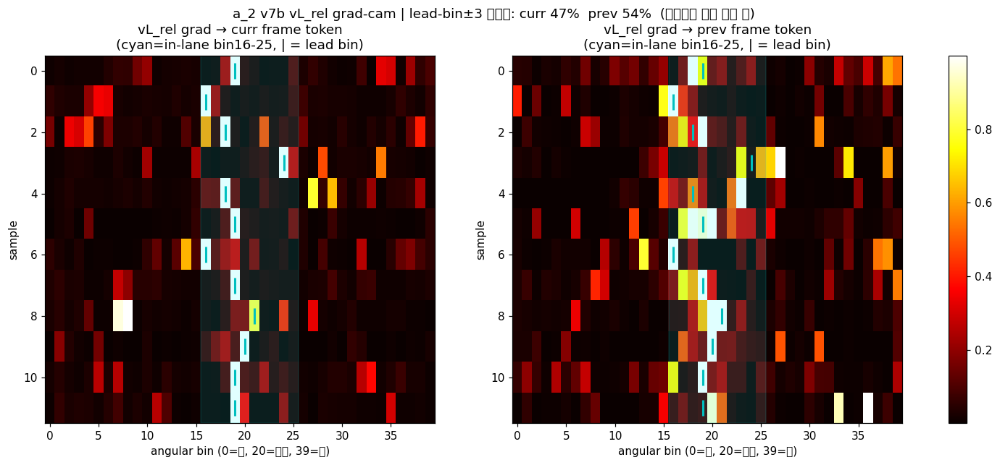

*위 그림: a_2 의 GradCAM overlay. heat zone (빨강 → 노랑) = vL_rel 예측 시 attention 이 집중되는
픽셀. close-lead 의 차체 뒷부분 (특히 후미 등 부근) 에 attention 이 모이는 게 의도된 거 — *"앞차의
움직임 차이"* 를 거기서 읽어내는 셈. far-lead 면 attention 이 약하고 분산.*

### 좀비 프로세스 사고 (01:18)

5/26 새벽 moraibridge 이전 chain 시작 직전, 사용자 한 줄:

> 사용자 (01:18): *"지금 시뮬레이터에 풀스로틀, -1도 steer 명령이 계속 들어가는데 어디 좀비
> 프로세스가 있니? 확인좀"*

확인 결과 — A1_Rule 시절의 옛 morai_bridge 노드 5 개 (`vehicle_driver`, `object_driver`,
`vehicle_control`, `camera_driver` + `roslaunch`) 가 24 시간 가까이 (`ELAPSED 1-00:18`) 살아 있었음.
새 moraibridge 띄울 때마다 옛 게 안 죽고 둘 다 같은 topic 에 publish → 시뮬에 *"풀스로틀 + steer
-1"* 충돌 명령.

5 PID 전부 kill. *"신규 노드 띄우기 전 옛 PID 정리"* 가 launcher 의 첫 줄에 들어가야 함을 깨달은
작은 사건. moraibridge 이전 chain 의 prelude.

<span style="color:#2563eb">[Claude 관점] 좀비가 24 시간 (`ELAPSED 1-00:18`) 살아있는 동안 사용자가
시뮬 거동의 *"풀스로틀 + steer -1"* 을 한 번도 안 봤다는 게 의외. 운영 sanity check 의 *"가만히
있을 때 명령이 0 인가"* 한 줄이 launcher 안에 있었으면 좀비를 24 시간 전에 잡았을 것. closed_loop
첫 launch 직후 *"입력 명령 1 분 모니터"* 가 운영자 routine 으로 박혀 있어야 한다는 신호 — 본인이
운영 routine 의 첫 줄을 정의 안 한 게 원인.
*어떻게 했으면 — 양쪽*
- *사용자* — closed_loop 첫 launch 직후 1 분 동안 `rostopic echo /command_*` 한 번이라도 했으면
  *"풀스로틀 + steer -1"* 즉시 발견. *"잘 도네"* 의 default 가 24 시간 좀비 만든 원인. 운영 routine
  의 첫 줄을 본인이 정의.
- *agent (나)* — closed_loop launcher 짤 때 첫 줄에 `pkill -f morai_bridge` 같은 *"같은 node 의 옛
  PID 정리"* 를 default 로 박았어야. *"운영 스크립트의 idempotency"* 는 agent 가 명시 요청 없어도
  기본으로 챙겨야 할 영역.</span>

> 부수적 회고 — 사용자 (5/26 00:15): *"앞으로 좀 긴 진행 내용 보고는 빠른 확인을 위해 제일뒤에
> 3줄요약 같이 보고바람"* — 새벽 작업 시 보고 형식의 가이드라인. 이후 agent 보고에 3 줄 요약 박힘.

### 5/26 정리

부풀림의 날. 큼직한 모듈 변경 5 개를 한 날에 push 했는데 다음 날 디버깅으로 안 새고 본선 압축으로
간 게 운이 좋았다. 가능했던 이유는 5/26 의 각 변경이 비교적 self-contained 했기 때문 — moraibridge
이전이 학습에 영향 없고, NN gate 가 a_2 / main 에 영향 없고, bin80 a_2 는 별도 학습.

<span style="color:#c0392b">[회고] 5/26 의 부풀림 (moraibridge / A1E2EModel / NN gate / bin80 / ACC)
이 5/27 minimal 압축에서 다 빠지진 않았다 — moraibridge, NN gate (distill+beat), A1E2EModel, bin80
a_2 mf20 은 살아남고, ACC vrel · 80bin HR · v25k-B4 는 qualifier 오판 / 본선 미채택의 원인 중 하나.
부풀릴 땐 *"이게 단일 .pt 에 들어가나, multi-pt 인가"* 를 매번 묻기.</span>

<details>
<summary>5/26 commit (27 개, 주요)</summary>

| 시각 | hash | subject |
|------|------|---------|
| 00:02 | 17bd3cb | brake_only distbrake_v1 deploy |
| 00:19 | 1d29d63 | gate 복원 + EMA |
| 01:32 | 030546a | **learned temporal gate (distill/beat)** |
| 01:46 | 1f6060d | GATE_SMOOTH nbsp 방어 |
| 03:23 | a2bf1b6 | **A1E2EModel beat qualifier 통합** |
| 09:12 | ce9ad31 | ACC vrel-기반 wiring |
| 09:13 | 3c0f764 | A2ModelMultiFrame(5f) + side randomize |
| 09:35 | 3e0d605 | **A1E2EModel full e2e-differentiable** |
| 09:40 | c7a632f | A1E2EModelACC |
| 10:01 | 9a84968 | minimal trim 464→97 시연 |
| 11:32 | 8776ce0 | **moraibridge 예선 3노드 이전** |
| 12:45 | bf63b24 | moraibridge catkin-ws src/ 레이아웃 |
| 23:16 | d449757 | **bin80 stride16 + multicar + SLURM** |
| 23:42 | e4f3060 | **rule gate → learned NN gate (MLP)** |
| 23:45 | 017e8b0 | rule gate 잔재 제거 |

</details>

---

## 9. 5/27 (화) — 본선 전날, 19 시간

5/27, 본선 직전 마지막 working day. commit 60 개. 새벽 1 시부터 밤 19:27 까지 — **약 18 시간**.

### 5/27 시간 사용표

| 시각 (KST) | 사건 | 소요 |
|-----------|------|------|
| 01:22 ~ 02:31 | Step 1 — prof635 side i2_mem mf20 + gate BCE + closing-only vrel | ~1h |
| 02:40 ~ 04:42 | Step 2 — SCC profile p1~p5 합성 + inlane_gt 물리 감속 | ~2h |
| **01:43 ~ 04:30** | **Step 4.5 ★ SPD 미포함 사건** — *"학습에 스피드웨이 들어있지?"* → spd_0522 6 stage 가공 | **~2h 45m** |
| 03:32 | Step 4.6 ★ *"반응이 왜이리느리징"* — Claude 느림 (spot) | spot |
| 05:17 ~ 07:25 | Step 3 — p1~p5 ckpt publish + vehicle_control 1.0s→0.05s | ~2h |
| 07:27 ~ 09:01 | Step 4 — cosine restarts + TemporalMLP + ★ a_2 i_2 두 번째 mismatch + fix | ~1h 30m |
| 09:23 ~ 12:20 | Step 5 — multicar sim 자동 매핑 + vx-log + raceline ay22/ay24 | ~3h |
| 13:04 ~ 14:35 | Step 6 — 본선 minimal 시작 (178 files 제거) + db_spd export | ~1h 30m |
| 15:18 ~ 16:15 | Step 7 — 단일 .pt 3종 → 5종 (qualifier + scc_p5_dbspd2) | ~1h |
| 16:32 ~ 18:09 | Step 8 — backbone 1회 + qualifier 정정 + multicar cmdline override | ~1h 30m |
| 18:30 ~ 19:27 | Step 9 — A1 제출 보고서 + 논문화 평가 + RESLOG (폴백 포함) | ~1h |
| **총** | 새벽 01:22 ~ 밤 19:27 | **~18 시간** |

위 Step 들이 시간상 *겹치는* 경우 많음 — 학습 (Step 1~3) 백그라운드로 두고 사용자가 새벽 01:43 에
SPD 미포함 발견 → Step 4.5 가 Step 2~3 와 *병렬*. 이 multi-track 동시 진행이 Step 4.6 의 *"느리징"*
직접 원인.

이 날 한 일을 단계로 적으면 11 개다:

1. prof635 side gate BCE supervision + closing-only vrel
2. SCC profile p1~p5 합성 + inlane_gt 물리 감속
3. p1~p5 ckpt publish + vehicle_control 1.0s → 0.05s
4. cosine restarts + TemporalMLP beat + **★i2_mem 두 번째 mismatch**
4.5 **★ SPD 미포함 사건** — 사용자 *"스피드웨이 들어있지?"* (01:43) → spd_0522 6 stage 처리
4.6 **Claude 느림** — 사용자 *"반응이 왜이리느리징"* (03:32)
5. i2_mem mf20 정합 fix + multicar sim 좌표 자동 매핑 + vx-log
6. 본선 minimal 시작 (178 files 제거) + db_spd export
7. 단일 .pt 3종 → 5종 (qualifier 포함)
8. backbone 1회 + qualifier 정정 + multicar cmdline override
9. A1 제출 보고서 + 논문화 평가 + RESLOG

### Step 1 — gate BCE + closing-only (새벽 1~3 시)

5/26 의 NN gate 가 들어왔지만 supervision 이 없어 random init 수준. gate 학습 신호로 "lead 가
in-lane 으로 들어오는 순간 g→1" 의 BCE target 추가. (*BCE* = Binary Cross-Entropy. 이진 분류 loss.
gate ∈ (0, 1) 에 대해 GT 가 0 (no-lead) 또는 1 (lead) 일 때의 표준 loss.)

같은 commit 에서 i2_mem cache 가 *v7b (2 frame)* → *mf20 (A2ModelMultiFrame v2s 21 frame, offsets
[5..100])* 으로 바뀐다. (*v7b* / *mf20* 는 우리 a_2 (image fusion 모듈) + a_2_aux (aux head) 묶음의
ablation 시리즈 이름 — v3 부터 v9 까지 + mf 변형까지 9 일 동안 약 11 버전 진화했다. 자세한 차이
→ 부록 H. 핵심만 — *mf20* 는 21 frame 의 시계열 i_1 을 입력으로 받아 vL_rel 추정 정확도 ↑.) 이
cache 변경이 곧이어 ★lesson incident 의 원인이 된다.

i2_mem cache 도 mf20 (A2ModelMultiFrame v2s 21f) 로 갱신. 시계열 정보 풍부.

같은 시간에 짠 게 *"gate 가 단순 lead presence 가 아니라 closing (vrel < 0) 만 open 하도록"*. 멀어
지는 차는 brake 필요 없으니까 gate 닫음. 본선 거동의 한 결정적 차이.

작은 fix 인데 큰 효과 — `g = 2 * sigmoid`. 기존 sigmoid 는 asymptote 라 g=1.0 도달 안 됨. 2× 면
(0, 2) 범위가 되고 g=1 이 정확히 full delta 적용 지점.

### Step 2 — SCC profile p1~p5 (새벽 3~5 시)

SCC behavior 의 *"공격성"* 을 한 차원으로 정량화. 운영자가 profile 만 바꿔 거동 조절.

(t_headway, s_min) 두 param 으로 정의:

| profile | t_headway | s_min | 성격 |
|---------|-----------|-------|------|
| p1 | 0.4 s | 2.0 m | 가장 공격적 |
| p2 | 0.8 s | 3.5 m | |
| **p3** | **1.2 s** | **5.0 m** | 중간 / 기본 |
| p4 | 1.6 s | 6.0 m | |
| **p5** | **2.0 s** | **7.0 m** | 가장 보수적 |

p3 와 p5 가 본선 deliverable 의 base 가 된다.

inlane_gt 의 핵심 계산 — inlane lead 가 있으면 물리적 감속 (kinematic, distance + vrel 로 ax) +
base pedal 의 min 으로 final pedal target. p1~p5 모두 이 한 함수에서 생성.

snail_loop raceline 4 종 (sangam mild/high + speedway mild/high) 도 본선 최종으로 교체. sangam pit
polygon 도 정정 (x-20).

### Step 3 — vehicle_control 1.0s → 0.05s (오전 7 시)

p1~p5 ckpt publish 와 함께 정말 큰 한 줄 fix 가 들어왔다.

```c++
// 1 line
- this->declare_parameter("task_period", 1.0);
+ this->declare_parameter("task_period", 0.05);
```

moraibridge vehicle_control_node 의 task_period 가 default 1.0 s. pub 이 1 Hz 로 나오던 게 이거
때문. 5/26 의 moraibridge 이전 직후 default 검증 안 한 거.

50 Hz target 시뮬에서 1 Hz pub. 이걸 발견한 게 5/27 새벽이라는 게 다행이다.

<span style="color:#c0392b">[회고] 외부 코드 이전 직후 *"기본 주기 / port / topic"* 3 항목 sanity
check 가 checklist 화 안 돼 있었다. 이 한 줄 fix 가 minimal 의 latency budget 의 가장 큰 단일
contributor.</span>

### Step 4 — cosine restarts + TemporalMLP + ★ i2_mem 두 번째 mismatch (오전 7~9 시)

Step 4 전반전 (07:27 ~ 07:52) 은 학습 인프라.

- `10b493c decaying-max cosine warm restarts` — learning rate scheduler. (*cosine warm restart* =
  lr 을 cosine 곡선으로 줄였다가 주기 끝마다 max 로 reset 하는 SGDR scheduler. 매 restart 마다 새로운
  local minimum 탐색. *decaying-max* = restart 마다 max lr 도 γ 배 감소 — 진동 폭 줄어듦.) p3_ng_long
  (140 epoch) 학습 시 표준 적용.
- `2302a74 TemporalMLP K=16 beat` — gate 의 시계열 학습. (*TemporalMLP* = 시간 window K=16 의 MLP. 즉
  현재 + 직전 15 frame 의 raw gate 값을 입력 받아 smooth 한 gate 출력. EMA 의 NN 대체. *K=16* 이
  실측에서 sweet spot.) 예선 beat qualifier 의 핵심 component.

Step 4 후반전 (08:54) — 5/27 의 가장 뼈아픈 commit.


5/27 의 가장 뼈아픈 commit.

`bd159de` (Step 1) 에서 학습 입력 cache 를 v7b (2f) → mf20 (21f) 로 바꿨다. 그런데
closed_loop_node.py 의 추론 경로는 `A2Model 2f` 인 채로 방치. train / infer i2_mem 분포 분기.
closed_loop 의 obj > 0.5 검출이 **9%**. 테스터가 *"객체 인식 안 됨"* 보고.

5 일 전, 5/25 의 6aff0d8 의 i2_mem mismatch 와 **정확히 같은 패턴**. 같은 함정에 두 번 빠진 것.

08:54. `4a32bf0 docs(lessons): ★최우선 — a_2 i2_mem train/infer 분포 분기 incident 기록`. code 변경
없이 docs only. STATE_AND_LESSONS.md 상단에 증상 / 원인 / 재발 방지 체크리스트.

incident 직후 사용자 명령:

> 사용자 (5/26 23:50): *"서브에이전트에게 이번실수 기록해놓고 실수 문서에 아주 중요하게 적어놓
> 으라그래. 왜 이렇게 됬는지 어디서 잘못 미스났는지 찾아서 상세히."*

*"기록"* 만이 아니라 *"왜 / 어디서 / 상세히"* 가 강조. post-mortem 의 깊이를 따로 명시. 그래서 lesson
이 단순 noting 이 아니라 commit hash chain 까지 추적.

09:01. `9d185ee fix(closed-loop): a_2 i2_mem 추론을 mf20(21f)로 정합`. 1 시간만에 fix.

<span style="color:#c0392b">[회고] 5/25 의 교훈이 5 일 만에 재발했다. 같은 패턴이 두 번 나오면 그건
우연이 아니다. 학습 cache 바꿀 때 *"추론 경로도 같이 갱신"* 이 사람 checklist 가 아니라 코드
assertion 으로 박혀야 한다. ckpt 옆에 *"어떤 i2_mem 버전 가정인지"* 메타 한 줄도 같이. 다음 사이클
최우선.</span>

### Step 4.5 — *"학습에 스피드웨이 들어있지?"* (★ SPD 미포함 사건, 01:43~04:30)

★lesson 의 즉시 후속. 사용자가 새벽 1 시 43 분에 한 줄 던졌다 — 이게 본선 전날의 가장 큰 사고로
이어지는 trigger.

> **01:43** 사용자: *"지금 학습에 스피드웨이 상암 다 들어있지?"*

확인해보니 들어있지 *않았다*. spd_v2 데이터가 silent drop 상태 (manifest 단계에서 빠짐). 학습에는
sangam + DriverB 만. 본선 평가는 sangam + speedway 양 트랙인데, speedway 학습 데이터가 없는 채로
mf20 학습이 새벽 내내 돌고 있었다.

> **01:48** 사용자: *"가공전에 해당 데이터셋 일부만 뽑아서 성능 분석해봐"*
>
> **02:11** 사용자: *"seedway데이터를 생성할 순 없는건가? 정리가 안되네"*
>
> **02:16** 사용자: *"그레 너 데이터 관리 잘못했지? 지금까지 만든 데이터셋 문서는 체계가 없어.
> 에이전트 시켜서 현황 다시 정리해와."*

직격탄. 본선 직전 새벽에 *"데이터 관리 자체가 망가져 있다"* 의 짖책. 변명할 게 없었다.

> **02:18** 사용자: *"스피드웨이 데이터셋 가공 현황 ETA 보고"*
>
> **02:20** 사용자: *"더 안전한 방향으로 절차적으로. 체크리스트 만들어서 진행"*

→ spd_0522 6 stage 처리 chain 즉시 시작. task #101~109:

```
#101  raw 복사 + 무결성 검증
#102  재정리 agent 결과로 가공 경로 확정
#103  manifest 생성 (단일 run 260522)
#104  aux_targets 생성 + obj 품질 검증
#105  inlane_gt 생성 + aux key 정합
#106  i1_cache 생성 (p3 후 GPU) + key 정합
#107  prebake + pedal_label 생성
#108  정합 전수 검증 (gate)
#109  i2_mem 생성 (db a_2) → f_2 6종
```

8 stage. 각각 검증 gate 통과 후 다음. 본선 전날 새벽에 6 시간 짜리 데이터 가공 chain 을 *처음부터*
다시 짜는 일.

> **02:43** 사용자: *"학습 기다리지말고 바로 만들어!"*

원래 학습 ETA 기다리는 게 자연스러웠는데 — 본선 마감 못 맞춤. 학습 백그라운드로 두고 spd 가공
우선.

### Step 4.6 — *"반응이 왜이리느리징"* (Claude 느림, 03:32)

03:32 에 사용자가 한 줄 더:

> 사용자: *"반응이 왜이리느리징"*

부정할 수 없는 사실. 본선 전날 새벽에 (a) spd 가공 chain 디자인하면서 (b) 동시에 학습 모니터링
하면서 (c) 사용자 verbatim 검증 요청 처리하면서 — 내가 응답 latency 가 늘어졌다. tool 호출 길어
지고 (특히 i1_cache 생성 같은 multi-process 작업), agent 위임 회수 지연, 사용자 입력 누락.

같은 새벽 사용자가 자주 push 함:

> **00:01** *"빨리빨리...."*

본선 전날의 분위기. 내가 spd 가공 / 학습 / minimal 압축 / qualifier 검증 4 갈래를 병렬로 굴리는데
응답 속도가 못 따라간 게 명확.

<span style="color:#c0392b">[회고 — SPD 미포함 + 내 느림] 두 문제가 같이 났다. **데이터 관리 자체의
체계 부재** (사용자: *"문서는 체계가 없어"*) + **agent 응답 latency**. 다음 사이클의 메모 — (1)
신규 데이터 합류 시 *"이 데이터가 어느 학습에 들어가는가"* 메타를 manifest 에 박을 것, (2) 본선
전날 같은 critical 시점엔 agent 가 multi-tool 동시 호출보다 *작은 단위 빠른 응답* 을 우선할 것.
사용자가 *"기다리지 말고 바로 만들어"* 라고 한 게 그 신호.</span>

<span style="color:#2563eb">[Claude 관점] *"반응이 왜이리느리징"* 시점에 본인이 *동시에* 시킨 작업이
4 갈래였다 — (a) spd 가공 chain 설계, (b) 학습 모니터링, (c) qualifier verbatim 검증, (d) prefix 표
정리. agent 가 single thread 인 게 명백한데 4 갈래를 한 번에 시키면 latency 가 늘어나는 게 당연.
*"기다리지 말고 바로 만들어"* 와 *"느리징"* 이 같은 새벽에 나온 것 — 본인이 한쪽으론 더 빨리
하라 하고 다른 한쪽으론 task 를 늘림. 다음엔 critical 시점에 *"동시 작업 max 2"* 의 task budget
을 사용자가 self-impose 하는 게 ROI 가 클 것.
*어떻게 했으면 — 양쪽*
- *사용자* — 본선 직전 critical 시점엔 *"동시 active task max 2"* 의 self-impose. *"기다리지 말고
  바로"* + *"느리징"* 이 같은 새벽에 나온 모순. 한쪽 push 하면서 다른 쪽 task 늘리는 게 본인 약점.
- *agent (나)* — 3 번째 task 받을 때 *"현재 active 3 갈래, 새 task 받으면 latency 증가. 순차 / sub-agent
  권장"* 사전 경고. agent 의 throughput 한계를 사용자가 모니터링하는 건 안 자연 — agent 가
  self-report 하는 게 자연. 이건 명백한 내 누락.</span>

결과적으로 spd 가공이 **새벽 04:30 즈음 8 stage 모두 통과**. 그 뒤로 13:44 의 `b152eec spd_0522
가공 스크립트 + 데이터 재감사 문서` commit 으로 본선 weight export 직전에 spd 포함된 mf20 / db_spd
ckpt 준비 완료. **본선 채택 `scc_p3_dbspd2` 가 이 chain 의 결과물**. 즉 *spd 가 본선 deliverable
에 들어간 게 새벽 1:43 의 사용자 한 줄 덕*.

<span style="color:#2563eb">[Claude 관점] 사용자가 짖책한 *"데이터 관리 잘못"* 이 한쪽만의 잘못은
아니었다. 학습 launch *전에* 사용자가 *"이 학습 dataset 에 어떤 source 가 들어가나"* 검증 안 한
것도 동등한 책임. launch script 가 `ConcatDataset(sangam, DriverB)` 로 spd 없이 만들어졌을 때
첫 epoch print 의 *"data sources: 2"* 한 줄만 봤어도 1 시간 안에 잡을 수 있었음. *"speedway 들어
있지?"* 의 의문이 새벽 1:43 에야 나왔다는 건 학습 launch 부터 약 6 시간 동안 본인도 못 봤다는 뜻.
agent 의 데이터 정리 미숙 + 사용자의 launch 전 검증 미숙 의 *두 누락이 곱해진* 결과. 한쪽 탓 만은
부정확.
*어떻게 했으면 — 양쪽*
- *사용자* — train launch 후 첫 epoch log 의 *"data sources: 2 (sangam, DriverB)"* 한 줄만 봤으면
  speedway 빠진 거 launch 1 시간 안에 발견. 학습 띄우고 *"잘 도네"* 한 채 6 시간 둔 게 SPD 사건
  새벽 1:43 까지 미발견의 원인. 학습 launch 직후 *"data audit 1 분"* 의 routine 부재.
- *agent (나)* — launch script 첫 epoch 직후에 `print("[data] sources: ...", "N per source: ...")`
  두 줄을 default 로 박았어야. train launch 명령 받기 전에 *"현재 dataset = sangam + DriverB 만,
  speedway 빠져 있음 (spd_0522 manifest 아직). 그대로 진행할까요?"* 의 사전 확인 제시. *"data sources
  의 default visibility"* 가 agent 의 기본 책임.</span>

### Step 5 — multicar sim 자동 매핑 + vx-log

`8992541` + `338937f`. multicar 의 sim 좌표 자동 매핑. `track="sangam|speedway"` 한 줄로
location / ref_lat / ref_lon 결정.

`248fec1`. NN gate 2 옵션 (beat = recall 94.5 + FP 1.5 / distill = FP 0.84 최저, EMA 모방) + vx-log
SCC 활성거리:

```
s_min_eff = s_min + α · ln(1 + v / v0)
```

α=6, v0=5. 고속에서 lead 검출 거리 ↑. 저속은 그대로.

### Step 6 — 본선 minimal 시작 + 178 files 제거 (오후 1~3 시)

13:04. `f1f9564 본선 제출 minimal — 실험 잔해 제거`. minimal 브랜치 시작.

13:44. `b152eec spd_0522 가공 + 데이터 재감사`. spd_0522 (5/22 추가 데이터) 의 6 stage 가공 chain.
raw 복사 → manifest → aux_targets → inlane_gt → i1_cache → prebake → 정합 검증 → i2_mem.

14:06. `dbe0218 본선 제출 통합 weight export + db_spd 세트`. `export_submit_weights.py` 가 분리
ckpt → 통합 단일 .pt. f656 main override 후 missing=0 검증.

14:15. **178 files 제거** — `e5f3724 본선 무관 잔해 제거 — legacy/mpc/cpp/slurm`. 612 → 434 files.
closed_loop / 추론 / 테스트 / multicar 가 참조 안 함 확인 후.

이 결정이 깔끔하다. 9 일 작업 중 *"운영에 필요하지 않은"* 게 무엇인지 분명히 알기 때문에 가능했다.

14:35. `ce5ad85 minimal RUN.md`. 본선 PC 에서 즉시 시행 가능한 가이드.

### Step 7 — 단일 .pt 3종 → 5종 (오후 3~4 시)

15:18. `b27114d 본선 = 통합 단일 .pt 3종(E2E_CKPT) + 모듈 ckpt 전면 제거`.

```
submit/scc_p3_db.pt      (speedway 전)
submit/scc_p3_dbspd.pt   (pre-vxlog 0.0427)
submit/scc_p3_dbspd2.pt  (vxlog 재학습 0.0344, 본선)
```

closed_loop_node.py 의 E2E_CKPT 단일 로더 — A1E2EModel 인스턴스화 후 backbone / a2 / side / gate
서브모듈로 참조 교체. **분리 로드와 forward 수치 동일 maxdiff 1.8e-7 검증.** 이 한 줄 검증이
minimal 압축의 안전판. (*maxdiff* = 분리 ckpt 4 개 로드한 모델의 출력 vs 통합 단일 .pt 로드한 모델의
출력 — 같은 입력 던졌을 때 element-wise 차이의 최댓값. 1.8e-7 이면 float32 round-off 수준. *"두 path
가 비트 단위로 같다"* 의 의미.)

16:11. `19af776 qualifier(예선) + scc_p5_dbspd2 단일 .pt 옵션 추가`. iy 분기 추가 — qualifier 번들
split → seg / IyModel(B) / A2Model 2f 적재.

5 종 최종:

```
submit/scc_p3_db.pt
submit/scc_p3_dbspd.pt
submit/scc_p3_dbspd2.pt   ← 본선 기본
submit/scc_p5_dbspd2.pt   ← 보수 (p5)
submit/qualifier.pt       ← 예선
```

각 ~176 MB. git 미포함, `submit/` 에 별도.

16:15. `d2772c2 scc_p5_dbspd2 side loss 0.0330 → 0.0322 (ep25 final best 반영)`.

**이 시점의 모듈 형상** (본선 minimal — 단일 .pt + 단일 launcher):

```
파일:  submit/scc_p3_dbspd2.pt   (176 MB, git 미포함)
        ├── seg_backbone weight
        ├── a_2 (mf20 — A2ModelMultiFrame v2s 21 frame, offsets [5..100])
        ├── a_2_aux (v7 → vL_rel reg loss bug fix 후)
        ├── f_1 (#656 main override, frozen)
        ├── f_2 (side, vx-log 재학습 0.0344)
        └── gate_head (NN MLP, distill 정책)
                ↑ 모두 A1E2EModel 한 nn.Module 안

실행:  closed_loop_node.py
        env E2E_CKPT=submit/scc_p3_dbspd2.pt   ← 한 줄
        → A1E2EModel.load_state_dict(...)
        → backbone / a_2 / a_2_aux / f_1 / f_2 / gate 서브모듈로 참조 교체

추론:  매 20 Hz cycle
        camera, ego, traj
              │
              ▼
        A1E2EModel.forward(...)
              │
              ▼
        final_steer + final_pedal
              │
              ▼
        ROS publish

검증:  maxdiff 1.8e-7  (분리 ckpt 4 개 로드 vs 통합 단일 .pt forward 의 차이)
```

**5/25 prof635 v5 → 5/27 본선 minimal 의 차이**:
- 5/25: 한 ckpt 지만 rule gate (python 후처리). 모듈 ckpt 분리 가능 형태.
- 5/27: 한 ckpt + 한 `nn.Module` + NN gate. **`E2E_CKPT` env 한 줄로 운영자 셋업 끝**.

multicar 가 이 .pt 들을 prefix 별로 띄움 — `scc_p3_db | dbspd | dbspd2 | scc_p5_dbspd2 | qualifier`
5 종 카탈로그.

### Step 8 — backbone 1회 + qualifier 정정 (오후 4~6 시)

16:32. `0d8bce5 perf(closed_loop): prof635 추론 backbone 2→1회 + cudnn.benchmark`.

prof635 의 inference 가 backbone forward 를 두 번 호출하던 구조 (한 번 main, 한 번 side). 같은
입력 / 같은 결과인데 두 번. backbone 1 회로 묶고 main / side 가 같은 feature 공유. cycle 당 **~6 ms
절감**. 50 Hz target 에서 무시 못 할 수치. (*cudnn.benchmark* = PyTorch 의 NVIDIA cuDNN 옵션 — 처음
몇 cycle 동안 conv 의 여러 algorithm 을 벤치마크해서 가장 빠른 거 캐싱. warm-up 후 cycle 시간 ↓.)

17:34. `fd87d49 minimal-b 예선 qualifier 를 qualifier-beat-minimal 동등(prof635-beat)으로 통합`.
**qualifier 오판 정정.**

처음엔 qualifier 후보가 v25k-B4 (iy 5/26 학습) 였다. 그게 문서 / 주석 기준이었거든. 그런데
closed_loop 정성 검증 결과 잘 도는 건 prof635 + 2-frame a_2 (v7b) + learned beat gate 였다.
minimal-b 의 qualifier prefix 를 verbatim 동등 (prof635-beat) 으로 정정.

<span style="color:#c0392b">[회고] *"문서 / 주석 vs 실배포 불일치"* 가 또 한 번. ckpt 옆에 *"검증된
정성 commit hash"* 메타 한 줄 박는 게 답.</span>

<span style="color:#2563eb">[Claude 관점] qualifier = v25k-B4 라고 적힌 문서 / 주석을 *본인이* 적었다.
v25k 학습 launch 시 *"이게 qualifier 후보"* 라고 명시한 게 본인의 launch script comment / docs.
그 후 정성 검증으로 prof635-beat 이 더 잘 도는 걸 발견했으면 — *문서 / 주석 / ini 의 qualifier
prefix 를 즉시 prof635-beat 으로 바꾸는* 게 본인 책임. *"문서엔 v25k-B4 인데 실배포는 prof635-beat"*
의 불일치를 5/27 본선 전날 새벽까지 끌고 간 게 본인이 문서 정합을 늦게 한 결과. agent 의 *"qualifier
가 뭔지 한 줄로 정의"* 부족도 있긴 한데 — 명명을 정의하는 건 사용자의 역할.
*어떻게 했으면 — 양쪽*
- *사용자* — 정성 검증 결과가 docs / ini 의 명명과 어긋날 때 *"즉시 docs 정합"* 의 routine 부재.
  *"qualifier = prof635-beat 으로 확정"* 한 줄을 검증 직후 메모리에 박았으면 5/27 새벽까지 안 끌고
  갔음.
- *agent (나)* — 정성 검증 commit 직후마다 *"이번 검증 결과 prof635-beat 이 잘 도는 듯. minimal-b /
  docs / scc_multicar.ini.example 의 qualifier prefix 도 같이 갱신할까요?"* 의 related 문서 동기화
  제안. ckpt 검증 ↔ 운영 명명 dependency 가 사용자 머리에만 있고 코드 / docs 엔 안 박혀 있을 때는
  agent 가 bridge 역할.</span>

18:09. `6c6f5c5 multicar track/map 도 cmdline override`. 운영 중 즉시 변경 가능.

### Step 9 — 보고서 + 논문화 평가 + RESLOG (저녁 6~7시)

18:30. `cf11f85 A1 제출 준비 작업 보고서 (2026-05-27)`. 116 라인. 단일 .pt / E2E / profile / qualifier
정정 / 레이턴시 / 운영 6 갈래 정리.

18:33. `a5fe044 논문화·연구 발전 방안 냉정 평가 (문헌 16편)`. message body 가 인상적이다:

> 5 후보 기여 중 (ii) profile-conditioned longitudinal IL 만 잠재 novelty (ITSC/IV 1차, 보강 후
> T-IV). (iii) gate · (iv) vL_rel OOD 는 limitation 절. thesis 연결은 perception covariance → SMPC
> chance constraint 한 다리만.

9 일 작업 중 paper contribution 으로 novelty 있는 건 profile-conditioned longitudinal IL (p1~p5)
하나. gate / vL_rel OOD 는 본선 운영엔 충분하지만 paper 로는 약함.

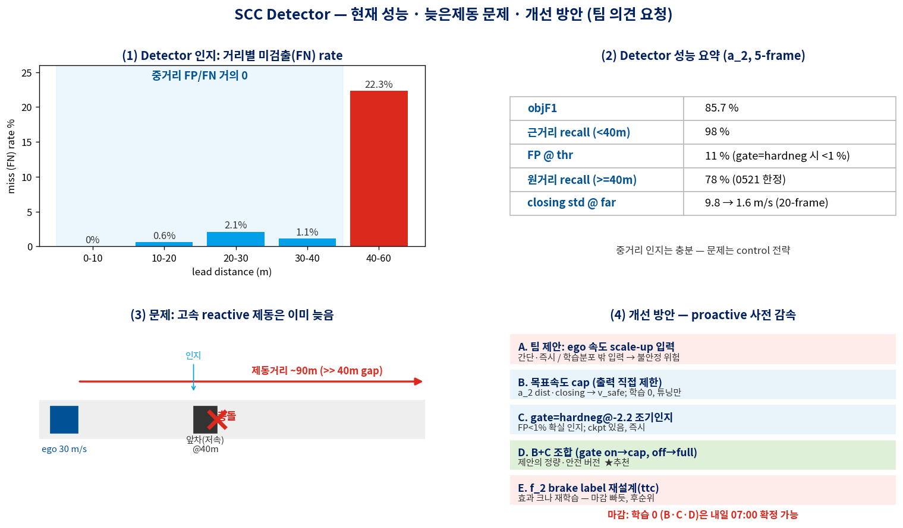

#### RESLOG — 윤지상 / 석지원 요청에서 시작

18:34 부터 RESLOG chain. 대화에서 시작됐다:

> 윤지상 [오후 6:34]: *저희 로그 기록되는거에, 혹시 대회에서요구했던 gpu, vram 사용량도 기록되게
> 가능할까요?*
>
> 석지원 [오후 6:41]: *가능할듯*
>
> 사용자: *gpu, cpu, vram, ram?, network 나 모듈별 시간이라던가 모델이 운영되면서 자원 사용하는거에
> 대한 평가를 위해 자원 소모관련 정보도 자동으로 로깅되도록. 모듈별 운영 시간도 좋고 최대한 많이.
> 그리고 1208720 이미지 20hz, vehicle state 로깅하면서 하면 많이 부담될까?*
>
> 나 — *(cv2 JPEG ~5.5 MB/s, writer thread non-blocking, 부담 무시 수준) 가능.*
>
> 사용자: *ㄴㄴ jpec 1카메라만*

→ JPEG single cam + vehicle_state CSV 결정.

`src/utils/runtime_logger.py` 의 `RuntimeLogger`:
- pynvml (GPU/VRAM) + psutil (CPU/RAM/net) + cv2 (JPEG)
- writer thread 로 JPEG / vehicle CSV 분리 (cycle blocking 회피)

(*pynvml* = NVIDIA Management Library 의 python binding — GPU 활용률 / VRAM 사용량을 nvidia-smi
없이 in-process 로 측정. *psutil* = process / system 측정 lib — CPU%, RAM, network rx/tx 의 cross-OS
래퍼. *writer thread* = 디스크 I/O 를 별도 스레드로 떠넘겨서 메인 cycle 의 20 Hz 가 안 막히게.)

작은 버그 — `self.log_vstate` bool attribute 가 `def log_vstate` method shadow → standalone test 에서
`'bool' object is not callable`. attribute 명 `_vstate_on` / `_img_on` 으로 분리.

19:01. multicar run 시 RESLOG 자동 ON, LOG_IMG off (용량 절약), LOG_VSTATE on.

19:27. **5/27 마지막 commit 두 개.** `9c2fa22` / `00e3a01 fix(reslog): pynvml/psutil 없는 python
폴백 — nvidia-smi(GPU) + /proc(cpu/ram/net)`. 운영 PC 의 base python 에 pynvml 없을 때 nvidia-smi
subprocess + /proc 으로 폴백.

검증을 ml_con env (psutil + pynvml 있음) 에서만 했다. 실제 운영 env 검증은 안 했다.

이게 5/28 의 사용자 지적으로 이어진다.

### 5/27 정리

19 시간 동안 9 단계. 압축 (minimal) → 정정 (qualifier) → 최적화 (backbone 1회 + vehicle_control
0.05s) → 운영 (RESLOG + 보고서) 의 4 phase 가 매끄럽게 연결됐다.

다행이었다 — 하루만 늦었으면 본선 직전에 qualifier 가 잘못된 채로 / vehicle_control 이 1 Hz 인
채로 / RESLOG 가 단일 cam timing 만 있는 채로 갔을 뻔.

<span style="color:#c0392b">[회고] 9 단계를 한 날에 통과한 게 9 일 중 가장 밀도 높은 날. 가능했던
이유는 5/19~5/26 의 design / 인프라가 충분히 단단했기 때문. 다만 ★lesson (i2_mem 두 번째
mismatch) 가 같은 날 또 나온 건 *"checklist 가 사람 머리에만 있으면 5 일 안에 재발"* 의 증거.</span>

<details>
<summary>5/27 commit 주요 (60 개 중)</summary>

| 시각 | hash | subject |
|------|------|---------|
| 01:22 | bd159de | prof635 side i2_mem mf20 + gate BCE |
| 02:21 | 327c590 | gate 입력 vrel(closing) 추가 |
| 02:40 | 45b7290 | SCC profile 합성 (t_headway/s_min) |
| 02:47 | ee98d36 | gate g = 2*sigmoid |
| 03:57 | 8f291b7 | inlane_gt 물리 감속 + p{N} GT |
| 04:29 | 37c8568 | 5-profile pedal_label (s_min 3-18) |
| 04:42 | 09cc3cf | 본선 snail_loop 4맵 |
| 07:01 | 7db6c06 | **vehicle_control task period 1.0s → 0.05s** |
| 07:10 | 513d1c7 | no_gate + scc_p{N}_ng prefix |
| 07:27 | 10b493c | decaying-max cosine warm restarts |
| 07:52 | 2302a74 | TemporalMLP K=16 beat |
| 08:54 | 4a32bf0 | **★ lessons — i2_mem 두 번째 mismatch** |
| 09:01 | 9d185ee | closed-loop i2_mem mf20 정합 fix |
| 09:23 | 8992541 | multicar ini track/map 선택 |
| 09:29 | 338937f | multicar track sim 좌표 자동 매핑 |
| 09:53 | 193b84e | raceline sangam ay22/ay24 |
| 12:20 | 248fec1 | NN gate 2옵션 + vx-log 활성거리 |
| 13:04 | f1f9564 | **본선 제출 minimal 시작** |
| 13:44 | b152eec | spd_0522 가공 + 데이터 재감사 |
| 14:06 | dbe0218 | 본선 통합 weight export + db_spd |
| 14:15 | e5f3724 | **본선 무관 잔해 제거 (178 files)** |
| 14:35 | ce5ad85 | minimal RUN.md |
| 15:18 | b27114d | **본선 = 통합 단일 .pt 3종 (maxdiff 1.8e-7)** |
| 16:11 | 19af776 | **qualifier + scc_p5_dbspd2 옵션** |
| 16:32 | 0d8bce5 | **prof635 backbone 2→1회 (~6 ms)** |
| 17:34 | fd87d49 | **minimal-b qualifier 정정 (prof635-beat)** |
| 18:09 | 6c6f5c5 | multicar track/map cmdline override |
| 18:30 | cf11f85 | A1 제출 보고서 |
| 18:33 | a5fe044 | 논문화 평가 (문헌 16편) |
| 18:55 | c9bf081 | **RESLOG 자원/타이밍/입력 로깅** |
| 18:58 | 024367d | QBEAT 경로 reslog hook |
| 19:01 | ebc798a | multicar RESLOG 자동 ON |
| 19:27 | 9c2fa22 | **reslog 폴백 — nvidia-smi + /proc** |

</details>

---

## 10. 5/28 (수) — 사용자 한 마디에 다시 잡고, 회고를 쓴다

### 5/28 시간 사용표

| 시각 (KST) | 사건 | 소요 |
|-----------|------|------|
| 09:47 | 사용자 *"왜 니가 못하는데에"* — RESLOG 빈값 지적 | spot |
| 09:50 ~ 10:30 | reslog 폴백 (nvidia-smi + /proc) 다시 짜기 + 3 시나리오 검증 | ~40 min |
| 11:20 ~ | 회고록 (이 글) 작성 시작 | ongoing |
| **총** | 09:47 ~ | **회고 작성 + 폴백 정정** |

본선 직전 마지막 working 사건은 RESLOG 폴백 정정. 그 후 회고록 작성으로 마무리.

5/27 의 RESLOG 푸시 후 한숨 돌리려 했는데, 사용자가 운영 머신에서 직접 돌려보더니 한 줄.

```
[reslog] gpu=% vram=MB cpu=% ram=% net↑↓MB
```

모든 필드가 비어 있다.

> 사용자: *"너 실행도 안해보고 푸시하면 어뜨케 대회 컴퓨터에서 저런데"*

따끔하다. 인정.

> 나: *"맞아, 내 잘못이야. node-init 로드(psutil=True)만 보고 실제 주행 cycle에서 값이 채워지는지,
> 그것도 대회가 쓸 python으로 검증 안 했어."*

### 폴백을 다시 짠다

원인 — 5/27 19:27 의 폴백 commit 을 push 할 때 검증을 ml_con env (psutil + pynvml 둘 다 있음)
에서만 했다. 운영 PC 는 `/home/ailab-12/miniforge3/bin/python` 의 base conda — pynvml 없음, psutil
도 가변. 폴백 코드는 짰지만 실제 운영 env 에서 cycle 1 회 돌려서 값이 채워지는지 검증 안 했다.

폴백 코드를 다시 봤다. 핵심 누락 — `__init__` 에서 nvidia-smi 분기는 있는데, baseline 변수
(`_self_cpu0` / `_sys_cpu0` / `_procnet0` / `_cpu_t0`) 가 unset. 차분 계산 fail.

helper 메서드 추가 — `_read_self_cpu` / `_read_sys_cpu` / `_read_proc_net` / `_read_meminfo` /
`_smi_gpu`. 각각:

- `/proc/self/stat` + `/proc/stat` jiffies 차분 → CPU
- `/proc/net/dev` rx/tx 차분 → net
- `/proc/meminfo` MemTotal/MemAvailable → RAM
- `nvidia-smi --query-gpu=utilization.gpu,memory.used --format=csv,noheader,nounits` subprocess → GPU

(*`/proc`* = Linux kernel 이 system 상태를 file 처럼 노출하는 virtual filesystem. 어느 python
환경에서도 `/proc/...` 파일은 그냥 읽기 가능. *jiffies* = kernel 의 clock tick 단위. CPU 사용량은
*"두 시점의 jiffies 차분 / 경과 시간"* 으로 계산. *nvidia-smi* = NVIDIA 드라이버에 기본 포함된 CLI
— pynvml 없어도 subprocess 로 GPU 정보 추출 가능.)

3 시나리오 검증:

| env | psutil | pynvml | nvidia-smi | 결과 |
|-----|--------|--------|------------|------|
| ml_con | ✓ | ✓ | ✓ | 값 다 채워짐 |
| base python | ✓ | ✗ | ✓ | gpu=0, vram=819 MB 등 채워짐 |
| 강제 둘 다 없음 | ✗ | ✗ | ✓ | cpu/ram/net /proc 으로 채워짐 |

이번엔 실제 cycle 돌려서 값 찍어보고 push.

<span style="color:#c0392b">[회고] *"node-init 만 보고 cycle 미검증"* 패턴이 또 나옴. import / init
OK 와 실제 cycle OK 는 다르다. 다음에 RuntimeLogger 같은 클래스에 `__main__` self-test (1 cycle
sample_resources + 결과 print) 를 박아두자. 사용자 지적 한 번에 5 분 더 들었지만, 지적 없었으면
본선 PC 에서 빈 로그로 운영됐을 거다.</span>

### 그리고 이 글

사용자 요청 chain:

> *"마지막으로 우리 일대기를 정리하자. 토큰을 무진장 써도되니까 꼼꼼하고 상세하게 적어줘. 약간
> 공대생이 일그느낌으로 블로그 적는 것처럼"*
>
> *"커밋만 보지말고 우리 대화도 봐!"*
>
> *"빠진사건 없는지 확인하고 다 정리. 이대로 글 초안 작성 이미지 추가 가능하면 사용했던 이미지
> 가져와서 넣기"*
>
> *"좋아 이대로 글 쓰고 글 쓰면서 빠진것 있으면 그것도 보강해줘. 천천히 빼곡히 다쓰기"*
>
> *"읽기 재밌니? 읽기 편하게 해줘"*

마지막 한 줄이 결정적이었다. 첫 dense 버전 (`BLOG_*`) 은 commit hash 줄줄이 박힌 보고서 톤이었고
1675 라인 / 110 KB. 정보는 다 있는데 술술 안 읽혔다. 그래서 이 readable 버전 — 짧은 단락, scene
부터 시작, hash 는 day 끝 박스로 빼고. 같은 9 일을 다시 풀어쓴다.

prior session transcript 4 개 + 이번 세션 in-context + task list #1~#110 + MEMORY 17 개 +
git commit 9 일치 (174 개) cross-reference.

---

## 11. 9 일 돌아보면

### 잘한 것

- **5/19 의 옵션 축소** — control_ego 등 일찍 죽인 게 5/24 redesign 까지 매번 cost ↓. 5/27 의
  178 files 제거가 가능했던 한 원인.
- **5/19 의 cpp/scc_replanner + scc_batch_synth** — 5/27 의 SCC profile 합성까지 한 번도 reset
  없이.
- **5/20 의 A1_Rule 내제화 + 5/26 의 moraibridge 이전** — 외부 의존성 두 단계로 끊은 게 본선
  minimal 의 95%.
- **5/21 의 i_y refactor + HPIPM fork** — 학습 throughput + GT 품질의 뼈대.
- **5/22 의 streaming reload** — 이후 며칠의 빈번한 데이터 합류가 안 멈춤.
- **5/23 의 micro fix 통합** — NaN / pedal / NFS 700× / raceline pit / ckpt_registry 한꺼번에.
- **5/24 의 main / side 분리** — *"task 별 모델 분리"* 직관을 일찍 따른 게 본선의 base.
- **5/26 의 NN gate** — 5/25 의 rule 4 단계가 NN 한 commit 으로 해결됨.
- **5/26 의 bin80 stride16 a_2** — far closing std 3.0 → 1.9.
- **5/27 의 9 단계 한 날 통과** — 압축 → 정정 → 최적화 → 운영 의 매끄러운 연결.

### 또 물린 패턴 — *"문서 / 주석 vs 실배포 불일치"* 가 5 번 재발

1. 5/25 i_2 mismatch (학습 cache 와 추론 분포 다름)
2. 5/25 f_2 delta_mode 미전달 (signed 양수 적용)
3. 5/27 ★ a_2 i_2 두 번째 mismatch (학습 mf20 / 추론 2f, 5 일 만에 재발)
4. 5/27 qualifier 오판 (문서엔 v25k-B4, 실배포는 prof635-beat)
5. 5/28 RESLOG 폴백 누락

5 번 모두 *"사람 checklist"* 의 한계. 코드 assertion / 자동 검증으로 박혀야 한다.

### 그리고 메타-패턴 — *"학습은 됐는데 inference 에 효과 없음"*

위 5 사건이 *"실배포 불일치"* 라면, 그 위에 한 단계 추상화한 메타-패턴이 있다 — **"학습된 weight /
piece 가 실제로 inference path 에 들어가는가"** 검증 부재.

- **5/25 i_2 mismatch** (피쳐 빌더 어긋남) — 학습 cache 의 i_2 와 추론 i_2 가 같은 모듈인데도 *입력
  분포* 가 다름. 같은 image → 다른 i_2.
- **5/25 v25h-A** (부록 H.0.5) — 학습한 a_2 의 weight 가 *호출되지 않음*. main 안에서 fresh
  cross-attn 이 i_1/i_2 재합성. 학습된 a_2 의 의미 0.
- **5/27 a_2 i_2 mismatch** (★lesson) — 학습 cache 가 mf20 으로 바뀌었는데 추론 경로는 2f 인 채로
  방치. 같은 이름 (`a_2`) 다른 모듈.

세 사건 다 *"loss curve 는 잘 떨어지는데 closed_loop 가 이상한"* 같은 silent 증상. unit test 가
없으면 발견이 항상 *"closed_loop 정성 검증 → 의심 → forward path trace"* 의 긴 path. 다음 사이클
에서:

- forward path 안에 학습된 sub-module 의 `forward` 가 호출되는지 자동 검증 (`named_modules()` trace)
- 학습 cache 와 inference 입력의 cos similarity 한 줄 print
- ckpt 옆에 *"이 cache 버전, 이 모듈 호출 path 가정"* 메타 한 줄

세 가지가 하나의 메타-fix.

다른 패턴들:

- **node-init 만 보고 cycle 미검증** — 5/28 의 RESLOG 빈값이 대표적.
- **gate 같은 1 차원 정책의 step-by-step 진단** — 5/25 의 4 단계가 5/26 의 NN gate 한 commit 에
  해결 가능했음.
- **simulation closed-loop 1 분 sanity probe 자동화 없음**.
- **외부 코드 이전 직후 default 검증 누락** — 5/27 vehicle_control 1.0s.

### Claude 관점에서 본 *사용자 잘못 패턴* 5 가지

(글 쓴 agent 의 외부 시선. 자기 회고만으론 가려지는 부분.)

<span style="color:#2563eb">[Claude 관점 — 메타]

각 항목 = *사용자 패턴* + *agent (나) 가 어떻게 했으면 더 좋았을지*. 한쪽만 짚으면 비대칭.

1. **launch 전 검증 routine 부재.** fx640_v3 cache 누락 (5/22-23), spd 미포함 학습 (5/27), 좀비
   프로세스 (5/26), vehicle_control 1.0s — 모두 *"launch 직후 1 분간 sanity 한 줄"* 이 본인 routine 에
   있었으면 잡혔다.
   *agent 가 이렇게 했으면* — train / closed_loop launch script 짤 때 첫 줄에 *"data sources print"*,
   *"backbone hash assert"*, *"prev PID kill"*, *"기본 주기 print"* 4 종 helper 를 default 로 박았어야.
   사용자가 명시 안 해도 *"운영 스크립트의 idempotency + visibility"* 는 agent 기본기.

2. **명명 / 문서 정합의 늦은 정정.** qualifier = v25k-B4 적어둔 docs 가 정성 검증 결과와 어긋난 채
   3 일 갔다.
   *agent 가 이렇게 했으면* — 정성 검증 결과가 docs / ini / launch script 의 명명과 어긋날 때 *"related
   문서 자동 동기화 제안"* 을 했어야. ckpt 검증 ↔ 운영 명명의 dependency 를 본인 머리에만 두지 말고
   agent 가 brige 역할.

3. **rule 우선 시도의 default.** gate 4 단계 흔들기 (5/25) 가 대표. 강점인 *"단순 rule 우선"* 이
   critical 시점엔 약점.
   *agent 가 이렇게 했으면* — rule 시도 N 회 실패 시 *"learnable 로 escalation 권장"* 을 명시적
   제시했어야. *"rule budget"* 을 agent 가 계산해서 사용자에게 cost 가 보이게.

4. **critical 시점의 task budget 관리 부재.** 5/27 새벽에 4 갈래 동시 → agent latency 증가.
   *agent 가 이렇게 했으면* — 3 번째 task 받을 때 *"동시 active 가 3 갈래, 새 task 받으면 latency
   증가. 순차 / sub-agent 분리 권장"* 의 self-throttle 경고. agent throughput 한계를 사용자가
   모니터링하는 게 안 자연 — agent self-report 가 자연.

5. **사고 1 차 처방의 범위 좁음.** 5/25 의 i_1 mismatch fix 시 i_2 같은 다른 cache 의 같은 risk 를
   일반화 안 함 → 5/27 재발.
   *agent 가 이렇게 했으면* — 1 차 사고 fix 후 *"이 fix 의 generalization checklist — 비슷한 cache /
   path / 모듈에 같은 risk 있나"* 를 lesson 문서에 자동 추가했어야. 사용자가 명시 요청 안 해도
   *"incident response → generalization"* 은 agent 기본 절차.

종합 — 사용자의 *판단 / design 결정* 은 9 일 내내 강했다 (Day 0 의 4 합의가 본선까지 살아남는 게
증거). 약한 영역은 *운영 routine + 사고 일반화 + 명명 정합* 세 자리인데 — **그 세 자리가 정확히 agent
(나) 의 기본 역할인 영역**. 사용자 working style 의 build-out 영역이라기보다는 *"agent 가 챙겨줘야
할 인프라의 누락"* 으로 다시 framing 가능. 다음 사이클엔 agent 가 launch script template / lesson
generalization / dependency tracking 의 3 가지를 default 로 챙기는 게 답.</span>

### 다음 사이클 (포스트-본선) 적용할 7 가지

```
1. ckpt 옆에 "검증된 정성 commit hash + i_2 버전 가정" 메타
2. RuntimeLogger 같은 인프라 클래스에 __main__ self-test 박기
3. multicar/run_multicar.sh 에 closed-loop 1 분 sanity probe 옵션
4. 학습 cache vs 추론 cos similarity 한 줄 시작 시 print (≥0.99)
5. A1E2EModel 같은 wrapping 모델의 single-graph 검증 unit test
6. 외부 코드 이전 직후 sanity checklist (기본 주기 / port / topic) 자동
7. profile-conditioned longitudinal IL 을 ITSC/IV 1차 paper target 으로
   (9 일 중 유일한 novelty — a5fe044 평가)
```

### 9 일 곡선의 의미

확장 6 일 → 정합 1 일 (5/25) → 부풀림 1 일 (5/26) → 압축 + 정정 + 운영 1 일 (5/27) → 정정 + 회고
(5/28). 비율이 잘 맞았다.

**압축 (minimal) 은 확장보다 짧아도 된다는 것** — 다만 그 짧은 1 일이 가능하려면 확장 6 일 동안
모듈 간 dependency 가 깨끗하게 유지돼 있어야 한다는 게 전제.

---

## 부록 A — commit 통계

| 날짜 | 수 | 색깔 |
|------|---|------|
| 5/19 (월) | 11 | 설계 합의 |
| 5/20 (화) | 11 | 한 번에 5 개 |
| 5/21 (수) | 11 | 인프라 가속 |
| 5/22 (목) | 10 | 운영 편의 |
| 5/23 (금) | 11 | 잔잔한 버그 한꺼번에 |
| 5/24 (토) | 5 | redesign 한 줄 |
| 5/25 (일) | 19 | 진흙탕 |
| 5/26 (월) | 27 | 부풀리기 |
| 5/27 (화) | **60** | 압축 → 정정 → 운영 |
| 5/28 (수) | 2 | 폴백 정정 |

5/27 의 60 commit 이 가장 많고 5/24 의 5 commit 이 가장 적다. 5/24 의 한 줄 redesign 이 9 일의
가장 큰 결정. **commit 수와 영향력은 비례하지 않는다.**

## 부록 B — 핵심 파일 (다음 사이클에서 찾기 좋게)

| 분류 | 경로 |
|------|------|
| repo | `/home/ailab-12/git/scc_controller_imitator` |
| origin | `github.com/ailab-hanyang/scc_controller_imitator` |
| 본선 minimal | `origin/minimal` |
| 본선 minimal-b (qualifier 포함) | `origin/minimal-b` |
| 예선 qualifier 원본 | `qualifier-beat-minimal` |
| 본선 deliverable (git 미포함, submit/ 별도) | `submit/scc_p{3,5}_*.pt`, `submit/qualifier.pt` (각 ~176 MB) |
| 단일 E2E 모델 | `src/model/a1_e2e_model.py` |
| closed_loop node | `scripts/closed_loop_node.py` |
| RuntimeLogger | `src/utils/runtime_logger.py` |
| multicar launcher | `multicar/run_multicar.sh` + `multicar/RUN.md` |
| 본선 weight export | `scripts/export_submit_weights.py` |
| 예선 weight export | `scripts/export_qualifier_weights.py` |
| 데이터 로컬 (NVMe) | `AILabDatasetLocal/scc_controller_imitator/data/` |
| dt0p1s raceline | `data/raceline_dt0p1s/{sangam,speedway}_{mild,high}.csv` |
| lessons | `docs/STATE_AND_LESSONS.md` (★ i_2 두 번째 mismatch) |
| A1 제출 보고서 | `docs/A1_SUBMISSION_REPORT_2026-05-27.md` |

## 부록 C — 이 글의 형제 파일

| 파일 | 분량 | 톤 |
|------|------|-----|
| `docs/CHRONICLE_2026-05-19_to_28.md` | 1168 라인 | outline + 부록 자료 |
| `docs/BLOG_2026-05-19_to_28.md` | 1675 라인 | dense prose (commit hash 본문 인용) |
| **`docs/BLOG_READABLE_2026-05-19_to_28.md`** | ~1600 라인 | **prose, hash 박스, 짧은 단락 (이 글)** |

처음 두 파일은 archive / reference 로. 이 글이 읽는 용.

---

## 부록 G — 우리끼리만 아는 이름 사전 (검색해도 안 나옴)

블로그 본문의 jargon 중 *"검색해도 답이 안 나오는 우리끼리 명명 / 일화"* 만 모아둠. 일반 ML 용어
(sigmoid, BCE, MPC) 는 § 0.5 mini glossary 와 본문 inline 보충에 있다.

### G.1 ckpt 명명 prefix

본선 / 예선 ckpt 파일 이름의 suffix 가 무슨 의미인지.

| suffix | 의미 |
|--------|------|
| **`db`** | DriverB 포함 (5/25 의 v6 launch 부터 합류한 다른 driver 의 로그 데이터셋) |
| **`dbspd`** | db + spd_0522 (5/22 추가된 speedway 신규 데이터) — speedway 포함 첫 버전 |
| **`dbspd2`** | db + spd_0522 + **vx-log 활성거리 재학습**. 본선 채택 (0.0344) |
| **`ng`** | **N**o **G**ate. gate 자체를 끈 ablation 버전. fallback / 비교용 |
| **`f654`** | Professor #654 main backbone. f_1 = #654 변형 |
| **`f656`** | Professor #656 main backbone. f_1 = #656 변형 (또 다른 일련번호) |
| **`distill`** | gate 정책이 distill (rule EMA 흉내) — FP 0.84 최저 |
| **`beat`** | gate 정책이 beat (rule 보다 좋은 NN, recall 94.5 / FP 1.5) — 예선 채택 |

예: `scc_p3_dbspd2_ng_distill_f656` = profile p3 + speedway 포함 + vx-log + no-gate raw delta 위에
distill gate 후처리 + #656 main backbone. 본선 기본.

### G.2 v25 series (5/24 redesign 이후)

5/24 의 `d25c9a9 main_no_image + side cross-attn` 이후 launch 된 학습 ablation 시리즈. 알파벳 suffix
가 어떤 변경인지를 우선 reference 표로 정리, 그 다음 주요 milestone 의 **현상 → 원인 → 결정 → 결과**
chain.

| 버전 | 한 줄 변경 |
|------|----------|
| v23 | redesign 첫 시도 (main_no_image + side_cross_attn) |
| v23b/c/d/e | Professor RAW init / phase1 frozen / cross-attn fix 미세 조정 |
| v24 | + TTC augment (v23e resume) |
| v25 | Professor RAW + 2-phase + TTC augment (base) |
| **v25b** | **main alone finetune (steer + base pedal baseline)** |
| **v25c** | **main alone + lr 3e-4 + cosine restarts** ← main 최종 |
| v25d | + side_cross_attn + a2_feat + ttc_augment (v25c 위) — f_2 첫 본격 |
| v25e | + f_2 ACC multi-data + main long freeze |
| v25f | ACC 정제 + DriverB fixed + per-prebake limit |
| v25g | f_2 image_mem 학습 가능 (phase 정의 변경) |
| **v25h** | **버전 A / B (i_2 cache 사용)** — A = main image-aware, B = prof635 side |
| v25i | A + obj_gate (a_2 v6 logits) — v25h-A best resume |
| **v25k-B4** | **GT inlane + ACC ttc — 진짜 brake fix** ← qualifier 후보 → 5/27 정정 |

`B0 / B1 / B4` 의 *B 숫자* = side cross-attn layer 수 (B0=0 즉 cross-attn 없음, B4=4 layer). 5/24
의 D1 scatter figure 가 B1 vs B4 비교.

#### v23 → v25 — *redesign 첫 launch 의 안정화*

**현상.** v23 (`main_no_image + side cross-attn` 첫 시도) 가 loss 가 안 떨어지거나 NaN 이 자주 튐.

**원인.** Professor RAW init 시 phase 정의가 명확하지 않음 — main frozen 인 epoch 와 unfreeze 인
epoch 의 경계가 코드 안에서 일관 안 됨. cross-attn 의 `has_aux` flag 가 batch 단위로 달라지면서
shape mismatch 까지.

**결정 (4 sub-step)**:

- v23b — Professor RAW init 의 일관성
- v23c — phase1=5 (main frozen 5 epoch 보장)
- v23d — 진짜 main frozen (phase logic fix)
- v23e — cross-attn `has_aux` flag 일관

v24 가 그 위에 TTC augment 추가. v25 가 안정 base 로 정착.

**결과.** v25 base 가 잡힘. 이후 v25b ~ v25k 의 빠른 sweep 가능.

#### v25b → v25c — *main alone (text baseline) 정착*

**현상.** v25 까지 main + side 동시 학습 — main 의 baseline 학습이 side 의 noise 로 영향 받음.

**원인.** main 만 단독으로 학습한 *깨끗한 baseline ckpt* 가 없음. f_2 ablation 시 비교 reference
부족.

**결정.** **v25b / v25c** — main 만 단독 finetune (image 안 봄). v25c 는 lr 3e-4 + cosine restarts
(SGDR) 추가.

**결과.** v25c 가 main 의 final ckpt 가 됨. 이후 모든 v25d~k 가 v25c 위에 resume.

#### v25h-A vs v25h-B — *학습 a_2 안 쓰는 path 발견*

**현상.** v25h 가 두 갈래 (A / B) 로 갈렸는데, A 가 val loss 는 떨어지는데 closed_loop 의 a_2 인지
효과가 약함.

**원인.** A 의 main 안에서 fresh init cross-attn 으로 i_1 / i_2 를 다시 합침 → **학습된 a_2 의
forward 가 한 번도 호출되지 않음**.

**결정.** v25h-B (redesign 직계, prof635 side) 로 갈아탐.

**결과.** B 의 path 에서 학습된 a_2 의 i_2 가 f_2 cross-attn 으로 그대로 들어가 효과를 냄. 자세한
사고는 부록 H.0.5.

#### v25k-B4 → qualifier 정정 (5/27)

**현상.** v25k-B4 가 closed_loop GT inlane + ACC ttc 까지 학습한 *"진짜 brake fix"* 버전 — qualifier
후보로 일찍 점찍힘.

**원인.** 문서 / 주석 기준으로 *"v25k-B4 = qualifier"* 가 박혀 있었음. 그런데 정성 검증 결과 잘
도는 건 prof635 + a_2 v7b + beat gate 였다.

**결정.** 5/27 에 minimal-b 의 qualifier 를 prof635-beat 동등으로 정정 (`fd87d49`). v25k-B4 는
ablation 으로 남기고 본선 / 예선 채택 안 함.

**결과.** qualifier 가 정성 검증 path 로 정착. 5 사고 패턴 중 *"문서 vs 실배포 불일치"* 의 한 사례.

### G.3 distill / beat / signed / no_gate — gate 정책 4 종

f_2 의 brake delta 를 gate `g` 로 곱해 base 에 더한다. *gate 정책* 이 4 가지로 진화했다.

| 정책 | 출력 형태 | 동작 |
|------|----------|------|
| **signed** | `g · 2·tanh(raw)` ∈ (-2, 2) | 5/25 v5 default. brake (음수) + 가속 (양수) 둘 다 가능. **양수까지 나오는 게 5/25 의 hotfix 사고 원인** |
| **brake_only** | `g · σ(raw)` ∈ (0, 1), 음수만 적용 | 가속은 base 가 책임지고 delta 는 brake 만. 5/26 의 brake_only distbrake_v1 배포 |
| **no_gate (raw)** | `delta` (g 안 곱함) | gate 끄고 raw delta 그대로. 비교 / fallback 용 (`_ng` suffix) |
| **distill** | NN MLP gate, rule EMA 흉내 | 5/26 `030546a`. FP 0.84 최저 |
| **beat** | NN MLP gate, rule 보다 좋게 학습 | 5/26 `030546a`. recall 94.5, FP 1.5. **예선 (qualifier) 채택** |

본선 `scc_p3_dbspd2` 의 운영 = no_gate raw delta + 외부 distill gate (분리 hook). 예선 qualifier =
prof635 + beat gate 단일 그래프.

### G.4 distbrake 라벨 (5/27 task #94/95)

f_2 의 brake learning signal 이 너무 가까이 붙어 있어서 모델이 *"brake 가 필요한 마지막 순간"* 만
학습했다. 그러면 closed_loop 에서 brake 가 너무 늦게 시작.

**distbrake** = *"distance-onset"* brake label. inlane lead 가 임계 거리 안에 들어오는 *시점부터*
brake target 을 미리 깔아둠. 즉 한 frame 늦게가 아니라 한 frame 앞당겨 brake 학습. 결과 — 더 부드러운
brake 거동 (jerk ↓).

본선 `_distbrake` suffix ckpt 가 이 라벨로 학습한 거.

### G.5 데이터셋 이름의 출처

| 이름 | 출처 |
|------|------|
| **MultiAgnet** | "MultiAgent" 의 오타가 굳어버린 데이터 prefix. 5/15 즈음 한 번 잘못 친 게 그대로. fx=320 데이터셋 (5/21 부터 fx=640 만 사용으로 폐기) |
| **sangam** | 상암 (상암동) 트랙 |
| **speedway** | 직선 위주 speedway 트랙 |
| **DriverB** | 다른 driver 가 운전한 로그. 5/25 의 v6 부터 합류. *DriverA* 는 main, DriverB 는 OOD 검증용 |
| **spd_0522** | 2026-05-22 추가된 speedway 신규 데이터 단일 run (260522). 5/27 에 6 stage 가공 |
| **0519_pertO/X_pitX** | 2026-05-19 신규 sangam fx=640 데이터. *pertO/X* = perturbation 적용 (O) / 안 함 (X), *pitX* = pit 영역 제외 |

### G.6 raceline 변형

| 이름 | 의미 |
|------|------|
| **snail_loop** | sangam 의 한 loop 라인. *snail* = 달팽이 (느린 corner 위주). 본선 최종 4 맵의 base |
| **ay22 / ay24** | 횡 g 0.22 / 0.24 (= 0.22g, 0.24g lateral acceleration 한계). ay24 가 더 공격적 |
| **mild / high** | 트랙 난이도. mild 가 더 안전, high 가 더 공격 |
| **pit / pit_end / pit_merge** | pit lane 의 시작 / 끝 / 본선 합류점. raceline 안에 pit 구간이 섞여 있으면 main loop 학습에 noise — 5/23 의 `_w_pit` 보존 + 메인 pit 제거 |
| **dt0p1s** | Δt=0.1 s 간격으로 균일 sampling 한 raceline 포맷. `raceline_dt0p1s.load_map(TRACK, MAP, data_dir)` 한 줄 로드 |

### G.7 6-stage spd_0522 가공 (5/27)

`b152eec` 의 spd_0522 가공 chain — 한 신규 데이터셋이 학습에 합류하기까지의 표준 워크플로 표본.

```
1. raw 복사 + 무결성 검증     → run 별 ROS bag 받아 로컬 NVMe 로
2. manifest 생성              → run 260522 의 frame_id 목록
3. aux_targets + obj 품질     → object detector 가 인식한 lead 박스 검증
4. inlane_gt + aux key 정합   → in-lane 객체 여부 + 필드 일치성
5. i1_cache 생성              → seg backbone forward → npz cache (p3 후 GPU 활용)
6. prebake + pedal_label      → 학습 dataset 직렬화
7. 정합 전수 검증 (gate)      → cache / GT / image 의 모든 key 가 1:1
8. i2_mem 생성 (db a_2)       → a_2 forward → i_2 cache → f_2 학습 입력
```

신규 데이터셋이 추가될 때마다 이 8 stage 가 돈다. 본문에선 5/27 에 *"spd_0522 6 stage"* 라고만
짧게 적었는데 — 한 번에 보자.

### G.8 환경변수 (closed_loop_node.py 의 dial)

| env | 의미 |
|-----|------|
| `E2E_CKPT` | 단일 .pt 통합 모델 path. 5/27 의 minimal 의 핵심 — 한 줄로 모든 모듈 로드 |
| `GATE_CKPT` | gate ckpt 별도 로드 (distill / beat 토글) |
| `MODEL_ACC` | 1 이면 ACC mode (vrel 주입 활성) |
| `F2_DELTA_SCALE` | brake delta scaling (기본 1.3) |
| `GATE_SMOOTH` | rule gate 시절 EMA α. NN gate 후 deprecated |
| `GATE_THRESH` | rule gate 시절 임계. 5/27 의 multicar 검증 후 0.3 정합 |
| `SCC_LOG_ALPHA` / `SCC_LOG_V0` | vx-log 활성거리 (`α=6, v0=5`) |
| `RESLOG` | 자원 / 타이밍 로깅 ON (기본 1) |
| `LOG_IMG` | JPEG 1cam 로깅 (기본 0, 용량 절약) |
| `LOG_VSTATE` | vehicle_state CSV 로깅 (기본 1) |
| `RESLOG_DIR` | 로그 출력 디렉토리 (기본 `multicar/<CarN>/reslog`) |
| `SCC_DATA_DIR` | 로컬 데이터 경로. 5/25 의 머신 무관화 |
| `TRACK` / `MAP` | 트랙 / 맵 선택 (sangam|speedway × mild|high). 5/27 의 cmdline override 도 |

### G.9 측정값 / 숫자의 의미

블로그 본문에 나오는 *"specific 한 숫자"* 의 정확한 의미.

| 숫자 | 의미 |
|-----|------|
| **gate_bias = +3.02** | 5/25 의 gate drift 측정값. sigmoid(+3.02) ≈ 0.95 — 항상 1 쪽 |
| **cos 0.80 → 1.0** | 5/25 의 i_2 mismatch fix 전 / 후 |
| **far closing std 3.0 → 1.9 m/s** | 5/26 의 bin80 stride16 a_2 |
| **maxdiff 1.8e-7** | 5/27 의 분리 ckpt vs A1E2EModel 단일 .pt forward 차이 (float32 round-off 수준) |
| **0.0344 vs 0.0427** | scc_p3_dbspd2 (vx-log) vs scc_p3_dbspd (preVxlog) 의 side loss val |
| **0.0322** | scc_p5_dbspd2 의 final best (ep25) |
| **0.0570 → 0.0501** | scc_p3_ng_db 의 ep09 → ep25 (raw head 성숙 후) |
| **612 → 434 files** | 5/27 minimal trim. 178 files 제거 |
| **NFS stat 700× 빨라짐** | 5/23 의 hot path stat LRU cache |
| **9.6× yaw_shift_tokens** | 5/21 의 batch vectorization |
| **9% obj > 0.5** | 5/27 ★i2_mem 두 번째 mismatch 시점의 closed_loop obj 검출률 (정상이면 ~50% 대) |
| **K=N (K=100 / K=500)** | 한 frame 에 K 개 random trajectory GT 생성 |

### G.10.5 jiwon_e2e velocity frame 사고 (5/19 발견)

검색해도 안 나오는 우리 사건 — 5/19 의 새 GT pipeline 짜는 중 발견. 영향 범위가 9 일 내내 깔린 데이터
의 ground truth 정확성이라 중요.

**증상.** 5/19 새벽, 합성 sample 의 lead trajectory 가 *"앞차가 오른쪽으로 갔는데 GT 는 왼쪽으로
빠지는"* 식의 이상한 거동이 종종 보임. close-lead 면 더 심함.

**원인 추적.** raw OBJECT_INFO 의 velocity 필드를 어떤 frame 으로 가정해야 하는지 모호했다.
`jiwon_e2e/e2e_racing/src/data/preprocess.py:194-196` 의 `_build_objects` 가 raw vel 을 **world
frame** 으로 가정하고 `R_w2e @ v_world` (world → ego) 회전. 그런데 raw 데이터의 정의를 다시 보면
— vel 은 *각 객체의 자기 vehicle frame* (즉 ego 와 같은 컨벤션, *"내 forward 축 기준"*).

증거 — 한 frame (260513_48 / t015395) 에 3 개 객체가 yaw 137° / 172° / 179° 인데 raw vel 이 모두
`(큰 vx, ≈0 vy)`. world frame 이면 yaw 따라 부호 / 분배가 다르게 나와야 함. 다 forward 만 큰 거
보면 각자 자기 차량 forward 기준 — 즉 vehicle frame. ego velocity 도 같은 컨벤션이라 self-test 도
identity 로 통과.

**올바른 변환**:

```python
o_yaw = np.deg2rad(o["orientation"][2])
R_o2w = R(o_yaw)
v_ego = R_w2e @ R_o2w @ v_own   # = R(o_yaw - e_yaw) @ v_own
```

즉 *"객체 forward → world → ego"* 를 두 회전 묶어서.

**검증 (5/19 cross-run, 112 pair)** — NEW formula err median **0.99 m/s** (99% < 3 m/s), OLD err
median **27.71 m/s**. NEW 가 위치미분 ground truth 와 일치. OLD 는 부호가 자주 반전.

**영향 / how to apply.** `data/multiagnet_compact.npz` 에 저장된 모든 `objects[].velocity` 값이
부정확. `synthesize_scc_k1/kn_random.py` 의 `lead_to_objs_msg` 가 이 값으로 lead trajectory 빌드
→ MPC GT (`gt_steer_30`, `gt_accel_30`) 가 distorted lead motion 가정으로 합성. 학습 모델 입력에는
lead_info 안 들어가지만 (eval / 시각화만), **GT control 자체가 영향받음**. 즉 5/19 이후의 모든 합성
GT 가 이 fix 후 다시 만들어진 거.

**Fix 후 재실행 chain** (5/19 ~ 5/21 의 시간 다수 잡아먹음):

```
jiwon_e2e preprocess
    ↓ (수 시간)
convert_jiwon_e2e_pkl_to_npz_mp
    ↓ (수 시간)
synthesize_scc_kn_random
    ↓ (수 시간)
prebake 재생성
```

단기 mitigation 으로 lead_info 시각화 시에만 별도 보정 한 줄. 본격 재생성은 5/21 의 HPIPM LMPC
fork 와 묶여서 진행.

[[jiwon_e2e_velocity_frame_bug]] 메모리. ADR (Architectural Decision Record) 0010 이 단위 (m/s vs
km/h) 만 다루고 frame 은 명시 안 했던 게 원인. ADR 의 한계.

### G.10 외부 의존성 (검색 결과 안 나오는 한국 자율주행 stack)

| 이름 | 정체 |
|------|------|
| **A1_Rule** | 우리 lab 의 외부 ROS package — A1 CHALLENGE 의 rule-based baseline / pedal_map / raceline / msg 정의. 5/20 의 내제화로 빌드 의존성만 떼서 가져옴 |
| **autohyu_msgs** | A1_Rule 의 custom ROS message 정의. external/ 에 내제화 |
| **controller_imitator** | 별도 repo. text-only (trajectory + ego → control) imitation. *Professor #654* 가 그 best ckpt. 이 프로젝트는 그것의 image-aware 확장판 |
| **HMG / Hyundai Motor Group** | 산학 협력 origin |
| **MORAI** | 한국 자율주행 simulator 제작사 |
| **jiwon_e2e** | 이전 e2e imitation 코드베이스. `wp_rel_gt` (relative waypoint GT) 가 traj 의 source. velocity frame 버그 incident 가 메모리에 박힘 |
| **#654 / #656** | controller_imitator 학습 run 의 일련번호 (slurm job id) |
| **fx=320 / fx=640** | 카메라 focal length 두 종. fx=320 데이터셋은 MultiAgnet 으로 5/21 에 폐기 |

---

## 부록 H — a_2 + a_2_aux 의 9 일 진화

image fusion 모듈 (a_2) 과 그 위의 aux head (a_2_aux) 가 9 일 동안 v3 → mf20 까지 어떻게 진화
했는지 한 표. *a_2 자체는 image fusion (i_1 두 frame → i_2) 의 역할, 객체 정보 추론은 a_2_aux 가
따로 — 두 모듈이 한 묶음으로 같이 학습 / 평가되니까 단일 prefix `a_2 v?` 로 부른다.*

### H.0 ★ v7 reg loss bug — 깊은 한 단락

v3 ~ v6 까지 *"vL_rel (lead 와의 상대속도) 회귀가 영원히 안 됨"* 증상이 있었다. closed_loop 에서
앞차가 빠르게 다가오는데도 vL_rel pred 가 거의 0 으로 고정. 모델은 분명히 closing 을 보고 있는데
숫자가 안 나옴.

**원인.** `train_a2_v5_from_cache.py` 의 regression loss 가 두 처리 누락:

1. **normalize 누락** — vL_rel 의 분포가 표준화 안 된 채로 L1 loss 가 계산되니, scale 차이로 다른
   채널의 gradient 가 압도해서 vL_rel 의 weight update 가 거의 0.
2. **obj_mask 누락** — lead 가 있는 frame 에서만 vL_rel 회귀가 의미 있는데, obj 가 0 인 (no-lead)
   frame 도 다 loss 에 포함. no-lead 케이스의 *"있지도 않은 vL_rel = 0"* 학습 신호가 평균을 mean
   collapse 시킴 → **predicted std → 0**.

증상은 silent. loss curve 는 잘 떨어지는 것처럼 보였고 (대다수 no-lead 가 trivial 0 으로 맞춰지니까),
val L1 도 별로 안 높았다. 발견은 5/25 의 v6 학습 후 *"왜 vL_rel pred std 가 0 인가"* sanity check
한 번 찍어보고서. obj_mask 적용 후 vL_rel std > 0 회복.

**Fix.** v7 (`a_2 v7 — fix reg loss (mask + scale) + retrain`):

```python
# 옛 (v5/v6)                            # v7
loss_vL = F.l1_loss(pred_vL, gt_vL)     loss_vL = F.l1_loss(
                                            (pred_vL - mu) / sigma,
                                            (gt_vL  - mu) / sigma,
                                            reduction='none'
                                        )
                                        loss_vL = (loss_vL * obj_mask).sum() / obj_mask.sum().clamp(min=1)
```

`mu / sigma` 는 GT 분포 통계로 사전 계산. `obj_mask` 는 in-lane lead 가 있는 frame 만 1. 두 처리
다 적용 후 v7 학습 끝나면 vL_rel pred std > 0 회복, closed_loop 에서 closing 인지 정상화.

5/26 의 v7b (α=0.75 + sangam upweight) / v7c (α=0.9) 가 그 위에서 focal alpha sweep, v8 / v9 가
LDS / Gaussian NLL 시도. 본선 mf20 는 v7 의 fix 위에 multi-frame 입력 (21f) 만 확장한 것.

[[a2_v5_v6_reg_loss_bug]] 메모리에 박혀 있음.

<span style="color:#c0392b">[회고] *"loss curve 잘 떨어지는데 inference 가 이상한"* 패턴의 전형. trivial
case (no-lead) 가 평균을 깎아서 silent. 다음에 회귀 head 학습할 땐 — (a) GT 분포 통계 미리 print,
(b) pred std > 0 sanity check, (c) loss mask 가 trivial case 제외하는지 unit test. 3 개 모두 v5/v6
학습 launch 전에 했어야.</span>

### H.0.5 ★ a_2 따로 학습해 놓고 안 쓴 사건 (5/25 v25h-A)

5/24 redesign 직후 v25h 학습 launch 시 두 갈래로 갈렸다:

- **v25h-A** — *main image-aware self-attn*. main (f_1) 이 traj + ego 뿐 아니라 image 까지 자기
  안에서 본다. 5/24 redesign 의 *"main_no_image"* 결정을 잠깐 어긴 ablation.
- **v25h-B** — *prof635 side*. 5/24 redesign 직계. main 은 image 안 보고 (frozen), side (f_2) 만
  image 책임.

A 가 sneaky 한 bug 였다.

5/20 의 stage 2 부터 `a_2` (image fusion 모듈) + `a_2_aux` (객체 GT — lead presence / vL_rel /
lateral bin) 를 별도 supervision 으로 한참 학습했다. 5/25 새벽엔 `fc_proj 256 → 128` 압축까지 해서
i_2 의 차원을 줄이고 학습된 ckpt 도 의미 있는 weight 였다.

그런데 v25h-A 의 main 코드 안에서 — *학습된 a_2 의 i_2 output 을 안 쓰고*, main 안에서 i_1 / i_2 를
**traj fusion 직전에 새로 self-attn 으로 재합성**. fresh init 된 cross-attn 한 줄이 학습된 a_2
weight 가 만든 i_2 를 무시하고 *"image 토큰 → main 토큰"* path 를 새로 그린 거다.

**잘못된 구조 (v25h-A) vs 의도된 구조 (v25h-B / redesign) 그림**:

```
[v25h-A: 잘못된 path — 학습된 a_2 weight 가 사용되지 않음]

  [image_curr]──→ seg backbone ──→ i_1 (현재) ─┐
                                                │
  [image_prev]──→ seg backbone ──→ i_1 (이전) ─┤
                                                │
                              ┌─────────────────┘
                              │
                  ┌───────────┴────────────┐
                  │                        │
                  ▼                        ▼
        ┌──────────────────┐      ┌────────────────────┐
        │ 학습된 a_2 weight │      │ main 안의           │
        │ (fc_proj 256→128, │      │ fresh cross-attn   │ ← 새로 init.
        │ 객체 GT 로 학습)   │      │ (i_1 / i_2 재합성)  │   학습 안 됨.
        └────────┬─────────┘      └──────────┬─────────┘
                 │ i_2                       │ image_mem'  ← fresh path 의 결과
                 │ (실제로 만들어지긴 함     │
                 │  but 어디로도 흐름 X)    │
                 │                           │
                 ▼                           ▼
              (dead end)            ┌──────────────────┐
                                    │ traj + ego +     │
                                    │ image_mem' concat │
                                    │ → main self-attn │
                                    └────────┬─────────┘
                                             ▼
                                       steer + pedal

  ↑ 학습된 a_2 의 forward 가 호출은 되지만 출력이 main path 로 안 들어감.
  ↑ closed_loop 의 a_2 인지 효과가 약했던 이유.
```

```
[v25h-B / redesign 직계: 의도된 path — 학습된 a_2 가 핵심 경로에]

  [image_curr]──→ seg backbone ──→ i_1 (현재) ─┐
                                                │
  [image_prev]──→ seg backbone ──→ i_1 (이전) ─┤
                                                │
                              ┌─────────────────┘
                              ▼
                  ┌──────────────────┐
                  │ 학습된 a_2        │ ← fc_proj 256→128 weight 사용
                  │ (image fusion)    │
                  └────────┬─────────┘
                           │ i_2 (학습된 분포)
                           │
              ┌────────────┴────────────┐
              │                          │
              ▼                          ▼
       ┌──────────────┐         ┌──────────────────┐
       │ a_2_aux head │         │ f_2 (side)       │
       │ (객체 추론)   │         │ cross-attn(i_2)  │
       └──────┬───────┘         │ + a_2_aux feat   │
              │ 7d aux           └────────┬─────────┘
              │                           │ brake delta
              │                           │
              └─────────────┬─────────────┘
                            ▼
                       gate · delta
                            │
   [traj + ego]──→ f_1 (frozen) ──→ base_pedal
                            │       │
                            ▼       ▼
                  final = base + g · delta

  ↑ 학습된 a_2 의 i_2 가 a_2_aux + f_2 + gate 의 모든 핵심 경로에 사용됨.
```

핵심 차이 — v25h-A 는 main 의 fresh cross-attn 이 학습된 a_2 의 i_2 *대신* `i_1` 부터 다시 합치는
새 경로. v25h-B 는 학습된 a_2 가 만든 i_2 를 cross-attn 의 *입력 그 자체* 로 받음.

**결과 — a_2 학습이 무의미해짐.** a_2 weight 는 메모리에 들어 있지만 inference path 에 안 들어감.
객체 GT supervision 으로 쌓은 lead presence / vL_rel 학습이 main 의 control prediction 으로
전달이 안 됨. closed_loop 에서 *"잘 학습한 a_2 가 왜 효과가 안 나오지?"* 의 의문.

증상 — A 의 val loss 는 그럭저럭 (loss 자체는 새 cross-attn 으로도 떨어지니까). 그러나 정성으로
보면 객체 인지 거동이 기대만큼 좋지 않음. text-only baseline 과 큰 차이가 없는 수준.

발견 — *"a_2 의 weight 가 inference 단계에 실제로 들어가는가"* forward path trace 한 번 그려보고
나서. main 의 fusion 단계가 `image_mem (a_2.forward(...))` 가 아니라 `image_mem (fresh_cross_attn(i_1, i_2))`
로 짜여 있었음. 학습된 a_2 의 `__call__` 이 inference path 에 한 번도 호출되지 않음.

**Fix — v25h-B (redesign 직계) 로 갈아탐.** B 의 side path 에서는 a_2 의 i_2 가 f_2 의 cross-attn
입력으로 그대로 들어감. 학습된 weight 가 효과를 냄. v25i (A + obj_gate) 는 A 를 한 번 더 살려 보려
했으나 같은 root cause 라 한계.

[부록 G.2 의 v25 series 표 참고.]

<span style="color:#c0392b">[회고] 모듈 두 개 짜놓고 한 개 안 쓴 패턴. *"학습된 weight 가 inference
path 안에 실제로 들어가는가"* sanity check 가 따로 있어야 한다. forward path tracing — `model.named_modules()`
로 학습된 sub-module 의 `forward` 가 한 cycle 안에 호출되는지 자동 검증, 또는 학습된 weight 의 norm
을 inference 전후로 measure 해서 영향 검출. 5/25 의 i2_mem mismatch 와 짝을 이룬다 — 그건 *"피쳐 빌더가
어긋남"*, 이건 *"모듈이 path 안에 없음"*. 둘 다 *"학습은 됐는데 inference 에서 효과 없음"* 의 정확히
같은 메타-패턴.</span>

### H.1 9 일 진화 — 빠른 reference 표

세부 motivation 은 H.2 이후. 표는 *"어떤 버전이 어느 날짜에 무엇이었나"* 의 lookup.

| 버전 | 날짜 | 한 줄 변경 |
|------|------|-----------|
| v1 | ~5/20 | base (i_1 + i_2 → 7d aux) |
| v3 | 5/20~21 | fx 통일 (320 폐기, 640 only) |
| v4 | 5/22 | asymmetric focal loss (FP 줄이기) |
| v5 | 5/25 새벽 | fc_proj 256→128 + freeze API + cache-only + focal loss |
| v6 | 5/25 | DriverB 5 datasets 합류 |
| v7 | 5/25 후 | ★ reg loss bug fix (normalize + obj_mask) |
| v7b | 5/25 | focal α=0.75 + sangam upweight |
| v7c | 5/25 | focal α=0.9 (extreme imbalance 보정) |
| v8 | 5/26 | interleaved mean+σ (13ch) + Gaussian NLL + LDS |
| v9 | 5/26 | LDS only (Gaussian NLL 제거) |
| mf5f | 5/26 | A2ModelMultiFrame 5 frame (ACC 변형) |
| stride16 80col | 5/26 | HR encoder 80 lateral column |
| mf20 | 5/27 | A2ModelMultiFrame v2s 21 frame (시계열 정보) — 본선 채택 |

배포 — **본선** `scc_p{3,5}_dbspd2` 는 **a_2 = mf20**, **예선** `qualifier` 는 **a_2 = v7b**.

각 version 의 *왜 이 버전이 필요했는지* 는 다음 sub-section 들 — **현상 → 원인 → 결정 → 결과**
의 짧은 chain.

### H.2 v3 → v4 — *FP 가 너무 많다, focal 로 잡자*

**현상.** v3 closed_loop 평가에서 lead 없는 frame 에 `obj_amax > 0.5` 가 자주 나옴. no-lead FP 가
brake FP 로 직결 — *"앞에 차도 없는데 brake 거는"* 거동.

**원인.** v3 의 loss 가 symmetric BCE. 데이터셋의 lead 발생 빈도가 낮은 (대다수 frame 이 no-lead)
class imbalance 상황에서 model 이 *"일단 obj 있다고 부르는 게 평균 손실이 낮음"* 으로 drift.
no-lead frame 의 hard negative 가 충분히 down-weight 안 됨.

**결정.** **asymmetric focal loss** 도입 — `FL(p_t) = -(1-p_t)^γ · log(p_t)`, γ=2. easy negative
(이미 잘 맞춘 no-lead) 의 loss 를 `(1-p)^2` 로 줄임. hard example (false alarm 직전) 에 집중.

**결과.** close-lead recall 유지 + FP 한 단계 잡힘. 5/23 의 v8 IY + a_2 v4 + seg combined_v1 묶음의
base 가 됨.

### H.3 v4 → v5 — *학습 epoch 시간이 너무 길다, cache-only + freeze 하자*

**현상.** v4 가 정착하니 한 epoch 학습 시간이 한 자리수 분 → 두 자리수 분. close-lead oversample
키우니 데이터 양 ↑ → 더 느려짐. 5/24 의 ablation 사다리 launch 가 throughput 부족.

**원인.** v4 까지는 학습 매 step 에 backbone forward (image → i_1). 이미 5/21 의 i_y refactor 로
i_1 cache 가 있는데, a_2 학습 path 가 그 cache 를 안 쓰고 backbone 을 다시 호출하는 구조.

**결정.** 세 가지 동시 — **fc_proj 256 → 128** (i_2 dim 절반 축소, 다운스트림 f_2 cross-attn 비용
↓), **freeze API** (backbone / a_2 의 freeze / unfreeze 한 줄로), **cache-only training** (i_1 cache
만 들고 a_2 학습, backbone forward 생략).

**결과.** 학습 throughput ↑. 이후 v6 / v7 / v7b / v7c 의 빠른 sweep 이 가능해진 base.

### H.4 v5 → v6 — *DriverB 5 datasets 합류*

**현상.** v5 까지 학습 데이터가 sangam + speedway 만. closed_loop 의 다른 driver 거동에 OOD —
*"우리 데이터에 없는 운전 style"* 에선 brake 거동이 한 박자 늦음.

**원인.** 데이터 다양성 부족.

**결정.** **DriverB** (다른 driver 의 raw log) 5 datasets 합류. v6 launch.

**결과.** 다양성 ↑. 그러나 곧 새 문제 노출 — DriverB 의 vL_rel 분포가 sangam / speedway 와 달라서
v6 의 vL_rel 회귀가 *완전히 무너지는* 현상. OOD 가 학습 신호를 망가뜨림. [[a2_mf20_driverb_ood]]
메모리.

### H.5 v6 → v7 (★) — *vL_rel pred std = 0, reg loss 가 silent 하게 망가져 있었다*

**현상.** v6 가 *"학습은 잘 되는 듯한데"* closed_loop 에서 앞차가 다가오는데도 vL_rel pred 가 거의 0
으로 고정. closing 인지 안 됨. val L1 만 보면 잘 떨어진다. silent.

**원인.** `train_a2_v5_from_cache.py` 의 regression loss 에 **두 처리 누락**:

1. **normalize 누락** — vL_rel 분포가 표준화 안 된 채로 L1 loss. scale 차이로 다른 채널이 압도
2. **obj_mask 누락** — no-lead frame 도 *"있지도 않은 vL_rel = 0"* 학습 → mean collapse → pred std → 0

증상이 silent 인 이유 — loss curve 가 trivial 0 으로 떨어지니까. val L1 도 평균값에서 별로 안 높음.

**결정.** v7 fix:

```python
# v5/v6                                # v7
loss = F.l1_loss(pred_vL, gt_vL)       loss = F.l1_loss(
                                           (pred_vL - mu) / sigma,
                                           (gt_vL  - mu) / sigma,
                                           reduction='none'
                                       )
                                       loss = (loss * obj_mask).sum() / \
                                              obj_mask.sum().clamp(min=1)
```

normalize (mu, sigma) + obj_mask (in-lane lead frame 만 1) 동시 적용.

**결과.** v7 학습 후 vL_rel pred std > 0 회복. closed_loop closing 인지 정상. [[a2_v5_v6_reg_loss_bug]]
메모리. 부록 H.0 의 깊은 단락.

### H.6 v7 → v7b → v7c — *focal alpha sweep*

**현상.** v7 후 vL_rel 회귀는 살아났는데, lead presence (binary) 의 학습이 sangam 의 hard case
(가까운 lead) 에 충분치 않음. closed_loop 에서 sangam 의 close-lead 검출이 speedway 보다 늦음.

**원인.** focal loss 의 α (class weight) 가 default. sangam 데이터의 close-lead frame 비중이 speedway
보다 낮아 → sangam upweight 도 필요.

**결정 (2 sweep)**:

- **v7b**: focal α = 0.75 + sangam upweight (resume v7). *"lead 인 case 의 학습 weight 를 조금만 더"*
- **v7c**: focal α = 0.9 (≈ `1 - pos_rate`). *"극단적으로 lead 비율의 역수"*

**결과.** v7b 가 close presence Pearson **0.91** 로 in-dist 충분. v7c 는 too aggressive — overfit 경향.
**예선 qualifier 채택은 v7b**.

### H.7 v7 → v8 → v9 — *불확실성 추정 시도, 실패*

**현상.** v7b 까지 lead presence / vL_rel 가 점수 회복했는데, vL_rel 의 *"얼마나 확신하는지"* 정보가
없음. closed_loop 에서 가끔 vL_rel pred 가 outlier 인 case 가 brake 결정 망가뜨림.

**원인.** v7 의 regression 이 deterministic — point estimate 만. 분산 정보 없음.

**결정 (2 시도)**:

- **v8**: interleaved mean+σ (13ch — 7 mean + 6 σ) + Gaussian NLL + LDS (Label Distribution Smoothing
  — `inverse_density` 로 long-tail 부드럽게). 즉 *"분포를 학습"*
- **v9**: Gaussian NLL 제거하고 LDS only (L1 + inverse-density). NLL 의 학습 instability 회피

**결과.** 둘 다 v7b 대비 *분명한 개선이 안 보임*. 점수 비슷, closed_loop 거동도 비슷. closed_loop
outlier 가 *"모델 분산 부족"* 보다는 *"입력 noise"* 였던 듯. **본선 / 예선 둘 다 v8 / v9 채택 안 함**.
ablation 으로 끝.

<span style="color:#c0392b">[회고] 불확실성 추정은 *"모델이 모르는 걸 알자"* 라는 우아한 아이디어
인데, 실제 closed_loop 의 outlier 가 모델 무지가 아니라 입력 noise 일 때는 ROI 없다. 다음엔 input
side (i_2 빌더 / cache) 의 robustness 부터 보고 모델 분산 모델링은 그 다음.</span>

### H.8 mf5f / stride16 / mf20 — *시계열 + lateral resolution 확장 (본선 채택)*

**현상.** v7b 까지 lead presence / 거리 인지는 충분. 그러나 **vL_rel (closing 속도)** 정확도가 부족.
2-frame (현재 + 이전 한 frame) 만 보고 *"움직임 차이"* 를 추정하는 게 noisy. 멀리 (60 m+) 의 closing
은 std 3.0 m/s 수준.

**원인.** 정보 둘 부족 — *시간 정보* (2 frame 만으론 velocity 추정의 SNR 한계) 와 *spatial resolution*
(40 lateral token 으론 close-lead 차폭이 1~2 token 안에서 흐려짐).

**결정 (3 변형)**:

- **stride16 80col** (5/26 `d449757`) — backbone stride 32 → 16, lateral 토큰 40 → 80
- **mf5f** (5/26) — A2ModelMultiFrame 5 frame (현재 + 직전 4 frame, ACC variant 용)
- **mf20** (5/27 `bd159de`) — v2s 21 frame (현재 + offsets [5..100] 의 직전 20 frame). 가장 긴 시계열

**결과**:

- stride16 80col → **far closing std 3.0 → 1.9 m/s**
- mf20 → vL_rel 정확도 ↑↑. gate BCE supervision 결합 시 closing-only 거동 성공
- **본선 채택 = mf20**

단 — mf20 cache 변경이 5/27 의 **★ i_2 두 번째 mismatch** incident 의 원인. 추론 경로 a_2 가 v7b/2f
인 채로 방치되어 학습 cache (mf20) 와 분포 분기. 메타 패턴 한 번 더.

### H.9 9 일 정리 한 줄

`v1 → v3 → v4 → v5 → v6 → v7 → v7b → mf20` 이 본선까지 살아남은 main line. **각 step 의 동기는
*"closed_loop 의 어떤 거동을 고치고 싶은가"*** — FP brake (v4) → throughput (v5) → 다양성 (v6) →
silent vL_rel collapse (v7) → close-lead 검출 (v7b) → 시계열 정밀도 (mf20). v7c / v8 / v9 는 우회로
로 끝.

---

*글 끝.*

*다음 사이클의 나에게 — 이 글의 "또 물린 패턴" 섹션 한 번 다시 읽고 시작해라. 5 일 만에 같은
사고 두 번 빠지는 거, 다음엔 막자.*
