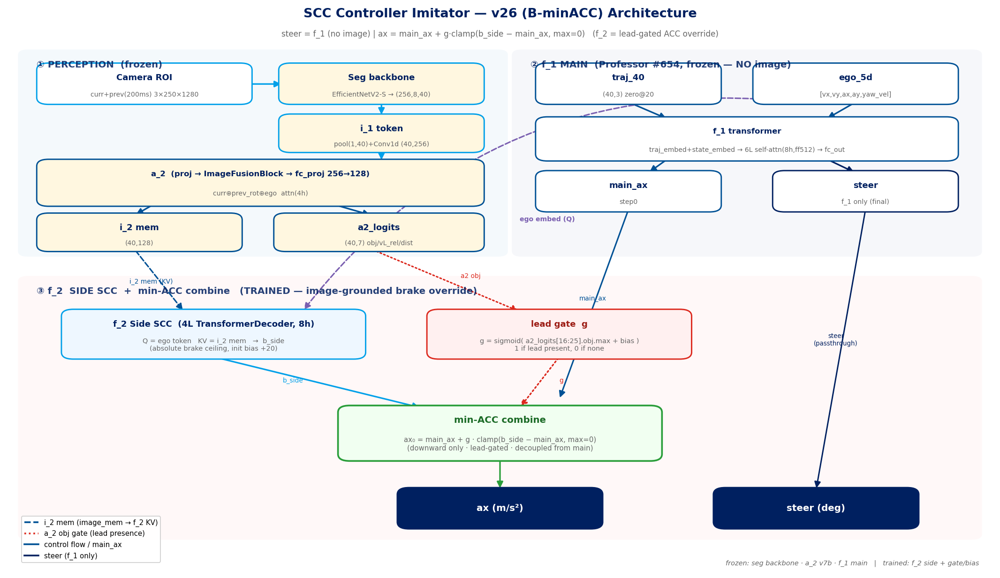

# SCC Controller Imitator — 구현 명세 (Implementation Spec)

작성일 2026-05-25 · 대상 모델 `v26 (B-minACC)` · `src/model/image_models/iy_model.py`, `a2_model.py`

> 목적: 이 문서만 읽고 전체 파이프라인(데이터→3-stage 학습→inference)을 재구현할 수 있도록 모듈 dim·tensor shape·hyperparam·명령어를 명시. 변경 이력은 `REPORT_v6.md`, 실수/검증은 `mistakes_report.md` / `data_verification_report.md`.

---

## 0. 시스템 개요

전방 카메라 1장(+ 직전 frame) + ego state + reference trajectory → **(steer_deg, ax_mps2)** 1-step 제어.

3개 모듈, **3-stage 순차 학습** (각 stage 의 출력이 다음 stage 입력 cache):

```
[Stage 1] seg pretrain   : image → EfficientNetV2-S backbone (도로/차량/벽 segmentation 으로 backbone 사전학습)
[Stage 2] a_2            : backbone token → lead car per-bin 측정 (obj/거리/상대속도)   → i_2 cache 생성
[Stage 3] f_1 + f_2 (iy) : traj+ego → steer/ax (f_1) ⊕ image lead-brake (f_2, min-ACC)
```

핵심 설계 원칙:
- **관심사 분리**: steer 는 f_1(Professor, 이미지 안 봄)이 전담, brake 는 f_2 가 lead 인지 시 override.
- **cache 기반**: backbone/a_2 는 동결 후 결과를 npz cache 로 저장 → Stage 3 학습이 backbone forward 없이 180× 빠름.

---

## 1. 입력 / 좌표 규약

| 항목 | 사양 |
|---|---|
| 카메라 원본 | 1280×720 RGB JPEG (`{raw}/{track}/{policy}/{run}/CAMERA_1/{tick}_Intensity.jpeg`) |
| ROI crop | y∈[235,485] → **250×1280** (하늘/보닛 제거) |
| 정규화 | ImageNet mean/std, `x=(rgb/255−mean)/std`, CHW |
| fx | **640** (고정; 학습 데이터 fx=640 만 사용) |
| prev frame | 직전 **200ms** (prev_dtick=20 @ 100Hz tick) |
| ego_5d | `[vx, vy, ax, ay, yaw_vel]` (m/s, m/s², rad/s) |
| traj_40 | (40,3) ego-frame reference waypoints `[x_fwd, y_left, yaw]`, Δt=0.1s (4s horizon) |
| 출력 | (steer_deg, ax_mps2) — **physical 단위** (loss 만 scale 로 정규화, §5.4) |
| wheel idx | FL=0, FR=1, RL=2, RR=3 |

---

## 2. Stage 1 — Segmentation pretrain (backbone)

| 항목 | 사양 |
|---|---|
| backbone | `timm.create_model("tf_efficientnetv2_s", features_only=True, out_indices=[-1])` |
| 마지막 feature | (B, **C_b=256**, ~8, ~40) |
| seg head | 4-class (0=bg, 1=road, 2=vehicle, 3=wall), SAM-masked GT |
| ckpt | `data/ckpts/seg_pretrain_combined_v1_best_miou_backbone.pt` (mIoU 0.892) 또는 `seg_pretrain_fx640_v3` (0.921) |
| 용도 | 이후 모든 모듈이 이 backbone 의 **token** 을 입력으로 사용 (FP 감소: 학습/inference token 분포 일치) |

backbone state_dict 은 `LateralStripEncoder.load_pretrained_backbone()` 으로 a_2 에 이식.

---

## 3. Stage 2 — a_2 (lead 측정 모듈)

파일 `src/model/image_models/a2_model.py` · class `A2Model`

### 3.1 구조 (dim 명시)
```
A2Model(img_backbone="tf_efficientnetv2_s", d_token=256, n_heads=4, n_ch=7, d_out=128)

LateralStripEncoder(d_token=256):
    backbone(x)[-1]                       (B, 256, ~8, ~40)
    adaptive_avg_pool2d(·,(1,40)).squeeze (B, 256, 40)
    proj = Conv1d(256, 256, k=1)          (B, 256, 40)
    → transpose                           (B, 40, 256)            # token

ImageFusionBlock(d=256, n_heads=4):       # curr + prev_rot + ego 융합
    lateral_pos: Parameter(40, 256)       # 위치 임베딩
    pre_sa  : _AttnBlock (self-attn + FFN(2×) + 2×LayerNorm)   # i_2a
    ego_proj: Linear(2, 256)              # [vx, yaw_vel] → token
    frame_type_emb: Embedding(3, 256)     # 0=curr Q, 1=prev KV, 2=ego KV
    cross   : _AttnBlock (Q=curr, KV=[prev, ego])              # i_2b
    post_sa : _AttnBlock                                       # i_2c
    → fi_mem                              (B, 40, 256)

fc_proj = Linear(256, 128)                fi_mem_out (B, 40, 128)   # ★ 차원 정합 (transformer 와 동일)
AuxHead  = Linear(128, 7)                 logits (B, 40, 7)
```
`_AttnBlock`: `MultiheadAttention(d,n_heads) → LN(x+attn) → FFN(Linear(d,2d)→GELU→Linear(2d,d)) → LN`.

### 3.2 출력 채널 (40 bin × 7)
bin = 이미지 가로 40 등분 (lateral strip). 채널: `[obj_logit, vL_abs, vY_abs, vL_rel, vY_rel, prox, dist]`.
- **in-lane = bin 16–25** (중앙 10 bin, 20.5 = 정중앙).
- vL_rel = 자차–객체 종방향 상대속도(접근=양), dist 정규화 = `dist/40`.

### 3.3 학습 (a_2 v7b = production)
| 항목 | 값 |
|---|---|
| 입력 | i_1 token cache (backbone 동결) — `LateralStripEncoder.proj`+fusion+fc_proj+head 만 학습 |
| GT | `aux_targets_{dataset}/*.npz` (40,7), MORAI object GT + 자차 pose 로 per-bin 투영 |
| obj loss | **focal BCE, α=0.75** (pos rate ~5% → α≈1−pos_rate) |
| reg loss | **L1, target/scale 정규화 + obj_mask 필수** (v5/v6 의 normalize+mask 누락 버그 fix → vL_rel std 0→0.3) |
| ckpt | `data/ckpts/a2_v7b_d128_alpha075_best_loss.pt` |
| 성능 | DriverB obj rec 63% / prec 66%, vL_rel corr 0.40, closing rec 49% |

> v8(Gaussian NLL, 13ch interleaved mean+σ) / v9(LDS inverse-density) 는 개선 실패 — perception 한계는 2-frame+perspective **정보** 문제(loss tricks 무효). v7b 동결.

### 3.4 i_2 cache 생성
`scripts/build_a2_cache.py` (또는 build_i2): 각 frame 의 `fc_proj` 출력(128d) + `AuxHead` 출력(7ch) 을 npz 로 저장.
→ `i2_mem_cache_{dataset}_v7b_prev20.npz` = `{keys, i2_mem (N,40,128), a2_logits (N,40,7)}`.

---

## 4. Stage 3 — f_1 + f_2 (IyModel)

파일 `src/model/image_models/iy_model.py` · class `IyModel`

### 4.1 하이퍼파라미터 (확정값)
```
C_b=256, d_model=128, nhead=8, num_layers=6, dim_feedforward=512, dropout=0.1
traj_seq_len=40, traj_dim=3, state_dim=6, num_model_output=2
main_no_image=True, side_cross_attn=True, side_num_layers=4, side_dim_feedforward=512
side_min_arb=True   # v26
```

### 4.2 f_1 (main transformer, Professor #654 계보)
```
traj_embed  = Linear(3, 128)              traj_40 → (B,40,128)
state_embed = Linear(6, 128)              ego_5d(5→pad6) → (B,1,128)
pos_encoder = PositionalEncoding(128, max_len=41)
tokens_text = pos_encoder(traj_embed + state_embed)          # (B,40,128), main_no_image → image 토큰 없음
encoded     = TransformerEncoder(6 layers, nhead=8, ff=512)(tokens_text)
pred        = fc_out(encoded[:, :40])     fc_out=Linear(128,2)  → (B,40,2) [steer, ax]
```
**main 은 image 를 일절 안 봄** → Professor 의 깨끗한 steer 보존. (steer 오염 방지가 핵심 설계, REPORT_v6 §2)

### 4.3 f_2 (Side SCC, **lead-gated ACC override** — v26)
```
side_q   = state_embed token (B,1,128)            # ★ traj 제거: in-lane 은 a_2 gate 가 담당
image_mem= i2_mem(B,40,128) + image_pos_emb        # KV (a_2 v7b 출력)
side_out = TransformerDecoder(4 layers, nhead=8, ff=512)(tgt=side_q, memory=image_mem)   # (B,1,128)
b_side   = Linear(128,1)(side_out[:,0]) + side_brake_bias   # 절대 brake ceiling, bias init +20
g        = sigmoid( a2_logits[:,16:26,0].amax(1) + side_gate_bias )   # lead 인지 게이트, bias init 0
ax[:,0]  = main_ax[:,0] + g · clamp(b_side − main_ax[:,0], max=0)     # downward only
# steer 는 f_1 그대로. ax 도 step0 외에는 main 그대로 (target_first_only).
```
설계 의미:
- **b_side 절대값** → main finetune 과 decouple (additive residual 의 calibration 결합 제거).
- **clamp(max=0)** → f_2 는 절대 가속 안 함 (보수적).
- **g (lead gate)** → 전방차 인지 시에만 ACC 동작 (FP 안전).
- **identity start**: bias +20 > cruise → 초기 clamp=0 → f_1 보존. b_side 직접 supervision(§5.3)으로 brake 학습.

### 4.4 forward 입력 dict (collate `collate_iy`)
```
tok_curr/tok_prev_raw (B,40,256)   # i_1 (i2_mem 있으면 미사용)
i2_mem (B,40,128), a2_logits (B,40,7)   # i_2 cache (있으면 backbone/fusion 우회)
traj_40 (B,40,3), ego_5d (B,5), d_yaw (B,), fx (B,)
target (B,40,2), target_mask (B,40), inlane_dist (B,), inlane_closing (B,)
```
> optional key(i2_mem/a2_logits/a2_feat)는 **batch 전체에 있을 때만** stack (`all(...)`) — SCCSynth(i2-cache 없으면 미생성)와 ci_aug(항상 생성) mixed batch 대응.

---

## 5. 학습 데이터 & 방법 (Stage 3)

### 5.1 데이터 소스
| 종류 | 내용 | lead | 용도 |
|---|---|---|---|
| SCC synth (sangam_lead_0520/0521) | MORAI 합성, 전방차 있음, MPC(HPIPM) 제어 GT | O | brake 학습 핵심 |
| SCC sangam pertO/pertX | perturbation 주행 | 일부 | 다양성 |
| DriverB_new (logged) | 실주행 로그 (agent 충돌 포함) | O | 실분포 brake |
| spd_streaming | speedway 크루징 | X | cruise/steer |
| ci_aug v0237/v0301/v0302 | controller_imitator waypoint (image 無, traj+ego only) | X | f_1 steer 보강 |

각 SCC dataset 마다 3종 cache 정렬: `f1_prebake_iy_{ds}_prev20.npz` + `i1_tok_cache_{ds}_prev20.npz` + `i2_mem_cache_{ds}_v7b_prev20.npz` + `inlane_gt_{ds}.npz`.

### 5.2 GT 생성 파이프라인 (처리 순서)
```
1. seg 이미지 (SAM mask → seg pretrain)
2. 객체 bin GT (aux_targets, MORAI object → per-bin 40×7)
3. SCC 제어 GT (MPC fork `mpc/`, HPIPM, ax state-constraint fix; raceline reference)
```
raceline csv: semicolon-delim `s;x;y;yaw_rad;curv;speed;pit`, s 비단조 → row index 로 sampling.

### 5.3 TTC augment (brake target 보정 — 핵심)
in-lane lead 접근 시 target ax 에 안전 감속 floor 적용. **GT inlane cache 필수**(predicted dist 과대평가 회피):
```
inlane_dist    = GT aux bin16-25 중 closest dist
inlane_closing = −GT vL_rel (접근=양)
# ACC-style desired decel:
a_kin   = closing² / (2·max(dist−2, 0.5))
a_gap   = kgap·max(d0+T·v_ego − dist, 0) + kclo·max(closing,0)·clo_gate
a_emerg = max_brake · clamp(1 − ttc/ttc_emerg, 0, 1)
clo_gate= clamp((decay − ttc)/(decay − ttc_emerg), 0, 1)    # 원거리 과제동 완화
aug_ax  = min(raw_ax, −max(a_kin,a_gap,a_emerg))            # max_brake 20
파라미터: d0=5, T(headway)=1, kgap=0.2, kclo=0.6, ttc_emerg=2.0, decay=5.0
```
flag: `--ttc-augment --ttc-acc-style --inlane-gt-cache <...> --ttc-augment-max-brake 20`.

### 5.4 손실
```
scales = [scale_steer=10, scale_ax=10]
diff   = (pred − target) / scales              # pred/target 은 physical, scale 은 정규화용
loss   = L1(diff[target_mask])                 # close-lead 가중: min_dist<30 → ×close_weight(5)
# v26 추가: b_side 직접 supervision (dead-start 회피)
loss  += side_min_arb_w(0.5) · L1(model.last_b_side[:,0], target_ax[:,0])[target_mask0]
```
`--target-first-only`: step0 만 loss (제어에 쓰는 건 step0). `--traj-zero-after 20`: traj 입력 20-step(2s) 뒤 zero-mask (inference 와 일치 필수).

### 5.5 2-phase 학습
```
phase1 (ep < phase1_epochs): f_1 frozen, f_2(+gate/bias) 만 학습
phase2 (ep ≥ phase1_epochs): joint, f_1 은 main_lr_phase2(1.5e-5) 로 미세
phase 판정: has_aux(=side_cross_attn or use_a2_feat ...) and ep<phase1_epochs → main.requires_grad=False
```
B 시리즈는 phase1-only(30/30) 로 f_1 완전 보존이 기본.

### 5.6 main(f_1) 별도 finetune
- v25c: Professor #654 → ci_aug v0237+v0301+v0302 (+ sangam limit1000). `main_no_image`, no side.
- v0301 단독 추가 finetune 가능(`launch_v25c2_main_v0301only.sh`) — **단 total 5,355 라 장 epoch 시 overfit, val=267 same-distribution 주의**.

### 5.7 재현 명령 (v26 = B-minACC)
```bash
bash scripts/launch_v26_Bminacc.sh
# 핵심 flag:
#   --resume-from <v0301 main best>        (side fresh, main frozen base)
#   --main-no-image --side-cross-attn --side-num-layers 4 --side-min-arb --side-min-arb-w 0.5
#   --i1-cache/-extra --i2-cache/-extra --inlane-gt-cache/-extra (5 datasets, DriverB 포함 limit 0=무제한)
#   --ttc-augment --ttc-acc-style ... --traj-zero-after 20 --target-first-only
#   --phase1-epochs 30 --epochs 30 --batch-size 256 --lr 3e-4 --lr-prof 1.5e-5
```

---

## 6. Inference (closed-loop ROS node)

`scripts/closed_loop_node.py` (`MODEL_VARIANT=B`), `bash scripts/run_closed_loop_B.sh --viz-all`.

매 tick:
```
1. 카메라 ROI + prev(200ms) → seg backbone → token (1,40,256)
2. prev token = yaw_shift_tokens_batch(prev, d_yaw, fx)        # token-level Δyaw 보정
3. a_2 v7b: encoder.proj → fusion → fc_proj → i2_mem(1,40,128) + head → a2_logits(1,40,7)
4. IyModel({i2_mem, a2_logits, traj_40(zero after 20), ego_5d}) → pred(1,40,2)
5. (steer_deg, ax) = pred[0,0]      # physical, scale 곱 없음
6. pedal_map.get_pedal_values(vx, ax) → accel/brake pedal
```
설정: `MODEL_TRAJ_ZERO_AFTER=20`, `MODEL_A2_V6_CKPT=a2_v7b_d128`, debug overlay = 제어 경로 v7b head(control 일치) + SCC ACTIVE/EGO 속도.
> v26(min-arb) ckpt 테스트 시 IyModel 생성에 `side_min_arb=True` 전달 필요(현재 B변수 additive용 False — pending).

---

## 7. 진단 도구

- `scripts/viz_iy_gradcam_b4.py`: lead-TTC 샘플에 대해 **brake→image** grad-cam (backbone conv feat) + **steer→traj** attribution(per-waypoint |∂steer/∂traj|) 동시 시각화.
- close-approach val (train_iy): inlane_dist<20 & inlane_closing>1 샘플의 ax 오차 + brake 방향 정확도 (brake-critical 모니터).
- val/r2_steer, val/r2_ax (wandb): step0 결정계수 (단 same-distribution val 은 낙관 편향; ax R² 는 cruise 분산 지배라 brake 지표 아님).

---

## 8. 아키텍처 다이어그램


