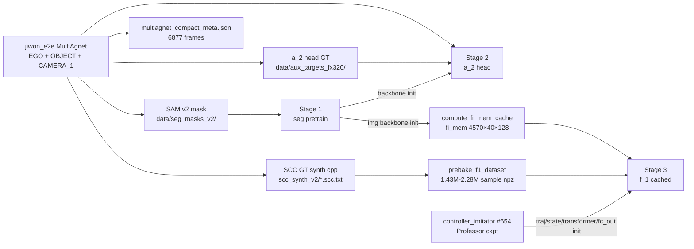
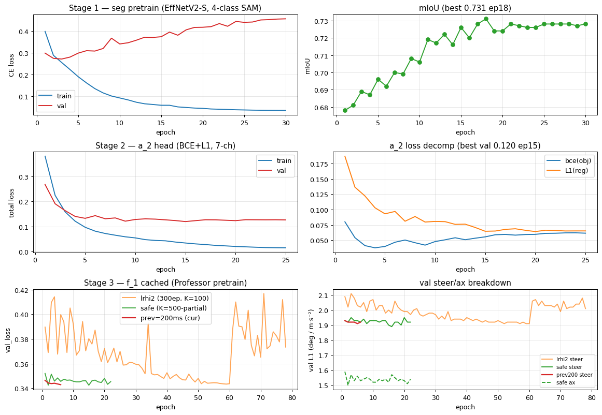
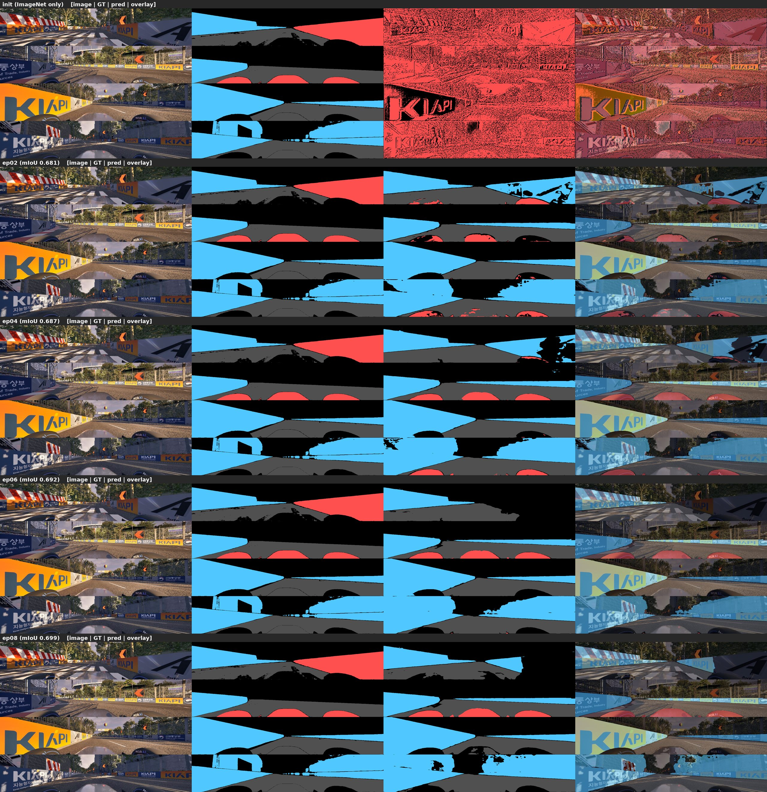
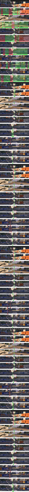
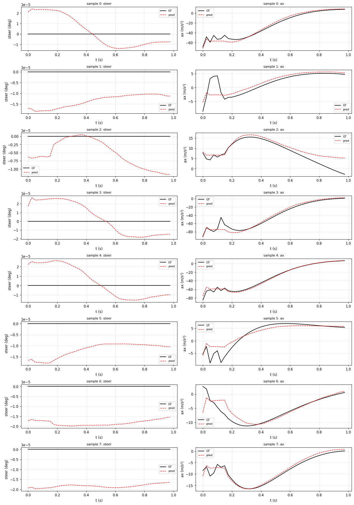
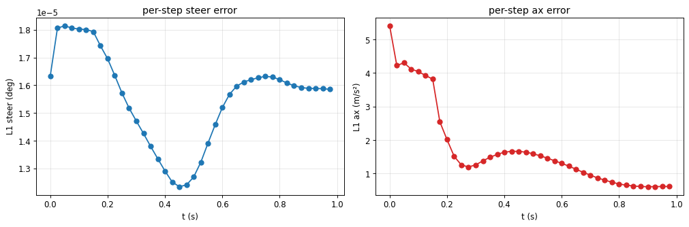
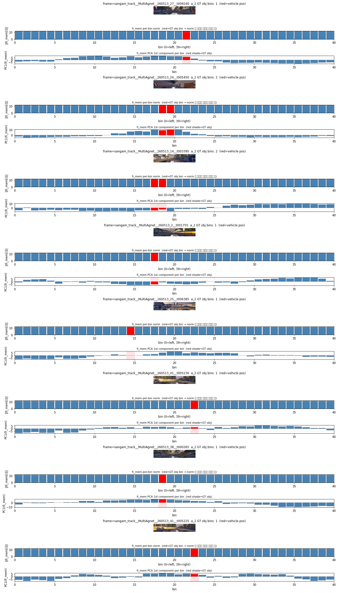
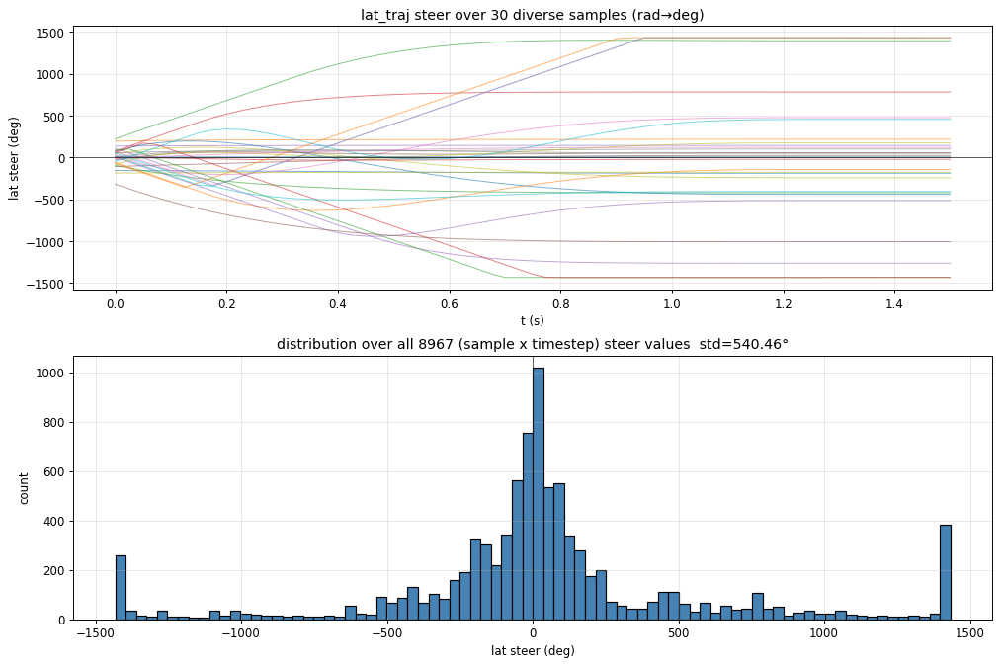
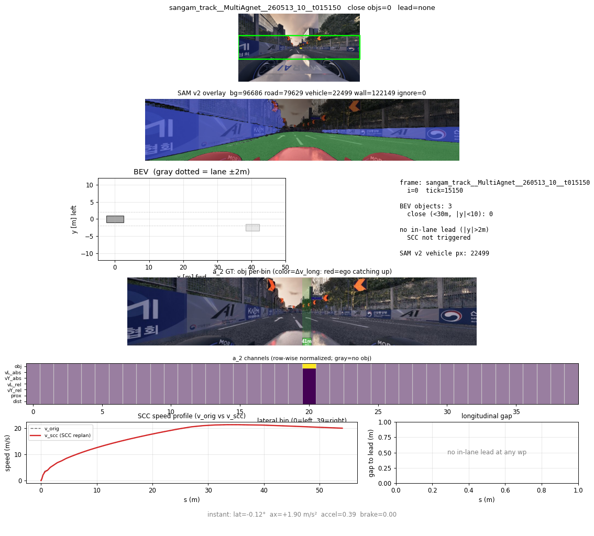
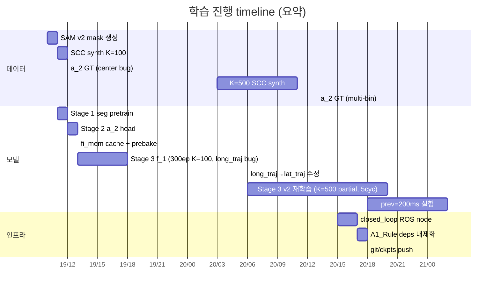

# SCC Controller Imitator — Data & Training Report (v1)

작성일 2026-05-20 · branch `main` · 모델 코드 `src/model/image_models/image_scc_models_v2.py`

---

## 1. 프로젝트 목표

기존 **controller_imitator (#654)** 는 traj + ego 만 입력 받는 transformer (SelfAttentionControlPredictor_Professor)
로, 카메라 정보를 활용하지 못함.

본 프로젝트는 여기에 **카메라 image stream 을 추가**해서:

> *image_curr + image_prev + ego_5d + raceline trajectory → (steer, ax) 시퀀스*

를 예측하도록 확장. 학습 GT 는 A1_Rule 의 SCC (DelayedKinematicBicycle LMPC 기반)
가 합성한 결과를 사용한다.

전체 모델 구조와 ID 규약은 `architecture.md` (§0–§5) 참조. 본 보고서는 데이터 → 학습 흐름과
지표 위주.

---

## 2. 데이터 파이프라인



### 2.1 원천 (`jiwon_e2e` MultiAgnet 라이드)

- 38 run × 5–10 분, 카메라 + EGO_INFO + OBJECT_INFO + LIDAR (미사용)
- 사용 frame: 6877 (multiagnet_compact_meta.json), sangam_track 만
- 이미지: CAMERA_1 1280×720 RGB jpeg, **ROI y∈[235,485] → 250×1280** strip 학습에 사용
- 평균 `dt_per_tick ≈ 11 ms`, file_step=5 tick

### 2.2 SAM v2 segmentation mask

- 목적: image backbone (i_1) 의 racing-domain pretrain (road / vehicle / wall)
- pipeline: **GroundingDINO (SwinB) + SAM2** ensemble of 2 prompts
  - PROMPT_A: `race car. track surface. lane line. wall. barrier.`
  - PROMPT_B: `car. vehicle. truck.` (vehicle 보강)
- `BOX_THRESHOLD = 0.25` (sweet spot; 0.15 → 벽/지면 false positive, 0.30 → 가까운 차량 누락)
- 출력: `data/seg_masks_v2/{frame_id}.npz` (5, 250, 1280) uint8 — 4 class active (bg/road/vehicle/wall) + ignore
- 6877 frame 처리 약 60 분 (RTX 3080 Ti + SAM2.1 hiera_base_plus)

### 2.3 SCC GT synthesis (cpp)

- 목적: 다양한 input trajectory 에 대한 SCC controller (DelayedKinematicBicycle LMPC) 의 **steer / ax 시퀀스** 정답
- 코드: `cpp/scc_batch_synth/` (synth_batch.cpp + frame_loader.cpp), A1_Rule 의 LateralControl / LongitudinalControl + 자체 SccSpeedReplanner
- 한 frame 당 K trajectory:
  - 1 × **logged** (raw EGO_INFO 향후 N tick)
  - K-1 × **random**: `v0237_traj_pool` (70,919 trajs) 에서 `|v0 - ego_vx| < 5 m/s` sampling
    → ego-local → world frame 변환
- 16-way parallel + `--skip-existing` 으로 K=100 (458K), K=500 (2.28M) 단계 확장
- 결과 `.scc.txt`: `# header` + traj header + **long_traj 61 × 8** (i, time, vx, ax, steer, trq, accel_pedal, brake_pedal) + **lat_traj 61 × 5** (i, time, vx, ax, steer)
- ⚠️ **중요**: `long_traj.steer` 는 longitudinal LMPC 가 안 다뤄서 항상 ~0. **학습 steer target 은 lat_traj.steer (단위 deg)** 사용 — 한 번 잘못 매핑해서 모델이 0 만 학습한 후 발견

### 2.4 a_2 head GT (`aux_targets_fx320/`)

- 목적: image stream 이 객체의 lateral 위치 / 거리 / 상대속도를 인식하는지 정성 검증
- per-frame `(40, 7)` tensor — lateral 40 bin (image width 1280 / 32px each) 각각:

| ch | 이름 | 설명 |
|---|---|---|
| 0 | obj | bin 에 객체 존재 (0/1) |
| 1 | vL_abs | 객체 절대 forward 속도 (m/s, ego basis) |
| 2 | vY_abs | 객체 절대 lateral 속도 |
| 3 | vL_rel | 상대 forward 속도 = abs - ego_vx |
| 4 | vY_rel | 상대 lateral |
| 5 | prox | exp(-d / 20m), 가까울수록 1 에 가까움 |
| 6 | dist | 평면 거리 (m, raw) |

- **4-corner projection**: 객체 박스 (L, W) 4 꼭지점을 ego frame 으로 보낸 후 lateral bin span 전체 라벨
  → 가까운 차량 (5m, 1.8m 폭) 이 6-7 bin 점유 (이전 center 1bin 만 라벨하던 버그 수정)
- fx 별 디렉토리 (현재 `fx320`, 미래 `fx640` 호환)

### 2.5 학습 데이터 효율화

K=100 ~ K=500 sample 수가 458K → 2.28M 까지 폭발 → **NFS I/O 가 학습 속도를 145× 느리게** 함.
두 단계 캐시:

1. **fi_mem cache** (`compute_fi_mem_cache.py`, `data/fi_mem_cache_*.npz`)
   - 이미지 → i_1 (seg backbone) → i_2 (random init) → **fi_mem (40, 128)** 사전 계산
   - 4570 frame × 40 × 128 = **43 MB** (float16)
   - i_1/i_2 freeze 상태에서 학습 inference 마다 같은 결과이므로 한 번만 계산 (3-5 분)
2. **prebake** (`prebake_f1_dataset.py`, `data/f1_prebake_*.npz`)
   - 모든 sample 의 traj_40 + target_40 + ego_5d + mask 를 단일 NPZ 에 in-memory bake
   - 16-worker process pool, 458K sample → ~25 분 / 1.43M → ~3 시간
   - 학습 dataset 은 `np.frombuffer` 만 — disk I/O 0

→ 결과적으로 **f_1 학습 1 epoch ≈ 55s** (cache + prebake) vs **125 min** (NFS 직접)

---

## 3. 모델 학습 (3 stage)

전체 학습 곡선:



### Stage 1 — i_1 (LateralStripEncoder) seg pretrain

- 목적: image backbone (tf_efficientnetv2_s, 21.5M params) 을 racing-domain feature 로 사전학습
- model: `SegPretrainModel` (backbone + FPN-like 4-stage decoder + Conv2d head)
- loss: CE 4-class (bg/road/vehicle/wall), ignore 5th channel
- 30 epoch, batch 12, AdamW, CosineAnnealingLR(T_max=30)
- 결과: **best mIoU = 0.731 (ep18)** — val_loss 는 ep03 부터 overfit, mIoU 는 ep18 까지 점진 개선
- ckpt: `data/ckpts/seg_pretrain_v2s_full_best_backbone.pt` (77 MB)

epoch 진행 정성 평가 (val 4 sample × 5 epoch, 좌: image → GT → pred → overlay):



ep18 (best) 의 8-sample 결과 (full size):

→ 도로/벽 IoU 0.80+, vehicle IoU 0.37 (작은 객체라 어려움)

### Stage 2 — a_2 (AuxHead) 학습

- 목적: image encoder + image fusion 이 객체 위치/거리/속도 인식 가능한지 확인 (i_2 가 의미 있게 학습되는지)
- model: `A2Model = LateralStripEncoder + ImageFusionBlock + Linear(D→7)`, d_token=256
- input: (image_curr, image_prev_rot, ego_motion=[vx, wz])
- loss: BCE(obj logit) + L1(regression 6채널, obj=1 bin 만)
- 25 epoch, batch 6, AdamW, lr_encoder 5e-5 / lr_head 2e-4
- 결과: **best val_loss = 0.120 (ep15)**, L1 metric:
  - vL_abs 1.4 m/s
  - vL_rel 1.6 m/s
  - dist 3.4 m
- ckpt: `data/ckpts/a2_v1_best_loss.pt` (83 MB)

epoch 진행 정성 평가 (val 4 sample × 6 epoch, 각 row: GT bin overlay → Pred bin overlay):



### Stage 3 — f_1 (Concat-SelfAttn + Professor pretrain) cached 학습

- 목적: **최종 SCC controller 모사** (image + ego + traj → steer/ax)
- model: `SCCControllerImitatorV2`
  - d_model = 128 (Professor 와 동일), nhead 8, num_layers 6
  - input flow:
    1. traj_embed(traj_40) + state_embed(ego_6d) → `ft_tok (40, D)`
    2. img_encoder(curr) + img_encoder(prev_rot) → img_fusion → `fi_mem (40, D)` (또는 cache load)
    3. concat → tokens (80, D)
    4. TransformerEncoder × 6L (Professor pretrain) → 앞 40 = `ff_fused`
    5. fc_out → (40, 2) [steer_deg, ax_mps²]
  - **78 keys load from Professor #654** (traj_embed, state_embed, pos_encoder.pe[0:41],
    transformer_encoder.* × 6L, fc_out). image stream 은 seg pretrain backbone 으로 i_1 init,
    img_fusion 은 random (cache 시점 seed=0)
- training:
  - 5-cycle CosineAnnealingWarmRestarts (T_0 = epochs/5)
  - lr_safe: prof 2e-4 / other 5e-4. (이전 `lrhi2`: prof 1e-3 / other 1e-2 → cycle 2 peak 에서 **NaN** 발생, safe 로 회귀)
  - prebake-fed in-memory, batch 64, AMP true

| run | dataset | epoch | best val | steer L1 | ax L1 | 비고 |
|---|---|---|---|---|---|---|
| v1_k100_e300 | K=100 (458K), long_traj target | 300 | 0.1781 | **0.00°** | 1.74 m/s² | ⚠️ steer bug |
| v2_k500p_e300 | K=500-partial (1.43M), lat_traj target | 30 | 0.3527 | 1.93° | 1.59 m/s² | bug 수정 후 |
| v2_k500p_5cyc_lrhi2 | 위 + 5-cycle T_0=60, lrhi2 | 78 | 0.3434 | 1.91° | 1.52 m/s² | NaN 1회 |
| v2_k500p_5cyc_safe | + lr_safe | 22+ | **0.3425** | 1.92° | 1.50 m/s² | (현재 4사이클 진행) |
| v3_k500p_prev200 (진행중) | + prev image Δt 200ms | 6 | 0.3429 | 1.92° | 1.51 m/s² | motion 인식 강화 실험 |

prediction 정성 평가 (val 8 sample, GT vs pred steer/ax 시계열):



per-step L1 (val 22,945 sample):



t=0 (instant cmd) 에서 ax L1 5 m/s² 로 큼 (다음 step 부터 급격히 ↓), steer L1 거의 0 — 학습 데이터 분포 특성 (racing 직선 다수).

### 보조 정성 검증

- **fi_mem 토큰**이 차량 위치를 인식하는지 (a_2 GT obj bin 과 fi_mem norm/PC1 비교)
  
- lat_traj steer 분포 (152 sample × 38 run)
  

review site (SAM + SCC + a_2 panel 통합 composite, 6877 frame):



---

## 4. closed_loop 통합 (`scripts/closed_loop_node.py`)

ROS 노드로 학습된 모델을 실시간 추론 → 차량 제어 cmd publish.

**입력 토픽**
- `/raw_img_app/perc/camera_1` (sensor_msgs/Image, 1280×720 RGB, 20 Hz)
- `/app/loc/vehicle_state` (autohyu_msgs/VehicleState)

**출력 토픽**
- `/app/con/command_steer` (Float32, deg)
- `/app/con/command_pedal_accel` / `command_pedal_brake` (Float32, 0~1)
- `/app/con/ml_scc_control_io` (autohyu_msgs/ControlInputOutput, 디버그 정보)

**처리 순서**:
1. 이미지 큐 (1.5s, 20Hz) 에서 prev = (curr - 100 ms) entry 선택 → Δyaw shift
2. raceline csv → ego 최근접 → vx 기반 등시간격 3s (40 wp × 0.1s) sampling → ego frame
3. `SCCControllerImitatorV2.forward({image_curr, image_prev_rot, ego_5d, traj_30})`
4. `pred[0,0,:]` = (steer_deg, ax_mps²) → PedalMap.get_pedal_values(vx, ax)
5. 4 topic publish + 디버그 viz Image topic (`/debug/scc_imitator_viz`)

**디버그 viz** (`--viz`, `--viz-seg`, `--viz-a2`, `--viz-all`):
- 4-panel composite (BEV trajectory + ROI image + steer/ax 시계열) sensor_msgs/Image publish
- seg head overlay (4-class color, 0.6 bg + 0.4 mask)
- a_2 head overlay (per-bin red/green bar = relative velocity, dist label)
- matplotlib Agg + 5Hz rate-limit + tight_layout 제거로 추론 영향 최소화

**A1_Rule 의존성 완전 내제화**:
- `external/autohyu_msgs/` (3 MB, generated Python msg classes)
- `src/utils/pedal_map.py`
- `data/control/pedal_map_a1_f4.csv` + `raceline_sangam.csv`
- `data/ckpts/*.pt`
→ `bash scripts/run_closed_loop.sh --viz-all` 만으로 다른 머신에서 즉시 구동

추론 시간 (RTX 3080 Ti, AMP):
- traj+img prep: 3-5 ms
- model forward: 18-25 ms
- viz publish: 4-50 ms (rate 제한)
- TOTAL: 25-80 ms (20 Hz 여유)

---

## 5. 학습 시계열 순서 + 주요 commit



주요 commit (origin/main):
- `cpp:` K=N random trajectory bank + file_step fix
- `data:` SAM seg v2 + SCC K=N bank + review site
- `ml:` seg + a_2 + f_1 pipelines
- `data:` a_2 GT multi-bin (4-corner projection)
- `feat:` closed_loop ROS node + pedal_map 내제화
- `feat:` external/autohyu_msgs 내제화
- `feat:` inference ckpts (data/ckpts/)
- `feat:` debug viz seg + a_2 head overlay

---

## 6. 미해결 / 다음 단계

1. **f_1 + i_1/i_2 joint fine-tune** — cached 단계 종료 후 image stream 도 unfreeze. 현재 i_2 (image fusion) 가 random 가중치라 학습 ceiling 존재
2. **backbone scale 실험** (task #13/14):
   - v2_l (116M params, encoder 2.8× 느림) — 정확도 ↑ 여지
   - v2_b0/b1 (5-7M, 0.65×) — embedded target
3. **prev image Δt 실험** — 50ms (학습 일치) vs 100/200/500ms — 상대속도 인식 trade-off
4. **multi-Δt prev** — curr + prev_50ms + prev_200ms 동시 입력
5. **K=500 full prebake + 학습** — 현재 K=500-partial (1.43M) 사용. SCC synth 완료 (2.28M) 후 재학습
6. **차량 / sim closed-loop 테스트** — control 성능 측정 (CTE, speed error, lap time)
7. **데이터 균형** — racing 직선 sample 다수 → steer 분포 0 dominant. Hard sample mining 또는 weighted sampling

---

## 부록: 핵심 디렉토리 트리

```
scc_controller_imitator/
├── architecture.md          # 모델 ID 규약 + 다이어그램
├── DESIGN.md                # 설계 문서
├── docs/                    # 본 보고서 + 이미지
├── cpp/
│   ├── scc_batch_synth/     # SCC GT 합성 (LMPC 통합)
│   └── scc_replanner/       # SCC speed replanner
├── scripts/
│   ├── generate_image_seg_masks.py    # SAM v2
│   ├── prepare_random_trajs.py        # bank
│   ├── prepare_logged_trajs.py        # bank
│   ├── prepare_a2_aux_targets.py      # a_2 GT
│   ├── compute_fi_mem_cache.py        # fi_mem cache
│   ├── prebake_f1_dataset.py          # prebake
│   ├── train_seg_pretrain.py          # Stage 1
│   ├── train_a2_head.py               # Stage 2
│   ├── train_f1.py / train_f1_cached.py # Stage 3
│   ├── eval_f1_cached.py              # 평가
│   ├── viz_*.py                       # 시각화
│   ├── closed_loop_node.py            # ROS inference
│   └── run_closed_loop.sh             # launcher
├── src/
│   ├── datamodule/          # *_dataset.py
│   ├── model/image_models/  # SCCControllerImitatorV2, A2Model, SegPretrainModel
│   └── utils/pedal_map.py
├── data/
│   ├── ckpts/               # inference ckpts (track)
│   ├── control/             # raceline + pedal_map csv (track)
│   └── v0237_traj_pool.npz  # random trajectory pool
└── external/
    └── autohyu_msgs/        # ROS generated msg classes (track)
```
