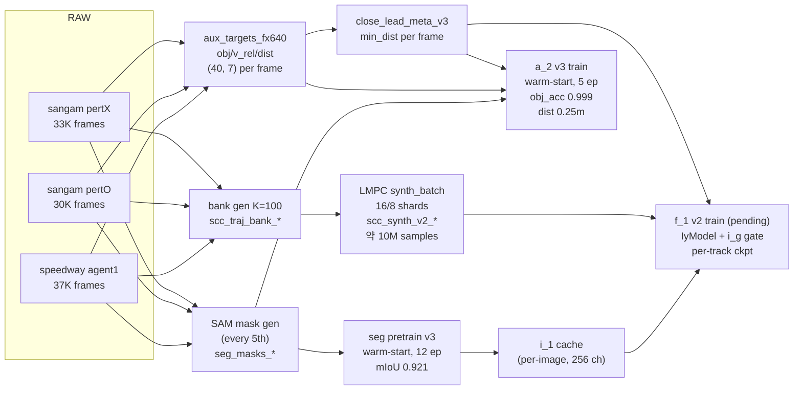
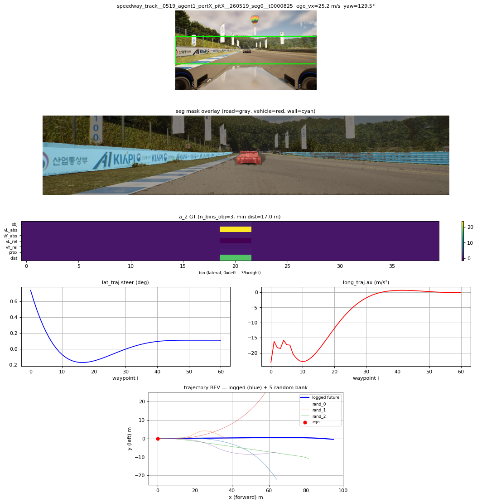
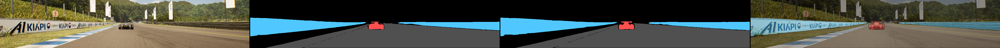
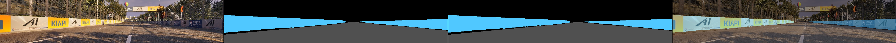
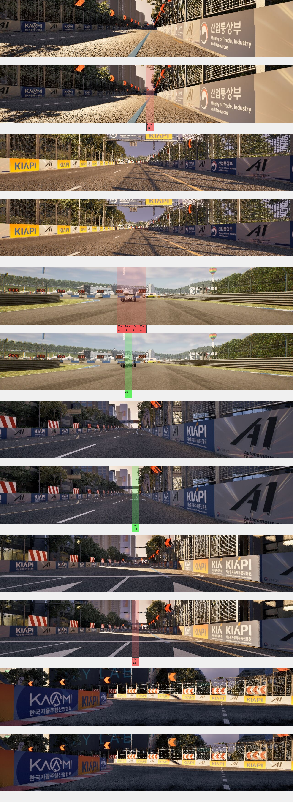
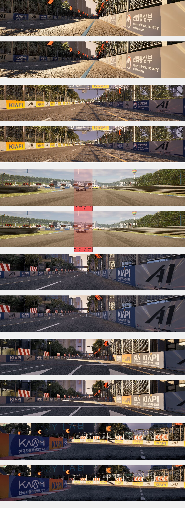
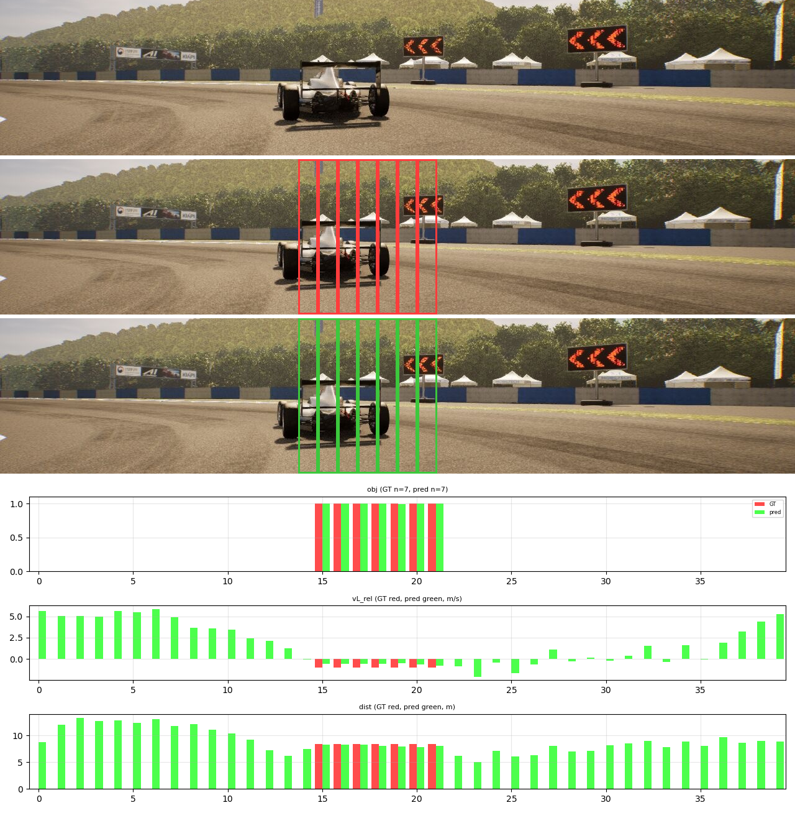

# SCC Controller Imitator — Data & Training Report (v2)

작성일 2026-05-21 · branch `main` · 모델: `src/model/image_models/iy_model.py` (v3 — i_y + i_g gate)

v1 (2026-05-20) 대비 핵심 변경:
- **i_y refactor**: pixel warp → token-level integer bin shift + per-image i_1 cache
- **fx-aware per-sample tensor**: fx=320/640 혼합 batch 지원
- **fx=640 only 데이터 정책**: MultiAgnet fx=320 폐기, speedway agent1 + 신규 sangam fx640 만
- **i_g image gate (v3)**: a_2 mini-head 가 객체 없는 frame 의 image 영향 차단
- **i_y 벡터화 가속**: 9.6× forward speedup (`torch.gather` 기반)
- **데이터 규모 ~4×**: 6.9K frames (sangam MultiAgnet) → 약 **100K frames** (speedway + sangam fx640)

---

## 1. 프로젝트 목표 (변동 없음)

기존 **controller_imitator (#654)** 의 traj + ego 입력에 **카메라 stream 추가**:

> `image_curr + image_prev + ego_5d + raceline trajectory → (steer, ax) 시퀀스`

학습 GT 는 A1_Rule 의 SCC (DelayedKinematicBicycle LMPC) 합성 결과.

---

## 2. 데이터 파이프라인 (fx=640 only)



### 2.0 데이터 sample (speedway agent1)

각 row = 5 panel: 카메라 image + seg mask overlay + a_2 GT heatmap + SCC GT 그래프 (steer/ax) + ego frame trajectory BEV (logged + 5 random K bank).



### 2.1 입력 데이터 (fx=640 only)

| 폴더 | track | policy | frames | OBJECT_INFO |
|------|-------|--------|--------|-------------|
| `0519_agent1_pertX_pitX` | speedway_track | agent1 | 37,040 | 풍부 (97.8% close-lead) |
| `0519_pertO_pitX` | sangam_track | pertO | 30,593 | **비어있음** (단독주행) |
| `0519_pertX_pitX` | sangam_track | pertX | 32,699 | **비어있음** (단독주행) |
| ~~`MultiAgnet`~~ | ~~sangam_track~~ | ~~MultiAgnet (fx=320)~~ | ~~6,877~~ | **폐기** |

**총 ~100K frames** (fx=640, RGB 1280×720, 20 Hz)

### 2.2 처리 단계 (병렬)

| 단계 | 도구 | 시간 (전체) | 출력 |
|------|------|-------------|------|
| 0. raw 로컬 cache | `parallel cp 32` | ~30분 (32GB) | `raw_cache/{track}/{policy}/{run}/` (NFS → local SSD) |
| 1. SAM seg mask (every 5th) | `generate_image_seg_masks.py` | speedway ~1h, sangam ~1.7h | `seg_masks_{spd,sangam_fx640}/{frame_id}.npz` (5ch × 250×1280) |
| 2. random K bank | `prepare_new_run_bank.py` | 3-4분 (parallel 16w) | `scc_traj_bank_*/{run}__t{tick:07d}.trajs.bin` (K=100) |
| 3. SCC synth (LMPC) | `scripts/run_synth_batch_shards.sh` + `synth_batch` C++ | speedway 43분, sangam pertO+pertX 35분 (각 8 shards) | `scc_synth_v2_*/{run}__t{tick:07d}__{logged,rand_NNNNN}.scc.txt` (총 약 10M) |
| 4. logged trajectory bank | `prepare_logged_trajs_v2.py` | ~17분 + 1분 | `scc_logged_bank_*/*.bin` |
| 5. aux_targets_fx640 | `prepare_a2_aux_targets.py --fx 640` | speedway ~7분 + sangam ~40분 | `aux_targets_*_fx640/{frame_id}.npz` |
| 6. manifest 통합 | `build_pair_manifest.py` | 1분 | `scc_synth_pair_manifest_*.json` (각 정책별 + 통합) |
| 7. close_lead_meta | `build_close_lead_meta.py` | 1.6초 | `cache/close_lead_meta_v3.npz` (100K, 36% <30m) |
| 8. i_1 cache | `compute_i1_tok_cache.py` | speedway 5분 | `cache/i1_tok_cache_*.npz` (image-level, 700MB / 37K) |
| 9. prebake_iy | `prebake_iy_dataset.py` (선택, f_1 학습용) | 10-30분 | `prebake/f1_prebake_iy_*.npz` (sample-level 통합) |

---

## 3. 모델 학습

표준 순서: **seg pretrain → a_2 → f_1** (`memory/pipeline_order.md`). 항상 prior best ckpt 에서 warm-start.

### 3.1 seg pretrain v3 (i_1 backbone)

| 항목 | v2 (sangam+speedway, 14K) | **v3 (fx640 only, 20K)** |
|------|---------------------------|--------------------------|
| 데이터 | sangam MultiAgnet 6877 + speedway 7408 | speedway 7408 + sangam fx640 12659 |
| ckpt init | seg_pretrain_v2s_full_best | combined_v1 best_miou_full (warm-start) |
| epochs | 20 (배포된 best ep 12) | 13 (배포된 best ep 12) |
| **best mIoU** | 0.892 | **0.921** (▲ +2.9%p) |
| **vehicle IoU** | 0.765 | **0.864** (▲ +9.9%p) |
| 시간 / epoch | ~5분 | ~5-6분 |

> vehicle IoU 큰 폭 ↑ — 신규 sangam fx640 가 obj 없는 negative training 으로 false positive 감소시킴.

**inference 정성 결과** (column: image | GT | pred | overlay)

speedway sample:



sangam fx640 sample:



### 3.2 a_2 v3 (객체 인식 head + i_g gate 학습용)

| 항목 | v1 (sangam MultiAgnet fx320) | **v3 (fx640 only, 100K)** |
|------|------------------------------|---------------------------|
| 데이터 | aux_targets_fx320 (sangam) | speedway 37K + sangam fx640 63K |
| pretrained backbone | seg_pretrain v1 | **seg_pretrain v3** (mIoU 0.921) |
| ckpt init | scratch | **a2_v1 best_loss warm-start** |
| `require_obj` filter | True | **False** (sangam 의 obj=0 frame negative supervision) |
| `prev_dtick` | 5 (50ms) | **20 (200ms)** |
| close-lead 가중 | X | ✓ `close_weight=3` |
| epochs | 25 | **5** (warm-start 라 적게) |
| batch / workers | 12 / 6 | **6** (OOM 회피) / 12 |
| 시간 / epoch | ~10분 (sangam만) | ~40분 (100K + local image cache) |
| **best val_loss** | ? | **0.018** (ep 04) |
| **obj_acc** | ? | **0.999** (gate 거의 perfect) |
| **dist L1** | ? | **0.25 m** |

ckpt: `outputs_multi/a2_fx640_v3_local/best_loss.pt`

**학습 진행 비교 (6 sample × {image, GT bin overlay, pred bin overlay, channel bars}):**

ep 00 — warm-start 직후 (a2_v1 fx320 ckpt):



ep 05 — 최종 (val=0.0172, obj_acc=1.000, dist L1=0.17m):



**객체 많은 frame inference** (speedway, obj bin 7개):



(각 row: 원본 image / GT bin overlay 빨강 박스 / pred bin overlay 초록 박스 / bar chart [obj prob, vL_rel, dist])

### 3.3 f_1 v2 (IyModel — pending)

**아키텍처 변경 (v3)**:
```
i_1 cache → i_y (token roll, vectorized) → img_proj → i_2 (ImageFusion 3-block)
         → i_g (obj_logit per-bin gate)
         → fi_mem_gated  ★ 객체 없으면 ≈ 0

traj + ego_5d → t_1 traj_embed + e_2 state_embed (+t_2 ego-add at t=0)
             → pos_enc
             → concat([tokens_text, fi_mem_gated]) (B, 80, D)
             → f_1 6L Transformer (Professor #654 warm-start)
             → fc_out → (B, 40, 2) = [steer °, ax m/s²]
```

**손실** = L1(steer/ax) / scales + α × BCE(obj_logit, obj_target) + close-lead per-sample weight

**계획**:
- ckpt: warm-start from `iy_spd_v1_full/best_loss.pt` (v1, val 0.337) + a_2 v3 의 i_2 / obj_head
- track 별 분리:
  - sangam fx640 only ckpt
  - speedway agent1 only ckpt
- 데이터: 각 manifest 별 prebake_iy → train_iy
- epochs ~10 (warm-start)

---

## 4. 성능 (학습 forward 가속)

상세: `docs/PERFORMANCE.md`. 핵심:

| batch | v2 (Python loop i_y) | **v3 (벡터화 i_y)** | speedup |
|-------|----------------------|---------------------|---------|
| 64    | 72.25 ms total | **7.53 ms** | **9.6×** |
| 256   | 174.50 ms total | **38.03 ms** | **4.6×** |

i_y 만: 138ms → 0.05ms (**~2,700× 가속**, `torch.gather` 기반).

새 병목: transformer 76-80% (정상), i_2 17-22%.

---

## 5. closed_loop ROS 통합 (변동 없음, v1 참조)

- `scripts/closed_loop_node.py` + `scripts/run_closed_loop.sh`
- A1_Rule 의존성 내제화 완료 (`external/autohyu_msgs`, pedal_map, raceline csv)
- 카메라 + ego + raceline 받아서 steer/pedal 명령 publish
- debug viz (seg / a_2 head overlay) `--viz-all` flag

f_1 v2 ckpt 완료되면 closed_loop 도 IyModel 로드하도록 업데이트 필요.

---

## 6. 시계열 + 주요 commit

| 일자 | 주요 작업 |
|------|----------|
| 2026-05-19 | sangam MultiAgnet seg mask + scc synth + a_2 v1 학습 (v1 baseline) |
| 2026-05-20 | f_1 cached train (best val 0.355), closed_loop ROS, i_y refactor, fx-aware, close-lead 가중 |
| 2026-05-20 | speedway agent1 데이터 처리 (3.7M sample), f_1 v1 학습 (best 0.337) |
| **2026-05-21** | sangam fx640 (pertO+pertX) 데이터 처리 (6.3M sample) |
| **2026-05-21** | seg pretrain v3 fx640 only (mIoU 0.921) + i_g gate 도입 + a_2 v3 학습 |
| **2026-05-21** | i_y 벡터화 (9.6× 가속) + DESIGN/architecture.md v3 갱신 |

주요 commit: `4935608` (i_y refactor), `9f7f9cf` (docs v3), `5ac9cac` (perf vectorize), `8ae9d4c` (gate diagrams)

---

## 7. 다음 단계

1. **a_2 v3 ep 05 완료** (~20분 후) → ckpt finalize
2. **f_1 v2 학습** (track 별 sangam / speedway 분리, warm-start, ~10 ep)
3. closed_loop 에 IyModel + i_g 로드 → 실차 evaluate
4. (옵션) fi_mem_gated pre-bake — 만약 f_1 학습이 여전히 느리면

## 부록: 디렉토리 트리

```
scc_controller_imitator/
├── docs/
│   ├── REPORT_v1.md
│   ├── REPORT_v2.md           ← 이 문서
│   └── PERFORMANCE.md
├── architecture.md            ← v3 i_g 다이어그램 포함
├── DESIGN.md                  ← §0.0 변경 이력 + i_y/i_g 반영
├── memory/                    ← claude auto-memory
│   ├── fx640_only.md
│   ├── always_warm_start.md
│   ├── pipeline_order.md
│   ├── iy_refactor_complete.md
│   └── training_priority_v2.md
├── scripts/
│   ├── generate_image_seg_masks.py     (--meta --raw-img-base --out-dir --every)
│   ├── prepare_new_run_bank.py         (raw run → bank, 16w parallel)
│   ├── prepare_logged_trajs_v2.py
│   ├── prepare_a2_aux_targets.py       (--fx 640)
│   ├── build_meta_from_framelist.py
│   ├── build_pair_manifest.py
│   ├── build_close_lead_meta.py
│   ├── compute_i1_tok_cache.py
│   ├── prebake_iy_dataset.py           (--aux-policy-dir 로 obj_target 도 bake)
│   ├── train_seg_pretrain.py           (--no-default --extra-meta/-mask-dir/-raw-base × N)
│   ├── train_a2_head.py                (--no-default --no-require-obj --close-lead-meta --prev-dtick)
│   ├── train_iy.py                     (--use-obj-gate --obj-loss-w --close-lead-meta)
│   ├── run_synth_batch_shards.sh
│   ├── relocate_manifest_paths.py
│   ├── profile_iy_model.py             (per-module timing)
│   ├── viz_seg_inference.py
│   ├── viz_a2_inference.py
│   ├── build_speedway_review_site.py
│   └── closed_loop_node.py
└── src/
    ├── datamodule/
    │   ├── seg_pretrain_dataset.py
    │   ├── a2_pair_dataset.py          (multi-policy fx + close-lead)
    │   ├── scc_synth_iy_dataset.py     (i_1 cache + prebake + obj_target)
    │   └── scc_synth_pair_dataset.py
    └── model/image_models/
        ├── iy_model.py                 (i_y vectorized + i_g gate)
        └── a2_model.py
```
