# 검증 리포트 (2026-05-24 ~ 25)

B 모델 brake 문제 추적 중 수행한 검증. 최상위 분류 **① 데이터 검증 / ② 모델 검증 / ③ 파이프라인·시스템**.
각 항목: **목적 / 방식(형태) / 결과**. 실수·수정은 `mistakes_report.md` 참조.

검증 데이터: 주로 DriverB_new (logged human). 반복 분석은 `val_sample_DriverB_5k.npz`(213KB) 즉시 로드.

---

# ① 데이터 검증 — GT·target·분포·시각화

데이터(GT, 학습 target) 자체가 올바른가. 모델과 무관하게 입력/정답을 검증.

## 1-A. GT / target 정확성·분포

### GT vL_rel 분포 sanity
- **목적**: GT 자체 정상성 (eval 이 [-956,+558] 보임).
- **방식**: aux GT `[...,3]` raw range/히스토그램, obj 토큰만. 3 dataset.
- **결과**: GT 정상 ([-9,+9]~[-38,+13]). 내 ×20 스케일 오류였음.

### GT ax ↔ (vL_rel/dist) 상관
- **목적**: target_ax 가 시각단서(접근/거리)와 인과 있는 학습가능 신호인가.
- **방식**: prebake target_ax[0] vs aux vL_rel/dist corr. DriverB/sangam, obj-frame.
- **결과**: DriverB **+0.49**(시각 일치) but sangam **-0.1**(raceline brake, 시각무관).

### brake target ttc 적용 전후
- **목적**: 근거리+접근의 실제 학습 target 이 brake 인가.
- **방식**: in-lane 근거리+접근 sample 의 raw vs ttc-augment(safe_decel) target_ax.
- **결과**: raw **+1.07(가속!)** → ttc **-3.22**. ttc 적용 시 정상. (단 NO-OP 로 실제론 미적용)

### 비-inlane 오염 정량
- **목적**: brake target 중 image 로 설명 불가한(in-lane lead 없는) 비율.
- **방식**: brake(ax<-1.5) sample 중 in-lane bin obj 있는 비율.
- **결과**: DriverB **44%** / sangam_0521 **56%** 오염 (raceline/신호/회전).

### 초근거리 가속 target 원인 진단
- **목적**: voxel 의 <5m+접근 +6.9 가속 원인.
- **방식**: GT-true <5m+접근 234 token 의 raw ax(+) 비율, ttc fire 비율, predicted vs GT dist.
- **결과**: raw 가속 94%, ttc fire **7%**, predicted dist **8.8 vs GT 3.8(+5 과대)** → closing -3.48 오판 → ttc miss → 가속 생존.

## 1-B. target 분포 시각화 (scatter / voxel)

### 3D scatter (dist × bin × closing, 색=target_ax)
- **목적**: brake 결정이 거리/bin위치/접근속도와 어떻게 관계되나 전역 조망.
- **방식**: obj 토큰 3D 산점도, 색=target_ax(파랑=감속). raw→ttc→GT-ACC→gated 단계별.

**(1) raw target (수정 전)** — 근거리 접근에도 빨강(가속) 산재:
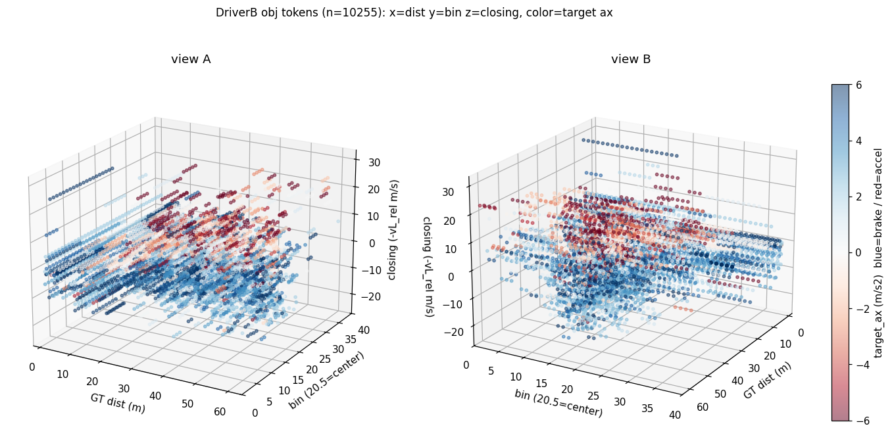

**(2) ttc-augment (predicted, full DriverB 351K)**:
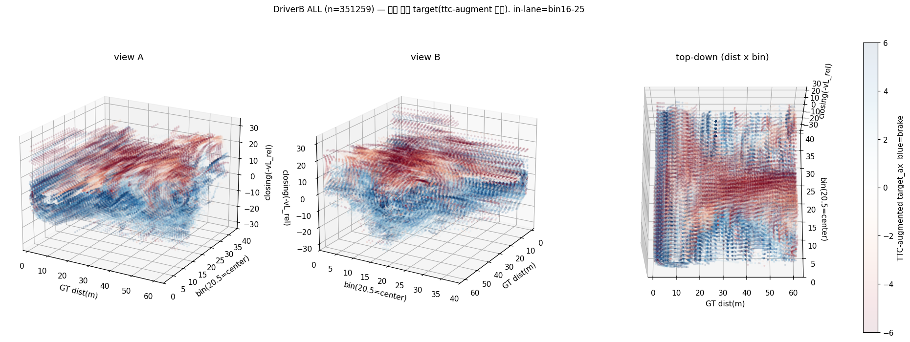

**(3) GT-inlane ACC ttc (수정)** — center bin+접근에 파랑 집결:
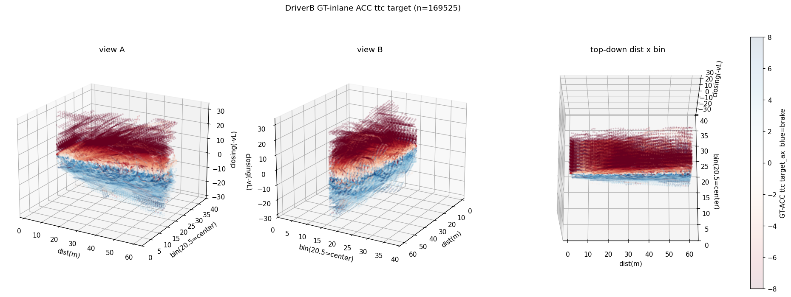

**(4) TTC-gated (원거리 완화)**:
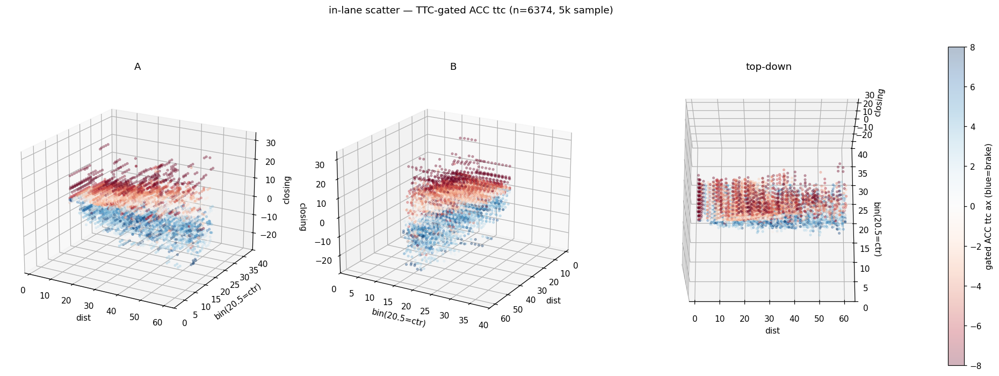

### voxel: dist × closing → ax mean/std
- **목적**: 각 (거리,접근속도) 구간의 target brake 강도(mean) + 일관성(std).
- **방식**: in-lane bin 합산, dist×closing 격자 mean/std heatmap.

**(1) predicted-ttc (버그)** — <5m+접근 **+6.9 가속**, std 8-13(비일관):
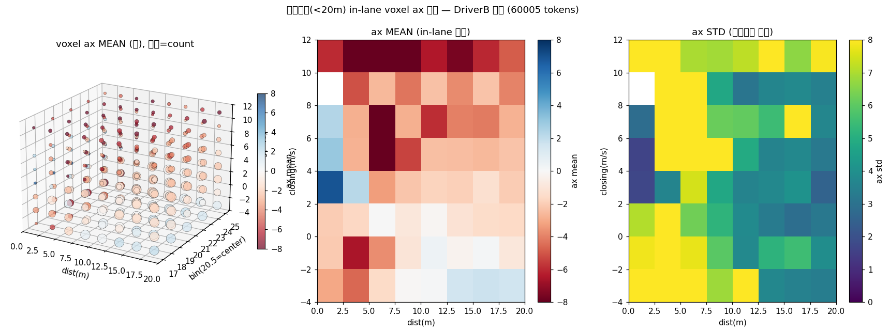

**(2) GT-ACC ttc (수정)** — <5m+접근 **-13.7 강한감속**, std 0.2(일관). closing↑→brake↑ 단조:
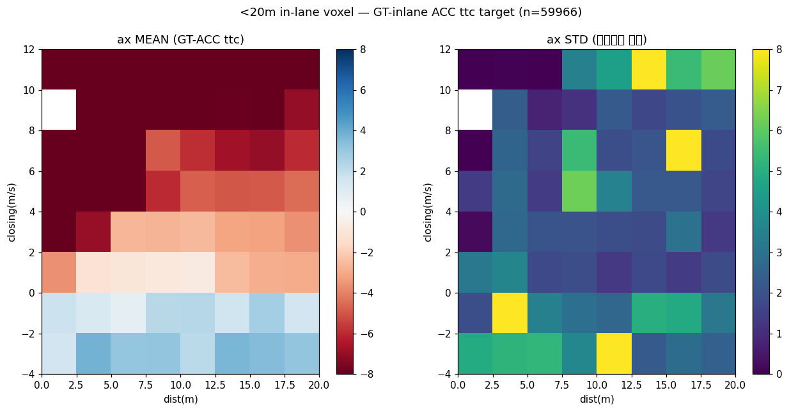

**(3) in-lane 0-60m 확장** — 전 거리 ACC 구조:
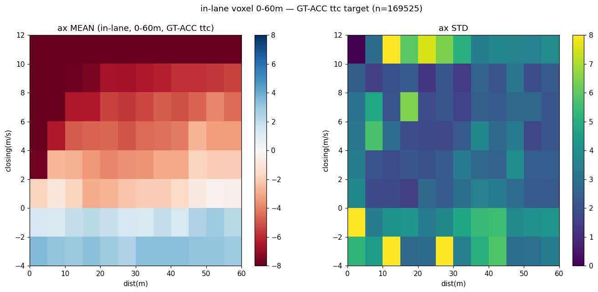

**(4) TTC-gated** — 40m@11 -6.6→-3.0, 근거리/긴급 유지:
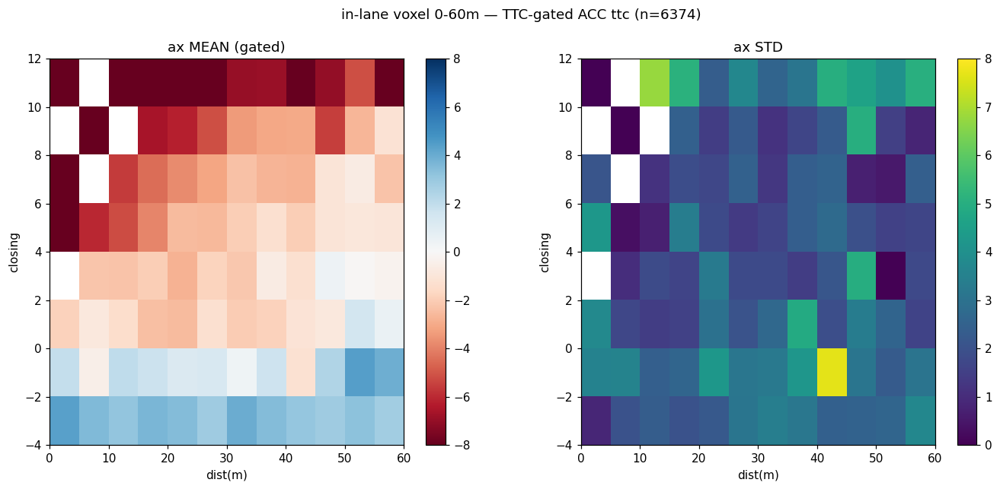

### out-lane voxel — 경로 밖은 cruise
- **목적**: out-lane 객체는 brake 불필요(가속/cruise) 확인.
- **방식**: out-lane bin(0-15,26-39) obj. bin×dist + 순수outlane closing×dist + 히스토그램.
- **결과**: 순수 outlane ax **+1.79**(brake 9%, 가속 64%), 근거리<10m 도 +2.97. 측면차 헛brake 안 함.

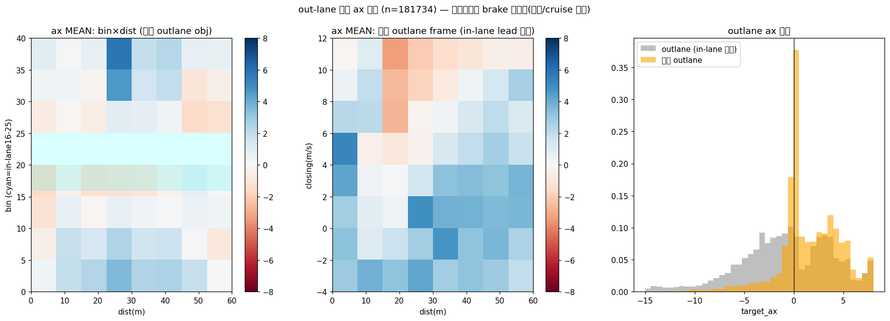

## 1-C. target 설계 튜닝

### ACC desired-decel 파라미터 sweep
- **목적**: kinematic 대신 ACC-style brake 파라미터(d0/T/kgap/kclo/ttc_emerg) 선택.
- **방식**: 4 후보(kinematic/A/B/C) × 구간(근거리·급접근·중거리·긴급·비접근) brake 평균.
- **결과**: kinematic 근거리 -2.57(약), C 중거리 -10(과). **ACC-A** 채택 — 근거리 -5.6, 긴급 -14.6(max-20), 비접근 ~0.

### TTC-gating 효과
- **목적**: 원거리 과brake 완화하되 근거리/긴급 유지.
- **방식**: closing 항에 TTC decay(d=4/5), 시나리오별 brake 비교.
- **결과**: 40m@11(TTC3.6) -6.6→-3.0(d=5), 근거리/긴급 유지. **decay=5 채택**.

## 1-D. 데이터 인프라·무결성

### raw 데이터 구조/포맷
- **목적**: 원천 이미지/ego/object 위치·포맷 (NAS→로컬 이전 검토).
- **방식**: raw 디렉터리 탐색, CAMERA_*/EGO_INFO/OBJECT_INFO head.
- **결과**: 학습은 **CAMERA_1(전방)만**. OBJECT_INFO 13열(name/pos/orient/size/vel_own/id), EGO velocity=ego-own frame. DriverB raw 는 AILabDataset NAS.

### a_2 cache 무결성 (Inf/NaN)
- **목적**: vL_rel eval 의 std=inf 가 cache 손상인지.
- **방식**: i2 cache a2_logits `~np.isfinite` 검사.
- **결과**: Inf/NaN **없음**. std=inf 는 float32 overflow 계산 artifact (float64 해결).

---

# ② 모델 검증 — 예측·attention·제어

학습된 모델(a_2 perception, B control)의 출력·거동을 검증.

## 2-A. perception 예측 정확도

### vL_rel head 정확도 (v6 → v7)
- **목적**: a_2 가 상대속도를 맞추는가.
- **방식**: i_2 cache `a2_logits[...,3]`(예측) vs aux GT corr/MAE/sign, closing recall.
- **결과**: v6 std=0(죽음). v7 fix 후 DriverB **corr +0.40**, sign 60-74%, 크기 압축(pred std 2 vs GT 5).

### a_2 v7/v7b/v7c 3-way (focal α)
- **목적**: focal α(0.5/0.75/0.9) 가 obj recall/precision 에 미치는 영향.
- **방식**: 동일 eval, α별 obj rec/prec + vL_rel corr.
- **결과**: α↑ → recall↑(47→76%) precision↓(83→44%). **v7b(63/66%) 채택**. vL_rel corr α 무관(0.40).

### dist channel 정확도 + 근거리 세분
- **목적**: brake 입력 dist 채널이 (특히 <20m) 정확한가.
- **방식**: in-lane lead dist 예측 vs GT, 거리 bucket MAE/corr. v7b/v8/v9.
- **결과**: corr **0.70**(vL_rel 0.40 보다 나음). 단 <5m 과대평가(true 3.8m→pred 8.8-14m). v8/v9 개선 실패.

### 근거리 <20m vL 정확도
- **목적**: brake-critical zone 의 속도 정확도.
- **방식**: in-lane lead, 0-5/5-10/10-15/15-20m bucket corr/MAE/sign (5k sample).
- **결과**: MAE 3.5m/s, corr 0.16-0.44(best 5-10m), sign 60-74%, 압축. "방향은 대충, 크기 불신".

## 2-B. perception 공간 attention

### grad-cam: vL_rel attention
- **목적**: 상대속도 계산 시 실제로 차(in-lane bin)를 보는가.
- **방식**: lead bin vL_rel 출력 → 입력 token grad → curr/prev bin별 히트맵. 12 sample.
- **결과**: lead-bin±3 집중도 **curr 47%/prev 54%** → 차 보고 양 프레임 사용(메커니즘 정상).

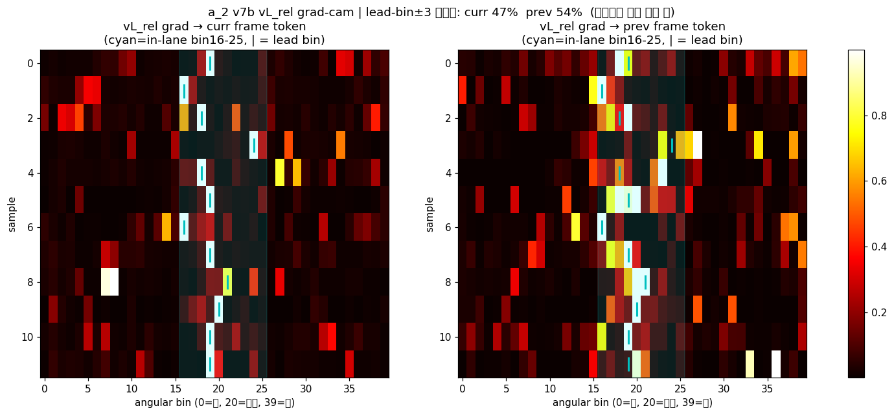

### grad-cam overlay: 실제 차 존재
- **목적**: heatmap bin 에 진짜 차가 있나 (GT projection 정확성).
- **방식**: raw CAMERA_1 ROI + grad peak/GT lead bin overlay. 8 frame.
- **결과**: (육안) cyan(GT)에 차 있고 grad peak 일치 → GT projection + 공간인지 정상.

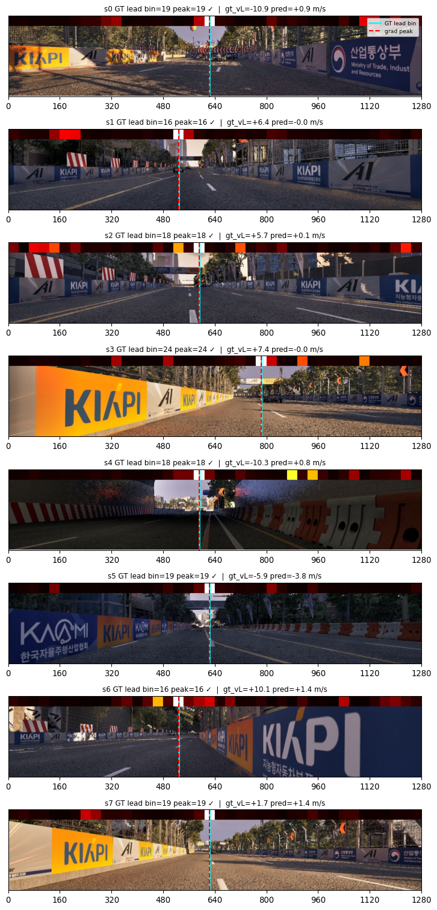

## 2-C. control (제어) 거동

### ax target↔pred scatter (B4 / B1)
- **목적**: 모델이 brake target 을 학습했나 (부호/크기).
- **방식**: 학습 ckpt forward, ax_target vs ax_pred 산점도 + brake-event pred 평균.
- **결과**: B4(4L,non-ttc) brake event pred **+0.57**(target -5.94). B1(1L) **+9.79**(더 나쁨). → ttc NO-OP 로 brake 미학습.

**B4 (4-layer):**
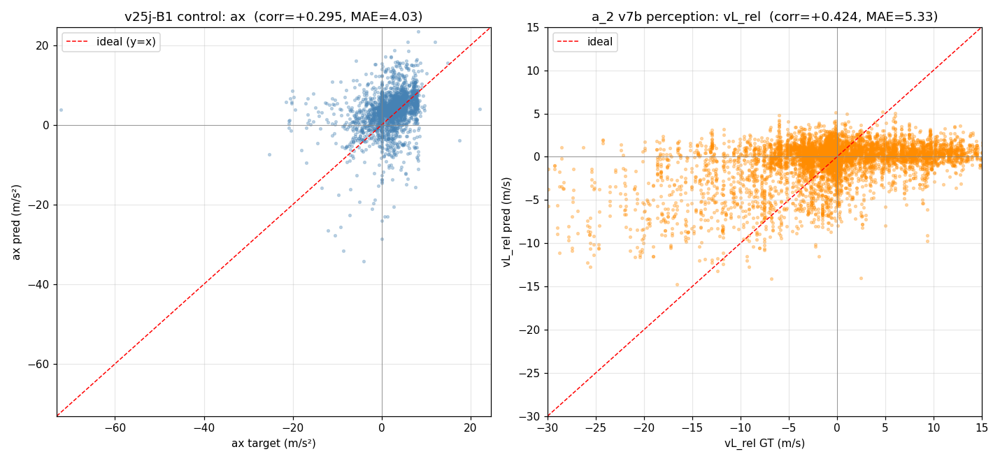

**B1 (1-layer):**
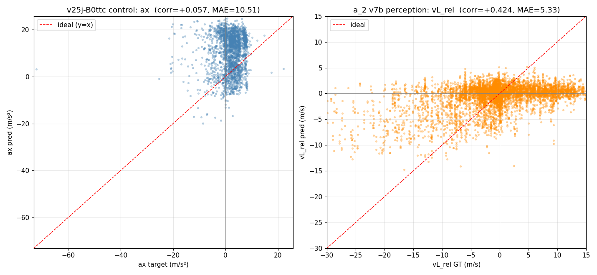

### grad-cam: ax 출력 (v25h-B)
- **목적**: 감속 출력 시 정면(lead) bin 보는가.
- **방식**: ax[0] 출력 → i_2 grad → bin별 집중도. brake sample 15개.
- **결과**: center 집중 43%, front_obj 27%, **ax 부호 7/15 틀림** → brake 학습 망가짐.

## 2-D. 모델 압축·load

### pruning sensitivity
- **목적**: a_2 모델 압축 여지.
- **방식**: global L1 unstructured pruning 0-90%, obj/vL_rel 측정 (finetune 없이).
- **결과**: 50% sparsity 까지 obj rec 유지, 90%도 붕괴 안 함 → redundancy 큼. 단 unstructured 실속도 이득 0 (2:4 structured 필요).

### ckpt smoke test (load 무결성)
- **목적**: 새 arch ckpt 가 깨끗이 load 되나.
- **방식**: build + `load_state_dict(strict=False)` missing/unexpected/shape-skip + forward 1회.
- **결과**: v25h-B2 missing=0/unexpected=0. a_2 v8 head 7→13 shape-skip=2(의도). forward OK.

---

# ③ 파이프라인·시스템 검증

### inlane NO-OP 확인 (배선)
- **목적**: B 학습 로그에 inlane 계산 실행됐나.
- **방식**: train 로그 "in-lane computed" grep + launcher cache 인자 확인.
- **결과**: 메시지 없음 + a2_cache=None → **ttc NO-OP 확정 (최대 근본원인)**.

### NFS rsync 속도 벤치마크
- **목적**: NAS→로컬 이전 시간 추정.
- **방식**: 1 run CAMERA_1 을 rsync/tar/parallel-cp/cp 로 복사 시간 측정.
- **결과**: rsync 7.4 / tar 16.6 / **parallel cp ×8 = 594 / cp -r = 2518 MB/s**.

### glances GPU 데이터 확인
- **목적**: 웹 GPU 미표시가 데이터/UI 중 어디 문제인지.
- **방식**: `/api/4/gpu`,`all`,`args` curl + JS bundle grep.
- **결과**: GPU 데이터·컴포넌트·disable_gpu=False 정상 → UI 렌더(브라우저) 문제로 격리.

---

## 검증 방식 요약 (재사용 가능)

| 검증 형태 | 대분류 | 무엇을 보나 | 도구 |
|---|---|---|---|
| 분포 sanity | 데이터 | GT range·collapse | 히스토그램, std |
| GT 상관/오염 | 데이터 | target↔단서 인과, 학습가능성 | corr, 조건부 통계 |
| 3D scatter / voxel | 데이터 | target 의 거리×속도 강도·일관성 | dist×bin×closing, mean/std |
| 파라미터 sweep | 데이터 | target 설계(ACC/TTC) | 구간별 분포 |
| cache 무결성 | 데이터 | Inf/NaN, scale | isfinite |
| corr/MAE/sign (bucket) | 모델 | 예측 정확도, 거리/속도별 | cache vs aux GT |
| grad-cam | 모델 | 공간 attention | output→input grad |
| grad-cam overlay | 모델 | GT projection·실제차 | raw 이미지 + grad |
| scatter (target↔pred) | 모델 | 제어 학습·부호 | 산점도 |
| pruning sweep | 모델 | redundancy | sparsity vs metric |
| ckpt smoke | 모델 | load 무결성 | strict=False count |
| 로그/배선 확인 | 파이프라인 | augment 실제 동작 | grep, 인자 확인 |

## 검증으로 도출한 핵심 결론
1. **데이터/target**: ttc-augment 적용 시 올바른 ACC brake (closing/dist 단조, outlane cruise). 단 NO-OP 버그로 미적용 → GT inlane 정정.
2. **모델 perception**: 공간인지·obj 정상, vL_rel 크기 압축(corr 0.40), dist 신뢰(0.70). 추가 개선 한계 → v7b 동결.
3. **모델 control**: 기존 B brake 미학습(+가속). target 정정 후 v25k-B4 재학습 중.
