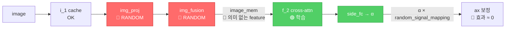
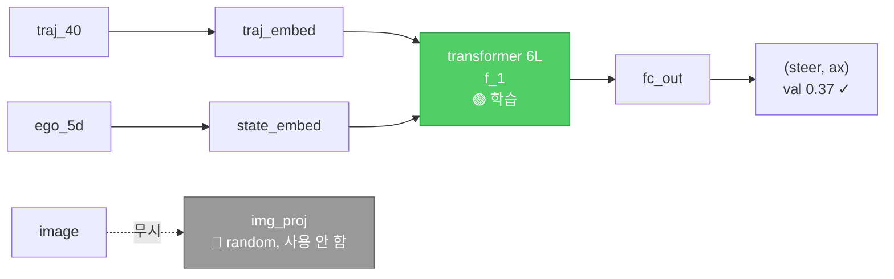

# v25f plateau 진단 다이어그램

학습이 멈춘 이유 (val 1.50 plateau, ax MAE 10.29 m/s²) 의 시각 설명.

---

## 1. 전체 architecture (forward 흐름)

```mermaid
graph LR
    subgraph IN["Input"]
        IMG["image (curr/prev)"]
        EGO["ego_5d"]
        TRAJ["traj_40"]
        A2["a_2 cache (40,7)"]
    end

    subgraph CACHE["Pre-computed (frozen)"]
        ENC["seg backbone<br/>(i_1 cache)<br/>frozen"]
    end

    IMG --> ENC
    ENC -->|"i_1 token<br/>(40, 256)<br/>raw, proj 전"| IMG_PROJ

    subgraph MAIN["Main model (frozen in phase1)"]
        IMG_PROJ["img_proj<br/>Conv1d(256→128)<br/>440K params<br/>⚠️ RANDOM INIT"]
        IMG_FUS["img_fusion<br/>(i_2 block)<br/>⚠️ RANDOM INIT"]
        TRAJ_EMB["traj_embed<br/>+state_embed"]
        TRANSFORMER["transformer 6L<br/>1.19M params<br/>(f_1)<br/>learned ✓"]
        FC_OUT["fc_out → ax/steer<br/>(f_1)"]
    end

    IMG_PROJ --> IMG_FUS
    IMG_FUS -->|"image_mem<br/>(40, 128)<br/>⚠️ RANDOM"| SIDE_KV
    TRAJ --> TRAJ_EMB
    EGO --> TRAJ_EMB
    TRAJ_EMB -->|"text tokens<br/>(main_no_image=True)"| TRANSFORMER
    TRANSFORMER -->|"traj_out (Q)"| SIDE_Q
    TRANSFORMER --> FC_OUT
    FC_OUT -->|"ax_main ≈ 0"| ADD

    subgraph SIDE["f_2 (Side SCC — learnable always)"]
        SIDE_Q["traj_out as Q"]
        SIDE_KV["image_mem as K,V"]
        A2_PROJ["a2_proj<br/>Linear(7→128)<br/>zero-init<br/>learnable ✓"]
        CROSS["MultiheadAttention<br/>cross-attn 1L<br/>~65K params<br/>learnable ✓"]
        SIDE_FC["side_fc_cross<br/>Linear(128→1)"]
        ALPHA["α gate<br/>zero-init → 0.37<br/>learnable ✓"]
    end

    A2 --> A2_PROJ
    A2_PROJ --> TRANSFORMER
    SIDE_Q --> CROSS
    SIDE_KV --> CROSS
    CROSS --> SIDE_FC
    SIDE_FC --> ALPHA
    ALPHA -->|"α * side_ax"| ADD

    ADD["ax_total = ax_main + α·side_ax"]
    FC_OUT -->|"steer_main"| OUTPUT
    ADD --> OUTPUT
    OUTPUT["(steer, ax)"]

    style IMG_PROJ fill:#ff6b6b,stroke:#c92a2a,stroke-width:3px,color:#fff
    style IMG_FUS fill:#ff6b6b,stroke:#c92a2a,stroke-width:3px,color:#fff
    style SIDE_KV fill:#ff6b6b,stroke:#c92a2a,stroke-width:3px,color:#fff
    style TRANSFORMER fill:#868e96,stroke:#495057,color:#fff
    style FC_OUT fill:#868e96,stroke:#495057,color:#fff
    style TRAJ_EMB fill:#868e96,stroke:#495057,color:#fff
    style ENC fill:#868e96,stroke:#495057,color:#fff
    style A2_PROJ fill:#51cf66,stroke:#2f9e44,color:#fff
    style CROSS fill:#51cf66,stroke:#2f9e44,color:#fff
    style SIDE_FC fill:#51cf66,stroke:#2f9e44,color:#fff
    style ALPHA fill:#51cf66,stroke:#2f9e44,color:#fff
```



**범례**:
- 🔴 **빨강 (RANDOM INIT)**: weight 가 학습된 적 없고 random. v25c (main_no_image=True) 때도 사용 안 함 → 의미 없는 weight
- ⚫ **회색 (frozen, learned)**: v25c 에서 학습된 weight. phase1 동안 frozen
- 🟢 **녹색 (learnable)**: f_2 의 모듈. phase1 에서도 학습 중

---

## 2. 무엇이 문제인가

### 2.a 의도된 학습 흐름 (가정)
```
image → i_1 cache → img_proj → img_fusion → image_mem (의미 있음)
                                                ↓
                                       f_2 cross-attn (KV)
                                                ↓
                                       brake 보정 학습
```

### 2.b 실제 학습 흐름 (v25f)


→ **f_2 가 random feature 를 KV 로 받아 학습 — 진짜 image 정보 안 흐름**

---

## 3. 왜 v25c (f_1 baseline) 는 학습됐는가

v25c 학습 시:
- `main_no_image=True`
- `side_cross_attn=False`, `use_a2_feat=False`
- 즉 image_mem 자체 **사용 안 함** (forward 에서 우회)
- 학습된 것: **transformer 6L (f_1) + traj_embed + state_embed** 만
- → val 0.37 도달 (text-only baseline 정상)



→ v25c 의 train_iy 가 image path 를 통과시키지 않음 (main_no_image=True). img_proj/img_fusion 이 **계산도 안 됨, gradient 도 안 흐름**. weights = init 상태 그대로 random.

---

## 4. v25f 에서 image path 가 처음 활성화

v25f config:
- `main_no_image=True` (f_1 의 transformer 는 text-only)
- `side_cross_attn=True` ← 신규 (f_2 활성)
- `use_a2_feat=True` ← 신규

`side_cross_attn=True` 일 때 forward (`iy_model.py`):
```python
if side_cross_attn:
    image_mem = self.img_fusion(self.img_proj(...), ...)   # ← 처음으로 image path 활성화
    side_attn = self.side_cross(Q=traj_out, K=image_mem, V=image_mem)
    ax_total = ax_main + α * side_fc(side_attn)
```

여기서 `img_proj` 와 `img_fusion` 이 v25c 의 random init 상태로 계산됨 → **image_mem 가 random feature**.

phase1 동안 `img_proj`, `img_fusion` 도 `main` group → frozen → **학습 안 됨**.

---

## 5. Fix 옵션

### 옵션 A: img_proj/img_fusion 을 side group 에 추가 (추천)
```python
# train_iy.py:461
side_keys = ["side_transformer", "side_fc", "side_alpha", "a2_proj", "a2_late_proj",
             "side_cross", "side_cross_ln", "side_fc_cross", "side_alpha_cross",
             "img_proj", "img_fusion", "image_pos_emb"]   # ← 추가
```
→ phase1 에서 image path 도 함께 학습. f_1 transformer 만 frozen.

### 옵션 B: phase1 짧게 + main joint
- `--phase1-epochs 5` + `--main-lr-phase2 5e-5`
- 처음 5 ep 만 f_1 frozen → 그 후 모두 joint 학습
- 그러나 main_no_image=True 라 img_proj 가 학습 안 됨 (transformer 에 안 통과)

### 옵션 C: main_no_image=False
- main 의 transformer 가 image_mem 도 받음
- 학습 자연스러움. controller_imitator 정통 (text-only) 의도 깨짐

**추천 = 옵션 A** — phase 정의만 변경. main_no_image=True 유지 (controller_imitator 호환).

---

## 6. 다이어그램 해석 요약

| 위치 | v25f 상태 | 문제점 |
|---|---|---|
| seg backbone (i_1 cache) | frozen, 학습됨 (mIoU 0.92) | ✓ OK |
| **img_proj (Conv1d 256→128)** | **RANDOM init, frozen** | **🔴 image_mem 가 random** |
| **img_fusion (i_2 block)** | **RANDOM init, frozen** | **🔴 image_mem 가 random** |
| transformer 6L (f_1) | frozen, 학습됨 (v25c 0.37) | ✓ |
| f_2 cross-attn | learnable | 🟢 학습 중, but random KV |
| α gate | learnable, 0→0.37 | 🟢 학습 중 |
| **결과** | val 1.50 plateau | **image 신호 의미 없음** |
