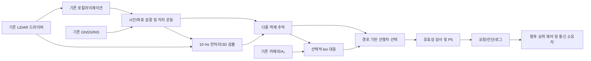

# 10 Hz 선행차 인지 및 P5 프로젝트 설계

## 결정과 구현 상태

실시간 코어는 C++17/ROS 2, 학습·시각화·회귀 검증은 Python으로 한다. C++는 Autoware/TensorRT와 차량 통신 어댑터 통합에 유리하다. Python도 CAN 통신은 가능하므로 언어 자체가 통신 가능 여부를 가르는 것은 아니다.

현재 제공한 것은 설계, 기존 자료의 실물 복사, 기본값 C++ P5 수치 코어, 비교 테스트다. 실시간 detector/tracker, A₂ 어댑터, ROS 노드, 통신 노드는 **아직 구현되지 않았다**. [기존 리포 활용안](BACKENDS_KR.md)을 따라 인지 백엔드를 도입한다.

## 결과에서 확인된 제약

복사한 `evidence/`를 근거로 한다. 4:26.1의 수동 seed 이후 마지막 관측은 약 5:59.1, lost는 약 6:01.1이다. 3~12분 5,401개 10 Hz 시점 중 P5 유효값은 847개(15.68%)였다. 초기 미지정과 추적 소실을 포함한 수치이므로 검출 recall과 같지 않다. 재획득 후에도 동일 차량임이 확인되어야 ID를 이어 붙인다.

P5 감속 요청은 약 5:15.6~5:33.0에 있었으며 최저 제한값은 -3 m/s²다. 이는 F1=0, gate=1인 조건부 오프라인 요청이며 실제 송신/제동/가속도 측정값이 아니다. 종전 표는 LiDAR 기준 radial surface range를 사용했다. 실제 제어에는 진행 경로의 종방향 범퍼 간격이 필요하며 두 값을 바꾸면 P5도 달라진다. 기존 비교에서 거리 정의 변경의 요청 차이는 최대 약 1.58 m/s²였다.

속도는 INS 자차 운동 보정과 점군 추정치다. 선행차 실측 정답은 없다. 2초 창 가속도는 지연과 잡음을 포함하므로 현재 P5 입력으로 쓰지 않고 진단값으로 둔다. 현재 P5는 선행차 등속 모델이다.

## 데이터 흐름

각 LiDAR 관측마다 한 번 처리한다. A₂는 기존 current+20 history(0.05~1초) 입력 구조와 약 21 Hz 처리를 유지하고 최신 유효 결과만 10 Hz 처리에 대응한다. A₂ 입력까지 10 Hz로 낮추면 학습된 시간 간격이 달라진다. 매 tick 동일 관측을 새 관측처럼 중복 사용하지 않는다.

## 모듈과 계약

| 모듈 | 입력 | 출력/책임 |
|---|---|---|
| input_adapter | PointCloud2, INS navigation solution, 기존 odometry | 측정 시각·좌표·품질 검증, 버퍼링 |
| lidar_detector | 보정된 점군 | 3D box, class, confidence, covariance/가용성 |
| object_tracker | 검출 + 연속적인 자차 운동 | ID, 위치, 세계/자차 좌표 속도, measured/coasting/lost |
| camera_association | A₂ presence/bin, 보정, 3D box | 대응 점수, ambiguity, freshness; 거리/속도 없음 |
| lead_selector | tracked objects, 경로/corridor | 선행차 ID, 종방향 간격, 선택 사유 |
| p5_request | 신뢰 가능한 간격·자차/선행차 종속도 | raw P5와 제한 요청, valid, 사유, 만료시각 |
| logger | 모든 결과와 단계 시간 | 원자료 시각·ID·공분산·시간 지연·파라미터 버전 |

출력 namespace는 `/lead_fusion`이다. 새 프로젝트가 다른 노드의 input topic에 publish하지 않는다. 구체적 외부 토픽 이름은 실장 시 실제 메시지 정의를 확인해 remap한다. 잘못된 INS twist를 타입만 맞춰 쓰지 않는다.

LeadState 계약: measurement_stamp, state_stamp, frame_id, track_id, track_state, position_xyz_m, absolute_velocity_xyz_mps, relative_velocity_xyz_mps, longitudinal_gap_m, radial_range_m, covariance, last_measurement_age_s, camera_support, time_valid, extrinsics_valid, velocity_valid, gap_valid, selection_reason. 미계산 수치는 NaN과 명시적 valid=false로 표시한다.

BrakeRequest 계약: source_stamp, publish_stamp, valid_until, track_id, raw_p5_mps2, requested_accel_mps2, valid, reason, gap_definition, config_version. ROS 메시지 패키지는 이 계약을 구현할 때 작성한다. 현재 C++ CLI는 이 실시간 계약의 구현이 아닌 수치 회귀 검증 도구다.

## 좌표·거리·속도

vehicle frame은 +X 전방, +Y 좌측, +Z 위쪽. 실제 lidar→vehicle 6DoF 및 원점을 설치 후 확정한다. 종전 로그에서는 센서 -Y가 차량 전방에 해당했지만 모든 장착에 하드코딩하지 않는다. 현재 TF의 base 원점이 LiDAR 위치일 수 있으므로 bumper offset을 별도 관리한다.

camera K/distortion, lidar→camera R,t, image crop/resize를 맞춰야 한다. 설치 XYZ를 아직 모른다면 미정으로 두고 카메라 융합을 비활성화한다. 0을 넣고 보정 완료로 취급하지 않는다. 렌즈/노출은 영상 검출 품질에도 영향을 주지만 카메라로 metric distance를 계산하지 않으면 지면 투영 거리의 높이/각도 민감도는 줄어든다.

v_lead_world는 연속 좌표계에서 자차 움직임을 보정한 추적 속도다. v_rel_long=(v_lead_world-v_ego_world)·tangent, v_lead_long=v_lead_world·tangent. 차체 회전 좌표의 위치 차분은 회전 항을 포함하므로 그대로 상대 종속도로 쓰지 않는다. 일반 LiDAR는 이 속도를 직접 측정하지 않는다. 가속도는 추적 속도의 창 기반 추정치와 유효성/지연을 함께 기록한다.

선행차는 경로 또는 차량 진행 corridor 안에서 양의 종방향 간격을 가진 후보 중 선택한다. 최근접 거리만으로 옆 차/후행차를 선택하지 않는다. 커브에서는 경로 좌표로 투영한다. 경로가 없을 때 제한된 직진 corridor 모드는 명시적 상태로 남긴다. 차체 길이/외부 보정 미정이면 범퍼 간격은 invalid이다.

## 시간과 자차 운동

IMU raw acceleration은 자차 속도가 아니다. GNSS/INS가 제공하는 navigation velocity와 orientation, 상태/공분산을 사용한다. NED/ENU, heading offset, body/world velocity, lever arm을 어댑터에서 명확히 변환한다. `gnss_odom_relay.py`는 복사해 검토하는 자료이며 현재 twist를 무검증 사용하지 않는다.

시간 기준은 센서 측정 시각이다. LiDAR scan 시작/중간/종료 정의를 확인하고 point timestamp로 회전·병진 deskew한다. 카메라 노출 시각과 전송 수신 시각을 구분하며 장치 clock→공통 clock 변환과 drift를 측정한다. GNSS epoch, UTC/GPS leap offset을 중복 적용하지 않는다. 과거 로그에서 추정한 -2.13초 오프셋 및 drift는 그 주행의 오프라인 보정값이며 live 상수가 아니다.

실시간 처리는 관측까지 들어온 데이터만 사용한다. timestamp 차이·버퍼 지연이 허용범위를 벗어나면 상태를 invalid로 낸다. 재생은 /clock에 일관되게 맞추고 live 시스템 시간을 섞지 않는다. map pose 점프를 속도로 미분하지 않고 연속 odom/INS 운동을 사용한다.

## 로컬/GNSS와 공존

기존 프로세스가 센서 드라이버·NIC·GNSS 설정·시간 동기화·공유 TF를 소유한다. 새 프로젝트는 구독자다. 원시 LiDAR 토픽을 차량 제거 점군으로 덮어쓰거나 로컬라이제이션 입력을 바꾸지 않는다. 같은 map→odom 또는 base→sensor TF를 중복 발행하지 않는다. 정적 보정의 소유자도 한 곳으로 정한다.

인지 노드 전용 bounded queue, 최신 관측 우선 정책, 처리 지연/드롭 계수를 둔다. 동일 GPU·CPU·메모리 대역 사용으로 로컬에 영향을 줄 수 있으므로 단순 namespace 분리만으로 무간섭을 보장하지 않는다. 로컬 단독 대비 동시 실행의 지연·드롭·위치 연속성을 측정한다.

## 제어 연결과 실패 상태

거리·종속도·시각·좌표·선행차 선택이 유효할 때만 P5를 계산한다. 예측만 이어가는 coasting과 실제 관측 measured를 구분한다. 기본 실험에서는 coasting/lost/초기화 미완료를 제어 invalid로 둔다. invalid는 감속 0이 아니며 상위 제어기가 상태 전환을 처리한다. 마지막 요청을 무기한 유지하지 않는다.

현재 P5 기본값: headway 2초, standstill 7m, log alpha 6m, v0 5m/s, dt .1초, 40 samples, 1초 평균 가속도. 원본 profile의 decel bound 20m/s²와 출력 요청 clamp -3m/s²는 다른 값이다. 실제 제동 한계로 해석하지 않는다. F1=0/현재속도 유지 조건의 코어를 제공한다. F1 계획과 가감속 통합, jerk 제한, brake mapping은 후속 설계·실차 식별 사항이다.

CAN/DBC 프로토콜은 차량 제어 소유자와 확정한다. perception은 10 Hz 요청만 보내고 통신 주기는 ECU 요구에 맞춰 독립적으로 구성한다. 최종 arbiter/통신 송신자는 하나로 둔다. 이 프로젝트는 CAN 프레임을 송신하지 않는다.

## 단계별 완료 기준

1. 현재 제공: 복사본 checksum, Python 기준 테스트, C++ 기본 P5 차등 검증.
2. 센서 계약: 실제 frame/time/INS velocity 검증, 설치 외부 보정 확정, camera ROI 재설정.
3. LiDAR 기준선: 호환 Autoware 모듈 및 모델 고정, 자동 차량 검출·다중 추적·선행차 선택, 3~12분 재생.
4. A₂ 보조: bin 투영 대응을 켜고/끄고 비교. 시간/보정 미확정이면 계속 단독 모드.
5. BEVFusion: 전방 1대 구성과 모델 호환 검증 후 동일 조건 비교, 필요한 경우 별도 학습 데이터로 미세조정.
6. 동시 실행: 처리 100ms 이내의 목표와 p95/p99 지연, 드롭률, 로컬 영향 실측. 기존 Python 추출 p95 약 97.5ms는 전체 시스템 10 Hz 보장이 아니다.
7. shadow 요청 평가 후 제어 어댑터 구현. 정답 거리/속도가 없는 기존 로그만으로 차량 제어 성능을 인증하지 않는다.

점군 2~3 scan 누적은 후보 개선이다. 자차 보정만으로 움직이는 선행차의 잔상이 사라지지 않으므로 학습 입력의 time feature 지원과 지연을 함께 확인한다. 전체 주행에 라벨을 달고 가시 구간을 구분하여 평가하며, 학습/튜닝 구간과 최종 평가 구간을 분리한다.
